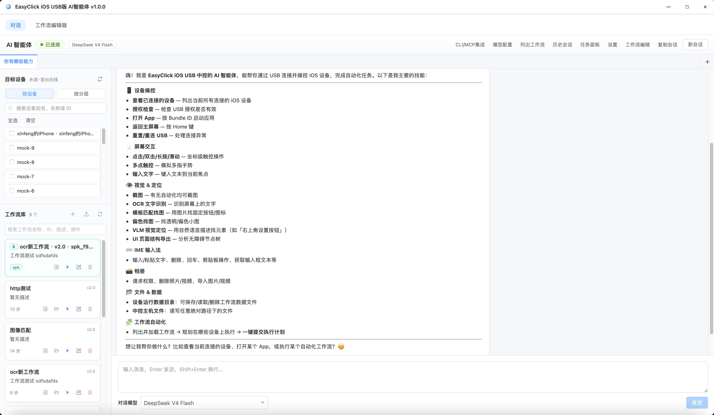
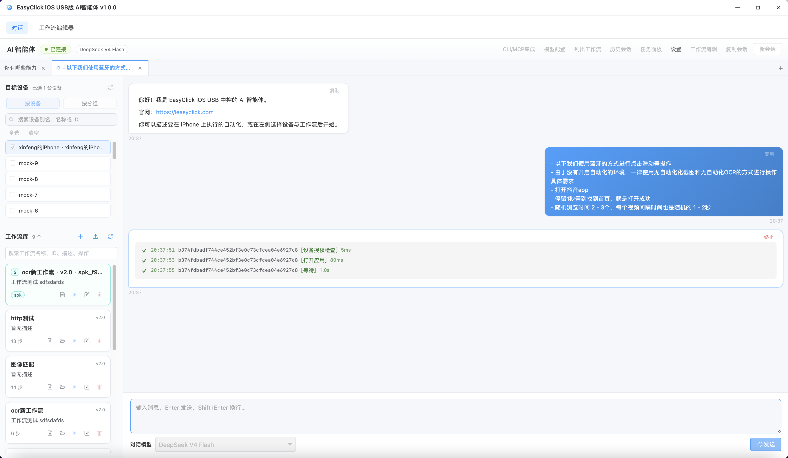
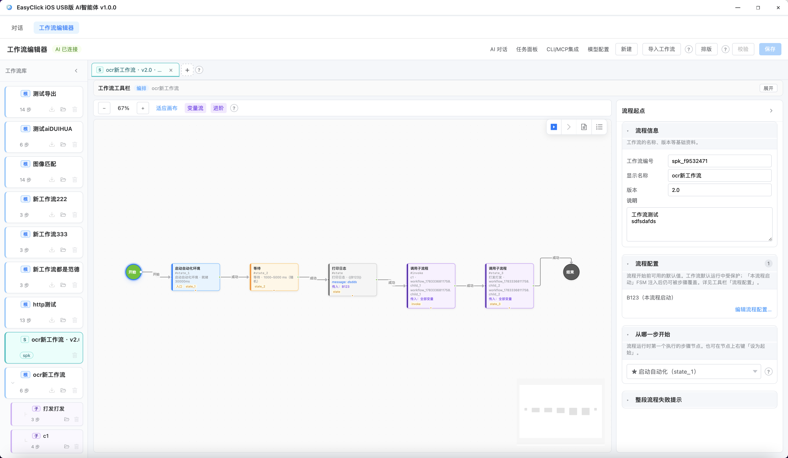
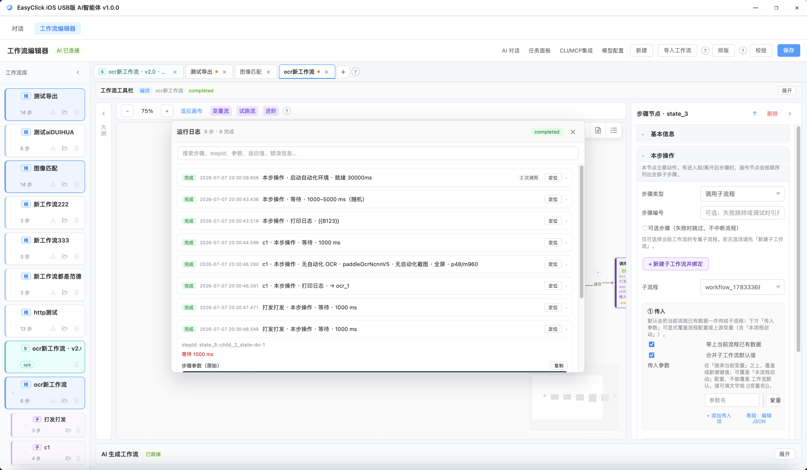
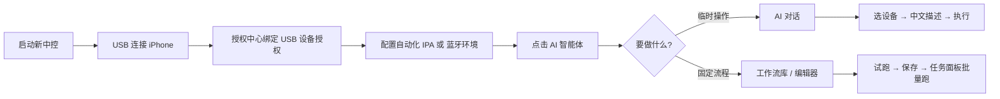

<!-- 来源：https://ieasyclick.com/iosdocs/advance/ai-agent/screenshots/ -->

> **产品升级提示（10.6.0+）**
>
> 从 **10.6.0** 版本起，AI 智能体已不再包含于 iOS USB 中控，已升级为独立产品 **iEasyRun 手机自动化 AI 工作站**。若您使用的是 **10.6.0 及以上**版本，请下载新产品： <https://ieasyrun.com/>

# 界面预览与上手路径

> **注意：关于截图**
>
> 若与您本地 UI 略有差异，以 **新中控 10.1.0+** 实际界面为准。

## 主要界面

### AI 对话

用中文描述任务，选择左侧设备与工作流后执行。

  

### 工作流编辑器

可视化流程图、试跑、变量池与 AI 辅助写流程。

### 任务与监控

批量运行时查看每台设备进度，支持暂停与继续。

## 30 秒上手路径

详细步骤：

1. [环境与授权](prerequisites.md) — USB 授权 + 运行环境
2. [快速开始](getting-started.md) — 打开窗口、配模型、选设备
3. [AI 对话](ai-chat.md) 或 [工作流编辑器](workflow-editor.md)

## 相关文档

- [概述与目录](index.md)
- [常见问题](troubleshooting.md)

