<!-- 来源：https://ieasyclick.com/iosdocs/advance/ios-usb-beginner-install/ -->

# 苹果群控投屏新手安装

# 苹果群控投屏安装教程（USB / 无线）

**11.6.0** 起 USB 与无线二合一。整页按 **五大步骤**：① **下载启动器**（一键安装中控）→ ② **一键配置**（开发者模式 / 镜像 / IPA）→ ③ **App 信任** → ④ **绑定授权** → ⑤ **打开投屏界面进行投屏**。

> **警告：iOS 15 系统版本以下**
>
> 若 **低于 iOS 15 系统版本**，请先看 USB 详细文档：[iOS USB 投屏教程](ios-usb-screen.md)。**无线模式不支持 iOS 15 以下。**

> **提示**
>
> 装完并能投屏后，日常操作请继续看：[新界面操作指引](ios-usb-screen-new.md)。更完整的镜像与代理说明见：[iOS USB投屏教程](ios-usb-screen.md)。

## 准备材料

- Windows 电脑（用 **EasyClick 启动器** 安装中控）
- iPhone；USB 模式用数据线连电脑，无线模式需手机与电脑同一局域网（一键配置仍要插线）
- 手机用 **USB 数据线** 连到电脑（一键配置要装镜像 / IPA）
- 推荐数据线：**品胜**
- 推荐 USB HUB：**西普莱 USB 2.0**，单口输出电流 **2.0A**（电流过小可能导致部分无法投屏或连接不稳）
- 能访问官网下载启动器
- 电脑怎么选、客户实际配置见 [iOS USB 电脑配置与客户案例](ios-usb-pc-config.md)
- 若 **低于 iOS 15 系统版本**，请先看 [iOS USB 投屏教程](ios-usb-screen.md)；无线模式不支持 iOS 15 以下

> **警告**
>
> 安装与使用前，请先 **关闭杀毒软件、安全中心、防火墙** 等防护软件，避免拦截中控、桥接程序或本机端口通信。若仍异常，关闭后 **重启电脑** 再试。

## 1. 下载启动器，一键安装 iOS 中控

先下载并打开 **EasyClick 启动器（用户版）**：

- 本站下载入口：[下载启动器](https://ieasyclick.com/ec-startup)
- 软件下载区：[下载区](https://ieasyclick.com/community/download_area/)

打开启动器后：

1. 确认顶部 **安装目录**（建议纯英文路径，默认如 `D:\EasyClick`）
2. 找到 **iOS 免越狱群控和投屏**（说明为 **USB 和无线二合一安装包**，当前为 **v11.6.0**）
3. 点右侧 **一键安装**，等待安装完成

> **提示**
>
> 若中控后续起不来、状态栏一直 **红色**，多半缺 **VC 运行库**：在同一启动器里对 **VC 类库压缩包** 点 **一键安装**，装完后 **重启电脑**，再打开中控。

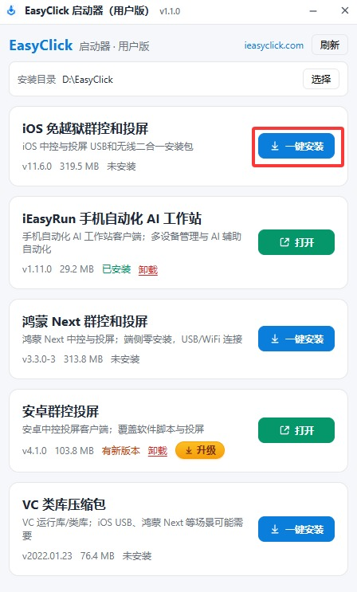

## 2. 安装完成，打开中控并登录

安装状态变为 **已安装** 后，在同一条目点绿色 **打开**，进入中控。弹出 **登录账号** 时，按提示 **登录**（或先 **注册**）。登录后才能做设备授权、换绑与批量操作。

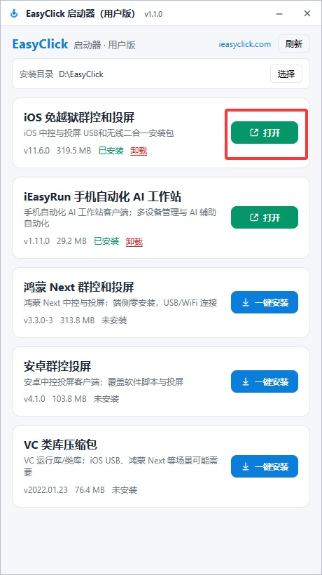

中控弹出登录框后输入账号密码，点 **登录**。

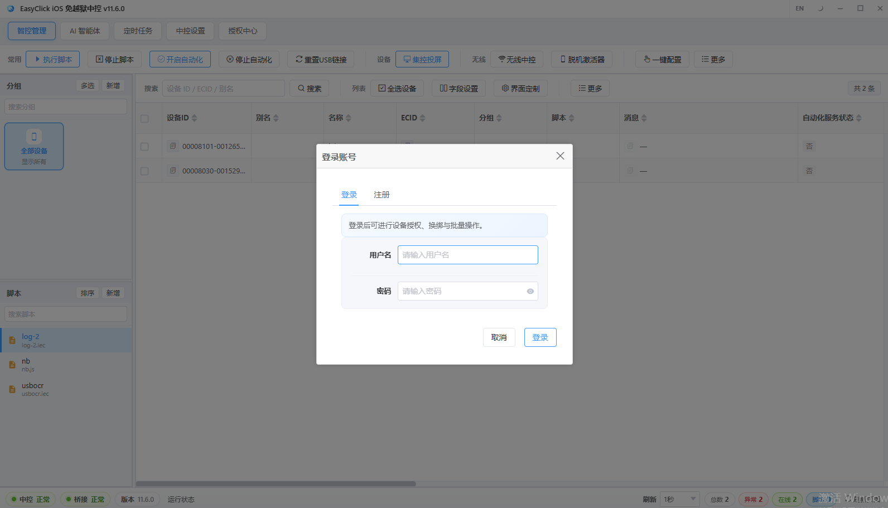

## 3. 选中设备，点一键配置

用 **USB 数据线** 把手机连上电脑，确认中控设备列表已出现设备。勾选要配置的设备，点工具栏 **一键配置**。

> **提示**
>
> 一键配置会按勾选项自动：**开启开发者模式**、**安装镜像**、**安装 IPA**；需要下载的包会自动准备，手机弹出确认时请点 **允许**。**一键配置前请先关闭手机锁屏密码和 Face ID**，否则也可能导致自动开启开发者模式失败。

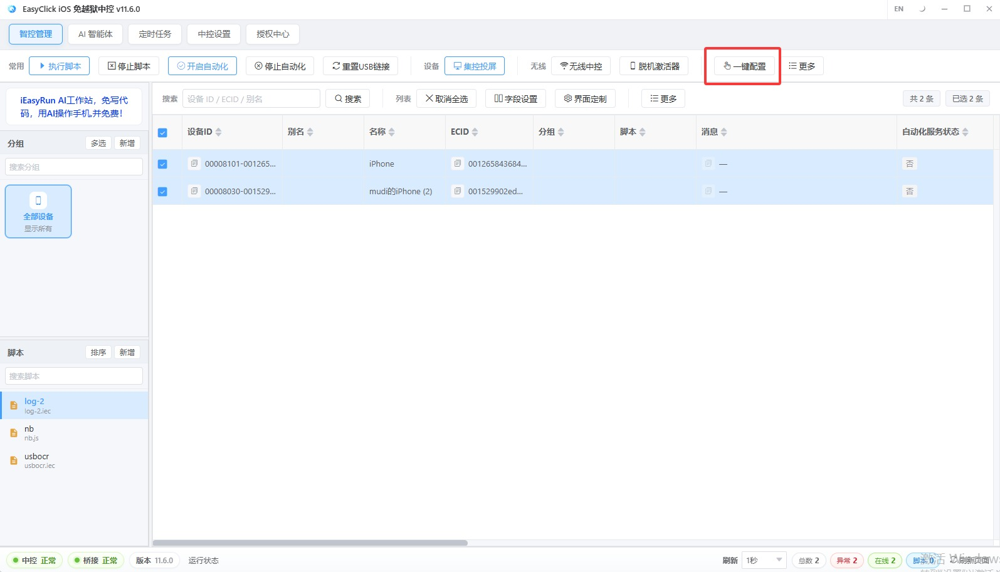

## 4. 勾选执行步骤，开始配置

在 **一键配置** 弹窗中确认已勾选需要的步骤（一般三项都勾）：

1. **开启开发者模式**
2. **安装镜像**
3. **安装 IPA**

确认设备列表后，点 **开始配置**。

> **警告**
>
> 安装完成后，请到手机「**设置 → 通用 → VPN 与设备管理**」信任企业应用证书；未信任时主程序无法打开。

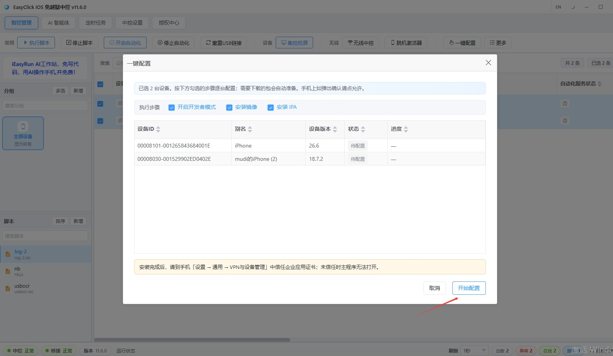

## 5. 等待配置成功

配置过程中会自动准备脱机主程序等安装包。待设备 **状态 / 进度** 都显示 **成功** 即可。若中途失败，可重新勾选设备再跑一次一键配置。

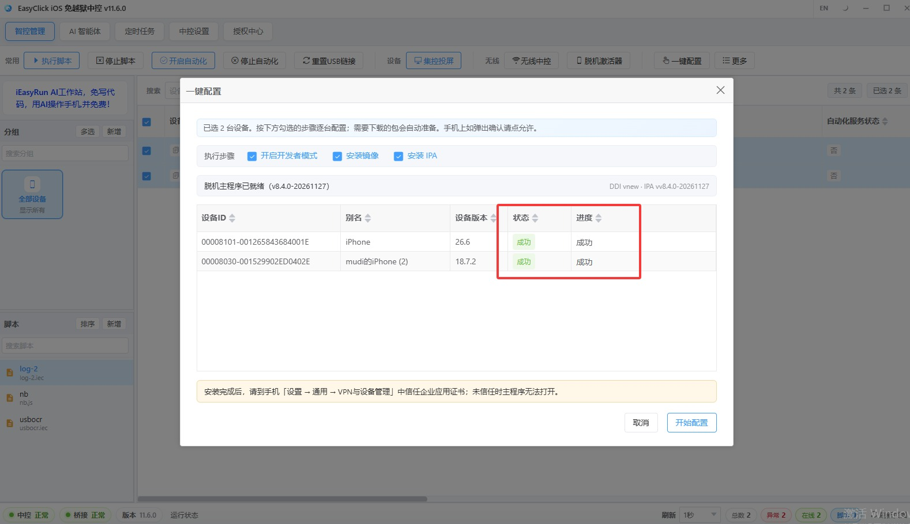

## 6. 在系统设置里信任描述文件

到手机：**设置 → 通用 → VPN 与设备管理**（部分系统文案为「设备管理」），找到刚安装的描述文件 / 企业应用，按系统提示点 **信任**。

一键配置已勾选 **开启开发者模式** 时，一般会自动处理；若自动化仍失败，再手动确认：**设置 → 隐私与安全性 → 开发者模式**（**仅 iOS 16+**；低于 16 没有此选项）。

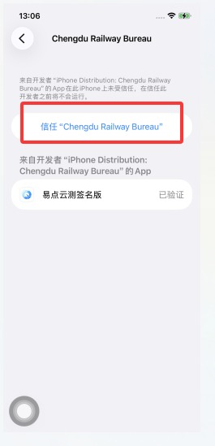

## 7. 打开 App 并授予权限

信任后打开 **易点云测签名版**（或当前脱机主程序图标）。若弹出授权提示，请 **全部允许**；也可到 App 内 **权限授予** 补齐。

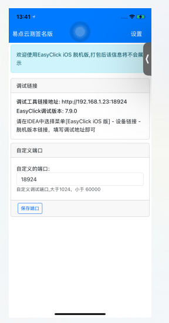

## 8. 在中控启动自动化

回到中控，确认手机仍用 **USB 数据线** 连接（或已完成无线入网）。一键配置成功后，镜像与 IPA 通常已就绪。点 **开启自动化 / 启动自动化**，稍等片刻，自动化状态变为 **是** 即表示正常。

若一直不是「是」，可在设备上 **鼠标右键 → 测试自动化**，查看具体错误再排查。

手机若 **重启**，开发者镜像通常会失效，可再跑一次 **一键配置**（勾选安装镜像）或手动刷镜像。

**走无线时：** 手机与电脑同一局域网，在中控用 **无线 / 扫描设备** 连上后投屏。

> **警告：iOS 15.8**
>
> **iOS 15.8** 兼容性很差，建议不要使用。

> **提示：找不到对应版本的开发者镜像时**
>
> 到中控安装目录 `bridgebin\config\DeveloperDiskImage` 下，复制临近版本文件夹并改名为当前版本（如 **26.5** → **27.0**），**重启中控和手机**后再刷。

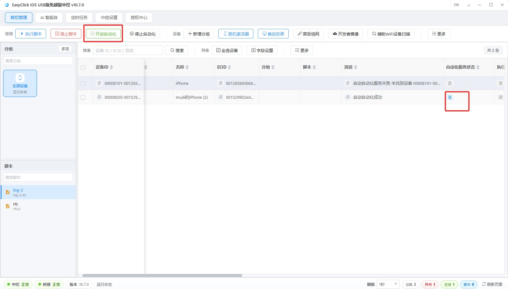

## 9. 打开集控投屏，选择投屏方式

在中控点 **集控投屏**，弹出「请选择投屏方式」：

- **USB 投屏**（推荐）：有线连接设备，走 USB 传输投屏
- **无线投屏**：脱机无线设备投屏（手机与电脑需同一局域网）

按设备连接方式点选对应卡片即可进入投屏。

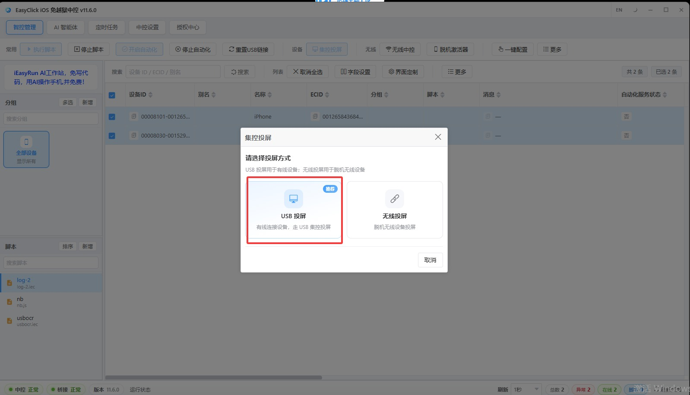

## 10. 检查 USB 投屏授权

若提示没有 **USB 投屏授权** 或授权过期：联系代理商或官方购买后，在中控 **授权中心** 绑定。

**USB 设备授权**是跑脚本用的，**USB 投屏授权**才是投屏操作用的，不要选错。

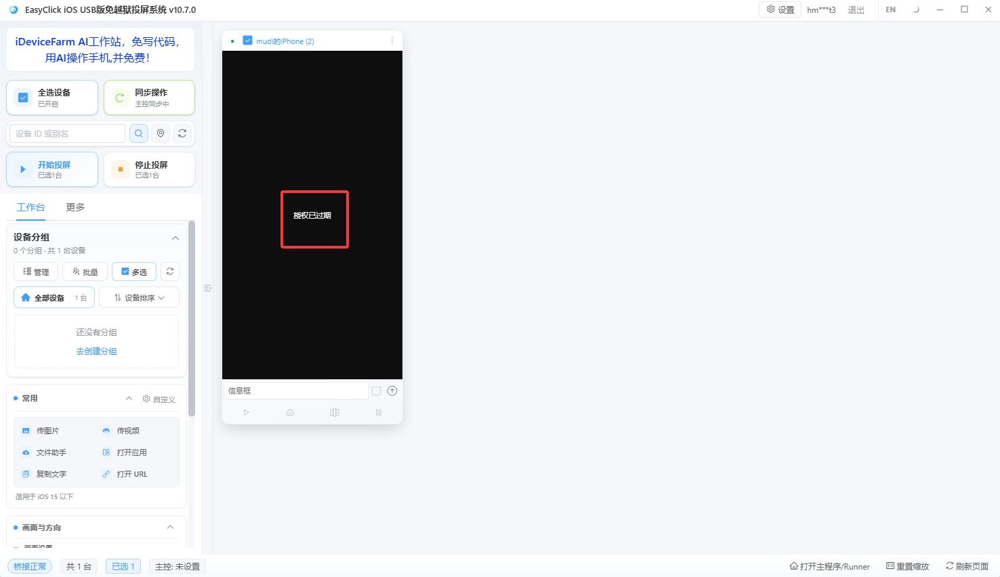

打开中控 **授权中心**，选中一台设备，点 **批量授权**；或在设备上 **鼠标右键 → 新增授权**，选择 **USB 投屏授权**。

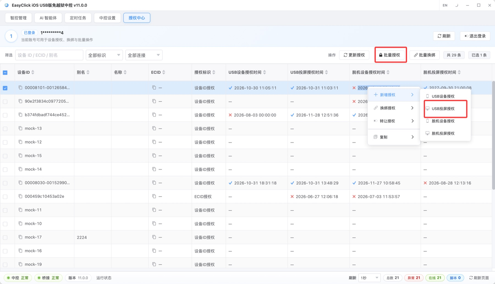

在弹窗中把授权类型选为 **USB 投屏授权**，再点击 **开始授权**。

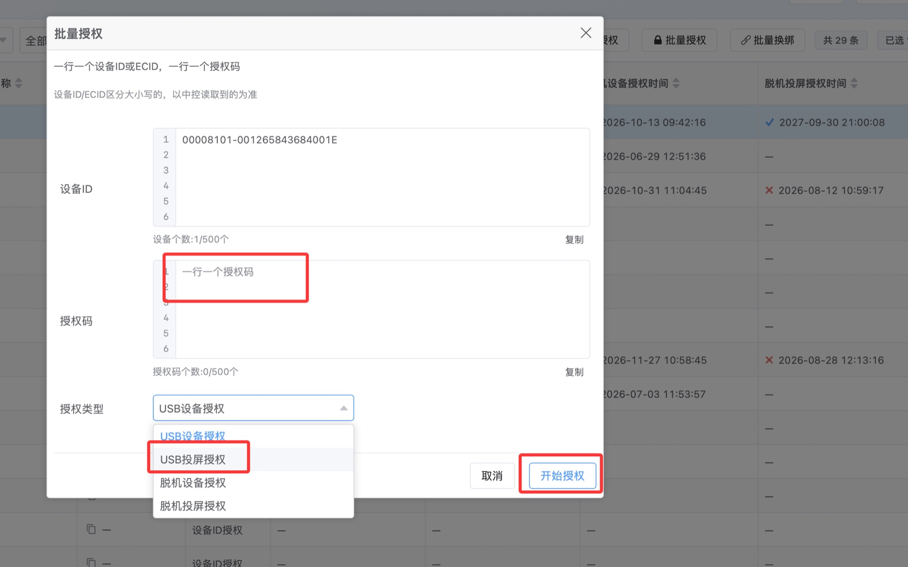

## 11. 再次投屏查看画面

授权就绪后再次投屏，应能看到手机画面。

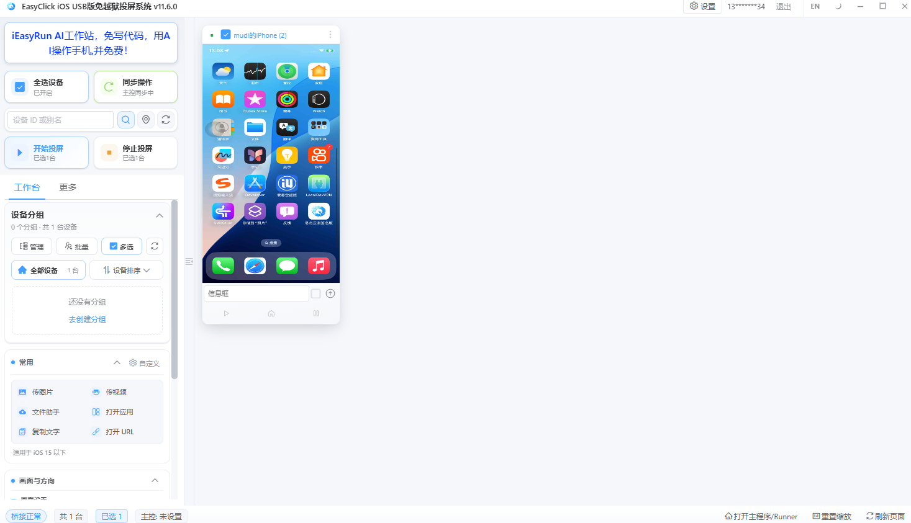

## 12. 更多高级设置

投屏窗口的 **系统设置** 里还有更多选项（场景模式、按屏配置等），可按业务需要再调。

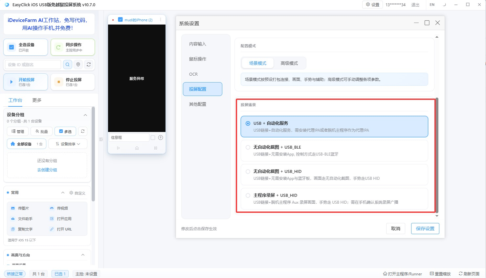

## 装完之后做什么

| 目标 | 去哪看 |
| --- | --- |
| 投屏里怎么点、滑、打字、传相册 | [新界面操作指引](ios-usb-screen-new.md) |
| 镜像、代理、蓝牙 / OTG 等完整说明 | [iOS USB投屏教程](ios-usb-screen.md) |
| 电脑配置与客户案例 | [iOS USB 电脑配置与客户案例](ios-usb-pc-config.md) |
| 旧界面操作 | [旧界面操作指引](ios-usb-screen-legacy.md) |

常见卡点回顾：

1. 未用启动器装上 **iOS 免越狱群控和投屏**，或不是 **11.6.0+** 二合一包 → 没有统一 USB/无线入口
2. 一键配置未勾 **安装镜像 / 安装 IPA**，或进度不是 **成功** → 重新勾选设备再跑一次
3. 未信任企业应用证书 / 未开 **开发者模式**（仅 iOS 16+；低于 16 没有此选项） / 未给权限 → 主程序打不开或自动化起不来
4. 手机重启后镜像失效 → 再跑一次一键配置（勾选安装镜像）或手动刷入
5. 找不到对应版本镜像 → 到中控安装目录的 `bridgebin\config\DeveloperDiskImage` 下，复制临近版本文件夹并改名为当前版本（如 **26.5** → **27.0**），**重启中控和手机**后再刷入
6. 启动器安装目录含中文或空格 → 建议改成纯英文路径后重新一键安装
7. 只有 **USB 设备授权**（跑脚本）、没有 **USB 投屏授权**（投屏）→ 能连上但投屏会提示过期；无线同理注意 **脱机投屏授权**
8. 无线扫不到设备 → 确认手机与电脑同一局域网；一键配置时仍要先插 USB
9. 遇到异常（连不上、自动化失败、投屏黑屏等）→ 先确认一键配置成功，再视情况 **重启手机**（重启后需重新刷镜像），并退出重开 **群控中控软件** 后重试
10. 启动后状态栏中控一直为 **红色**、起不来 → 系统可能缺少 **VC 类库**；在 **启动器** 里对 VC 类库压缩包点 **一键安装**，完成后 **重启电脑** 再开中控
11. 启动自动化服务提示 **`use of closed network connection`** → 中控设置里把 **本机桥接 → 自动化链接** 改成 **每次使用新连接**，再试启动；投屏界面启动不了自动化也做同样修改
12. 杀毒 / 安全中心 / 防火墙未关 → 可能拦截程序或本机通信；关闭后 **重启电脑** 再试
13. 启动自动化失败提示 **`receive packet: Invalid Service`** → 多为 **iOS 16+** 未开 **开发者模式**（低于 16 没有此选项），按上文第 6 步开启后再试
14. 报错类似 **`write tcp 127.0.0.1:…->127.0.0.1:27015: wsasend: An established connection was aborted by the software in your host`** → 多半是 **防火墙** 拦截；关闭防火墙后 **重启电脑**，也可用 **爱思助手** 做 **驱动修复**，修复完成后按提示 **重置 Winsock**，再重试
15. 群控中控 **不显示手机设备** → 先用 **爱思助手** 看能否识别设备；再做爱思 **驱动修复**、**重置 Winsock**，并 **关闭杀毒软件、防火墙、安全中心**，然后 **重启电脑** 再开中控
16. 投屏画面 **延迟 / 卡顿** → 若场景模式选的是 **无自动化截图**，本身就会偏慢；想更快请切到 **主程序录屏** 或 **自动化** 模式。若已是自动化模式仍卡顿、延迟，请对照电脑与线材配置：[iOS USB 电脑配置与客户案例](ios-usb-pc-config.md)
17. 带设备过多且 USB HUB 电流过小 → 可能导致部分无法投屏；电压不稳也可能导致连接电脑不稳定。建议购买 **品胜** 数据线、**西普莱 USB 2.0**、单口输出电流为 **2.0A** 的 USB HUB；若连接不稳定，建议 **逐个连接设备** 排查电脑到底能带多少台

## 开启 USB HID 模式（可选）

USB HID 用数据线模拟点击、滑动，**不需要**蓝牙板或 OTG 板。手机系统需 **iOS 17 及以上**。低于 iOS 17 请继续用前面的「启动自动化 / USB + 自动化服务」。

1. 打开投屏客户端，进入 **系统设置 → 场景模式**
2. 按需要选择：
   - **无自动化截图 + USB\_HID**：不装 App，USB 连上即可（最简单）
   - **主程序录屏 + USB\_HID**：画面更流畅，需已安装脱机主程序 IPA。系统会先抓图把画面显示出来，再自动打开主程序并弹出直播窗口，请点 **开始直播**
3. 点 **开始投屏**。若选了主程序录屏：先看到抓图画面，随后主程序打开并弹出直播提示，点 **开始直播** 后即可用鼠标点击、滑动操作

鼠标点手机没反应时：在设备小屏幕或设备列表上 **右键 → USB HID → 重建 USBHID 会话**，再试。

更完整说明见 [新界面操作指引](ios-usb-screen-new.md) 与 [USB HID 函数](../funcs/usb-hid-event-api.md)。

## 错误排查

### 群控不显示手机设备

若中控 / 群控界面 **看不到手机设备**：

1. 确认数据线已插好，手机已点 **信任此电脑**
2. 打开 **爱思助手**，查看是否能识别到该设备（爱思也识别不到时，优先换线 / 换口，再继续下面步骤）
3. 在爱思助手中使用 **驱动修复**；修复完成后若弹出提示，点击 **重置 Winsock**（winsock 重置）
4. **关闭杀毒软件、防火墙、安全中心** 等防护软件
5. **重启电脑** 后重新打开中控，再插上手机查看是否出现

### 启动自动化服务提示 `receive packet: Invalid Service`

若 **启动自动化服务** 失败，报错含 **`receive packet: Invalid Service`**：多为 **iOS 16 及以上** 未开 **开发者模式**。**低于 iOS 16 没有开发者模式，不需要打开。** 请按上文第 6 步开启（设置里打开、或中控右键开启、或爱思实时投屏引导），确认开启并按系统要求重启后再试。

### 报错 `wsasend: An established connection was aborted by the software in your host`

若出现类似：

`write tcp 127.0.0.1:62200->127.0.0.1:27015: wsasend: An established connection was aborted by the software in your host`

多半是本机 **防火墙**（或安全中心 / 杀毒软件）拦截了本地端口通信。可按下面排查：

1. **关闭防火墙、安全中心、杀毒软件**，然后 **重启电脑** 再开中控重试
2. 打开 **爱思助手**，使用 **驱动修复**；修复完成后若弹出提示，点击 **重置 Winsock**（winsock 重置），并确认防火墙已关闭
3. 修复 / 重置后再 **重启电脑**，重新打开中控启动自动化

### 启动自动化服务提示 `use of closed network connection`

若中控或投屏界面 **启动自动化服务** 失败，报错类似 **`use of closed network connection`**：

1. 打开 **中控设置**
2. 找到 **本机桥接 → 自动化链接**
3. 改成 **每次使用新连接**
4. 再试一次 **启动自动化服务**

投屏界面里启动不了自动化服务时，同样按上面改一次再试。

### 投屏画面延迟或卡顿

若投屏画面 **延迟 / 卡顿**：

1. 场景模式若选的是 **无自动化截图**，本身就会偏慢，这是正常现象
2. 想更快请切到 **主程序录屏** 或 **自动化** 模式，改完后重开投屏页或刷新
3. 若已是自动化模式仍卡顿、延迟，请对照电脑、线材、集线器配置：[iOS USB 电脑配置与客户案例](ios-usb-pc-config.md)

### 多设备 / USB HUB 电流不足

若带过多设备，且 USB HUB 电流过小：可能导致部分设备无法投屏；电压不稳定也可能导致连接电脑不稳定。

建议：

- 购买 **品胜** 数据线
- 使用 **西普莱 USB 2.0**、单口输出电流为 **2.0A** 的 USB HUB
- 若连接不稳定，建议 **逐个连接设备** 排查电脑到底能带多少台

