<!-- 来源：https://ieasyclick.com/iosdocs/advance/ios-usb-pc-config/ -->

# 电脑配置与客户案例

# iOS USB 电脑配置与客户案例

下面整理的是社区学员 / 客户的 **实际电脑配置**，以及选主板、USB 口时的经验。带机量会随 **投屏还是只跑脚本、画质帧率、线材和供电** 差很多，**不能当成官方承诺台数**。

装软件的步骤见：[苹果群控USB版新手安装](ios-usb-beginner-install.md)。

## 选购要点

选电脑 **先看主板 USB**，其次才是 CPU / 内存。现阶段社区里用得比较多的是 **B85**、**X79** 大板（淘宝可搜「华硕 B85 大板」等）。连接数主要吃 **USB 带宽**，不少人用 **USB 2.0** 口换稳定性。

| 用途 | 社区常见配置 |
| --- | --- |
| 脚本性能一般、连接数优先 | **E5 + 32G**；**i3 / i5 / i7 + 16G** 也能跑 |
| 主板例子 | 华南 **X79** 单路 E5；华硕 **B85M-F** + i7 等 B85 大板 |

USB 口不够时，可加 **PCIe 扩展卡**（搜「USB PCIe 扩展卡」）。常见两类：

- PCIe x4 转多口 Type-C（免驱、免外接供电的型号较多）
- PCIe 转 USB 3.0、**独立通道** 的工业采集卡（带宽更高，适合口不够时扩）

> **警告：避坑**
>
> 部分 **X99**（含 D3、Wellsburg 等）社区反馈 **很难稳定超过约 20 台**。买二手主板前先确认芯片组，不要只看「X99」三个字。

规模再大可以考虑 **分布式**：多台 **i5 + B85** 做桥接（单台大约连几十台），一台 **E5 + 万兆网卡 + 万兆交换机** 做中控主机。社区提到过更高台数的部署，以实测为准。

## 投屏卡顿、延迟、闪屏

**软件**

1. 手机不要锁屏；若已经锁屏，重启手机后再开自动化
2. 降低投屏 **帧率** 和 **画质**
3. 投屏模式有多种时 **挨个试**，改完重开投屏页或刷新
4. 仍异常可尝试恢复出厂或升级系统

**硬件**

1. 主板 USB 尽量用 **2.0**，用 **大板**；社区常推荐 **X79**，可在 BIOS 关闭 **xHCI**
2. 集线器用 **USB 2.0**、**独立供电**（约 2A），社区常提到西普莱一类带电源的 Hub
3. 数据线用品牌线（如品胜）或手机原装 / MFi 线，杂线容易掉线

## 客户实际案例

### 案例 1：技嘉 B85 + i7-4790 + 16G

学员自用台式机，Windows 10。

- 处理器：Intel **i7-4790** 3.60GHz 四核
- 主板：技嘉 **B85-HD3-A**
- 内存：16 GB DDR3
- 硬盘：120 GB SSD

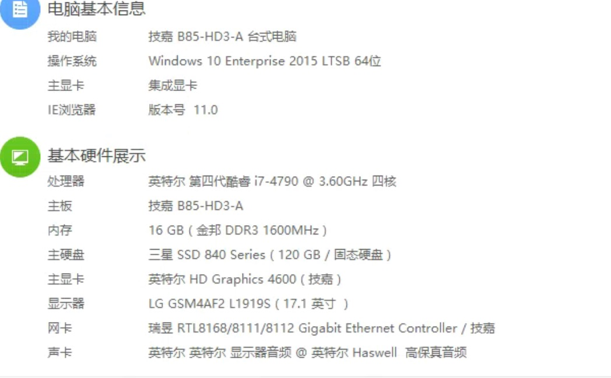

### 案例 2：华硕 Z97 + i7-4790 + 32G

- 处理器：Intel **i7-4790** 3.60GHz 四核
- 主板：华硕 **Z97-A**
- 内存：32 GB DDR3
- 硬盘：256 GB SSD

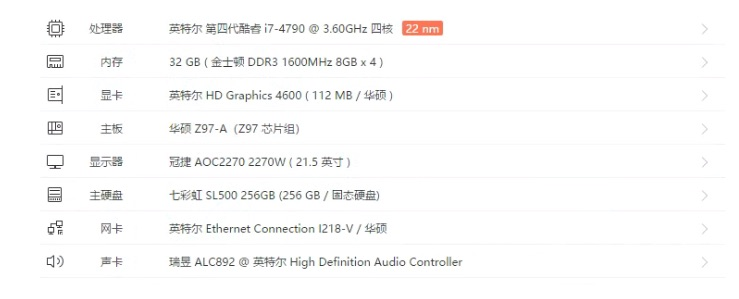

### 案例 3：B85 大板套餐（厂商宣传带机量，仅供参考）

市场套餐截图，CPU 为四代 i5 / i5-K / i7-K，主板华硕 **B85M-F** 豪华大板，内存 8G～12G。图中「待机量」是卖家宣传数字，**不是 EasyClick 官方实测**。

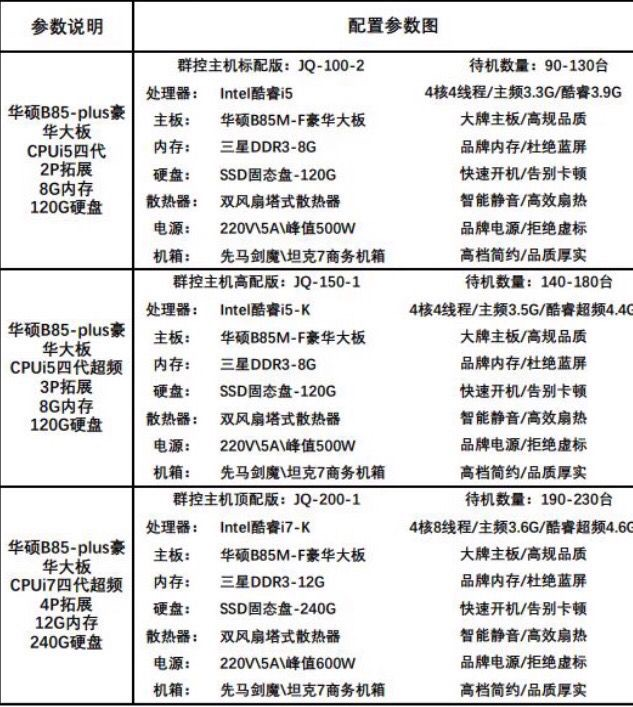

### 案例 4：桥接主机（华硕 B85 + i3-4150T + 8G）

图中标注为 **桥接程序主机**，配置偏低，适合前面说的「B85 当桥接」那种拆分。

- 处理器：Intel **i3-4150T** 3.00GHz 双核
- 主板：华硕 **B85M-K**
- 内存：8 GB DDR3
- 硬盘：180 GB SSD

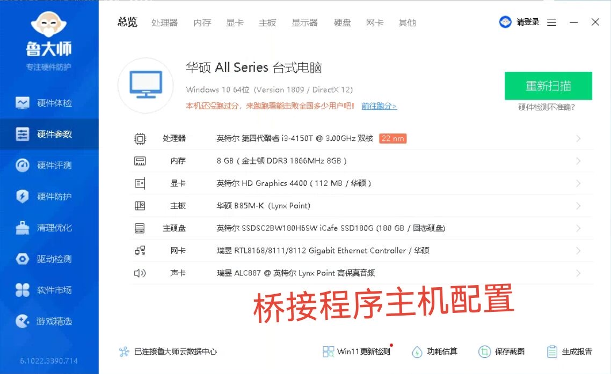

### 案例 5：华硕 X79 + E5-2696 v2 + 32G

- 处理器：Intel Xeon **E5-2696 v2** 2.50GHz
- 主板：华硕 **P9X79**
- 内存：32 GB DDR3
- 显卡：GTX 960
- 硬盘：240 GB SSD

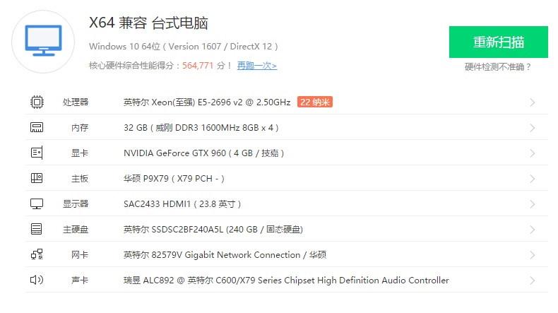

### 案例 6：约 94 台投屏（i5-10400 + 16G）

客户实测大约 **94 台同时投屏**。论坛原帖：[带 94 台投屏配置的电脑](https://bbs.ieasyclick.com/thread-619-1-1.html)。

- 处理器：Intel **i5-10400** 2.90GHz 六核
- 主板：技嘉 **H510M S2**
- 内存：16 GB DDR4
- 显卡：GTX 1660 Ti
- 硬盘：480 GB SSD

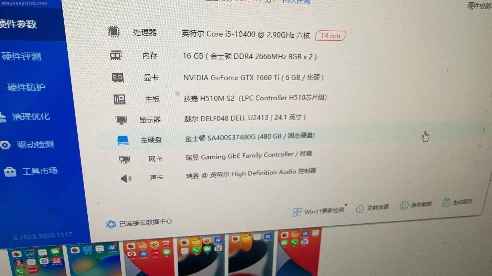

### 案例 7：约 160 台脚本 + 投屏（B550 + R5 5600G）

客户分享：主板 **技嘉 B550M AORUS PRO-P**，CPU **Ryzen 5 5600G**，内存约 **16 GB**。截图时中控在线约 **139**、列表约 **135** 台。线材用批量苹果数据线；机箱后置用 **USB 2.0 挡板线** 把主板针脚扩成多个口（也有人用 USB 3.0 20Pin 挡板）。

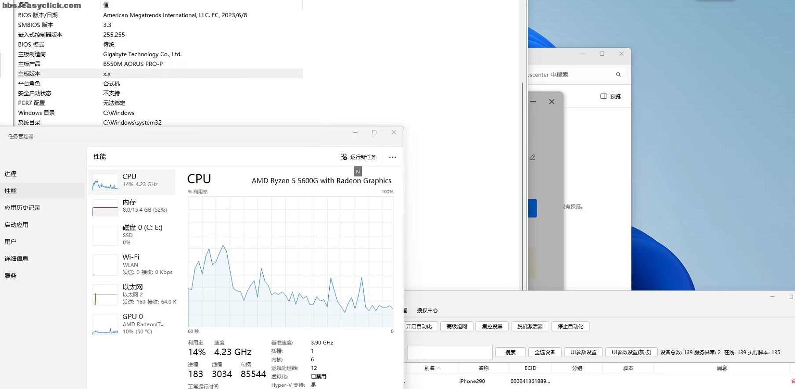

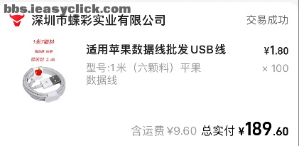

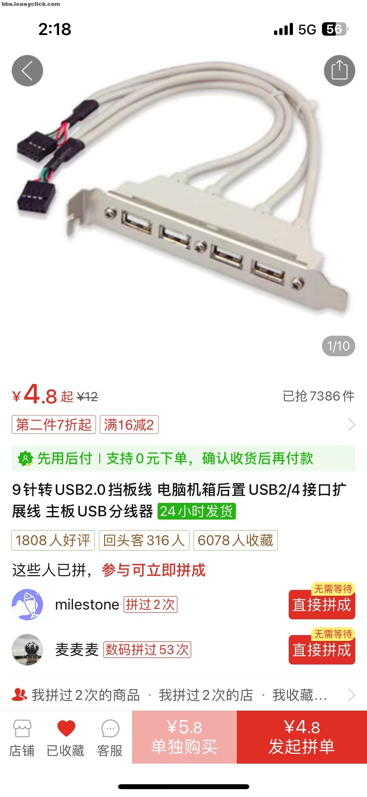

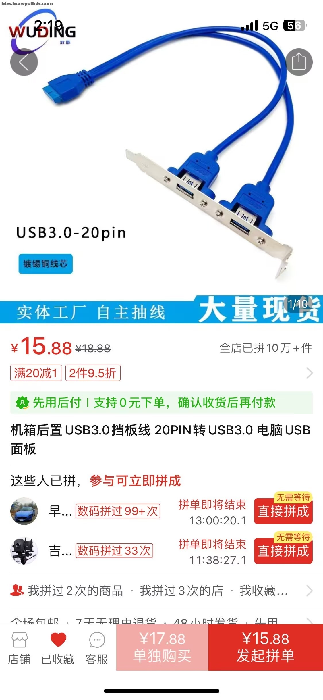

## 其他对照表（摘自其他中控资料，未验证）

下表来源不是 EasyClick 实测，CPU / Hub 数字仅作对照，**不要直接当本软件的官方规格**。

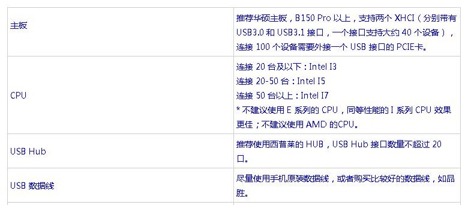

- 主板：有资料写 B150 Pro 以上、双 xHCI，一个口大约 40 台，上百台再加 PCIe USB 卡
- CPU：20 台以下 i3、20～50 台 i5、50 台以上 i7；不建议同性能 E 系列替代 I 系列，也不建议 AMD（与上面 **5600G 客户案例** 可能矛盾，以实测为准）
- Hub：独立供电，单 Hub 口数不要堆太多（有资料写不超过 20 口）
- 线：原装或品胜一类品牌线

