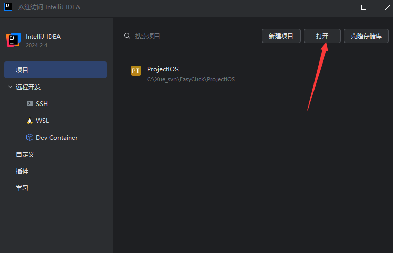
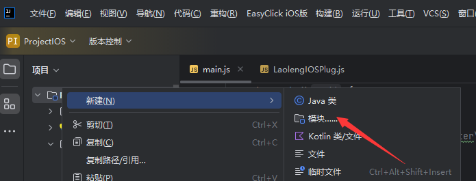
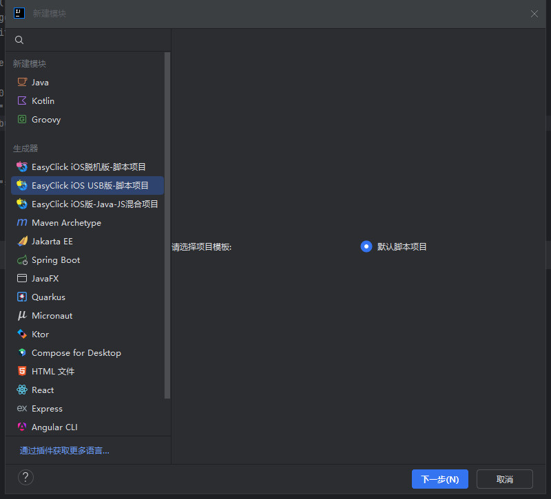
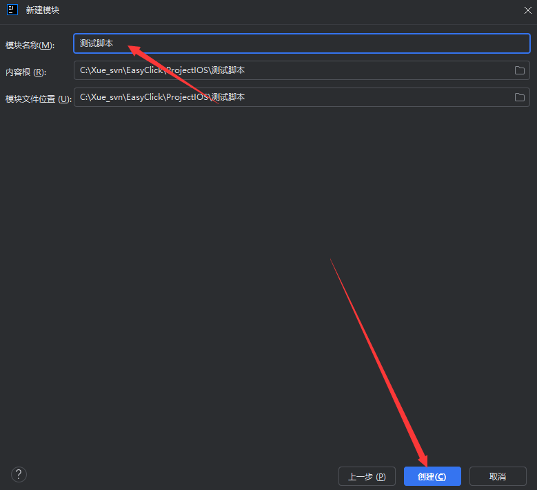
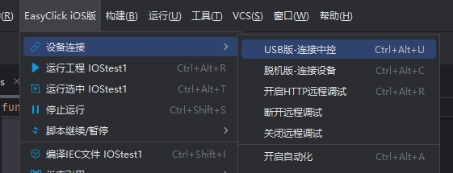
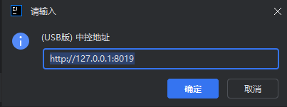

<!-- 来源：https://ieasyclick.com/iosdocs/firstproject/ -->

# 创建第一个工程

本页带你从零跑通 iOS USB 脚本工程：新建模块 → 连接中控。

## 准备工作

- 已按 [安装开发插件](tools/installdevtools.md) 装好开发插件
- 视频可参考：[工程创建与项目简介](https://www.laoleng.vip/docs/free-courses/ec-ios-usb#2%E5%BC%80%E5%8F%91%E6%8F%92%E4%BB%B6-%E5%AE%89%E8%A3%85%E4%B8%8E%E7%AE%80%E4%BB%8B)

## 新建工程

EasyClick 采用多模块方式开发。

1. 创建并打开一个空文件夹，如 `ProjectIOS`  
   
2. 右键选择新建 module/模块  
   
3. 选择 **EasyClick IOS USB版-脚本项目**，点击 Next  
   
4. 输入模块名，点击 Create  
   

## 连接中控开发

前置条件：代理程序已安装、中控已启动、手机已授权 **USB设备授权**。

1. 打开链接中控调试地址  
   
2. 默认地址为 `http://127.0.0.1:8019`，也可改 IP:端口对接其他电脑  
   
3. 点击确定后，在 IDEA 下方查看链接日志；连接多台设备时，需选中要调试的设备

## 下一步

- [苹果群控USB版新手安装](advance/ios-usb-beginner-install.md)
- [投屏操作教程](advance/ios-usb-screen.md)
- [脚本函数](funcs/index.md)
- 不写代码可用 [AI 智能体](advance/ai-agent/index.md)

