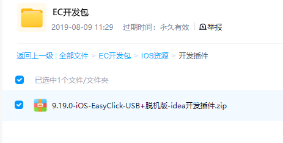
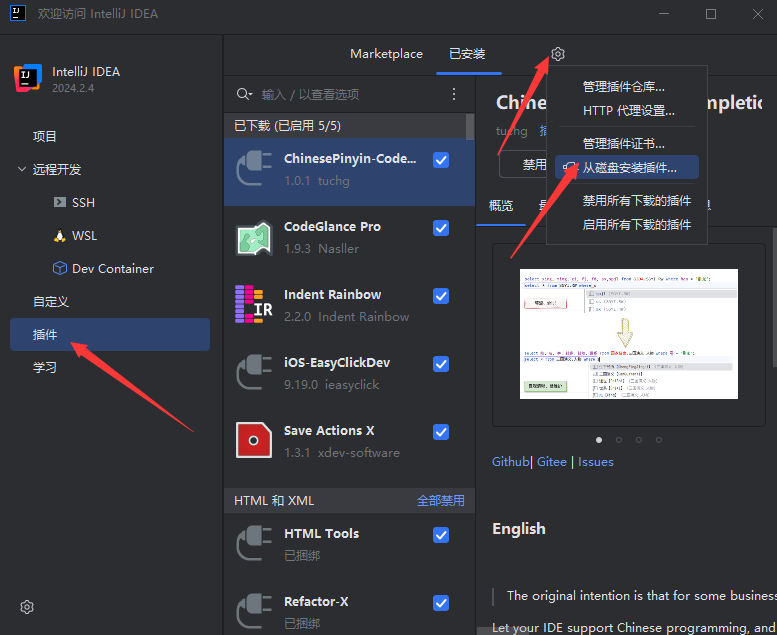
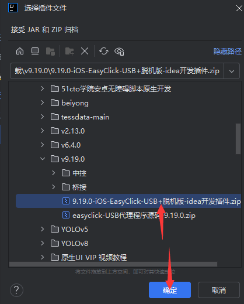
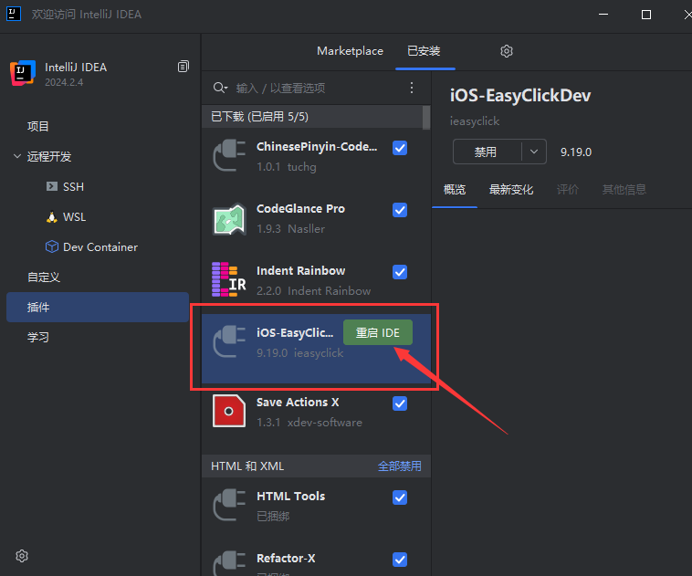

<!-- 来源：https://ieasyclick.com/iosdocs/tools/installdevtools/ -->

# 安装开发插件

- 视频教程—> [**开发插件安装与简介**](https://www.laoleng.vip/docs/free-courses/ec-ios-usb#2%E5%BC%80%E5%8F%91%E6%8F%92%E4%BB%B6-%E5%AE%89%E8%A3%85%E4%B8%8E%E7%AE%80%E4%BB%8B)

## 1、下载安装插件

- 到[资源区网盘](https://ieasyclick.com/iostjdocs/tools/download_resources) **EC开发包—>IOS资源—>开发插件** 进行下载  
  
- 兼容范围较广，但**强烈推荐 IDEA 2026.2 及以上**，尽量不要使用更老的版本
- **推荐使用官方正版 IDEA 2026.2 及以上**：请到 [JetBrains 官网](https://www.jetbrains.com/idea/download/) 下载安装，再安装 EasyClick 开发插件即可。旧版本后续将不再支持，请统一使用 2026.2+
- 如果不适应新的 IDEA UI：打开 IDEA **设置 → 插件**，搜索 **Classic UI** 并安装，**重启 IDEA** 后即可恢复经典界面
- <https://download.jetbrains.com/idea/idea-2026.2.win.zip>
- 安装好后，重新启动idea即可

### 1.从磁盘安装

### 2.选择插件压缩包位置

### 3.重启IDEA

