<!-- 来源：https://ieasyclick.com/iosdocs/tools/signagent/ -->

# 安装代理ipa

- 用于安装到iphone/ipad上的程序,打通电脑与手机的通讯,控制手机
- 由于苹果限制,未上架苹果商店的三方ipa安装包,需要签名方可安装使用  
  因此需要个人开发者或巨魔等进行签名[推荐],也可通过我们提供的源码,用MacOS的Xcode进行源码编译

> **提示**
>
> - iOS 15 及以上，可以直接用脱机主程序（v7.2.0 及以上）作为 USB 的自动化程序，不必再签名安装本页的代理 IPA
> - 脱机主程序在网盘 **iOS资源文件夹 → 脱机版本**，选一个版本，下载里面的主程序，签名后安装即可
> - 官方在[下载页面](https://ieasyclick.com/community/download_area)提供了已经签名好的 IPA，可以直接下载安装，用来测试
> - 装上脱机主程序后，中控里按自动化程序使用它。不要把它和本页的 USB 代理 IPA 当成必须同时安装的两个包

## 签名使用

### 签名

- 免费方法: `巨魔TrollStore` 或换皮巨魔如 `超然签` 等,重启会掉签,需重新签名EasyClick提供的代理程序,支持 `ios15-ios16.6.1`
- 付费方法: 注册 `个人开发者` 账号,付费688元/年,可绑定100台,支持 `ios12以上`
- 付费方法: QQ群/淘宝/闲鱼等,购买 `个签/企业签` , 注意: 此签名很多只支持 `ios15以上` 系统,注意甄别
- 如果已有证书，可以使用网盘里的签名工具进行签名

### 使用

- 签名后,通过 `爱思助手` 安装到iphone/ipad上即可,后续使用需配合中控程序
- 如安装失败可到论坛搜索解决方法

## MacOS源码编译

- 此方法只适合拥有MacOS电脑的开发者,不适合大批量使用

### 下载Agent源码

编译Agent源码请使用 `mac系统`，为了节省成本，可以使用mac mini二手(淘宝一大堆)或者虚拟机安装黑苹果，百度一下一堆教程

编译Agent源码需要使用`xcode`，建议使用xcode 13.1版本

因为往往涉及到配置`Team`和`自动签名`等事宜。

请到资源区网盘最终找到这个压缩包，下载到本地并解压

此处以9.19.0版本为例

**EC开发包—>IOS资源—>USB版本—>v9.19.0—>easyclick-USB代理程序源码-9.19.0.zip**

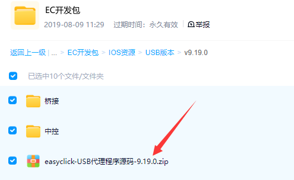

> 双击 `easyclick.xcodeproj`  xcode会自动打开这个工程

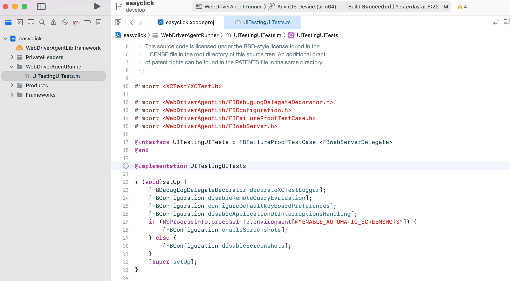

### 设置签名

```
签名类型:
普通的appleid签名:
  - 免费
  - 限制: 只能安装3台设备，bundleId只能允许十天更改三次，
    证书7天就会过期，需要再次使用xcode运行代理ipa源码
  - 地址: https://appleid.apple.com/account
个人开发者签名:
  - 费用688元，使用iPhone/iPad
  - 限制: 安装100台设备，证书一年后过期，过期后需要再次使用xcode运行代理ipa源码
  - 地址：https://developer.apple.com/cn/support/enrollment/
  - https://www.jianshu.com/p/029167817dde

这里演示的是appleid免费的签名
实际开发和调试脚本可以使用免费appleid
正式使用超过3台设备，需要使用个人开发者签名或者申请大量的免费appleid签名
```

点击左上角的项目，进入项目属性，点击`TARGETS`中的`WebDriverAgentRunner`，切换到`Signing & Capabilities`：

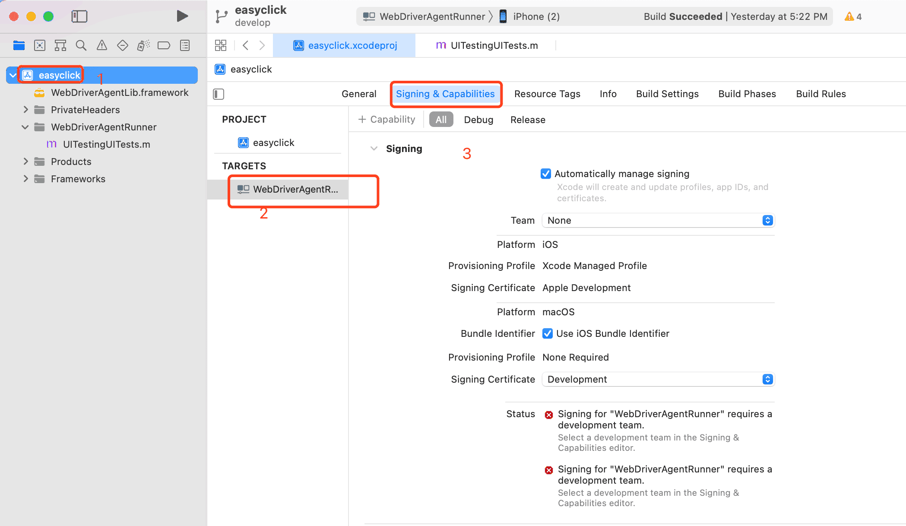

默认`Team`是`None`，需要去选择一个自己的苹果账号：

或者点击add account新增一个苹果账号:

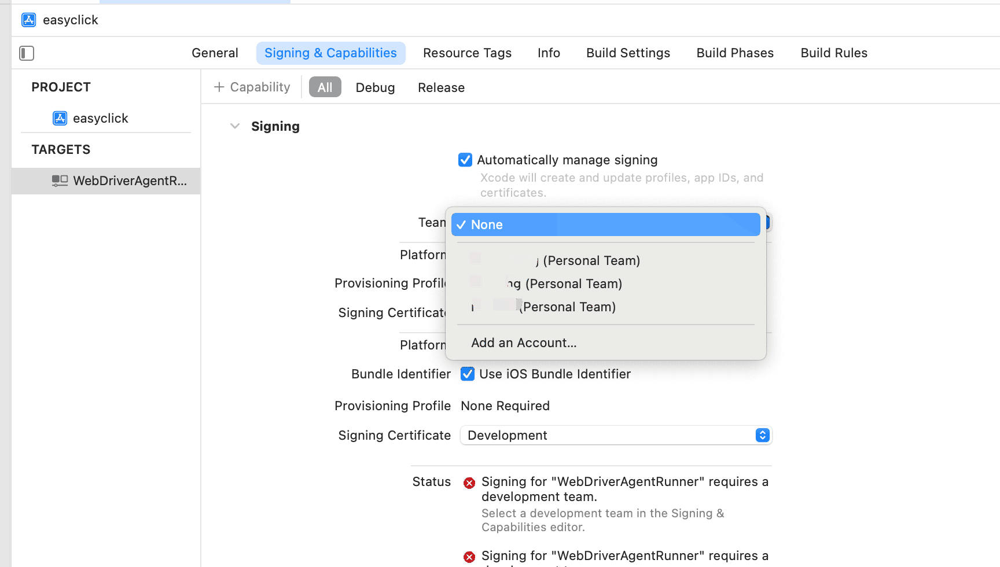

然后会触发自动修复，显示`Waiting to repair`：

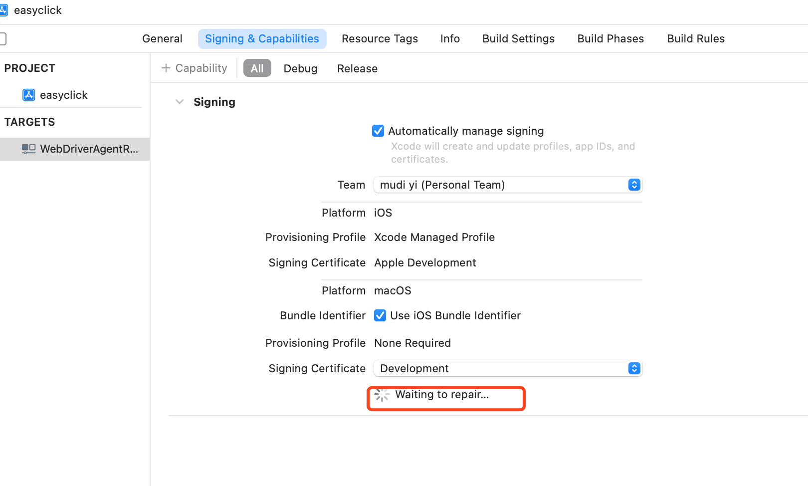

看到没有其他警告或错误，就表示自动创建签名和Profile等工作正常了：

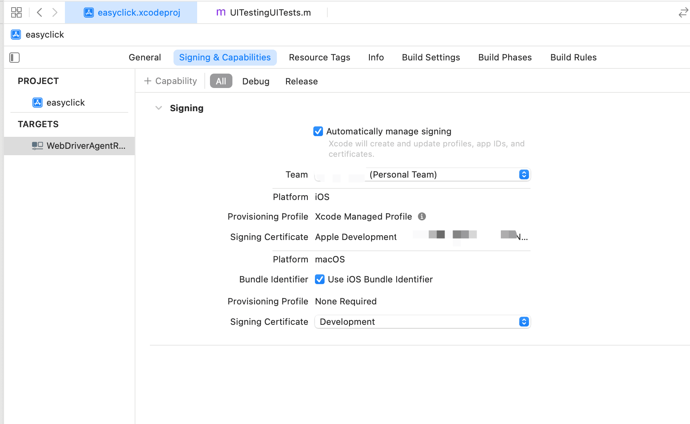

### 编译运行

将iphone插入到电脑，xcode识别后，选择要运行的iphone:

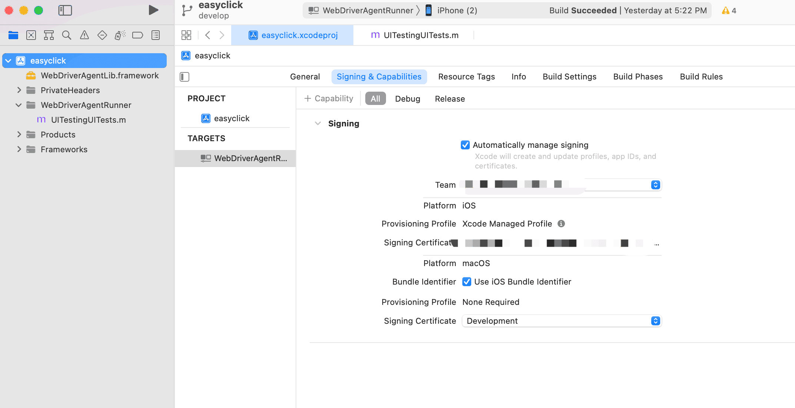

之后即可正常的`Product`->`Test`去测试，启动服务，供后续使用了。

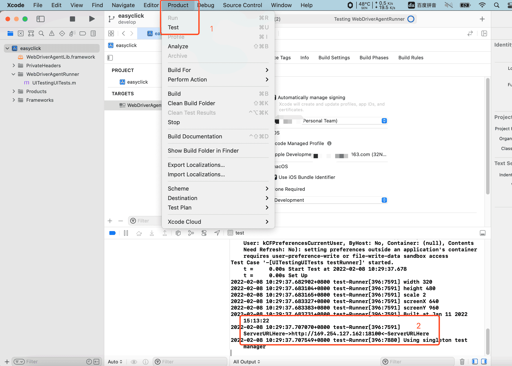

`控制台出现了ServerURLHere 代表正常启动了`

如果出现这个弹窗，请到手机信任这个程序:

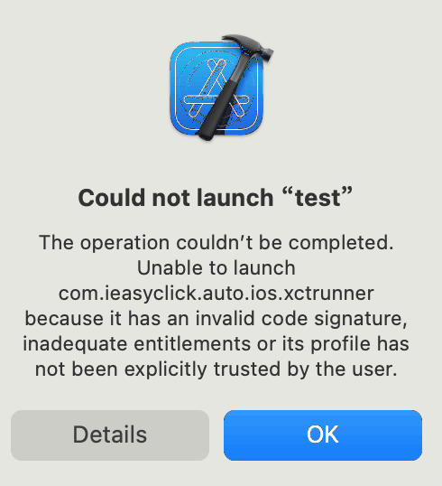

`进入手机的 设置 - 通用 - 设备管理 ，选择开发者应用, 点击信任 apple developement:xxxx`

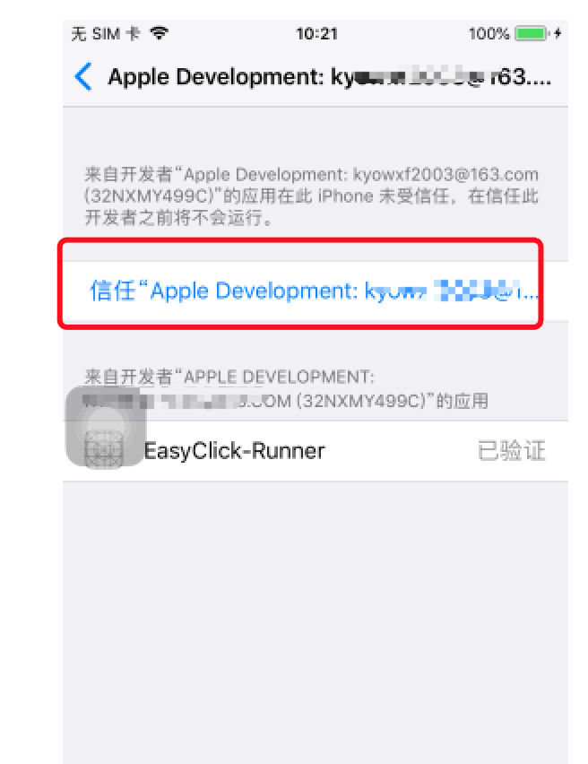

### 常见错误

#### Failed to register bundle identifier

如果`Signing & Capablities`的自动修复后报错：

```json
No profiles for 'com.ieasyclick.auto.ios' were found
Xcode couldn't find any iOS App Development provisioning profiles matching 'com.ieasyclick.auto.ios'.
```

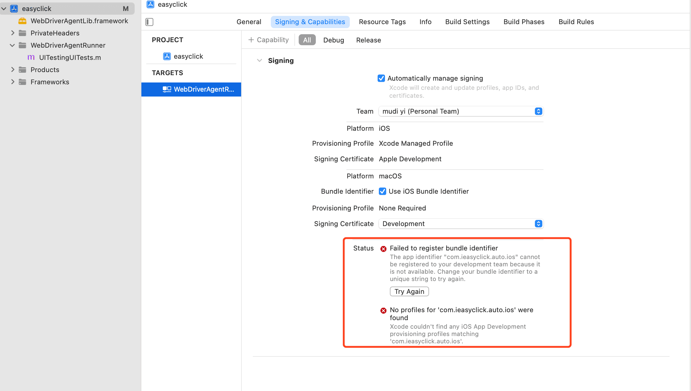

**原因**：（很可能是）默认的ID：`com.ieasyclick.auto.ios` 已存在，重复了，导致无法继续。

**解决办法**：修改为其他（独一无二的）值

**操作步骤**：

```json
WebDriverAgentRunner`的属性 -> `Build Settings` -> `Packaging` -> `Product Bundle Identifier
把值从默认的：com.ieasyclick.auto.ios 改为别的，确保不重复的值，比如我此处改为：com.ieasyclick.auto.ios.xxxx1
```

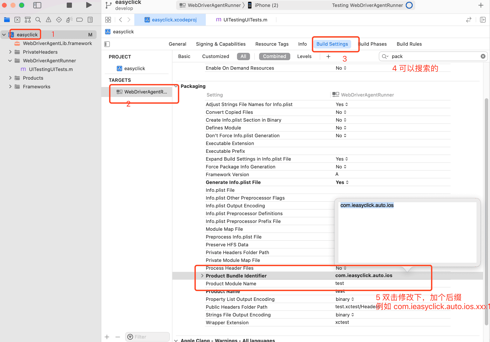

> 别处调用到此处的Product Bundle Identifier

后来注意到一个细节，别处会调用到此处的`Product Bundle Identifier`中的值

比如：`Info`->`Key`->`Bundle Identifier`: `$(PRODUCT_BUNDLE_IDENTIFIER)`

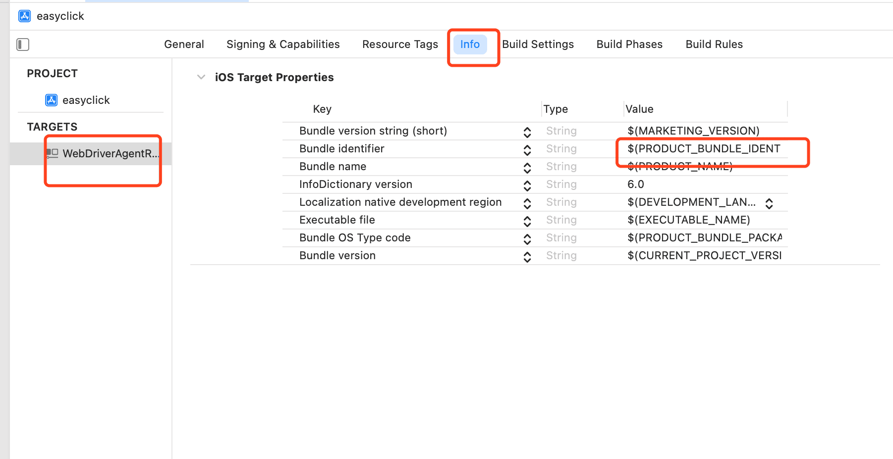

#### XCode报错：A build only device cannot be used to run this target

```json
A build only device cannot be used to run this target.
No supported iOS devices are available. Connect a device to run your application or choose a simulated device as the destination.
```

原因：XCode中没有选择正确的目标设备

解决办法：插入iPhone，且选择对应的iPhone等iOS真机设备。

#### xcodebuild报错：Signing certificate is invalid

**原因**：自己的Apple苹果（开发者）账号过期了。不可用，没法给代码code sign了。

**解决办法**：花钱，给苹果开发者账号续费。价格：99美元/年。

#### XCode报错：The certificate used to sign has either expired or has been revoked

```json
Unable to install "WebDriverAgentRunner-Runner"
The certificate used to sign "WebDriverAgentRunner-Runner" has either expired or has been revoked. An updated certificate is required to sign and install the application.
```

点击`Details`还可以看到详情：

```bash
Details

Unable to install "WebDriverAgentRunner-Runner"
Domain: com.apple.dt.MobileDeviceErrorDomain
Code: -402620392
Recovery Suggestion: The certificate used to sign "WebDriverAgentRunner-Runner" has either expired or has been revoked. An updated certificate is required to sign and install the application.
--
The identity used to sign the executable is no longer valid.
Domain: com.apple.dt.MobileDeviceErrorDomain
Code: -402620392
User Info: {
    DVTRadarComponentKey = 487925;
    MobileDeviceErrorCode = "(0xE8008018)";
    "com.apple.dtdevicekit.stacktrace" = (
     0   DTDeviceKitBase                     0x000000011d4bcc8f DTDKCreateNSErrorFromAMDErrorCode + 220
     1   DTDeviceKitBase                     0x000000011d4fb241 __90-[DTDKMobileDeviceToken installApplicationBundleAtPath:withOptions:andError:withCallback:]_block_invoke + 155
     2   DVTFoundation                       0x0000000101ba464b DVTInvokeWithStrongOwnership + 71
     3   DTDeviceKitBase                     0x000000011d4faf82 -[DTDKMobileDeviceToken installApplicationBundleAtPath:withOptions:andError:withCallback:] + 1440
     4   IDEiOSSupportCore                   0x000000011d36ba10 __118-[DVTiOSDevice(DVTiPhoneApplicationInstallation) processAppInstallSet:appUninstallSet:installOptions:completionBlock:]_block_invoke.292 + 3513
     5   DVTFoundation                       0x0000000101cd317e __DVT_CALLING_CLIENT_BLOCK__ + 7
     6   DVTFoundation                       0x0000000101cd4da0 __DVTDispatchAsync_block_invoke + 1191
     7   libdispatch.dylib                   0x00007fff6db306c4 _dispatch_call_block_and_release + 12
     8   libdispatch.dylib                   0x00007fff6db31658 _dispatch_client_callout + 8
     9   libdispatch.dylib                   0x00007fff6db36c44 _dispatch_lane_serial_drain + 597
     10  libdispatch.dylib                   0x00007fff6db375d6 _dispatch_lane_invoke + 363
     11  libdispatch.dylib                   0x00007fff6db40c09 _dispatch_workloop_worker_thread + 596
     12  libsystem_pthread.dylib             0x00007fff6dd8ba3d _pthread_wqthread + 290
     13  libsystem_pthread.dylib             0x00007fff6dd8ab77 start_wqthread + 15
);
}
--

System Information

macOS Version 10.15.7 (Build 19H2)
Xcode 12.4 (17801) (Build 12D4e)
Timestamp: 2021-04-13T21:17:10+08:00
```

**原因**：苹果开发者账号过期了，没续费。导致证书不可用。

**解决办法**：同上，续费即可。

