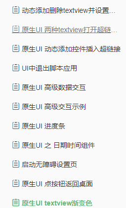

<!-- 来源：https://www.laoguicom.top/doc/63/ · 抓取状态：ok -->

# EasyClick 原生UI教程总纲
 讲师：Mr-老鬼，QQ：1156346325 EC交流QQ群：620028786,647082990
**写在前面**
**目录下的前三章必看，不然不知道重要的属性信息。**
# 付费教程地址 
[原生UI课程](http://laogui.uicp.top/project-5/doc-83/) VIP会员 需要注册账号并缴纳学费￥688RMB 后开通权限。

# CSDN博客地址如下
说明： 第〇章 第一章 第三章第一篇综合使用 为免费教程可直接阅读。其他为订阅付费内容！
订阅付费内容，值提供文档，不提供后期解答和更新。
教程源码：博客版配套源码[下载地址](https://download.csdn.net/download/qq_21460781/20463056)
## 第〇章 XML扫盲
1. [EasyClick 原生UI教程扫盲篇](https://blog.csdn.net/qq_21460781/article/details/115911414)
2. XML 文件名必须字母的，tag标签必须字母或字母加数字组合的。不要用中文汉字命名，哪怕用拼音全拼都行。
3. ui.js 补充说明：ui.save 这种 save 是xml里定义的android:tag="save" 请注意不要搞错了，否则找不到控件报错。

## 第一章 UI基础
以了解认识为主，不理解意思后面都会讲到，先有个大概的认识即可。
1. [EasyClick 原生UI连载 一](https://blog.csdn.net/qq_21460781/article/details/115409085)
基础控件
2. [EasyClick 原生UI连载 二](https://blog.csdn.net/qq_21460781/article/details/115426859)
基础控件
3. [EasyClick 原生UI连载 三](https://blog.csdn.net/qq_21460781/article/details/115427105)
原生UI共有属性
4. [EasyClick 原生UI连载 四](https://blog.csdn.net/qq_21460781/article/details/115427226)
    基础布局

 重要提示：从下面章节开始教程所有代码请抄录一遍，预览一下界面看看效果，自己修改一下属性值，看看修改后的样子加深理解！

## 第二章 UI入门

这一章为详细介绍各个布局和控件的具体属性。

1. [EasyClick 原生UI连载 九](https://blog.csdn.net/qq_21460781/article/details/115525068?spm=1001.2014.3001.5502)
原生UI之布局详解

2. [EasyClick 原生UI连载 十](https://blog.csdn.net/qq_21460781/article/details/115534281)
 原生UI之控件详解
 
3. **补充知识**：[Android UI 长度单位和内外边距](https://www.cnblogs.com/xiaoluo501395377/p/3389980.html)

## 第三章 进阶用法
这一章介绍综合运用布局和控件。

1. [EasyClick 原生UI连载 五](https://blog.csdn.net/qq_21460781/article/details/115438061)
综合使用

2. [EasyClick 原生UI连载 六](https://blog.csdn.net/qq_21460781/article/details/115459789?spm=1001.2014.3001.5501)
UI与脚本之间的交互 一

3.  [EasyClick 原生UI连载 七](https://blog.csdn.net/qq_21460781/article/details/115463459)
搭配Androidstudio 设计UI

4. [EasyClick 原生UI连载 八](https://blog.csdn.net/qq_21460781/article/details/115485559?spm=1001.2014.3001.5501)
原生UI 之登录UI界面

5. [EasyClick 原生UI连载 十一](https://blog.csdn.net/qq_21460781/article/details/115574313)
 原生UI之主界面

##  第四章 高级使用

这一章为高阶使用，务必理解前三章内容，否则看不懂用法。

1.  [EasyClick 原生UI连载 十二](https://blog.csdn.net/qq_21460781/article/details/115675641)
原生UI之悬浮窗UI
2. [EasyClick 原生UI连载十三](https://blog.csdn.net/qq_21460781/article/details/115704180)
   对话框UI
3. [EasyClick 原生UI连载十四](https://blog.csdn.net/qq_21460781/article/details/115710791)
   原生UI之自定义悬浮窗动态显示标识数据
4. [EasyClick 原生UI连载十五](https://blog.csdn.net/qq_21460781/article/details/115740746)
原生UI之切换页面
	
5. [EasyClick 原生UI连载十六](https://blog.csdn.net/qq_21460781/article/details/115764507)
原生UI之TextView跑马灯特效

6. [EasyClick 原生UI连载十七](https://blog.csdn.net/qq_21460781/article/details/115798252)
   原生UI之图片轮播特效（可做公告栏）
   
7. [EasyClick 原生UI连载十九](https://blog.csdn.net/qq_21460781/article/details/115867752)
配置idea创建xml布局模板

8. [EasyClick 原生UI连载二十](https://blog.csdn.net/qq_21460781/article/details/115907153)
FlexboxLayout 布局（聪明的布局） 

9. [EasyClick 原生UI连载二十一](https://blog.csdn.net/qq_21460781/article/details/115914440)
CardView 布局（卡片布局）

10. [EasyClick 原生UI连载二十二](https://blog.csdn.net/qq_21460781/article/details/115943711)
 XML悬浮窗按钮交互
 
11. [EasyClick 原生UI连载二十四](https://blog.csdn.net/qq_21460781/article/details/116073307)
 button和textview 共有特性
 
12.  [EasyClick 原生UI连载二十六](https://blog.csdn.net/qq_21460781/article/details/116139063)
 UI与脚本之间的交互 二
13. [EasyClick 原生UI连载二十七](https://blog.csdn.net/qq_21460781/article/details/116151915)
 使用view动态输出日志
 
14. [EasyClick 原生UI连载三十](https://blog.csdn.net/qq_21460781/article/details/116329690)
帧布局详解

15. [EasyClick 原生UI连载三十二](https://blog.csdn.net/qq_21460781/article/details/116332932 "EasyClick 原生UI连载三十二")
帧布局运用例子
16. [EasyClick 原生UI连载 三十四](https://editor.csdn.net/md/?articleId=116614693)
多行编辑框

17. [EasyClick 原生UI连载三十五](https://blog.csdn.net/qq_21460781/article/details/116659363)
UI交互四脚本读取并修改UI配置参数

18. [EasyClick 原生UI连载三十六](https://blog.csdn.net/qq_21460781/article/details/116722106 "EasyClick 原生UI连载三十六")
横向滚动布局
19. [EasyClick 原生UI连载三十七](https://blog.csdn.net/qq_21460781/article/details/117371469 "EasyClick 原生UI连载三十七")
UI动态添加view

20. [EasyClick 原生UI连载三十八](https://blog.csdn.net/qq_21460781/article/details/117391811?spm=1001.2014.3001.5501 "EasyClick 原生UI连载三十八")
textview 打开超链接

21. [EasyClick 原生UI连载三十九](https://blog.csdn.net/qq_21460781/article/details/119106985?spm=1001.2014.3001.5501 "EasyClick 原生UI连载三十九")
对话框大全

22. [EasyClick 原生UI连载四十](https://blog.csdn.net/qq_21460781/article/details/119190513?spm=1001.2014.3001.5501 "EasyClick 原生UI连载四十")
UI下载文件

### 更多高级课程在VIP 课程 这里就不展示了。
新增内容如下

新增旋转动画课程

修复 对话框交互bug！ 原第五章重新划分为第四章

新增原生UI自定义对话框交互

新增原生UI对话框复用XML高级交互

新增原生UI 下载文件

新增原生UI 文本字体样式

新增原生UI读文本

新增原生UI 高级事件写法

新增原生UI 下拉框选项动态绑定

新增原生UI ListView组件（三种模式）

新增原生UI 动态解析xml 布局

新增原生UI 动态解析xml 布局 交互

新增原生UI SeekBar组件

新增原生UI 动态设置网络图片为背景图

新增原生UI 隐藏启动按钮

新增原生UI scrollview 自动滚动

新增原生UI 文本样式

新增原生UI 单选按钮复选框自定义效果

新增原生UI switch 组件自定义效果

新增原生UI 点按钮打开指定目录

新增原生UI 悬浮窗超链接事件处理

新增原生UI 表格UI

新增原生UI viewpager组件

新增原生UI popwindow组件

新增原生UI 动画效果

新增原生UI 自定义通知栏通知

新增原生UI 控件添加图标

新增原生UI 网络操作

新增原生UI 水印图制作

## 第五章 UI框架搭建
前四章内容运用熟练后，再来看这一章内容。

1. [EasyClick 原生UI连载十八](https://blog.csdn.net/qq_21460781/article/details/115835777)
  底部标签栏UI简易框架
  
2.  [EasyClick 原生UI连载二十三](https://blog.csdn.net/qq_21460781/article/details/116035195)
   登录主页框架联动
   
3. [EasyClick 原生UI连载二十八](https://blog.csdn.net/qq_21460781/article/details/116263488 )
悬浮按钮自动贴边

4. [EasyClick 原生UI连载二十九](https://blog.csdn.net/qq_21460781/article/details/116273620)
对话框交互 VIP版已修复bug

5. [EasyClick 原生UI连载三十一](https://blog.csdn.net/qq_21460781/article/details/116330559)
页面内启停按钮框架 

6. [EasyClick 原生UI连载三十三](https://blog.csdn.net/qq_21460781/article/details/116573290)
运行模式检测模板

7. 动态代码排版
代码写布局模板

8. 新增原生UI 点击按钮执行指定脚本

9. 对话框大全模板
代码创建对话框大全

10. 原生UI 悬浮窗控制启动脚本
悬浮窗启动对应任务（可穿透点击）

11. 原生UI SeekBar 模板

12. 更多模版在VIP 高级课程

新增原生UI 模糊搜索模板

新增原生UI 自定义热更新模板

新增原生UI 九宫格模板

新增原生UI 对话框自定义布局

## 第六章 编辑框番外
1. 编辑框设置输入类型
2. 编辑框监听

## 第七章 UI排版美化
1. 权重的使用
2. 线性布局巧用
3. 单项排版
4. view巧用

## 第八章 XML布局和EC节点
1. XML布局和节点的关系

## 番外避坑
常见的错误解决办法。
1. [EasyClick 原生UI 连载二十五](https://blog.csdn.net/qq_21460781/article/details/116095950)
 常见UI问题避坑指南
 
2. VIP版番外避坑付费获取

## 更多高级教程付费获取。

## VIP 高级会员福利课程
**EasyClick 常用封装**
**EasyClick 反盗版**

## 其他相关资料
教程源码： VIP版付费获取。
EasyClick原生UI手册：免费版 [Android代码手册](https://shimo.im/docs/jyQ9HkG6pqgXHyvp)。
					VIP版 在VIP课程目录

  
**Adnroid 颜色表** ：[颜色表](http://tools.jb51.net/static/colorpicker/)
Android UI设计规范参考 ： [UI设计规范](http://www.woshipm.com/screen/android.html)
我的一些EC相关的博客文章
[Easy Click常用的东西](https://blog.csdn.net/qq_21460781/category_10895405.html)

友情链接：[Mr、老冷EasyClick**VIP**插件](http://home.laoleng.top:3001/web/#/9?page_id=167)

我是Mr-老鬼。
专注安卓开发、EasyClick 自动化，八年开发经营。精通多个编程语言。
交流QQ群：620028786，647082990，772810035
 **---------------------------------------版权声明----------------------------------------**
版权所有~Mr-老鬼 ~转载请注明原文地址
免责声明：本文所有的教程仅限交流学习使用不得用于违法用途，造成的法律后果本人不承担责任。