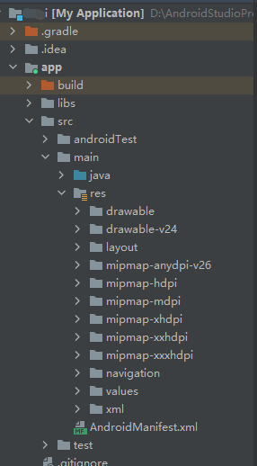
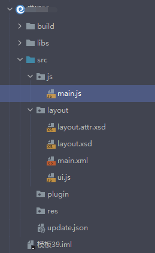

<!-- 来源：https://www.laoguicom.top/doc/367/ · 抓取状态：ok -->

# EasyClick 原生UI与Android UI 的区别
## 项目格式
Android项目

EasyClick 脚本项目


上面所示 Android项目比EasyClick 项目 文件目录要多出来好多个 。对比看一下就行了。
## xml 布局文件格式
### Android xml
```xml
<?xml version="1.0" encoding="utf-8"?>
<androidx.constraintlayout.widget.ConstraintLayout xmlns:android="http://schemas.android.com/apk/res/android"
    xmlns:app="http://schemas.android.com/apk/res-auto"
    xmlns:tools="http://schemas.android.com/tools"
    android:layout_width="match_parent"
    android:layout_height="match_parent"
    tools:context=".MainActivity">

    <include layout="@layout/layout_test" />
</androidx.constraintlayout.widget.ConstraintLayout>
```
### EasyClick layout xml
```
<?xml version="1.0" encoding="UTF-8" ?>  <!-- 第一行声明是个xml 文件 编码UTF-8 -->
<ScrollView
    xmlns:xsi="http://www.w3.org/2001/XMLSchema-instance"
    xmlns:android="http://schemas.android.com/apk/res/android"
    xsi:noNamespaceSchemaLocation="layout.xsd"
    android:layout_height="match_parent"
    android:layout_width="match_parent" >
    <LinearLayout
        android:layout_height="match_parent"
        android:layout_width="match_parent"
        android:orientation="vertical"
        android:padding="20dp"  >
        <TextView
            android:layout_width="match_parent"
            android:layout_height="wrap_content"
            android:text=" "/>

    </LinearLayout>
</ScrollView>
```
说明：
1. 命名空间不一样。
2. EasyClick 不支持类名做标签名。
## 布局和控件
EasyClick 支持的布局和控件相对较少，目前布局支持如下：
```
LinearLayout 线性布局 
FrameLayout 帧布局 
RelativeLayout 相对布局 
ScrollView 滚动框布局 
RadioGroup 单选布局  
include 引用布局  
FlexboxLayout 布局  
CardView 布局   
HorizontalScrollView 横向滚动布局
```
支持的xml控件如下：
```
View 控件
TextView 控件 
button 控件
EditText 输入框控件
CheckBox 复选框
RadioButton 单选按钮
Spinner 下拉选择框
Swtich 开关按钮
ImageView 图像
WebView 内嵌浏览器
Canvas 画布
```
其他控件需要使用代码动态添加方式实现。

总的来说 EasyClick 的原生UI组件 是Android的精简版支持常用的控件和布局，其他不支持的需要代码动态方式添加实现。
## 属性
EasyClick xml 布局支持的属性是常用的基本属性，部分属性xml 不支持，需要代码动态添加实现。
EasyClick 不支持 自定义样式，不支持 color.xml 引用颜色值，不支持string.xml 文件引用定义的字符串，不支持themes.xml主题引用,不支持 arrys.xml 预定义settings选项 。
其他控件属性 部分不支持。具体对比Android SDK 官方文档对比。

我是Mr-老鬼、QQ1156346325 。交流QQ群：620028786,647082990
**------------------------------------------------版权声明------------------------------------------------------**
 本文版权所有~Mr-老鬼 ~转载请注明原文地址
免责声明：本文所有的教程仅限交流学习使用不得用于违法用途，造成的法律后果本人不承担责任。