<!-- 来源：https://www.laoguicom.top/doc/47/ · 抓取状态：ok -->

# JavaScript基础教程
### 讲师：Mr-老鬼/1156346325
 


# JavaScript介绍
JavaScript 简称“JS”，是一种脚本编程语言，它灵活轻巧，兼顾函数式编程和面向对象编程，是 Web 前端开发的唯一选择。JavaScript 还有很多框架，比如 jQuery、AngularJS、React 等，它们这是学习 JavaScript 的重要内容。
JavaScript 最初只能运行于浏览器环境，用于 Web 前端开发，后来有“好事”的程序员将 JavaScript 从浏览器中分离出来，搞了一套独立的运行环境，所以现在的 JavaScript 也能用于网站后台开发了。学了 JavaScript，你就是全栈工程师。
# [速查手册](http://doc.laoguicom.top/docs/javascript.html "速查手册")

# 第一个JavaScript程序
## Html中使用
在 HTML 页面中嵌入 JavaScript 脚本需要使用 `<script> `标签，用户可以在` <script> `标签中直接编写 JavaScript 代码，具体步骤如下。
第 1 步，新建 HTML 文档，保存为 test.html。
第 2 步，在 `<head> `标签内插入一个` <script> `标签。
第 3 步，为 `<script>` 标签设置`type="text/javascript"`属性。
现代浏览器默认 `<script>` 标签的脚本类型为 JavaScript，因此可以省略 `type `属性；如果考虑到兼容早期版本浏览器，则需要设置 `type` 属性。
第 4 步，在` <script> `标签内输入 JavaScript 代码：
```html
document.write("<h1>Hi,JavaScript!</h1>")；。
<!DOCTYPE html>
<html>
<head>
    <meta charset="UTF-8">
    <title>第一个JavaScript程序</title>
    <script type="text/javascript">
        document.write("<h1>Hi,JavaScript!</h1>");
    </script>
</head>
<body></body>
</html>
```
在 JavaScript 脚本中，`document` 表示网页文档对象；`document.write()` 表示调用 Document 对象的 `write()`  方法，在当前网页源代码中写入 HTML 字符串`"<h1>Hi,JavaScript!</h1>"`。

第5步，保存网页文档，在浏览器中预览，显示效果如图所示。 

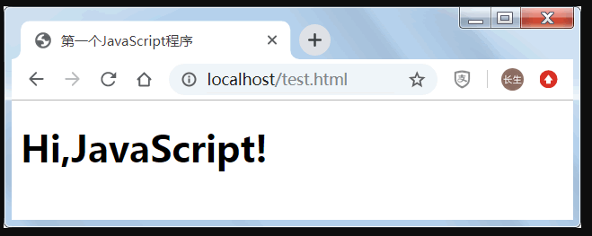
## 新建 JavaScript 文件
JavaScript 程序不仅可以直接放在 HTML 文档中，也可以放在 JavaScript 文件中。

JavaScript 文件是文本文件，扩展名为.js，使用任何文本编辑器都可以编辑。新建 JavaScript 文件的步骤如下。

第1步，新建文本文件，保存为 test.js。注意，扩展名为.js，它表示该文本文件是 JavaScript 类型的文件。

第2步，打开 test.js 文件，在其中编写如下 JavaScript 代码。
`alert("Hi,JavaScript!");`
在上面代码中，`alert() `表示 `Window` 对象的方法，调用该方法将弹出一个提示对话框，显示参数字符串 `"Hi, JavaScript!"。`

第3步，保存 JavaScript 文件。在此建议把 JavaScript 文件和网页文件放在同一个目录下。

JavaScript 文件不能够独立运行，需要导入到网页中，通过浏览器来执行。使用` <script>` 标签可以导入 JavaScript 文件。

第4步，新建 HTML 文档，保存为 test.html。

第5步，在 `<head>` 标签内插入一个 `<script>` 标签。定义 src 属性，设置属性值为指向外部 JavaScript 文件的 URL 字符串。代码如下：
`<script type="text/javascript" src="test.js"></script>`
注意：使用＜script＞标签包含外部 JavaScript 文件时，默认文件类型为 Javascript。因此，不管加载的文件扩展名是不是 .js，浏览器都会按 JavaScript 脚本来解析。

第6步，保存网页文档，在浏览器中预览，显示效果如图所示。

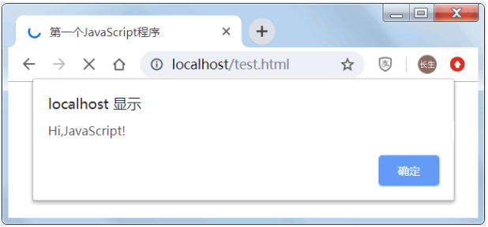
定义 src 属性的` <script>` 标签不应再包含 JavaScript 代码。如果嵌入了代码，则只会下载并执行外部 JavaScript 文件，嵌入代码将被忽略。
执行 JavaScript 程序
浏览器在解析 HTML 文档时，将根据文档流从上到下逐行解析和显示。JavaScript 代码也是 HTML 文档的组成部分，因此 JavaScript 脚本的执行顺序也是根据 `<script>` 标签的位置来确定的。
示例
使用浏览器测试下面示例，会看到 JavaScript 代码从上到下逐步被解析的过程。
```html
<!DOCTYPE html>
<script>
    alert("顶部脚本");
</script>
<html>
<head>
    <meta charset="UTF-8">
    <title>test</title>
    <script>
        alert("头部脚本");
    </script>
</head>
<body>
    <h1>网页标题</h1>
    <script>
        alert("页面脚本");
    </script>
    <p>正文内容</p>
</body>
<script>
    alert("底部脚本");
</script>
</html>
```
在浏览器中浏览上面示例网页，首先弹出提示文本“顶部脚本”，然后显示网页标题“test”，接着弹出提示文本“头部脚本”，下面才显示一级标题文本“网页标题”，继续弹出提示文本“页面脚本”， 接着显示段落文本“正文内容”，最后弹出提示文本“底部脚本”。

你看，对于导入的 JavaScript 文件，也将按照 `＜script> `标签在文档中出现的顺序来执行，而且执行过程是文档解析的一部分，不会单独解析或者延期执行。

如果想改变 JavaScript 文件的执行顺序，可以给 `<script>` 标签增加 `defer` 或者 `async` 属性，我们将在下节中讲解。
JavaScript字符编码
JavaScript 遵循 Unicode 字符编码规则。Unicode 字符集中每个字符使用 2 个字节来表示，这意味着用户可以使用中文来命名 JavaScript 变量。

Unicode 是 Latin-1 字符集的超集，编码数目达到百万级；Latin-1是 ASCII 字符集的扩展，包含 256 个拉丁字母； ASCII 字符集包含 128 个基本字符，即常用英文字母和符号。
## 示例
新建 HTML5 文档，保存为 test.html。在页面中嵌入 `＜script＞ `标签，然后在该标签中输入下面代码，即可正常执行。
```html
<script>
    var 书名="《JavaScript从入门到精通》", 
    姓名="张三";
    function 彩蛋(谁){
        document.write("<h1>" + 谁 + "</h1><p> 欢迎你学习 " + 书名 + "。</p>");
    }
    彩蛋(姓名);
</script>
```

注意：在 JavaScrip t第 1、2 版本中，仅支持 ASCII 字符编码，Unicode 字符只能出现在注释或者引号包含的字符串中。考虑到 JavaScript 版本的兼容性以及开发习惯，不建议使用双字节的中文字符命名变量或函数名。

由于 JavaScript 脚本一般都嵌入在网页中，并最终由浏览器来解释，因此在考虑到 JavaScript 字符编码的同时， 还要兼顾 HTML 文档的字符编码，以及浏览器支持的编码。一般建议保持 HTML 文档的字符编码与 JavaScript 字符编码一致，以免出现乱码。
JavaScript中的几个重要概念
JavaScript 遵循 ECMA-262 规范，目前其最新版是 ECMAScript 2018，而获得所有主流浏览器完全支持的则是 ECMAScript 5。以ECMAScript 5版本为基础，兼顾 ECMAScript 6 版本 中获得较大支持的新特性进行介绍。
## 基本词法
JavaScript 语法就是指构成合法的 JavaScript 程序的所有规则和特征的集合，包括词法和句法。简单描述如下：
词法定义了 JavaScript的基本名词规范，包括字符编码、命名规则、标识符、关键字、注释规则、 运算符和分隔符等。
句法定义了 JavaScript的基本运算逻辑和程序结构，包括短语、句子和代码段的基本规则，如表达式、语句和程序结构等。
### 区分大小写
JavaScript 严格区分大小写。为了避免输入混乱和语法错误，建议采用小写字符编写代码。在以下特殊情况下可以使用大写形式：

1) 构造函数的首字母建议大写。构造函数不同于普通函数。
示例
下面示例调用预定义的构造函数 `Date()`，创建一个时间对象，然后把时间对象转换为字符串显示出来。
```javascript
d = new Date();  //获取当前日期和时间
document.write(d.toString());  // 显示日期

```
2) 如果标识符由多个单词组成，可以考虑使用骆驼命名法——除首个单词外，后面单词的首字母大写。例如：
```javascript
typeOf();
printEmployeePaychecks();
```
### 提示：
上述都是约定俗成的一般习惯，不构成强制性要求，用户可以根据个人习惯进行命名。
直接量
直接量`（Literal）`就是具体的值，即能够直接参与运算或显示的值，如字符串、数值、布尔值、正则表达式、对象直接量、数组直接量、函数直接量等。
示例
下面示例分别定义不同类型的直接量：字符串、数值、布尔值、正则表达式、特殊值、对象、数组和函数。
```javascript
//空字符串直接量
1  //数值直接量
true  //布尔值直接量
/a/g  //正则表达式直接量
null  //特殊值直接量
{}  //空对象直接量
[]  //空数组直接量
function(){}  //空函数直接量，也就是函数表达式
```
### 转义序列
转义序列就是字符的一种表示方式（映射）。由于各种原因，很多字符无法直接在代码中输入或输出，只能通过转义序列间接表示。
```javascript
Unicode 转义序列方法：\u + 4位十六进制数字。
Latin-1 转义序列方法：\x + 2位十六进制数字。
```
#### 示例
对于字符“©” , Unicode 转义为` \u00A9`，ASCII 转义为` \xA9`。

```javascript
document.write("\xa9");  //显示字符©
document.write("\u00a9");  //显示字符©
```
### JavaScript标识符、关键字和保留字
#### 标识符
标识符（Identifier）就是名称的专业术语。JavaScript 标识符包括变量名、函数名、参数名和属性名。

合法的标识符应该注意以下强制规则：
第一个字符必须是字母、下划线`（_）`或美元符号`（$）`。
除了第一个字符外，其他位置可以使用 Unicode 字符。一般建议仅使用 ASCII 编码的字母，不建议使用双字节的字符。
不能与 JavaScript 关键字、保留字重名。
可以使用 Unicode 转义序列。例如，字符 a 可以使用`“\u0061”`表示。
示例
在下面示例中，定义变量 a，使用 Unicode 转义序列表示变量名。
```javascript
var \u0061 = "字符 a 的 Unicode 转义序列是 \\0061";
document.write(\u0061);
```

使用转义序列不是很方便，一般常用转义序列表示特殊字符或名称，如 JavaScript 关键字、程序脚本等。
#### 关键字
关键字就是 ECMA-262 规定的 JavaScript 语言内部使用的一组名称（或称为命令）。这些名称具有特定的用途，用户不能自定义同名的标识符。具体说明如表所示。

| break                     | delete   | if         | this   | while |
|---------------------------|----------|------------|--------|-------|
| case                      | do       | in         | throw  | with  |
| catch                     | else     | instanceof | try    |       |
| continue                  | finally  | new        | typeof |       |
| debugger（ECMAScript 5 新增） | for      | return     | var    |       |
| default                   | function | switch     | void   |       |
#### 保留字
保留字就是 ECMA-262 规定的 JavaScript 语言内部预备使用的一组名称（或称为命令）。这些名称目前还没有具体的用途，是为 JavaScript 升级版本预留备用的，建议用户不要使用。具体说明如表所示。

| abstract | double  | goto       | native    | static       |
|----------|---------|------------|-----------|--------------|
| boolean  | enum    | implements | package   | super        |
| byte     | export  | import     | private   | synchronized |
| char     | extends | int        | protected | throws       |
| class    | final   | interface  | public    | transient    |
| const    | float   | long       | short     | volatile     |


ECMAScript 3 将 Java 所有关键字都列为保留字，而 ECMAScript 5 规定较为灵活。

例如，在非严格模式下，仅规定 class、const、enums、export、extends、import、super 为保留字，其他 ECMAScript 3 保留字可以自由使用；在严格模式下，ECMAScript 5 变得更加谨慎，严格限制 `implements、interface、let、package、private、protected、public、static、yield、eval（非保留字）、arguments（非保留字）`的使用。

JavaScript 预定义了很多全局变量和函数，用户也应该避免使用它们。具体说明如表所示。


| arguments          | encodeURL          | Infinity | Number         | RegExp      |
|--------------------|--------------------|----------|----------------|-------------|
| Array              | encodeURLComponent | isFinite | Object         | String      |
| Boolean            | Error              | isNaN    | parseFloat     | SyntaxError |
| Date               | eval               | JSON     | parseInt       | TypeError   |
| decodeURL          | EvalError          | Math     | RangeError     | undefined   |
| decodeURLComponent | Function           | NaN      | ReferenceError | URLError    |

不同的 JavaScript 运行环境都会预定义一些全局变量和函数，上表列出的仅针对 Web 浏览器运行环境。
无论是在严格模式下还是在非严格模式下，都不要在定义变量名、函数名或者属性名时使用上面列举出的保留字，以免同学们入坑。
#### JavaScript空白符（分隔符）
分隔符（空白符）就是各种不可见字符的集合，如空格`（\u0020）`、水平制表符`（\u0009）`、垂直制表符`（\u000B`）、换页符`（\u000C）`、不中断空白`（\u00A0）`、字节序标记`（\uFEFF）`、换行符`（\u000A）`、 回车符`（\u000D）`、行分隔符`（\u2028）`、段分隔符`（\u2029）`等。

在 JavaScript 中，分隔符不被解析，主要用来分隔各种记号，如**标识符**、**关键字**、**直接量**等信息。 在 JavaScript 脚本中，常用分隔符来格式化代码，以方便阅读。
**示例1**
对于下面一行代码：
```javascript
function toStr(a){return a.toString();}
```

可以使用分隔符格式化显示：
```javascript
function toStr(a){
  return a.toString();
}
```

一般 JavaScript 编辑器都会提供代码格式化的功能。

分隔符使用时需要注意以下几点：
1) 分隔符虽然无实际意义，但是在脚本中却不能缺少。如果在标识符与关键字之间不使用分隔符分隔，JavaScript 就会抛出异常。
**示例2**
在下面代码中，把关键字 `function` 与标识符 `toStr` 连在一起，以及把关键字 `return` 与 `toString` 标识符连在一起都是错误的。
```javascript
functiontoStr(a){returna.toString();}  //错误写法
function toStr(a){return a.toString();}  //正确写法
```

2) JavaScript 解析器一般采用最长行匹配原则，不恰当地换行显示一句代码，容易引发异常或错误。
**示例3**
下面代码会返回意外的结果。
```javascript
function toStr(a){
    return 
    a.toString();  //错误的换行
}
document.write(toStr("abc"));  //实际返回 undefined,应该返回"abc"

```
这是因为 `return` 作为一条独立语句，JavaScript 解析器可以正确解析它，虽然它后面没有分号，解析器在正确解析的前提下会自动为其补加一个分号，以表示该句已经结束。这样换行显示的` a.toString()；`就是下一句待执行的命令，而不是被返回的值。

3) 不能在标识符、关键字等内部使用分隔符。
示例4
在下面函数中使用空格把 `toString()` 分为两部分，JavaScript 会因无法识别而抛出异常。
```javascript
function toStr(a){
  return a.to String();  //错误分隔符
}

```
4) 在字符串或者正则表达式内，分隔符是有意义的，不能够随意省略或替换。
**示例5**
在下面代码中，变量 `a `和` b` 被赋予相同的字符串，但是变量` b` 中插入了空格，则比较结果是不相等的。

```javascript
var a = "空格";
var b = "空格 ";
document.write((a==b));  //返回 false,说明不相同
```
### JavaScript注释（多行注释+单行注释）
注释就是不被解析的一串字符。JavaScript 注释有以下两种方法：
 单行注释：`//单行注释信息。`
 多行注释：`/*多行注释信息*/。`
 #### 示例1
 把位于//字符后一行内的所有字符视为单行注释信息。下面几条注释语句可以位于代码段的不同位置，分别描述不同区域代码的功能。
```javascript
 //程序描述
 function toStr(a){  //块描述
   //代码段描述
   return a.toString();  //语句描述
 }
```
使用单行注释时，在//后面的同一行内的任何字符或代码都会被忽视，不再解析。
#### 示例2
 使用`/*`和`*/`可以定义多行注释信息。
```javascript
/*
* jQuery JavaScript Library v3.3.1
* https://jquery.com/
* Includes Sizzle.js
* https://sizzlejs.com/
* Copyright JS Foundation and other contributors
* Released under the MIT license
* https://jquery.org/license
* Date: 2019-08-21 T 17:24 Z
*/
```
在多行注释中，包含在`/*`和`*/`符号之间的任何字符都视被为注释文本而忽略掉。
### JavaScript转义字符
转义字符是字符的一种间接表示方式。在特殊语境中，无法直接使用字符自身。例如，在字符串中包含说话内容。
`"子曰："学而不思则罔，思而不学则殆。""`

由于 JavaScript 已经赋予了双引号为字符串直接量的标识符，如果在字符串中包含双引号，就必须使用转义字符表示。
`"子曰：\"学而不思则罔，思而不学则殆。\""`

JavaScript 定义反斜杠加上字符可以表示字符自身。注意，一些字符加上反斜杠后会表示特殊字符，而不是原字符本身，这些特殊转义字符被称为转义序列，具体说明如表所示。

| 序列     | 代表字符                                                                                               |
|--------|----------------------------------------------------------------------------------------------------|
| \0     | Null字符（\u0000）                                                                                     |
| \b     | 退格符（\u0008）                                                                                        |
| \t     | 水平制表符（\u0009）                                                                                      |
| \n     | 换行符（\u000A）                                                                                        |
| \v     | 垂直制表符（\u000B）                                                                                      |
| \f     | 换页符（\u000C）                                                                                        |
| \r     | 回车符（\u000D）                                                                                        |
| \"     | 双引号（\u0022）                                                                                        |
| \'     | 撇号或单引号（\u0027）                                                                                     |
| \\     | 反斜杠（\u005C）                                                                                        |
| \xXX   | 由 2 位十六进制数值 XX 指定的 Latin-1 字符                                                                      |
| \uXXXX | 由 4 位十六进制数值 XXXX 指定的 Unicode 字符                                                                    |
| \XXX   | 由 1~3 位八进制数值（000 到 377）指定的 Latin-1 字符，可表示 256个 字符。如 \251 表示版本符号。注意，ECMAScript 3.0 不支持，考虑到兼容性不建议使用。 |

提示：
如果在一个正常字符前添加反斜杠，JavaScript 会忽略该反斜杠。例如：

`document.write ("子曰：\"学\而\不\思\则\罔\, \思\而\不\学\则\殆\。\"")`
等价于：

`document.write("子曰：\"学而不思则罔，思而不学则殆。\"")`

## JavaScript的变量
变量相当于容器，值相当于容器内装的东西，而变量名就是容器上贴着的标签，通过标签可以找到 变量，以便读、写它存储的值。
### 声明变量
在 JavaScript 中，声明变量使用 `var` 语句。
### 示例1
在一个 `var` 语句中，可以声明一个或多个变量，也可以为变量赋值，未赋值的变量初始化为 `undefined`（未定义）值。当声明多个变量时，应使用逗号运算符分隔。
```javascript
var a;  //声明一个变量
var a,b,c;  //声明多个变量
var b = 1; //声明并赋值
document.write(a);  //返回 undefined
document.write(b);  //返回 1
```
### 示例2
在 JavaScript 中，可以重复声明同一个变量，也可以反复初始化变量的值。
```javascript
var a = 1;
var a = 2;
var a = 3;
document.write(a);  //返回 3
```
注意：
在非严格模式下，JavaScript 允许不声明变量就直接为其赋值，这是因为 JavaScript 解释器能够自动隐式声明变量。隐式声明的变量总是作为全局变量使用。在严格模式下，变量必须先声明，然后才能使用。
### 新增的变量声明方式 var，let 和 const
1. **const定义的变量不可以修改，而且必须初始化。**
```javascript
const b = 2;//正确
// const b;//错误，必须初始化 
console.log('函数外const定义b：' + b);//有输出值
// b = 5;
// console.log('函数外修改const定义b：' + b);//无法输出
```
2. **var定义的变量可以修改，如果不初始化会输出undefined，不会报错。**
```javascript
var a = 1;
// var a;//不会报错
console.log('函数外var定义a：' + a);//可以输出a=1
function change(){
a = 4;
console.log('函数内var定义a：' + a);//可以输出a=4
} 
change();
console.log('函数调用后var定义a为函数内部修改值：' + a);//可以输出a=4
```
3. **let是块级作用域，函数内部使用let定义后，对函数外部无影响。**
```javascript
let c = 3;
console.log('函数外let定义c：' + c);//输出c=3
function change(){
let c = 6;
console.log('函数内let定义c：' + c);//输出c=6
} 
change();
console.log('函数调用后let定义c不受函数内部定义影响：' + c);//输出c=3
```

### 赋值变量
使用等号`=`运算符可以为变量赋值，等号左侧为变量，右侧为被赋的值。
#### 示例
变量提升。JavaScript 在预编译期会先预处理声明的变量，但是变量的赋值操作发生在 JavaScript 执行期，而不是预编译期。
```javascript
document.write(a); //显示undefined
a =1;
document.write(a); //显示 1
var a;
```

在上面示例中，声明变量放在最后，赋值操作放在前面。由于 JavaScript 在预编译期已经对变量声明语句进行了预解析，所以第一行代码读取变量值时不会抛出异常，而是返回未初始化的值 `undefined`。第三行代码是在赋值操作之后读取，故显示为数字 `1`。
提示：
JavaScript 引擎的解析方式是：先解析代码，获取所有被声明的变量，然后再一行一行地运行。 这样，所有声明的变量都会被提升到代码的头部，这就叫**作变量提升（Hoisting）**。
### 变量作用域
变量作用域（`Scope`）是指变量在程序中可以访问的有效范围，也称为变量的可见性。

JavaScript 变量可以分为**全局变量**和**局部变量**：
**全局变量**：变量在整个页面脚本中都是可见的，可以被自由访问。
**局部变量**：变量仅能在声明的函数内部可见，函数外是不允许访问的。
#### 示例1
下面示例演示了全局变量和局部变量的关系。
```javascript
var a = 1;  //声明并初始化全局变量
function f(){  //声明函数
    document.write(a);  //显示undefined
    var a = 2;  //声明并初始化局部变量
    document.write(a);  //显示 2
}
f(); //调用函数

```
由于在函数内部声明了一个同名局部变量 `a`，所以在预编译期，JavaScript 使用该变量覆盖掉全局变量在函数内部的影响。而在执行初期，局部变量 `a` 未赋值，所以在函数内第 1 行代码读取局部变量 `a` 的值也就是 `undefined` 了。当执行到函数第 2 行代码时，为局部变量赋值 `2`，所以在第 3 行中就显示为 `2`。
#### 示例2
下面示例演示了如果不显式声明局部变量所带来的后果。
```javascript
var jQuery = 1;
(function () {
    jQuery = window.jQuery = window.$ = function(){};
})()
document.write(jQuery);  //显示函数代码：function(){}

```
因此，在函数体内使用全局变量是一种危险的行为。为了避免此类问题，应该养成在函数体内使用 var 语句显式声明局部变量的习惯。
### 变量类型
JavaScript 是**弱类型**语言，对于变量类型的规范比较松散。具体表现如下：
变量的类型分类不严谨、不明确，带来使用的随意性。
声明变量时，不要求指定类型。
使用过程不严格，可以根据需要自动转换变量类型。
变量的转换和类型检查没有一套统一、规范的方法，导致开发效率低下。

由此带来的优缺点如下：  
**优点**：使用灵活，简化了代码编写。
**缺点**：执行效率低，在开发大型应用时，程序性能会受到影响。
 
### JavaScript变量污染
定义全局变量有 3 种方式：
在任何函数体外直接使用 `var` 语句声明。`var f = 'value1';`
直接添加属性到全局对象上。在 Web 浏览器中，全局作用域对象为 window。
`window.f = 'value';`
直接使用未经声明的变量，以这种方式定义的全局变量被称为隐式的全局变量。`f = 'value';`

全局变量在全局作用域内都是可见的，因此具有污染性。大量使用全局变量会降低程序的可靠性，用户应该避免使用全局变量。

减少使用全局变量有两种方式，
示例如下：
**示例1**
在脚本中创建一个全局变量，作为当前应用的唯一接口，然后通过对象直接量的形式包含所有应用程序变量。
```javascript
var MyAPP = {}; //定义 APP 访问接口
MyAPP.name = { //定义APP配置变量
    "id" : "应用程序的ID编号"
};
MyAPP.work = {
    num : 123,  //APP计数器等内部属性
    sub : { name : "sub_id"}, //APP应用分支
    doing : function(){ //具体方法
        //执行代码
    }
};

```
把应用程序的所有变量都追加在该唯一名称空间下，降低与其他应用程序相互冲突的概率，应用程序也会变得更容易阅读。
**示例2**
使用函数体封装应用程序，这是最常用的一种方法。
```javascript
(function(window){
    var MyAPP = {};  //定义 APP 访问接口
    MyAPP.name = {  //定义APP配置变量
        "id" : "应用程序的ID编号"
    };
    MyAPP.work = {
        num : 123,  //APP计数器等内部属性
        sub : { name : "sub_id"},  //APP 应用分支
        doing : function(){  //具体方法
            //执行代码
        }
    };
    window.MyAPP;  //对外开放应用程序接口
})(window)
```
在 JavaScript 函数体内，所有声明的私有变量、参数、内部函数对外都是不可见的，如果不主动开放，外界是无法访问内部数据的，因此使用函数体封装应用程序是最佳实践。
## JavaScript基本数据类型
JavaScript 的数据类型分为两种：
**简单的值**（原始值）：包含字符串、数字和布尔值，此外，还有两个特殊值——`null`（空值）和 `undefined`（为定义）。
**复杂的数据结构**（泛指对象）：包括狭义的对象、数组和函数。
### 基本类型
JavaScript 定义了 6 种基本数据类型，如表所示。

| 数据类型      | 说明               |
|-----------|------------------|
| null      | 空值，表示非对象         |
| undefined | 未定义的值，表示未赋值的初始化值 |
| number    | 数字，数学运算的值        |
| string    | 字符串，表示信息流        |
| boolean   | 布尔值，逻辑运算的值       |
| object    | 对象，表示复合结构的数据集    |

使用 `typeof` 运算符可以检测数据的基本类型。
**示例1**
下面代码使用 `typeof` 运算符分别检测常用值的类型。
```javascript
console.log(typeof 1);  //返回字符串"number"
console.log(typeof "1");  //返回字符串"string"
console.log(typeof true);  //返回字符串"boolean"
console.log(typeof {});  //返回字符串"object"
console.log(typeof []);  //返回字符串"object"
console.log(typeof function(){});  //返回字符串"function"
console.log(typeof null);  //返回字符串"object"
console.log(typeof undefined) ;  //返回字符串"undefined"
```
注意：
`typeof` 运算符以字符串的形式返回 6 种基本类型之一，不过通过比较可以发现，`typeof` 返回值与上表存在两点差异，简单说明如下：
把 `null` 归为 `Object` 类型，而不是作为一种特殊类型（`Null`）的值。
把` function(,){} `归为 `Function` 类型。即把函数视为一种独立的基本数据类型，而不是 `Object` 类型的一种特殊子类。
**示例2**
由于 `null` 值返回类型为 `Object`，使用下面自定义函数可以避开因为 `null` 值影响基本类型检测。
```javascript
//如果是 null 值，则先返回字符串 "null" 否则返回（typeof o）的值
function typeOf(o){
    return (o === null) ? "null" : (typeof o);
}
console.log(typeOf(1));  //返回字符串"number"
console.log(typeOf("1"));  //返回字符串"string"
console.log(typeOf(true));  //返回字符串 "boolean"
console.log(typeOf({}));  //返回字符串"object"
console.log(typeOf(null));  //返回字符串"null"
console.log(typeOf(undefined));  //返回字符串"undefined"
```

在 JavaScript 中，函数是一种比较特殊的结构。它可以是一段代码集合，也可以是一种数据类型；可以作为对象来使用，还可以作为构造函数创建类型。JavaScript 函数的用法比较灵活，这也是 JavaScript 语言敏捷的一种表现（函数式编程）。

两种简单的值类型——**布尔型**和 **Null**，
#### 布尔型
布尔型（Boolean）仅包含两个固定的值：`true` 和 `false`。其中，`true` 代表"真”，而 `false` 代表“假”。

在 JavaScript 中，`undefined`、`null`、`""`、`0`、`NaN` 和 `false` 这 6 个特殊值转换为布尔值时为 `false`，被称为假值。除了假值以外，其他任何类型的数据转换为布尔值时都是 `true`。
**示例**
使用 `Boolean()` 函数可以强制转换值为布尔值。
```javascript
console.log(Boolean(0));  //返回 false
console.log(Boolean(NaN)); //返回 false
console.log(Boolean(null)); //返回 false
console.log(Boolean("")); //返回 false
console.log(Boolean(undefined)); //返回 false
```
#### Null
**Null** 类型只有一个值，即 `null`，它表示空值，定义一个空对象指针。

使用 `typeof` 运算符检测 `null` 值，返回 `Object`，表明它属于对象类型，但是 JavaScript 把它归为一类特殊的值。

设置变量的初始化值为 `null`，可以定义一个备用的空对象，即特殊的对象值，或称为非对象。例如，如果检测一个对象为空的，则可以对其进行初始化。

```javascript
if (men == null){
    men = {
        //初始化men
    }
}
```
#### 对象 Object
JavaScript的对象是一种无序的集合数据类型，它由若干键值对组成。
JavaScript的对象用于描述现实世界中的某个对象。例如，为了描述“小明”这个淘气的小朋友，我们可以用若干键值对来描述他：
```javascript
var xiaoming = {
    name: '小明',
    birth: 1990,
    school: 'No.1 Middle School',
    height: 1.70,
    weight: 65,
    score: null
};
```
JavaScript用一个`{...}`表示一个对象，键值对以xxx: xxx形式申明，用,隔开。注意，最后一个键值对不需要在末尾加,，如果加了，有的浏览器（如低版本的IE）将报错。
上述对象申明了一个name属性，值是'小明'，`birth` 属性，值是 `1990`，以及其他一些属性。最后，把这个对象赋值给变量xiaoming后，就可以通过变量 `xiaoming` 来获取小明的属性了：
```javascript
xiaoming.name; // '小明'
xiaoming.birth; // 1990
```
访问属性是通过.操作符完成的，但这要求属性名必须是一个有效的变量名。如果属性名包含特殊字符，就必须用`''`括起来：
```javascript
var xiaohong = {
    name: '小红',
    'middle-school': 'No.1 Middle School'
};
```
`xiaohong` 的属性名 `middle-school`不是一个有效的变量，就需要用`''`括起来。访问这个属性也无法使用.操作符，必须用`['xxx']`来访问：
```javascript
xiaohong['middle-school']; // 'No.1 Middle School'
xiaohong['name']; // '小红'
xiaohong.name; // '小红'
```
也可以用`xiaohong['name']`来访问`xiaohong`的`name`属性，不过`xiaohong.name`的写法更简洁。我们在编写JavaScript代码的时候，属性名尽量使用标准的变量名，这样就可以直接通过`object.prop`的形式访问一个属性了。
实际上JavaScript对象的所有属性都是字符串，不过属性对应的值可以是任意数据类型。
如果访问一个不存在的属性会返回什么呢？JavaScript规定，访问不存在的属性不报错，而是返回`undefined：`
```javascript
'use strict';
var xiaoming = {
    name: '小明'
};
```
由于JavaScript的对象是动态类型，你可以自由地给一个对象添加或删除属性：
```javascript
var xiaoming = {
    name: '小明'
};
xiaoming.age; // undefined
xiaoming.age = 18; // 新增一个age属性
xiaoming.age; // 18
delete xiaoming.age; // 删除age属性
xiaoming.age; // undefined
delete xiaoming['name']; // 删除name属性
xiaoming.name; // undefined
delete xiaoming.school; // 删除一个不存在的school属性也不会报错
```
如果我们要检测 `xiaoming` 是否拥有某一属性，可以用 `in` 操作符：
```javascript
var xiaoming = {
    name: '小明',
    birth: 1990,
    school: 'No.1 Middle School',
    height: 1.70,
    weight: 65,
    score: null
};
'name' in xiaoming; // true
'grade' in xiaoming; // false
```
不过要小心，如果 in 判断一个属性存在，这个属性不一定是 xiaoming 的，它可能是 xiaoming 继承得到的：
```javascript
'toString' in xiaoming; // true
```
因为 toString 定义在 object 对象中，而所有对象最终都会在原型链上指向 object，所以xiaoming 也拥有 toString 属性。
要判断一个属性是否是 xiaoming 自身拥有的，而不是继承得到的，可以用 `hasOwnProperty()` 方法：
```javascript
var xiaoming = {
    name: '小明'
};
xiaoming.hasOwnProperty('name'); // true
xiaoming.hasOwnProperty('toString'); // false
```
##  数组
 JavaScript的Array可以包含任意数据类型，并通过索引来访问每个元素。
要取得Array的长度，直接访问length属性：
```javascript
var arr = [1, 2, 3.14, 'Hello', null, true];
arr.length; // 6
```
请注意，直接给Array的length赋一个新的值会导致Array大小的变化：
```javascript
var arr = [1, 2, 3];
arr.length; // 3
arr.length = 6;
arr; // arr变为[1, 2, 3, undefined, undefined, undefined]
arr.length = 2;
arr; // arr变为[1, 2]
```
Array可以通过索引把对应的元素修改为新的值，因此，对Array的索引进行赋值会直接修改这个Array：
```javascript
var arr = ['A', 'B', 'C'];
arr[1] = 99;
arr; // arr现在变为['A', 99, 'C']
```
请注意，如果通过索引赋值时，索引超过了范围，同样会引起Array大小的变化：
```javascript
var arr = [1, 2, 3];
arr[5] = 'x';
arr; // arr变为[1, 2, 3, undefined, undefined, 'x']
```
大多数其他编程语言不允许直接改变数组的大小，越界访问索引会报错。然而，JavaScript的Array却不会有任何错误。在编写代码时，不建议直接修改Array的大小，访问索引时要确保索引不会越界。
indexOf
与String类似，Array也可以通过indexOf()来搜索一个指定的元素的位置：
var arr = [10, 20, '30', 'xyz'];
arr.indexOf(10); // 元素10的索引为0
arr.indexOf(20); // 元素20的索引为1
arr.indexOf(30); // 元素30没有找到，返回-1
arr.indexOf('30'); // 元素'30'的索引为2
注意了，数字30和字符串'30'是不同的元素。
### slice
`slice()`就是对应String的substring()版本，它截取Array的部分元素，然后返回一个新的Array：
```javascript
var arr = ['A', 'B', 'C', 'D', 'E', 'F', 'G'];
arr.slice(0, 3); // 从索引0开始，到索引3结束，但不包括索引3: ['A', 'B', 'C']
arr.slice(3); // 从索引3开始到结束: ['D', 'E', 'F', 'G']
```
注意到`slice()`的起止参数包括开始索引，不包括结束索引。
如果不给slice()传递任何参数，它就会从头到尾截取所有元素。利用这一点，我们可以很容易地复制一个Array：
```javascript
var arr = ['A', 'B', 'C', 'D', 'E', 'F', 'G'];
var aCopy = arr.slice();
aCopy; // ['A', 'B', 'C', 'D', 'E', 'F', 'G']
aCopy === arr; // false
```
### push 和 pop
`push()`向Array的末尾添加若干元素，`pop()`则把Array的最后一个元素删除掉：
```javascript
var arr = [1, 2];
arr.push('A', 'B'); // 返回Array新的长度: 4
arr; // [1, 2, 'A', 'B']
arr.pop(); // pop()返回'B'
arr; // [1, 2, 'A']
arr.pop(); arr.pop(); arr.pop(); // 连续pop 3次
arr; // []
arr.pop(); // 空数组继续pop不会报错，而是返回undefined
arr; // []
```
### unshift 和 shift
如果要往Array的头部添加若干元素，使用unshift()方法，shift()方法则把Array的第一个元素删掉：
```javascript
var arr = [1, 2];
arr.unshift('A', 'B'); // 返回Array新的长度: 4
arr; // ['A', 'B', 1, 2]
arr.shift(); // 'A'
arr; // ['B', 1, 2]
arr.shift(); arr.shift(); arr.shift(); // 连续shift 3次
arr; // []
arr.shift(); // 空数组继续shift不会报错，而是返回undefined
arr; // []
```
### sort
`sort()`可以对当前Array进行排序，它会直接修改当前Array的元素位置，直接调用时，按照默认顺序排序：
```javascript
var arr = ['B', 'C', 'A'];
arr.sort();
arr; // ['A', 'B', 'C']
```
能否按照我们自己指定的顺序排序呢？完全可以，我们将在后面的函数中讲到。
### reverse
reverse()把整个Array的元素给调个个，也就是反转：
```javascript
var arr = ['one', 'two', 'three'];
arr.reverse(); 
arr; // ['three', 'two', 'one']
```
### splice
`splice()`方法是修改Array的“万能方法”，它可以从指定的索引开始删除若干元素，然后再从该位置添加若干元素：
```javascript
var arr = ['Microsoft', 'Apple', 'Yahoo', 'AOL', 'Excite', 'Oracle'];
// 从索引2开始删除3个元素,然后再添加两个元素:
arr.splice(2, 3, 'Google', 'Facebook'); // 返回删除的元素 ['Yahoo', 'AOL', 'Excite']
arr; // ['Microsoft', 'Apple', 'Google', 'Facebook', 'Oracle']
// 只删除,不添加:
arr.splice(2, 2); // ['Google', 'Facebook']
arr; // ['Microsoft', 'Apple', 'Oracle']
// 只添加,不删除:
arr.splice(2, 0, 'Google', 'Facebook'); // 返回[],因为没有删除任何元素
arr; // ['Microsoft', 'Apple', 'Google', 'Facebook', 'Oracle']
```
### concat
`concat()`方法把当前的Array和另一个Array连接起来，并返回一个新的Array：
```javascript
var arr = ['A', 'B', 'C'];
var added = arr.concat([1, 2, 3]);
added; // ['A', 'B', 'C', 1, 2, 3]
arr; // ['A', 'B', 'C']

```
请注意，concat()方法并没有修改当前Array，而是返回了一个新的Array。
实际上，concat()方法可以接收任意个元素和Array，并且自动把Array拆开，然后全部添加到新的Array里：
```javascript
var arr = ['A', 'B', 'C'];
arr.concat(1, 2, [3, 4]); // ['A', 'B', 'C', 1, 2, 3, 4]
```
### join
`join()`方法是一个非常实用的方法，它把当前Array的每个元素都用指定的字符串连接起来，然后返回连接后的字符串：
```javascript
var arr = ['A', 'B', 'C', 1, 2, 3];
arr.join('-'); // 'A-B-C-1-2-3'
```
如果Array的元素不是字符串，将自动转换为字符串后再连接。
多维数组
如果数组的某个元素又是一个Array，则可以形成多维数组，例如：
```javascript
var arr = [[1, 2, 3], [400, 500, 600], '-'];
```
上述Array包含3个元素，其中头两个元素本身也是Array。 
## JavaScript字符串（string）
JavaScript 字符串（String）就是由零个或多个 Unicode 字符组成的字符序列。零个字符表示空字符串。
### 字符串直接量
字符串必须包含在单引号或双引号中。字符串直接量有以下几个特点。

1) 如果字符串包含在双引号中，则字符串内可以包含单引号；反之，也可以在单引号中包含双引号。例如，定义 HTML 字符串时，习惯使用单引号表示字符串，HTML 中包含的属性值使用双引号表示， 这样不容易出现错误。
```javascript
console.log('<meta charset="UTF-8">');
```

2) 在 ECMAScript 3 中，字符串必须在一行内表示，换行表示是不允许的。例如，下面字符串直接量的写法是错误的。
```javascript
console.log("字符串
直接量"); //抛出异常

```
如果要换行显示字符串，可以在字符串中添加换行符`\n`。例如：
```javascript
console.log("字符串\n直接量");  //在字符串中添加换行符
```

3) 在 ECMAScript 5 中，字符串允许多行表示。实现方法：在换行结尾处添加反斜杠`\`。反斜杠和换行符不作为字符串直接量的内容。例如：
```javascript
console.log("字符串\
直接量");  //显示“字符串直接量”
```

4) 在字符串中插入特殊字符，需要使用转义字符，如单引号、双引号等。例如，英文中常用单引号表示撇号，此时如果使用单引号定义字符串，就应该添加反斜杠转义字符，单引号就不再被解析为字符串标识符，而是作为撇号使用。
```javascript
console.log('I can\'t read.');  //显示"I can' t read."
```

5) 字符串中每个字符都有固定的位置。第 1 个字符的下标位置为 0，第 2 个字符的下标位置为 1…… 以此类推，最后一个字符的下标位置是字符串长度减1。
### 字符串操作
借助 String 类型的原型方法，可以灵活操作字符串。再配合正则表达式，还可以完成复杂的字符串处理任务。

在 JavaScript 中，可以使用加号+运算符连接两个字符串，使用字符串的 length 属性获取字符串的字符个数（长度）。
示例
下面代码先合并两个字符串，然后计算它们的长度。
```javascript
var str1 = "学而不思则罔",
    str2 = "思而不学则殆",
    string = str1 + "，" + str2;
document.write(string);  //显示“学而不思则罔，思而不学则殆”
document.write(string.length);  //显示 13
```
### 字符序列
JavaScript 字符串是固定不变的字符序列，虽然可以使用各种方法对字符串执行操作，但是返回的都是新的字符串，原字符串保持固定不变。此外，也不能使用 delete 运算符删除字符串中指定位置的字符。

在 ECMAScript 5 中，字符串可以作为只读数组使用。除了使用 `charAt() `访问其中的字符外，还可以使用中括号运算符来访问。位置下标从 0 开始，最大位置下标为 length-1。
**示例**
下面代码使用 for 语句逐个读取字符串中每个字符并显示出来。

```javascript
var str = "学而不思则罔，思而不学则殆";
for(var i=0; i<str.length; i++){
  console.log(str[i]);
}
```

注意：字符串中的字符不能被 `for/in `语句循环枚举。 
## JavaScript数字（数值）
**数字（Number）也称为数值或数。**
### 数值直接量
当数字直接出现在程序中时，被称为数值直接量。在 JavaScript 程序中，直接输入的任何数字都被视为数值直接量。
**示例1**
数值直接量可以细分为整型直接量和浮点型直接量。浮点数就是带有小数点的数值，而整数是不带小数点的数值。
```javascript
var int = 1;  //整型数值
var float = 1.0;  //浮点型数值
```

整数一般都是 32 位数值，而浮点数一般都是 64 位数值。

JavaScript 中的所有数字都是以 64 位浮点数形式存储，包括整数。例如，2 与 2.0 是同一个数。
**示例2**
浮点数可以使用科学计数法来表示。
```javascript
var float = 1.2e3;
```
其中 e （或 E）表示底数，其值为 10，而 e 后面跟随的是 10 的指数。指数是一个整型数值，可以取正负值。上述代码等价于：
```javascript
var float = 1.2*10*10*10;
var float = 1200;
```
**示例3**
科学计数法表示的浮点数也可以转换为普通的浮点数。
`var float = 1.2e-3;`

等价于：
`var float = 0.0012;`

但不等于：
```javascript
var float = 1.2*1/10*1/10*1/10;  //返回 0.0012000000000000001
var float = 1.2/10/10/10;  //返回 0.0012000000000000001
```
### 浮点数溢出
执行数值计算时，要防止浮点数溢出。例如，0.1+0.2 并不等于 0.3。
```javascript
num = 0.1+0.2;   //0.30000000000000004
```

这是因为 JavaScript 遵循二进制浮点数算术标准（IEEE 754）而导致的问题。这个标准适合很多应用，但它违背了数字基本常识。

解决方法：浮点数中的整数运算是精确的，所以小数表现出来的问题可以通过指定精度来避免。例如，针对上面的相加可以这样进行处理。
`a = (1+2)/10;   //0.3`

这种处理经常在货币计算中用到。例如，元可以通过乘以 100 而转成分，然后就可以准确地将每项相加，求和后的结果可以除以 100 再转换回元。
### 特殊数值
JavaScript 定义了几个特殊的数值常量，说明如表所示。

| 特殊值                      | 说明                                     |
|--------------------------|----------------------------------------|
| Infinity                 | 无穷大。当数值超过浮点型所能够表示的范围；反之，负无穷大为-Infinity |
| NaN                      | 非数值。不等于任何数值，包括自己。如当0除以0时会返回这个特殊值       |
| Number.MAX_VALUE         | 表示最大数值                                 |
| Number.MIN_VALUE         | 表示最小数值，一个接近0的值                         |
| Number.NaN               | 非数值，与NaN常量相同                           |
| Number.POSITIVE_INFINITY | 表示正无穷大的数值                              |
| Number.NEGATIVE_INFINITY | 表示负无穷大的数值                              |

#### `NaN`
NaN（Not a Number，非数字值）是在 IEEE 754 中定义的一个特殊的数值。
```javascript
typeof NaN === 'number '   //true

```
当试图将非数字形式的字符串转换为数字时，就会生成 `NaN`。
```javascript
+ '0'  //0
+ 'oops'  //NaN
```

当 NaN 参与数学运算时，运算结果也是 `NaN`。因此，如果表达式的运算值为 `NaN`，那么可以推断其中至少一个运算数是 `NaN`。

`typeof` 不能分辨数字和 NaN，并且 NaN 不等同于它自己。
```javascript
NaN === NaN //false
NaN !== NaN //true
```
使用 `isNaN() `全局函数可以判断 `NaN`。
```javascript
isNaN(NaN) //true
isNaN(0) //false
isNaN('oops') //true
isNaN('0') //false
```

使用 `isFinite()` 全局函数可以判断 `NaN` 和 `Infinity`。因此，可以使用它来检测 `NaN`、正负无穷大。如果是有限数值，或者可以转换为有限数值，那么将返回 `true`。如果只是 `NaN`、正负无穷大的数值，则返回 `false`  。
**示例**
`isFinite()` 会试图把检测到的值转换为一个数字。如果值不是一个数字，那么使用` isFinite()` 直接检测就不是有效的方法。通过自定义 isNumber 函数可以避免 `isFinite()` 的缺陷。下面自定义函数先判断值是否为数值类型，如果是数值类型，再使用 `isFinite() `过滤出有效数字。
```javascript
var isNumber = function isNumber(value){
    return typeof value === 'number' && isFinite(value);
}
```
### 数值运算
使用算数运算符，数值可以参与各种计算，如**加、减、乘、除**等运算操作。
**示例1**
为了解决复杂数学运算，JavaScript 提供了大量的数值运算函数，这些函数作为 Math 对象的方法可以直接调用。
```javascript
var a = Math.floor(20.5);  //调用数学函数，向下舍入
var b = Math.round(20.5);  //调用数学函数，四舍五入
document.write(a);  //返回20
document.write(b);  //返回21
```
**示例2**
toString() 方法可以根据所传递的参数把数值转换为对应进制的数字字符串。参数范围为 2~36 之间的任意整数。
```javascript
var a = 32;
document.writeln(a.toString(2));  //返回字符串100000
document.writeln(a.toString(4));  //返回字符串200
document.writeln(a.toString(16));  //返回字符串20
document.writeln(a.toString(30));  //返回字符串12
document.writeln(a.toString(32));  //返回字符串10
```

数值直接量不能直接调用 `toString()` 方法，必须先使用小括号或其他方法强制把数字转换为对象。

```javascript
document.writeln(32.toString(16));  //抛出语法错误
document.writeln((32).toString(16));   //返回20
```

## JavaScript Undefined类型
**undefined** 是 Undefined 类型的唯一值，它表示未定义的值。当声明变量未赋值时，或者定义属性未设置值时，默认值都为 undefined。
**示例1**
undefined 派生自 null，null 和 undefined 都表示空缺的值，转化为布尔值时都是假值，可以相等。
```javascript
console.log(null == undefined);  //返回 true
```

null 和 undefined 属于两种不同类型，使用全等运算符（==）或 typeof 运算符可以进行检测。
```javascript
console.log(null === undefined);  //false
console.log(typeof null);  //返回"object"
console.log(typeof undefined);  //返回"undefined"
```
**示例2**
检测一个变量是否初始化，可以使用 undefined 快速检测。
```javascript
var a; //声明变量
console.log(a);  //返回变量默认值为 undefined
(a == undefined) && (a = 0);  //检测变量是否初始化，否则为其赋值
console.log(a);  //返回初始值 0
```

也可以使用 `typeof` 运算符检测变量的类型是否为 `undefined`。
```javascript
(typeof a == "undefined") && (a = 0);  //检测变量是否初始化，否则为其赋值
```

**示例3**
在下面代码中，声明了变量 `a`，但没有声明变量` b`，然后使用 `typeof` 运算符检测它们的类型，返回的值都是字符串 "`undefined`"。说明不管是声明的变量，还是未声明的变量，都可以通过 `typeof` 运算符检测变量是否初始化。
```javascript
var a;
console.log(typeof a);  //返回"undefined”
console.log(typeof b);  //返回"undefined"
```

对于未声明的变量 `b` 来说，如果直接在表达式中使用，会引发异常。
```javascript
console.log(b == undefined); //提75未定义的错误信息
```
**示例4**
对于函数来说，如果没有明确的返回值，则默认返回值也为
```javascript
function f(){}
console.log(f());  //返回"undefined"
```

`undefined` 隐含着意外的空值，而 null 隐含着意料之中的空值。因此，设置一个变量、参数为空值时，建议使用 null，而不是 `undefined`。
## JavaScript 数据类型转换完全攻略
JavaScript 能够根据运算环境自动转换值的类型，以满足运算需要。但是在很多情况下需要开发者手动转换数据类型，以控制运算过程。
### 转换为字符串
常用值转换为字符串，如图所示。

把值转换为字符串的常用方法有 2 种，具体说明如下。
1. 使用加号运算符
当值与空字符串相加运算时，JavaScript 会自动把值转换为字符串。

1) 把数字转换为字符串，返回数字本身。

```javascript
var n = 123;
n = n + "";
console.log(typeof n); //返回类型为 string

```

2) 把布尔值转换为字符串，返回字符串 "true" 或 "false"。

```javascript
var b = true;
b = b + "";
console.log(b); //返回字符串"true"
```

3) 把数组转换为字符串，返回数组元素列表，以逗号分隔。如果是空数组，则返回空字符串。

```javascript
var a = [1,2,3];
a = a + "";
console.log(a); //返回字符串 "1,2,3"

```

4) 把函数转换为字符串，返回函数的具体代码字符串。

```javascript
var f = function(){return 1;};
f = f + "";
console.log(f);  //返回字符串 "function (){return 1;}"
```

① 如果是内置类型函数，则只返回构造函数的基本结构，省略函数的具体实现代码。而自定义类型函数与普通函数一样，返回函数的具体实现代码字符串。
```javascript
d = Date + "";
console.log(d);  //返回字符串 "function Date () { [ native code ] } "
```

② 如果是内置静态函数，则返回` [object Class]` 格式的字符串表示。
```javascript
m = Math +"";
console.log(m);  //返回字符串 "[object Math]"

```
5) 如果把对象实例转换为字符串，则返回的字符串会根据不同类型或定义对象的方法和参数而不同。具体说明如下。

① 对象直接量，则返回字符串为 `"[object object]"`

```javascript
var a = {
  x :1
}
a = a + "";
console.log(a);  //返回字符串 "[object object]"

```
② 如果是自定义类的对象实例，则返回字符串为 `"[object object]"`。
```javascript
var a =new function(){}();
a = a + "";
console.log(a);  //返回字符串 "[object object]"
```

③ 如果是内置对象实例，具体返回字符串将根据参数而定。

正则表达式对象会返回匹配模式字符串，时间对象会返回当前GMT格式的时间字符串，数值对象会返回传递的参数值字符串或者0等。
```javascript
a = new RegExp(/^\w$/) + "";
console.log(a);  //返回字符串 "/^\w$/"

```
加号运算符有两个计算功能：数值求和、字符串连接。但是字符串连接操作的优先级要大于求和运算。因此，在可能的情况下，即运算元的数据类型不一致时，加号运算符会尝试把数值运算元转换为字符串，再执行连接操作。

但是当多个加号运算符位于同一行时，这个问题就比较复杂。例如：
```javascript
var a = 1 + 1 + "a";
var b= "a" + 1 + 1;
console.log(a);  //返回字符串 "2a"
console.log(b);  //返回字符串"a11"
```
通过上面代码可以看到，加号运算符还会考虑运算的顺序。对于变量 a 来说，按照从左到右的运算顺序，加号运算符会执行求和运算，然后再执行连接操作。但是对于变量 b 来说，由于 "a" + 1 表达式运算将根据连接操作来执行，所以返回字符串 "a1"，然后再用这个字符串与数值 1 进行运算，再次执行连接操作，最后返回字符串 "a11”，而不是字符串 "a2”。

如果要避免此类现象的发生，可以考虑使用小括号运算符来改变表达式的运算顺序。
```javascript
var b = "a" + (1 + 1) ; //返回字符串 "a2"
```
2. 使用`toString()`方法
当为简单的值调用 toString() 方法时，JavaScript 会自动把它们封装为对象，然后再调用 toString() 方法，获取对象的字符串表示。
```javascript
var a = 123456;
a.toString();
console.log(a);  //返回字符串“123456”
```

使用加号运算符转换字符串，实际上也是调用 `toString()` 方法来完成，只不过是 JavaScript 自动调用 `toString() `方法实现的。

JavaScript 能够根据运算环境自动转换变量的类型。在自动转换中，JavaScript 一般根据运算的类型环境，按需进行转换。例如，如果在执行字符串为字符串；如果在执行基本数学运算，则会尝试把字符串转换为数值；如果在逻辑运算环境中，则会尝试把值转换为布尔值等。

### 转换为数字模式字符串

`toString()` 是 Object 类型的原型方法，Number 子类继承该方法后，重写了 `toString()`，允许传递一个整数参数，设置显示模式。数字默认为十进制显示模式，通过设置参数可以改变数字模式。

1) 如果省略参数，则 toString() 方法会采用默认模式，直接把数字转换为数字字符串。

```javascript
var a = 1.000;
var b = 0.0001;
var c = 1e-1;
console.log(a.toString());  //返回字符串“1”
console.log(b.toString());  //返回字符串“0.0001”
console.log(c.toString());  //返回字符串“0.0001”

```

`toString()` 方法能够直接输出整数和浮点数，保留小数位。小数位末尾的零会被清除。但是对于科学计数法，则会在条件许可的情况下把它转换为浮点数，否则就用科学计数法形式输出字符串。
```javascript
var a = 1e-14;
console.log(a.toString());  //返回字符串“1e-14”
```

在默认情况下，无论数值采用什么模式表示，`toString()` 方法返回的都是十进制的数字字符串。因此，对于八进制、二进制或十六进制的数字，`toString()` 方法都会先把它们转换为十进制数值之后再输出。
```javascript
var a = 010;  //八进制数值 10
var b = 0x10;  //十六进制数值10
console.log(a.toString());  //返回字符串“8”
console.log(b.toString());  //返回字符串“16”
```

2) 如果设置参数，则 `toString()` 方法会根据参数把数值转换为对应进制的值之后，再输出为字符串表示。
```javascript
var a = 10;  //十进制数值 10
console.log(a.toString(2));  //返回二进制数字字符串“1010”
console.log(a.toString(8));  //返回八进制数字字符串“12”
console.log(a.toString(16));  //返回二进制数字字符串“a”
```

### 转换为小数格式字符串
使用` toString() `方法把数值转换为字符串时，无法保留小数位。这对于货币格式化、科学计数等专业领域输出显示数字来说，无疑是不方便的。为此，JavaScript 提供了 3 个专用方法，具体说明如下。
1) toFixed()
toFixed() 能够把数值转换为字符串，并显示小数点后的指定位数。
```javascript
var a = 10;
console.log(a.toFixed(2));  //返回字符串“10.00”
console.log(a.toFixed(4));  //返回字符串“10.0000”
```

2) toExponential()
toExponential() 方法专门用来把数字转换为科学计数法形式的字符串。
```javascript
var a = 123456789;
console.log(a.toExponential(2));  //返回字符串“1.23e+8”
console.log(a.toExponential(4));  //返回字符串“1.2346e+8”
toExponential() 方法的参数指定了保留的小数位数。省略部分采用四舍五入的方式进行处理。
```

3) toPrecision()
toPrecision() 方法与 toExponential() 方法相似，但它可以指定有效数字的位数，而不是指定小数位数。
```javascript
var a = 123456789;
console.log(a.toPrecision(2));  //返回字符串“1.2e+8”
console.log(a.toPrecision(4));  //返回字符串“1.235e+8”
```

### 转换为数字
常用值转换为数字说明如下：
把值转换为数字的常用方法有 3 种，具体说明如下。
使用 parseInt()
parseInt() 是一个全局方法，它可以把值转换为整数。转换的过程如下：
先解析位置 0 处的字符，如果不是有效数字，则直接返回 NaN。
如果位置 0 处的字符是数字，或者可以转换为有效数字，则继续解析位置 1 处的字符，如果不是有效数字，则直接返回位置 0 处的有效数字。
以此类推，按照从左到右的顺序，逐个分析每个字符，直到发现非数字字符为止。
parseInt() 将把前面分析合法的数字字符全部转换为数值并返回。
```javascript
console.log(parseInt("123abc"));  //返回数字123
console.log(parseInt("1.73"));   //返回数字1
console.log(parseInt(".123"));   //返回值NaN
```

浮点数中的点对于 parseInt() 来说属于非法字符，因此不会转换小数部分的值。

如果是以 0 开头的数字字符串，则 parseInt() 会把它作为八进制数字处理：先把它转换为八进制数值，然后再转换为十进制的数字返回。

如果是以 0x 开头的数字字符串，则 parseInt() 会把它作为十六进制数字处理：先把它转换为十六进制数值，然后再转换为十进制的数字返回。
```javascript
var d = 010;  //八进制数字字符串
var e = 0x10;  //十六进制数字字符串
console.log(parseInt(d));  //返回十进制数字8
console.log(parseInt(e));  //返回十进制数字16
```

parseInt() 也支持基模式，可以把二进制、八进制、十六进制等不同进制的数字字符串转换为整数。基模式由 parseInt() 函数的第二个参数指定。

【实例1】下面代码把十六进制数字字符串“123abc”转换为十进制整数。
```javascript
var a = "123abc";  
console.log(parseInt(a,16));  //返回十进制整数1194684

```

【实例2】下面代码把二进制、八进制和十进制数字字符串转换为十进制的整数。

```javascript
console.log(parseInt("10",2));  //把二进制数字 10 转换为十进制整数，为 2
console.log(parseInt("10",8));  //把八进制数字 10 转换为十进制整数，为 8
console.log(parseInt("10",10));  //把十进制数字 10 转换为十进制整数，为 10
```

【实例3】如果第一个参数是十进制的值，包含 0 前缀，为了避免被误解为八进制的数字，则应该指定第二个参数值为 10，即显示定义基模式，而不是采用默认基模式。

```javascript
console.log(parseInt("010"));  //把默认基模式数字 010 转换为十进制整数为 10
console.log(parseInt("010",8));  //把八进制数字 010 转换为十进制整数为 8
console.log(parseInt("010",10));  //把十进制数字 010 转换为十进制整数为 10
```

使用 parseFloat() 函数
parseFloat() 也是一个全局方法，它可以把值转换为浮点数，即它能够识别第一个出现的小数点，而第二个小数点被视为非法。解析过程与 parseInt() 方法相同。

```javascript
console.log(parseFloat("1.234.5"));  //返回数值 1.234
```

parseFloat() 的参数必须是十进制形式的字符串，而不能使用八进制或十六进制的数字字符串。同时，对于数字前面的 0（八进制数字标识）会忽略，对于十六进制的数字将返回 0。

```javascript
console.log(parseFloat("123"));  //返回数值 123
console.log(parseFloat("123abc"));  //返回数值 123
console.log(parseFloat("010"));  //返回数值 10
console.log(parseFloat("0x10"));  //返回数值 0
console.log(parseFloat("x10"));  //返回数值 NaN
```

使用乘号运算符
如果变量乘以 1，则变量会被 JavaScript 自动转换为数值。乘以 1 之后，结果没有发生变化，但是值的类型被转换为数值。如果值无法被缓缓为合法的数值，则返回 NaN。

```javascript
var a = 1;  //数值
var b = "1";  //数字字符串
console.log(a + (b * 1));  //返回数值 2
```

### 转换为布尔值
常用值转换为布尔值说明如下：

把值转换为布尔值的常用方法有 2 种，具体说明如下。
1. 使用双重逻辑非
一个逻辑非运算符!可以把值转换为布尔值并取反，两个逻辑非运算符就可以把值转换为正确的布尔值。

```javascript
console.log(!!0);  //返回false
console.log(!!1);  //返回true
console.log(!!"");  //返回false
console.log(!!NaN);  //返回false
console.log(!!null);  //返回false
console.log(!!undefined);  //返回false
console.log(!![]);  //返回true
console.log(!!{});  //返回true
console.log(!!function(){});  //返回true
```

2. 使用 Boolean() 函数
使用 Boolean() 函数可以强制把值转换为布尔值。
```javascript
console.log(Boolean(0));  //返回false
console.log(Boolean(1));  //返回true
```

### 转换为对象
使用 new 命令调用 String，Number，Boolean 类型函数执行实例化操作，并把值“123”传进去，使用 new 运算符创建实例对象，简单值分别被封装为字符串型对象、数值型对象和布尔型对象。

```javascript
var n = "123";
console.log(typeof new String(n));  //返回Object
console.log(typeof new Number(n));  //返回Object
console.log(typeof new Boolean(n));  //返回Object
console.log(Object.prototype.toString.call(new String(n)));  //返回 [object String]
console.log(Object.prototype.toString.call(new Number(n)));  //返回 [object Number]
console.log(Object.prototype.toString.call(new Boolean(n)));  //返回 [object Boolean]
```

### 转换为简单值

1. 在逻辑运算环境中
在逻辑运算环境中，所有复合型数据对象转换为布尔值都为 true。

下面代码创建 3 个不同类型的对象，然后参与逻辑与运算。因为不管其值是什么，凡事对象转换为布尔值都为 true，所以才看到不同的显示结果。

```javascript
var b = new Boolean(false);  //封装false为对象
var n = new Number(0);  //封装数字0为对象
var s = new String("");  //封装空字符串对象
b && console.log(b);  //如果b为true，则显示 "false"
n && console.log(n);  //如果n为true，则显示 "0"
s && console.log(s);  //如果s为true，则显示""
```

2. 在数值运算环境中
在数值运算环境中，对象会尝试调用 valueOf() 方法；如果不成功，则再调用 toString() 方法，获取一个值。然后尝试把该值转换为数字，如果成功，则取用该值参与运算；如果转换失败，则取用 NaN 参与运算。

下面代码使用 Boolean 类型函数把布尔值 true 转换为布尔型对象，然后通过 b-0 数值运算，把布尔型对象转换为数字 1。

```javascript
var b = new Boolean(true);  //把true封装为对象
console.log(b.valueOf());  //测试该对象的值为true
console.log(typeof(b.valueOf));  //测试值得类型为boolean
var n = b-0;  //投放到数值运算环境中
console.log(n);  //返回值为1
console.log(typeof n);  //测试类型，则为number
```

3. 在字符串运算环境中
在字符串运算环境中，对象会调用 toString() 方法，获取对象的字符串表示，以此作为转换的值。

4. 转换数组
数组转换为简单值时，会调用 toString() 方法，获取一个字符串表示，然后根据具体运算环境，再把该字符串转换为对应类型的简单值。
如果为空数组，则转换为空字符串。
如果仅包含一个元素，则取该元素值。
如果包含多个元素，则转换为多个元素的值组合的字符串，并以逗号分隔。

5. 转换对象
当对象与数值进行加运算时，会尝试把对象转换为数值，然后参与求和运算。如果不能转换为有效数值，则执行字符串连接操作。

```javascript
var a = new String("a");  //字符串封装为对象
var b = new Boolean(true);  //布尔值封装为对象
console.log(a+0);  //返回字符串"a0"
console.log(b+0);  //返回数值1
```

当对象与字符串进行加运算时，则直接转换为字符串，执行连接操作。

```javascript
var a = new String(1); 
var b = new Boolean(true); 
console.log(a+"");  //返回字符串"1"
console.log(b+"");  //返回字符串"true"

```

当对象与数值进行比较运算时，则尝试把对象转换为数值，然后参与比较运算。如果不能转换为有效数值，则执行字符串比较运算。

```javascript
var a = new String("true");  //无法转换为数值
var b = new Boolean(true);  //可以转换为数值
console.log(a>0);  //返回false，以字符串形式进行比较
console.log(b<0);  //返回true，以数值形式进行比较
```

当对象与字符串进行比较运算时，则直接转换为字符串，进行比较操作。

对于 Date 对象来说，加号运算符会先调用 toString() 方法进行转换。因为当加号运算符作用于 Date 对象时，一般都是字符串连接操作。当比较运算符作用于 Date 对象时，则会转换为数字，以便比较时间的先后。

6. 转换函数
函数转换为简单值时，会调用 toString() 方法，获取字符串表示（对于普通函数，则返回的是函数代码本身）。然后根据不同运算环境，再把该字符串表示转换为对应类型的值。

```javascript
var f = function(){return 5; };
console.log(String(f));  //返回字符串function (){return 5; }
console.log(Number(f));  //返回NaN
console.log(Boolean(f));  //返回true
```

### 强制类型转换
JavaScript 支持使用以下函数进行强制类型转换。
Boolean(value)：把参数值转换为布尔型值。
Number(value)：把参数值转换为数字。
String(value)：把参数值转换为字符串。

在下面代码中，分别调用上述 3 个函数，把参数值强制转换为新的类型值。

```javascript
console.log(String(true));  //返回字符串"true"
console.log(String(0));  //返回字符串"0"
console.log(Number("1"));  //返回数值1
console.log(Number(true));  //返回数值1
console.log(Number("a"));  //返回NaN
console.log(Boolean(1));  //返回true
console.log(Boolean(""));  //返回false
```

注意：
1) true 被强制转换为数值 1，false 被强制转换为数值 0，而使用 parseInt() 方法转换时，都返回 NaN。

```javascript
console.log(Number(true));  //返回1
console.log(Number(false));  //返回0
console.log(parseInt(true));  //返回NaN
console.log(parseInt(false));  //返回NaN
```
2) 当值包括至少一个字符的字符串、非 0 数字或对象时，Boolean() 强制转换后都会返回 true。

3) 如果值是空字符串、数字 0、undefined 或 null，Boolean() 强制转换后都会返回true。

4) Number() 强制转换与 parseInt() 和 parseFloat() 方法的处理方式不同，Number() 转换的是整体，而不是局部值。

```javascript
console.log(Number("123abc"));  //返回NaN
console.log(Number("123abc"));  //返回数值123
```

5) String() 能够把 null 和 undefined 强制转换为对应字符串，而调用 toString() 方法将引发错误。

```javascript
console.log(String(null));
console.log(String(undefined));
console.log(null.toString());
console.log(undefined.toString());

```

在 JavaScript 中，使用强制类型转换非常有用，但是应该根据具体应用场景使用，以确保正确转换值。
自动类型转换
JavaScript 能够根据具体运算环境自动转换参与运算的值得类型。下面简单介绍常用值在不同运算环境中被自动转换的值列表。

## JavaScript运算符完全攻略
 JavaScript 定义了 47个运算符，另有 4 个存在争议的运算符。它们具有多重功能，在不同环境中可能会执行不同的操作，而且它们拥有更高的优先级（15级）。简单说明如下：
### .（点号）：
读、写对象的属性，语法格式为“对象...属性”。
### []（中括号）：
读、写数组的元素，或者读、写对象的属性，语法格式为“数组[整数]”“对象['属性名称']”。
### ()（小括号）：
定义函数、调用函数、表达式分组等，常用语法格式为“函数(参数)”“(表达式)”。
### new：
创建实例对象或者调用函数，语法格式为“new类型”“new函数”。

操作数的个数
一般情况下，运算符与操作数配合才能使用。其中，运算符指定执行运算的方式，操作数提供运算的内容。例如，1 加 1 等于 2，用表达式表示就是“n=1+1”。其中，1 是被操作的数，符号+表示两个值相加的运算，符号=表示赋值运算，n 表示接受赋值的变量。

不同的运算符需要配合的操作数的个数不同，可以分为以下 3 类：

一元运算符：一个操作符仅对一个操作数执行某种运算，如取反、递加、递减、转换数字、类型检测、删除属性等运算。

二元运算符：一个运算符必须包含两个操作数。例如，两个数相加、两个值比较大。大部分运算符都需要操作数配合才能够完成运算。

三元运算符：一个运算符必须包含三个操作数。JavaScript 中仅有一个三元运算符——条件运算符`?:（if语句的简化形式）`。

操作数的类型
运算符操作的数据并不是随意的，大部分都有类型限制。例如加、减、乘、除四则运算要求参与的操作数必须是数值，逻辑运算要求参与的操作数必须是布尔值。另外，每个运算符执行运算之后，都会有明确的返回类型。

JavaScript 能够根据运算环境自动转换操作数的类型，以便完成运算任务。

在下面代码中，两个操作数都是字符串，于是 JavaScript 自动把它们转换为数字，并执行减法运算，返回数字结果。

```javascript
console.log("10"-"20");  //返回-10
在下面代码中，数字 0 本是数值类型，JavaScript 会把它转换为布尔值 false，然后再执行条件运算。
console.log(0 ? 1 : 2);  //返回2
在下面代码中，字符串 5 被转换为数字，然后参与大小比较运算，并返回布尔值。
console.log(3 > "5");  //返回false
在下面代码中，数字 5 被转换为字符编码，参与字符串的顺序比较运算。
console.log("a" > 5);  //返回false
在下面代码中，加号运算符能够根据数据类型执行相加或者相连运算。
console.log(10 + 20);  //返回30
console.log("10" + "20");  //返回"1020"
在下面代码中，布尔值 true 被转换为数字 1，参与乘法运算，并返回 5。
console.log(true * "5");  //返回5
```

### 运算符的优先级
运算符的优先级决定执行运算的顺序。例如，1+2*3 结果是 7。而不是 9，因为乘法优先级高，虽然加号位于左侧。

使用小括号可以改变运算符的优先顺序。例如，(1+2)*3 结果是 9，而不是7。

在下面代码中，第二行与第三行返回结果相同，但是它们的运算顺序是不同的。第二行先计算 5 减 2，最后赋值给变量 n，并显示变量 n 的值；而第三行先计算 5 减 2，再把结果赋值给变量 n，最后变量 n 乘以 2 ，并显示两者所乘结果。

```javascript
console.log(n=5-2*2);  //返回1
console.log(n=(5-2)*2);  //返回6
console.log((n=5-2)*2);  //返回6
```

注意：
不正确的使用小括号也会引发异常。

```javascript
console.log((1+n=5-2)*2);   //返回异常
```

在上面代码中，加号运算符优先级高，先执行加运算，但是此时的变量 n 还是一个未知数，所以就会抛出异常。

### 运算符的结合性
一元运算符、三元运算符和赋值运算符都是按照先右后左的顺序进行结合并运算。

在下面代码中，右侧的 typeof 运算符先与数字 5 结合，运算结果是字符串“number”，然后左侧的 typeof 运算符再与返回的字符串“number”结合，运算结果是字符串“string”。

```javascript
console.log(typeof typeof 5);  //返回“string”
```
其运算数序使用小括号表示如下：
```javascript
console.log(typeof (typeof 5));   //返回“string”
```

对于下面表达式，左侧加号先结合，1+2 等于 3；然后 3 与右侧加号结合，3+3 等于 6；6 再与右侧加号结合，6+4 等于 10；最后返回结果。

```javascript
1+2+3+4
```

其运算顺序使用小括号表示如下：

```javascript
((1+2)+3)+4
```

### 左值、赋值及其副作用

左值就是只能出现在赋值运算符左侧的值，在 JavaScript 中主要指变量、对象的属性、数组的元素。

运算符一般不会对操作数本身产生影响。例如，a=b+c，其中的操作数 b 和 c 不会因为加法运算而导致自身的值发生变化。不过，具有赋值功能的运算符能够改变操作数的值，进而潜在干扰程序的运行状态，并可能对后面的运算造成影响，因此具有一定的副作用，使用时应该保持警惕。具体说明如下：
### 赋值运算符=
附加操作的赋值运算符如+=、%=等
递增++或递减--运算符
### delete运算符（功能等同于赋值 undefined）
**示例1**
在下面代码中，变量 a 经过赋值运算和递加运算后，其值发生了两次变化。

```javascript
var a = 0;
a++;
console.log(a);  //返回1
```

**示例2**
在下面代码中，变量 a 在参与运算的过程中，其值不断的被改写，显然这个程序干扰了程序的正常运行结果。

```javascript
var a = 1;
a = (a++) + (++a) - (a++) - (++a);  //返回-4
拆解 (a++) + (++a) - (a++) - (++a) 表达式如下：
var a = 1;
b = a++;
c = ++a;
d = a++;
e = ++a;
console.log(b+c-d-e);
```

从可读性考虑，在一个表达式中最好不要对同一个操作数执行两次或多次赋值运算。
**示例3**
下面代码由于每个操作数仅执行了一次赋值运算，所以不会引发歧义，也不会干扰后续运算。

```javascript
a = (b++) + (++c) - (d++) - (++e);
console.log(a);  //返回-4
```

## JavaScript算术运算（加减乘除+求余数+取反+自增自减）
算术运算符包括：加+、减-、乘*、除/、求余运算符%、数值取反运算符-。 
### 加法运算
**示例1**
注意特殊操作数的求和运算。

```javascript
var n = 5;  //定义并初始化任意一个数值
console.log(NaN + n);  //NaN与任意操作数相加，结果都是NaN
console.log(Infinity + n);  //Infinity与任意操作数相加，结果都是Infinity
console.log(Infinity + Infinity);  //Infinity与Infinity相加，结果是Infinity
console.log((-Infinity) + (-Infinity));  //负Infinity相加，结果是负Infinity
console.log((-Infinity) + Infinity);  //正负Infinity相加，结果是NaN
```

**示例2**
加运算符能够根据操作数的数据类型，决定是相加操作，还是相连操作。

```javascript
console.log(1 + 1);  //如果操作数都是数值，则进行相加运算
console.log(1 + "1");  //如果操作数中有一个是字符串，则进行相连运算
console.log(3.0 + 4.3 + "");  //先求和，再连接，返回"7.3"
console.log(3.0 + "" + 4.3);  //先连接，再连接，返回"34.3"
                              //3.0转换为字符串3

```

在使用加法运算符时，应先检查操作数的数据类型是否符合需要。
### 减法运算
示例1
注意特殊操作数的减法运算。

```javascript
var n = 5;  //定义并初始化任意一个数值
console.log(NaN - n);  //NaN与任意操作数相减，结果都是NaN
console.log(Infinity - n);  //Infinity与任意操作数相减，结果都是Infinity
console.log(Infinity - Infinity);  //Infinity与Infinity相减，结果是NaN
console.log((-Infinity) - (-Infinity));  //负Infinity相减，结果是NaN
console.log((-Infinity) - Infinity);  //正负Infinity相减，结果是-Infinity
```

**示例2**
在减法运算中，如果操作数为字符串，先尝试把它转换为数值，再进行运算。如果有一个操作数不是数字，则返回 NaN。

```javascript
console.log(2 - "1");  //返回1
console.log(2 - "a");  //返回NaN
```

使用值减去 0，可以快速把值转换为数字。例如 HTTP 请求中查询字符串一般都是字符串型数字，可以先把这些参数值减去 0 转换为数值。这与调用 parseFloat() 方法的结果相同，但减法更高效、快捷。减法运算符的隐性转换如果失败，则返回 NaN，这与使用 parseFloat() 方法执行转换时的返回值是不同的。

例如，对于字符串“100aaa”而言，parseFloat() 方法能够解析出前面几个数字，而对于减法运算符来说，则必须是完整的数字，才可以进行转换。

```javascript
console.log(parseFloat("100aaa"));  //返回100
console.log("100aaa" - 0);  //返回NaN

```

对于布尔值来说，parseFloat() 方法能够把 true 转换为 1，把 false 转换为 0，而减法运算符视其为 NaN。

对于对象来说，parseFloat() 方法会尝试调用对象的 toString() 方法进行转换，而减法运算符先尝试调用对象的 valueOf() 方法进行转换，失败之后再调用 toString() 进行转换。
### 乘法运算
注意特殊操作数的乘法运算。

```javascript
var n = 5;  //定义并初始化任意一个数值
console.log(NaN * n);  //NaN与任意操作数相乘，结果都是NaN
console.log(Infinity * n);  //Infinity与任意非零正数相乘，结果都是Infinity
console.log(Infinity * (- n));  //Infinity与任意非零负数相乘，结果是-Infinity
console.log(Infinity * 0);  //Infinity与0相乘，结果是NaN
console.log(Infinity * Infinity);  //Infinity与Infinity相乘，结果是Infinity
```

### 除法运算
注意特殊操作数的除法运算。

```javascript
var  n = 5;  //定义并初始化任意一个数值
console.log(NaN / n);  //如果一个操作数是NaN，结果都是NaN
console.log(Infinity / n);  //Infinity被任意数字除，结果是Infinity或-Infinity
                            //符号由第二个操作数的符号决定
console.log(Infinity / Infinity);  //返回NaN
console.log(n / 0);  //0除一个非无穷大的数字，结果是Infinity或-Infinity，符号由第二个操作数的符号决定
console.log(n / -0);  //返回-Infinity，解释同上
```

### 求余运算
求余运算也称模运算例如：

```javascript
console.log(3 % 2);  //返回余数1
```
模运算主要针对整数进行操作，也适用于浮点数。例如：
```javascript
console.log(3.1 % 2.3);  //返回余数0.8000000000000003
```

**示例**
注意特殊操作数的求余运算。

```javascript
var n = 5;  //定义并初始化任意一个数值
console.log(Infinity % n);  //返回NaN
console.log(Infinity % Infinity);  //返回NaN
console.log(n % Infinity);  //返回5
console.log(0 % n);  //返回0
console.log(0 % Infinity);  //返回0
console.log(n % 0);  //返回NaN
console.log(Infinity % 0);  //返回NaN
```

### 取反运算
取反运算符是一元运算符，也称一元减法运算符。
示例
注意特殊操作数的取反运算。
```javascript
console.log(- 5);  //返回-5。正常数值取负数
console.log(- "5");  //返回-5。先转换字符串数字为数值类型
console.log(- "a");  //返回NaN。无法完全匹配运算，返回NaN
console.log(- Infinity);  //返回-Infinity
console.log(- (- Infinity));  //返回Infinity
console.log(- NaN);  //返回NaN
```
与一元减法运算符相对应的是一元加法运算符，利用它可以快速把一个值转换为数值。
### 递增和递减
递增++和递减--运算就是通过不断的加 1 或减 1，然后把结果赋值给左侧操作数，以实现改变自身结果的一种简洁方法。

作为一元运算符，递增运算符和递减运算符职能作用于变量、数组元素或对象属性，不能作用于直接量。根据位置不同，可以分为 4 种运算方式：
前置递增（++n）：先递增，再赋值。
前置递减（--n）：先递减，再赋值。
后置递增（n++）：先赋值，再递增。
后置递减（n--）：先赋值，再递减。
示例
下面比较递增和递减的 4 种运算方式所产生的结果。
```javascript
var a = b = c = 4;
console.log(a++);  //返回4，先赋值，再递增运算结果不变
console.log(++b);  //返回5，先递增，再赋值，运算结果加1
console.log(c++);  //返回4，先赋值，再递增，运算结果不变
console.log(c);  //返回5，变量的值加1
console.log(++c);  //返回6，先递增，再赋值，运算结果加1
console.log(c);  //返回6
```

递增和递减是相反的操作，在运算之前都会试图转换值为数值类型，如果失败则返回 NaN。

## JavaScript &&（与运算）详解
逻辑运算又称布尔代数，就是布尔值（true 和 false）的“算数”运算。逻辑运算符包括：逻辑与`&&`、逻辑或`||`和逻辑非`!`。 
### 逻辑与运算
逻辑与运算`（&&）`是 AND 布尔操作。只有两个操作数都为 true 时，才返回 true，否则返回 false。具体描述如表所示。

| 第一个操作数 | 第二个操作数 | 运算结果  |
|--------|--------|-------|
| true   | true   | true  |
| true   | false  | false |
| false  | true   | false |
| false  | false  | false |

逻辑与是一种短路逻辑，如果左侧表达式为 false，则直接短路返回结果，不再运算右侧表达式。运算逻辑如下：
第 1 步：计算第一个操作数（左侧表达式）的值。
第 2 步：检测第一个操作数的值。如果左侧表达式的值可转换为 false（如 null、undefined、NaN、0、""、false），那么就会结束运算，直接返回第一个操作数的值。
第 3 步：如果第一个操作数可以转换为 true，则计算第二个操作数（右侧表达式）的值。
第 4 步：返回第二个操作数的值。
示例1
下面代码利用逻辑与运算检测变量并进行初始化。
```javascript
var user;  //定义变量
(! user && console.log("没有赋值"));  //返回提示信息“没有赋值”
```
等效于：
```javascript
var user;  //定义变量
if (! user){  //条件判断
    console.log("变量没有赋值");
}
```

如果变量 user 的值为 0 或空字符串等假值转换为布尔值时，则为 false，那么当变量赋值之后，依然提示变量没有赋值。因此，在设计时必须确保逻辑与左侧的表达式返回值是一个可以预测的值。
```javascript
var user = 0;  //定义并初始化变量
(! user && console.log("变量没有赋值"));  //返回提示信息“变量没有赋值”

```
右侧表达式不应该包含赋值、递增、递减和函数调用等有效运算，因为当左侧表达式为 false 时，则直接跳过右侧表达式，会给后面的运算带来潜在影响。
示例2
使用逻辑与运算符可以代替设计多重分支结构。
```javascript
var n = 3;
(n == 1) && console.log(1);
(n == 2) && console.log(2);
(n == 3) && console.log(3);
( ! n ) && console.log("null");
```
上面代码等效于下面多重分支结构。
```javascript
var n = 3;
switch(n){
    case1:
        console.log(1);
        break;
    case2:
        console.log(2);
        break;
    case3:
        console.log(3);
        break;
    default:
        console.log("null");
		｝
```

逻辑与运算的操作数可以是任意类型的值，并返回原始表达式的值，而不是把操作数转换为布尔值再返回。

1) 对象被转换为布尔值时为 true。例如，一个空对象与一个布尔值进行逻辑与运算。

```javascript
console.log(typeof ({} && true));  //返回第二个操作数的值  true的类型：布尔型
console.log(typeof (true && {}));  //返回第二个操作数的值  {}的类型：对象
```

2) 如果操作数中包含 null，则返回值总是 null。例如，字符串 "null" 与 null 类型值进行逻辑与运算，不管位置如何，始终都返回 null。

```javascript
console.log(typeof ("null" && null));  //返回null的类型：对象
console.log(typeof (null && "null"));  //返回null的类型：对象
```

3) 如果操作数中包含 NaN，则返回值总是 NaN。例如，字符串 "NaN" 与 NaN 类型值进行逻辑与运算，不管位置如何，始终都返回 NaN。

```javascript
console.log(typeof ("NaN" && NaN));  //返回NaN的类型：数值
console.log(typeof (NaN && "NaN"));  //返回NaN的类型：数值

```

4) 对于 Infinity 来说，将被转换为 true，与普通数值一样参与逻辑与运算。
```javascript
console.log(typeof ("Infinity" && Infinity));  //返回第二个操作数Infinity的类型：数值
console.log(typeof (Infinity && "Infinity"));  //返回第二个操作数"Infinity"的类型：字符串

```

5) 如果操作数中包含 undefined，则返回 undefined。例如，字符串 "undefined" 与 undefined 类型值进行逻辑与运算，不管位置如何，始终都返回 undefined。

```javascript
console.log(typeof ("undefined" && undefined));  //返回undefined
console.log(typeof (undefined && "undefined"));  //返回undefined
```

### JavaScript ||（或运算）详解
逻辑或运算||是布尔 OR 操作。如果两个操作数都为 true，或者其中一个为 true，就返回 true，否则就返回 false。具体如图所示。

| 第一个操作数 | 第二个操作数 | 运算结果  |
|--------|--------|-------|
| true   | true   | true  |
| true   | false  | true  |
| false  | true   | true  |
| false  | false  | false |

逻辑或也是一种短路逻辑，如果左侧表达式为 true，则直接短路返回结果，不再运算右侧表达式。运算逻辑如下：
第 1 步：计算第一个操作数（左侧表达式）的值。
第 2 步：检测第一个操作数的值。如果左侧表达式的值可转换为 true，那么就会结束运算，直接返回第一个操作数的值。
第 3 步：如果第一个操作数可以转换为 false，则计算第二个操作数（右侧表达式）的值。
第 4 步：返回第二个操作数的值。
示例1
针对下面 4 个表达式：

```javascript
var n = 3;
(n == 1) && console.log(1);
(n == 2) && console.log(2);
(n == 3) && console.log(3);
( ! n ) && console.log("null");
```

可以使用逻辑或对其进行合并：

```javascript
var n = 3;
(n == 1) && console.log(1) || 
(n == 2) && console.log(2) || 
(n == 3) && console.log(3) || 
( ! n ) && console.log("null");
```

由于&&运算符的优先级高于||运算符的优先级，所以不必使用小括号进行分组。不过使用小括号分组后，代码更容易阅读。

```javascript
var n = 3;
((n == 1) && console.log(1)) ||
((n == 2) && console.log(2)) ||
((n == 3) && console.log(3)) ||
(( ! n ) && console.log("null")) ||

```
逻辑与和逻辑或运算符具有以下 2 个特点：
在逻辑运算过程中，临时把操作数转换为布尔值，然后根据布尔值决定下一步的操作，但是不会影响操作数的类型和最后返回结果。
受控于第一个操作数，可能不会执行第二个操作数。
**示例2**
在下面条件分支中，由于` a="string" `操作数可以转换为 true，则逻辑或运算就不再执行右侧的定义对象表达式。最后 `console.log(b.a);` 语句抛出异常。
```javascript
if(a = "string" || (b = {
    a : "string"
    })
) console.log(b.a);  //调用b的属性a
```
如果使用逻辑与运算，就可以避免上述问题。
```javascript
if(a = "string" && (b = (
    a : "string"
    })
) console.log(b.a);  //调用b的属性a，返回字符串“string”
```
**示例3**
下面代码设计了一个复杂的嵌套结构，根据变量 a 决定是否执行下一个循环。
```javascript
var a = b = 2;  //定义并连续初始化
if(a){  //条件结果
    while(b ++ < 10){  //循环结构
        console.log(b++);  //循环执行语句
    }
)
```
使用逻辑与和逻辑或运算符进行简化：
```javascript
var a = b = 2;  //定义并连续初始化
while(a && b ++ < 10) console.log(b++);  //逻辑与运算符合并的多条件表达式
```
如果转换为如下嵌套结构就不能够继续使用上述表达式进行简化，因为下面的代码时先执行循环体，后执行条件检测。

```javascript
while(b ++ < 10){  //先执行循环
    if(a){  //再判断条件
        console.log(b++);
    }
｝
```

### JavaScript !（非运算）详解

逻辑非运算!是布尔取反操作（NOT）。作为一元运算符，直接放在操作数之前，把操作数的值转换为布尔值，然后取反并返回。 

示例1
下面列举一些特殊操作数的逻辑非运算返回值。
```javascript
console.log( ! {} );  //如果操作数是对象，则返回false
console.log( ! 0 );  //如果操作数是0，则返回true
console.log( ! (n = 5));  //如果操作数是非零的任何数字，则返回false
console.log( ! null );  //如果操作数是null，则返回true
console.log( ! NaN );  //如果操作数是NaN，则返回true
console.log( ! Infinity );  //如果操作数是Infinity，则返回false
console.log( ! ( - Infinity ));  //如果操作数是-Infinity，则返回false
console.log( ! undefined );  //如果操作数是undefined，则返回true
```
示例2
如果对操作数执行两次逻辑非运算操作，就相当于把操作数转换为布尔值。
```javascript
console.log( ! 0 );  //返回true
console.log( ! ! 0 );  //返回false
```

逻辑与和逻辑或运算的返回值不必是布尔值，但是逻辑非运算的返回值一定是布尔值。
## JavaScript大小比较

```javascript
	//  > 、<、>=、<=  运算符
```
关系运算也称比较运算，需要两个操作数，运算返回值总是布尔值。

比较大小的运算符有 4 个，说明如表所示。

| 大小运算符 | 说明                                     |
|-------|----------------------------------------|
| <     | 如果第一个操作数小于第二个操作数，则返回true；否则返回 false    |
| <=    | 如果第一个操作数小于或等于第二个操作数，则返回true；否则返回 false |
| >=    | 如果第一个操作数大于或等于第二个操作数，则返回true；否则返回 false |
| >     | 如果第一个操作数大于第二个操作数，则返回true；否则返回 false    |

比较运算中的操作数可以是任意类型的值，但是在执行运算时，会被转换为数字或字符串，然后再进行比较。如果是数字，则比较大小；如果是字符串，则根据字符编码表中的编号值从左到右逐个比较每个字符。

具体说明如下：
1) 如果两个操作数都是数字，或者一个是数值，另一个可以转换成数字，则将根据数字大小进行比较。
```javascript
console.log( 4 > 3 );
console.log("4" > Infinity );

```
2) 如果两个操作数都是字符串，则执行字符串比较。

```javascript
console.log("4" >"3");
console.log("a" > "b");
console.log("ab" >"cb");
console.log("abd" > "abc");
```

3) 如果一个操作数是数字，或者被转换为数字，另一个是字符串，或者被转换为字符串，则使用 parseInt() 将字符串转换为数字（对于非数字字符串，将被转换为 NaN），最后以数字方式进行比较。

4) 如果一个操作数为 NaN，或者被转换为 NaN，则始终返回 false。
```javascript
console.log("a" >"3");  //返回true，字符a编码为61，字符3编码为33
console.log("a" > 3);  //返回false，字符a被强制转换为NaN
```

5)如果一个操作数是对象，则先使用 valueOf() 取其值，再进行比较；如果没有 valueOf() 方法，则使用 toString() 取其字符串表示，再进行比较。

6) 如果一个操作数是布尔值，则先转换为数值，再进行比较。

7) 如果操作数都无法转换为数字或字符串，则比较结果为 false。

字符比较是区分大小写的，一般小写字符大于大写字符。如果不区分大小写，则建议使用 toLowerCase() 或 toUpperCase() 方法把字符串统一为小写或大写形式之后再比较。
注意：
为了设计可控的比较运算，建议先检测操作数的类型，主动转换类型。
### JavaScript判断相等或者不等于
```javascript
// ==、===、!=、!== 运算符
```
等值检测运算符包括 4 个，详细说明如表所示。

| 等值检测运算符  | 说明                            |
|----------|-------------------------------|
| ==（相等）   | 比较两个操作数的值是否相等                 |
| !=（不想等）  | 比较两个操作数的值是否不相等                |
| ===（全等）  | 比较两个操作数的值是否相等，同时检测它们的类型是否相同   |
| !==（不全等） | 比较两个操作数的值是否不相等，同时检测它们的类型是否不相同 |

在相等运算中，应注意以下几个问题：
如果操作数是布尔值，则先转换为数值，其中 false 转为 0，true 转换为 1。
如果一个操作数是字符串，另一个操作数是数字，则先尝试把字符串转换为数字。
如果一个操作数是字符串，另一个操作数是对象，则先尝试把对象转换为字符串。
如果一个操作数是数字，另一个操作数是对象，则先尝试把对象转换为数字。
如果两个操作数都是对象，则比较引用地址。如果引用地址相同，则相等；否则不等。
示例1
下面是特殊操作数的相等比较。
```javascript
console.log("1" == 1);  //返回true。字符串被转换为数字
console.log(true == 1);  //返回true。true被转换为1
console.log(false == 0);  //返回true。false被转换为0
console.log(null == 0);  //返回false
console.log(undefined == 0);  //返回false
console.log(undefined == null);  //返回true
console.log(NaN == "NaN");  //返回false
console.log(NaN ==1);  //返回false
console.log(NaN == NaN);  //返回false
console.log(NaN != NaN);  //返回true
```
NaN与任何值都不相等，包括它自己。null 和 undefined 值相等，但是它们是不同类型的数据。在相等比较中，null 和 undefined 不允许被转换为其他类型的值。
示例2
下面两个变量的值是相等的。
```javascript
 var a = "abc" + "d";
var b = "a" + "bcd";
console.log(a == b);  //返回true
```
数值和布尔值的相等比较运算效率比较高，而字符串需要逐个字符进行比较，相等比较运算效率比较低。

在全等运算中，应注意以下几个问题：
如果两个操作数都是简单的值，则只要值相等，类型相同，就全等。
如果一个操作数是简单的值，另一个操作数是复合型对象，则不全等。
如果两个操作数都是复合型对象，则比较引用地址是否相同。
示例3
下面是特殊操作数的全等比较。
```javascript
console.log(null === undefined);  //返回false
console.log(0 === "0");  //返回false
console.log(0 === false);  //返回false
```
示例4
下面是两个对象的比较，由于它们都引用了相同的地址，所以返回 true。
```javascript
var a = {};
var b = a;
console.log(a === b);  //返回true
```
下面两个对象虽然结构相同，但是地址不同，所以不全等。
```javascript
var a = {};
var b = {};
console.log(a === b);  //返回false
```
示例5
对于复合型对象，主要比较引用的地址，不比较对象的值。
```javascript
var a = new String("abcd);  //定义字符串“abcd”对象
var b = new String("abcd);  //定义字符串“abcd”对象
console.log(a === b);  //返回false
console.log(a == b);  //返回false
```
在上面示例中，两个对象的值相等，但是引用地址不同，所以它们既不想等，也不全等。因此，对于复合型对象来说，相等`==`和全等`===`运算的结果是相同的。
示例6
对于简单的值，只要类型相同、值相等，它们就是全等，不考虑表达式运算的过程变化，也不用考虑变量的引用地址。
```javascript
var a = "1" + 1;
var b = "11";
console.log(a ===b);  //返回true
```
示例7
表达式`（a>b || a==b）`与表达式`（a>=b）`并不完全相等。
```javascript
var a = 1;
var b = 2;
console.log((a > b || a == b) == (a >= b));  //返回true，此时似乎相等
```
如果为变量 a 和 b 分别赋值 null 和 undefined，则返回值 false，说明这两个表达式并非完全等价。
```javascript
var a = null;
var b = undefined;
console.log((a > b || a == b) == (a >= b));  //返回false，表达式的值并非相等
```
因为` null == undefined `等于 `true`，所以表达式`（a > b || a == b）`的返回值为 true，但是表达式 `null >= undefined `的返回值为 `false` 
## JavaScript赋值运算符详解
赋值运算符左侧的操作数必须是变量、对象属性或数组元素，也称为左值。例如，下面的写法是错误的，因为左侧的值是一个固定的值，不允许操作。
```javascript
1 = 100;  //返回错误

```
赋值运算有以下两种形式：
简单的赋值运算`= `:把等号右侧操作数的值直接复制给左侧的操作数，因此左侧操作数的值会发生变化。
附加操作的赋值运算 ：赋值之前先对右侧操作数执行某种操作，然后把运算结果复制给左侧操作数。具体说明如表所示。
示例1
使用赋值运算符设计复杂的连续赋值表达式。
```javascript
var a = b = c = d = e = f = 100;  //连续赋值
//在条件语句的小括号内进行连续赋值
for((a = b = 1;a < 5;a++) {console.log(a + "" + b)};)
```
赋值运算的结合性是从右向左，最右侧的赋值运算先执行，然后再向左赋值，以此类推，所以连续赋值运算不会引发异常。
示例2
在下面表达式中，逻辑与左侧的操作数是一个赋值表达式，右侧的操作数也是一个赋值表达式。但是左侧赋的值是一个简单值，右侧是把一个函数赋值给变量b。
```javascript
var a;
console.log(a = 6 && (b = function(){
        return a;
    })()
);
```
在逻辑与运算中，左侧的赋值并没有真正的复制给变量 a，当逻辑与运算执行右侧的表达式时，该表达式是把一个函数赋值给变量 b，然后利用小括号运算符调用这个函数，返回变量 a 的值，结果并没有返回变量 a 的值 6，而是 undefined。

由于赋值运算作为表达式使用具有副作用，使用时要慎重，确保不会引发风险。对上面的表达式更安全的写法如下：

```javascript
var a = 6;  //定义并初始化变量a
b = function () {  //定义函数对象b
    return a;
}
console.log(a && b());  //逻辑与运算，根据a决定是否调用函数b
```
## JavaScript 条件判断
单行条件判断
JavaScript使用`if () { ... } else { ... }`来进行条件判断。
流程图 `if (){ }else{ }`

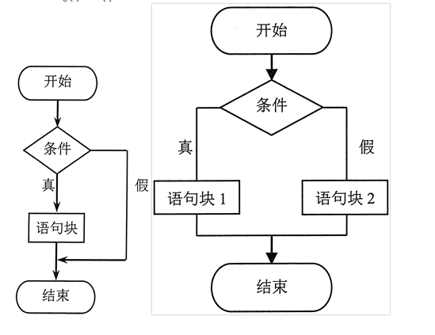


例如，根据年龄显示不同内容，可以用if语句实现如下：
```javascript
var age = 20;
if (age >= 18) { // 如果age >= 18为true，则执行if语句块
    alert('adult');
} else { // 否则执行else语句块
    alert('teenager');
}
```
其中else语句是可选的。如果语句块只包含一条语句，那么可以省略{}：
```javascript
var age = 20;
if (age >= 18)
    alert('adult');
else
    alert('teenager');
```
省略`{}`的危险之处在于，如果后来想添加一些语句，却忘了写`{}`，就改变了`if...else...`的语义，例如：
```javascript
var age = 20;
if (age >= 18)
    alert('adult');
else
    console.log('age < 18'); // 添加一行日志
    alert('teenager'); // <- 这行语句已经不在else的控制范围了
```
上述代码的`else`子句实际上只负责执行`console.log('age < 18')`;，原有的`alert('teenager')`;已经不属于`if...else...`的控制范围了，它每次都会执行。
相反地，有`{}`的语句就不会出错：
```javascript
var age = 20;
if (age >= 18) {
    alert('adult');
} else {
    console.log('age < 18');
    alert('teenager');
}
```
这就是为什么我们建议永远都要写上`{}`。
### 多行条件判断
流程图` if(){}else if(){} else if (){ }else{}`

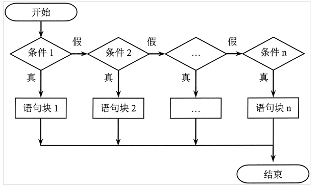

如果还要更细致地判断条件，可以使用多个`if...else...`的组合：
```javascript
var age = 3;
if (age >= 18) {
    alert('adult');
} else if (age >= 6) {
    alert('teenager');
} else {
    alert('kid');
}
```
上述多个`if...else...`的组合实际上相当于两层`if...else...`：
```javascript
var age = 3;
if (age >= 18) {
    alert('adult');
} else {
    if (age >= 6) {
        alert('teenager');
    } else {
        alert('kid');
    }
}
```
但是我们通常把`else if`连写在一起，来增加可读性。这里的`else`略掉了`{}`是没有问题的，因为它只包含一个if语句。注意最后一个单独的`else`不要略掉`{}`。
请注意，`if...else...`语句的执行特点是二选一，在多个`if...else...`语句中，如果某个条件成立，则后续就不再继续判断了。
试解释为什么下面的代码显示的是teenager：
```javascript
'use strict';
var age = 20;
 
teenager
```
由于age的值为20，它实际上同时满足条件`age >= 6`和`age >= 18`，这说明条件判断的顺序非常重要。请修复后让其显示adult。
如果if的条件判断语句结果不是true或false怎么办？例如：
```javascript
var s = '123';
if (s.length) { // 条件计算结果为3
    //
}
```
JavaScript把`null`、`undefined`、`0`、`NaN`和空字符串`''`视为`false`，其他值一概视为`true`，因此上述代码条件判断的结果是`true`。
例子
小明身高1.75，体重80.5kg。请根据BMI公式（体重除以身高的平方）帮小明计算他的BMI指数，并根据BMI指数：
低于18.5：过轻
18.5-25：正常
25-28：过重
28-32：肥胖
高于32：严重肥胖
用`if...else...`判断并显示结果：

```javascript
var height = parseFloat(prompt('请输入身高(m):'));
var weight = parseFloat(prompt('请输入体重(kg):'));
let bmi =weight / height * height;
if(bmi >25 && bmi <28){
    console.log("过重"); 
}else if(bmi >28 && bmi <32){
  console.log("肥胖"); 
}else if(bmi >32){
  console.log("严重肥胖"); 
}else if (bmi <18.5){
  console.log("过轻"); 
}else if(bmi >18.5 && bmi<25 ){
  console.log("正常"); 
}

```
## JavaScript switch case语句详解
switch 语句专门用来设计多分支条件结构。与 `else/if` 多分支结构相比，switch 结构更简洁，执行效率更高。
语法格式
```javascript
switch (expr) {
    case value1 :
        statementList1
        break;
    case value2 :
        statementList2
        break;
    ...
    case valuen :
        statementListn
        break;
    default :
        default statementList
}
```
switch 语句根据表达式 expr 的值，依次与 case 后表达式的值进行比较，如果相等，则执行其后的语句段，只有遇到 break 语句，或者 switch 语句结束才终止；如果不相等，则继续查找下一个 case。switch 语句包含一个可选的 default 语句，如果在前面的 case 中没有找到相等的条件，则执行 default 语句，它与 else 语句类似。

switch 语句流程控制示意如图所示：

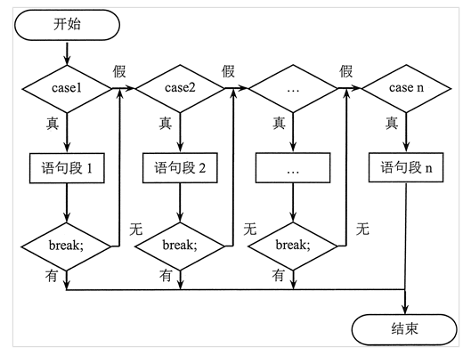

示例1
下面示例使用 switch 语句设计网站登录会员管理模块。
```javascript
var id = 1;
switch (id) {
    case 1 :
        console.log("普通会员");
        break;  //停止执行，跳出switch
    case 2 :
        console.log("VIP会员");
        break;  //停止执行，跳出switch
    case 3 :
        console.log("管理员");
        break;  //停止执行，跳出switch
    default :  //上述条件都不满足时，默认执行的代码
        console.log("游客");
｝
```
当 JavaScript 解析 switch 结构时，先计算条件表达式，然后计算第一个 case 子句后的表达式的值，并使用全等===运算符来检测两值是否相同。由于使用的是全等运算符，因此不会自动转换每个值的类型。
示例2
case 子句可以省略语句，这样当匹配时，不管下一个 case 条件是否满足，都会继续执行下一个 case 子句的语句。下面示例演示了把普通会员和 VIP 会员合并在一起进行检测。
```javascript
var id = 1;
switch (id) {
    case 1 :
    case 2 :
        console.log("VIP会员");
        break;
    case 3 :
        console.log("管理员");
        break;
    default : 
        console.log("游客");
｝
```
在 switch 语句中，case 子句只是指明了执行起点，但是没有指明执行的终点，如果在 case 子句中没有 break 语句，就会发生连续执行的情况，从而忽略后面 case 子句的条件限制，这样就容易破坏 switch 结构的逻辑。如果在函数中使用 switch 语句，可以使用 return 语句终止 switch 语句，防止代码继续执行。
default语句
default 是 switch 子句，可以位于 switch 内任意位置，不会影响多重分支耳朵正常执行。下面结合示例介绍使用 default 语句应该注意 3 个问题。
示例1
如果 default 下面还有 case 子句，应该在 default 后面添加 break 语句，终止 switch 结构，防止程序突破 case 条件的限制继续执行下面 case 子句。
```javascript
var id = 1;
switch (id) {
    default : 
        console.log("游客");
        break;
    case 1 : 
        console.log("普通会员");
        break;
    case 2 :
        console.log("VIP会员");
        break；
    case 3 :
        console.log("管理员");
        break;
}
```
示例2
在下面代码中，JavaScript 先检测 case 表达式的值，由于 case 表达式的值都不匹配，则跳转到 default 子句执行，然后继续执行 case 1 和 case 2 子句。但是，最后不会返回 default 子句再重复执行。
```javascript
var id = 3;
switch (id) {
    default : 
        console.log("游客");
    case 1 :
        console.log("普通会员");
    case 2 :
        console.log("VIP会员");
}
```
示例3
下面示例使用 switch 语句设计一个四则运算函数。在 switch 结构内，先使用 case 枚举 4 种可预知的算术运算，当然还可以继续扩展 case 子句，枚举所有可能的操作，但是无法枚举所有不测，因此最后使用 default 处理意外情况。
```javascript
function oper (a,b,opr) {
    switch (opr) {
        case "+" :  //正常枚举
            return a + b;
        case "-" :  //正常枚举
            return a - b;
        case "*" :  //正常枚举
            return a * b;
        case "/" :  //正常枚举
            return a / b;
        default :  //异常处理
            return "非预期的 opr 值";
    }
}
console.log(oper (2,5,"*"));  //返回10

```
default 语句与 case 语句简单比较如下：
语义不同：default 为默认项，case 为判例。
功能扩展：default 选项是唯一的，不可以扩展。而 case 选项是可扩展的，没有限制。
异常处理：default 与 case 扮演的角色不同，case 用于枚举，default 用于异常处理。
## JavaScript 循环
## while和do while循环语句
在程序开发中，存在大量的重复性操作或计算，这些任务必须依靠循环结构来完成。JavaScript 定义了 `while`、`for` 和` do/while `三种类型循环语句。
###  while语句
while 语句是最基本的循环结构。语法格式如下：
`while (expr)
    statement`

当表达式 expr 的值为真时，将执行 statement 语句，执行结束后，再返回到 expr 表达式继续进行判断。直到表达式的值为假，才跳出循环，执行下面的语句。while 循环语句

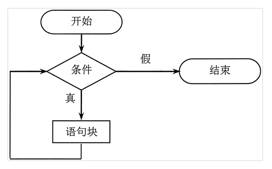

示例
下面使用 while 语句输出 1 到 100 之间的偶数。
```javascript
var n = 1;  //声明并初始化循环变量
while(n <= 100){  //循环条件
    n++;  //递增循环变量
    if (n % 2 == 0) document.write(n + "");   //执行循环操作
}
```
也可以在循环的条件表达式中设计循环变量。代码如下：
```javascript
var n = 1;  //声明并初始化循环变量
while (n++ <= 100){  //循环条件
    if (n % 2 == 0) document.write(n + "");   //执行循环操作
}
```
###  do/while语句
do/while 与 while 循环非常相似，区别在于表达式的值是在每次循环结束时检查，而不是在开始时检查。因此 do/while 循环能够保证至少执行一次循环，而 while 循环就不一定了，如果表达式的值为假，则直接终止循环不进入循环。语法格式如下：
`do
    statement
while(expr)`

`do/while` 循环语句的流程控制示意如图所示。


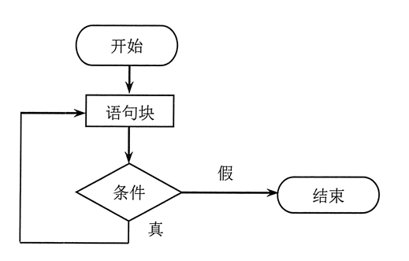

示例
针对上面使用 do/while 结构来设计，则代码如下：
```javascript
var n = 1;  //声明并初始化循环变量
do {  //循环条件
    n++;  //递增循环变量
    if (n % 2 == 0) document.write(n + "");  //执行循环操作
} while (n <= 100);

```
建议在 do/while 结构的尾部使用分号表示语句结束，避免意外情况发生。

### for和for in循环语句
for 语句
for 语句是一种更简洁的循环结构。
for语法格式如下：
`for (expr1;expr2;expr3)
    statement`

表达式 expr1 在循环开始前无条件地求值一次，而表达式 expr2 在每次循环开始前求值。如果表达式 expr2 的值为真，则执行循环语句，否则将终止循环，执行下面代码。表达式 expr3 在每次循环之后被求值。for 循环语句的流程控制示意如图所示。


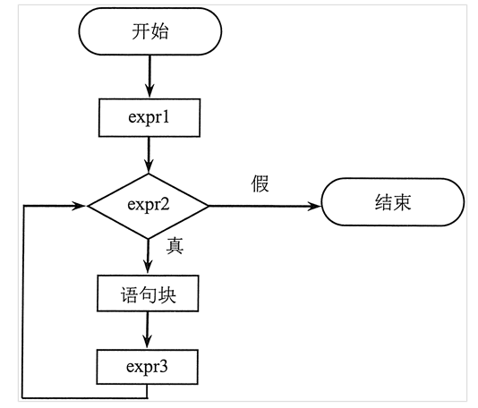


for 语句中 3 个表达式都可以为空，或者包括以逗号分隔的多个子表达式。在表达式 expr2 中，所有用逗号分隔的子表达式都会计算，但只取最后一个子表达式的值进行检测。expr2 为空，会默认其值为真，意味着将无限循环下去。除了 expr2 表达式结束循环外，也可以在循环语句中使用 break 语句结束循环。
示例1
针对上面示例，使用 for 循环来设计。
```javascript
for (var n = 1;n <=100;n++){
    if (n % 2 == 0) document.write(n + "");  //执行循环操作
}
```
示例2
下面示例使用嵌套循环求 1 到 100 之间的所有素数。外层 for 循环遍历每个数字，在内层 for 循环中，使用当前数字与其前面的数字求余。如果有至少一个能够整除，则说明它不是素数；如果没有一个被整除，则说明它是素数，最后输出当前数字。
```javascript
for (var i = 2;i < 100;i++) {
    var b = true;
    for (var j = 2;j < i;j++) {
        if (i % j == 0) b = false;  //判断i能否被j整除，能被整除则说明不是素数，修改布尔值为false
    }
    if (b) document.write(i + "");  //打印素数
}
```
### for/in语句
for/in 语句是 for 语句的一种特殊形式。语法格式如下：
`for ( [var] variable in <object | array)
    statement`
variable 表示一个变量，可以在其前面附加 var 语句，用来直接声明变量名。in 后面是一个对象或数组类型的表达式。在遍历对象或数组过程中，把或取的每一个值赋值给 variable。

然后执行 statement 语句，其中可以访问 variable 来读取每个对象属性或数组元素的值。执行完毕，返回继续枚举下一个元素，以此类推知道所有元素都被枚举为止。

对于数组来说，值是数组元素的下标；对于对象来说，值是对象的属性名或方法名。
示例1
下面示例使用 for/in 语句遍历数组，并枚举每个元素及其值。
```javascript
var a = [1,true,"0",[false],{}];  //声明并初始化数组变量 
for (var n in a) {  //遍历数组
    document.write("a["+n+"] = " + a[n] + "<br>");  //显示每个元素及其值
}
```

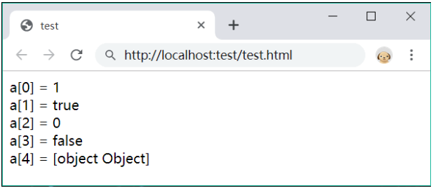


使用 while 或 for 语句可以实现相同的遍历操作。例如：
```javascript
var a = [1,true,"0",[false],{}];  //声明并初始化数组变量
for (var n = 0;n < a.length;n++) {  //遍历数组
    document.write("a["+n+"] = " + a[n] + "<br>");  //显示每个元素的值
```
示例2
在下面示例中，定义一个对象 o，设置 3 个属性。然后使用 for/in 迭代对象属性，把每个属性值寄存到一个数组中。
```javascript
var o = {x : 1,y : true,z : "true"},  //定义包含三个属性的对象
    a = [],  //临时寄存数组
    n = 0;  //定义循环变量，初始化为0
for (a[n++] in o);  //遍历对象o，然后把所有属性都赋值到数组中
```
其中 for (a[n++] in o); 语句实际上是一个空循环结构，分号为一个空语句。
示例3
for/in 适合枚举不确定长度的对象。在下面示例中，使用 for/in 读取客户端 document 对象的所有可读属性。
```javascript
for (var i = 0 in document) {
    document.write("document." + i + "=" +document[i] +"<br />");

```
如果对象属性被设置为只读、存档或不可枚举等限制特性，那么使用 for/in 语句就无法枚举了。枚举没有固定的顺序，因此在遍历结果中会看到不同的排列顺序。
示例4
for/in 能够枚举可枚举的属性，包括原生属性和继承属性。
```javascript
Array.prototype.x = "x";  //自定义数组对象的继承属性
var a = [1,2,3];  //定义数组对象，并赋值
a.y = "y"  //定义数组对象的额外属性
for (var i in a) {  //遍历数组对象a
    document.write(i + ": " + a[i] + "<br />");
}
```

在上面示例中，共获取 5 个元素，其中包括 3 个原生元素，一个继承的属性 x 和一个额外的属性 y，结果如图所示。


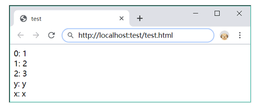


如果仅想获取数组 a 的元素值，只能使用 for 循环结构。
```javascript
for (var i = 0;i < a.length;i++) 
    document.write(i + ": " + a[i] + "<br />");

```
for/in 语句适合枚举长度不确定的对象属性。 
## break和continue语句详解
JavaScript break 和 continue 关键字都可以用在 for 和 while 循环结构中，表示跳出循环；break 关键字还可以用在 switch case 选择结构中，表示结束当前的选择语句。

break 和 continue 关键字可以在中途改变循环结构和分支结构的流程方向。
### break语句
break 语句能够结束当前 for、for/in、while、do/while 或者 switch语句的执行；同时 break 也可以接受一个可选的标签名，来决定跳出的结构语句。
`break label;`
如果没有设置标签名，则表示跳出当前最内层结构。

break 语句流程控制示意如图所示。


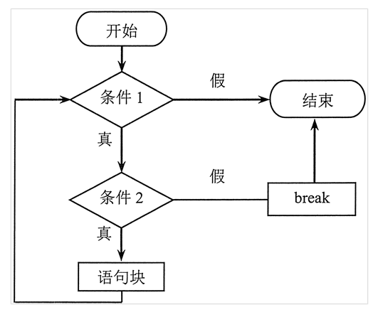
示例1
下面示例设计在客户端查找 document 的 bgColor 属性。如果完全遍历 document 对象，会浪费时间，因此设计一个条件判断所有枚举的属性名是否等于“bgColor”，如果相等，则使用 break 语句跳出循环。
```javascript
for (i in document) {
    if (i.toString() == "bgColor") {
        document.write("document." +  i + "=" + document[i] + "<br />");
        break;
    }
}
```
在上面代码中，break 语句并非跳出当前的 if 结构体，而是跳出当前最内层的循环结构。
示例2
在下面嵌套结构中，break 语句并没有跳出 for/in 结构，仅仅退出 switch 结构。
```javascript
for (i in document) {
    switch (i.toString()) {
        case "bgColor" :
            document.write("document." + i + "=" + document[i] + "<br />");
            break;
        default :
            document.write("没有找到");
    }
}   
``` 
示例3
针对示例 2，可以为 for/in 语句定义一个标签 outloop，然后在最内层的 break 语句中设置该标签名，这样当条件满足时就可以跳出最外层的 for/in 循环结构。
```javascript
outloop : for (i in document) {
    switch (i.toString()) {
        case "bgColor" :
            document.write("document." + i + "=" + document[i] + "<br />");
            break outloop;
        default : 
            document.write("没有找到");
    }
}

```
break 语句和 label 语句配合使用仅限于嵌套的循环结构，或者嵌套的 switch 结构，且需要退出非当前层结构。break 与标签名之间不能包含换行符，否则 JavaScript 会解析为两个句子。
### continue语句
continue 语句用在循环结构内，用于跳过本次循环中剩余的代码，并在表达式的值为真时，继续执行下一次循环。它可以接受一个可选的标签名，开决定跳出的循环语句。语法格式如下：
`continue label;`

continue语句流程控制示意如图所示。


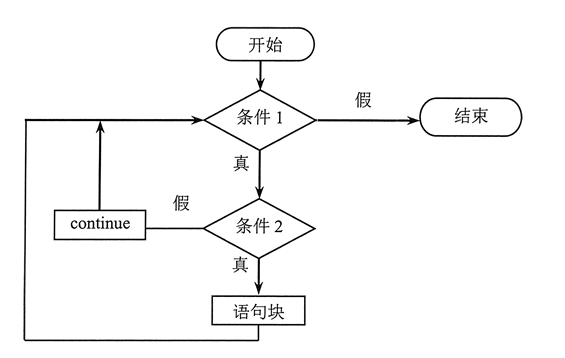

示例
下面示例使用 continue 语句过滤数组中的字符串值。
```javascript
var a = [1,"hi",2,"good","4", ,"",3,4],  //定义并初始化数组a
    b = [], j = 0;  //定义数组b和变量j
for (var i in a) {  //遍历数组a
    if (typeof a[i] == "string")  //如果为字符串，则返回继续下一次循环
        continue;
    b[j ++] = a[i];  //把数字寄存到数组b
}

document.write(b);  //返回1,2,3,4
```
continue 语句只能用在 while、do/while、for、for/in 语句中，对于不同的循环结构其执行顺序略有不同。
对于 for 语句来说将会返回顶部计算第 3 个表达式，然后再计算第 2 个表达式，如果第 2 个表达式为 true，则继续执行下一次循环。
对于 for/in 语句来说，将会以下一个赋给变量的属性名开始，继续执行下一次循环。
对于 while 语句来说，将会返回顶部计算表达式，如果表达式为 true，则继续执行下一次循环。
对于 do/while 语句来说，会跳转到底部计算表达式，如果表达式为 true，则会返回顶部开始下一次循环。

## JavaScript函数
JavaScript 函数是被设计为执行特定任务的代码块。
JavaScript 函数会在某代码调用它时被执行。
### 函数语法
JavaScript 函数通过 function 关键词进行定义，其后是函数名和括号 ()。
函数名可包含字母、数字、下划线和美元符号（规则与变量名相同）。
圆括号可包括由逗号分隔的参数：
(参数 1, 参数 2, ...)
由函数执行的代码被放置在花括号中：{}
```javascript
function name(参数 1, 参数 2, 参数 3) {
    要执行的代码
}
```
函数参数（Function parameters）是在函数定义中所列的名称。
函数参数（Function arguments）是当调用函数时由函数接收的真实的值。
在函数中，参数是局部变量。
在其他编程语言中，函数近似程序（Procedure）或子程序（Subroutine）。
### 函数调用
调用函数时，按顺序传入参数即可：
```javascript
abs(10); // 返回10
abs(-9); // 返回9
```
由于JavaScript允许传入任意个参数而不影响调用，因此传入的参数比定义的参数多也没有问题，虽然函数内部并不需要这些参数：
```javascript
abs(10, 'blablabla'); // 返回10
abs(-9, 'haha', 'hehe', null); // 返回9
```
传入的参数比定义的少也没有问题：
```javascript
abs(); // 返回NaN
```
此时abs(x)函数的参数x将收到undefined，计算结果为NaN。
要避免收到undefined，可以对参数进行检查：
```javascript
function abs(x) {
    if (typeof x !== 'number') {
        throw 'Not a number';
    }
    if (x >= 0) {
        return x;
    } else {
        return -x;
    }
}
```
#### 函数作为方法调用
在 JavaScript 中你可以将函数定义为对象的方法。
以下实例创建了一个对象 (myObject), 对象有两个属性 (firstName 和 lastName), 及一个方法 (fullName):
实例
```javascript
var myObject = {
    firstName:"John",
    lastName: "Doe",
    fullName: function () {
        return this.firstName + " " + this.lastName;
    }
}
myObject.fullName();         // 返回 "John Doe"
```
#### 使用构造函数调用函数
如果函数调用前使用了 new 关键字, 则是调用了构造函数。
这看起来就像创建了新的函数，但实际上 JavaScript 函数是重新创建的对象：
实例
```javascript
// 构造函数:
function myFunction(arg1, arg2) {
    this.firstName = arg1;
    this.lastName  = arg2;
}
 
// This    creates a new object
var x = new myFunction("John","Doe");
x.firstName;                             // 返回 "John"
```
## JavaScript String高阶用法
### 获取字符串长度（length属性）
在 JavaScript 中，使用字符串的 length 属性可以读取字符串的长度。长度以字符为单位，该属性为只读属性。

下面代码使用字符串的 length 属性获取字符串的长度。
```javascript
var s = "String 类型长度";  //定义字符串
console.log(s.length);  //返回10个字符
```

JavaScript 支持的字符包括单字节、双字节两种类型，为了精确计算字符串的字节长度，可以采用下面方法来计算。
字符串拼接/连接（3种方式）
使用加号运算符
连接字符串最简便的方法是使用加号运算符。
示例
下面代码使用加号运算符连接两个字符串。
```javascript
var s1 = "abc" , s2 = "def";
console.log(s1 + s2);  //返回字符串“abcdef”
```
使用concat()方法
使用字符串 concat() 方法可以把多个参数添加到指定字符串的尾部。该方法的参数类型和个数没有限制，它会把所有参数都转换为字符串，然后按顺序连接到当前字符串的尾部最后返回连接后的字符串。
示例
下面代码使用 concat() 方法把多个字符串连接在一起。
```javascript
var s1 = "abc";
var s2 = s1.concat("d" , "e" , "f");  //调用concat()连接字符串
console.log(s2);  //返回字符串“abcdef”
```
concat() 方法不会修改原字符串的值，与数组的 concat() 方法操作相似。
使用join()方法
在特定的操作环境中，也可以借助数组的 join() 方法来连接字符串，如 HTML 字符串输出等。
示例
下面代码演示了如何借助数组的方法来连接字符串。
```javascript
var s = "JavaScript" , a = [];
for (var i = 0; i < 1000; i ++) {
    a.push(s);
var str = a.join("");
a = null;
document.write(str);
```
在上面示例中，使用 for 语句把 1000 个 “JavaScript”字符串装入数组，然后调用数组的 join() 方法把元素的值连接成一个长长的字符串。使用完毕应该立即清除数组，避免占用系统资源。
字符串查找（6种方法）

| 字符串方法         | 说明                |
|---------------|-------------------|
| charAt()      | 返回字符串中的第 n 个字符    |
| charCodeAt()  | 返回字符串中的第 n 个字符的代码 |
| indexOf()     | 检索字符串             |
| lastIndexOf() | 从后向前检索一个字符串       |
| match()       | 找到一个或多个正则表达式的匹配   |
| search()      | 检索与正则表达式相匹配的子串    |

查找字符
使用字符串的 charAt() 和 chatCodeAt() 方法，可以根据参数（非负整数的下标值）返回指定位置的字符或字符编码。

对于 charAt() 方法来说，如果参数不在 0 和字符串的 length-1 之间，则返回空字符串；而对于 charCodeAt() 方法来说，则返回 NaN，而不是 0 或空字符串。
示例
下面示例为 String 类型扩展一个原型方法，用来把字符串转换为数组。在函数中使用 charAt() 方法读取字符串中每个字符，然后装入一个数组并返回。
```javascript
String.prototype.toArray = function () {  //把字符串转换为数组
    var 1 = this.length; a = [];  //获取当前字符串长度，并定义空数组
    if (1) {  //如果存在则执行循环操作，预防空字符串
        for (var i = 0; i < 1; i ++) {  //遍历字符串，枚举每个字符
            a.push(this.charAt(i));  //把每个字符按顺序装入数组
        }
    }
    return a;  //返回数组
}
```
应用原型方法：
```javascript
var s = "abcdefghijklmn".toArray();  //把字符串转换为数组
for (var i in s) {  //遍历返回数组，显示每个字符
    console.log(s[i]);
}
```
### 查找字符串
使用字符串的 indexOf() 和 lastIndexOf() 方法，可以根据参数字符串，返回指定子字符串的下标位置。这两个方法都有两个参数，说明如下。
第一个参数为一个子字符串，指定要查找的目标。
第二个参数为一个整数，指定查找的起始位置，取值范围是 0~length-1。
对于第二个参数来说，需要注意一下几个特殊情况。
如果值为负数，则视为 0，相当于从第一个字符开始查找。
如果省略了这个参数，也将从字符串的第一个字符开始查找。
如果值大于等于 length 属性值，则视为当前字符串中没有指定的子字符串，返回 -1。
示例1
下面代码查询字符串中首个字母 a 的下标位置。
```javascript
var s = "JavaScript";
var i = s.indexOf("a");
console.log(i);  //返回值为1，即字符串中第二个字符
```
indexOf() 方法只返回查找到的第一个子字符串的起始下标值，如果没有找到则返回 -1。
示例2
下面代码查询 URL 字符串中首个字母 n 的下标位置。
```javascript
var s = "c.biancheng.net";
var a = s.indexOf("biancheng");  //返回值为3，即第一个字符n的下标位置
```
如果要查找下一个子字符串，则可以使用第二个参数来限定范围。
示例3
下面代码分别查询 URL 字符串中两个点号字符下标的位置。
```javascript
var s = "c.biancheng.net";
var b = s.indexOf(".");  //返回值为1，即第一个字符.的下标位置
var e = s.indexOf(".", b + 1);  //返回值为11，即第二个字符.的下标位置
```
indexOf() 方法是按照从左到右的顺序进行查找的。如果希望从右到左来进行查找，则可以使用 lastIndexOf() 方法来查找。 
示例4
下面代码按从右到左的顺序查询 URL 字符串中最后一个点号字符的下标位置。
var s = "c.biancheng.net";
var n = s.lastIndexOf(".");  //返回值为11，即第二个字符.的下标位置
lastIndexOf() 方法的查找顺序是从右到左但是其参数和返回值都是根据字符串的下标按照从左到右的顺序来计算的，即字符串第一个字符下标值始终都是 0，而最后一个字符的下标值始终都是 length-1。
示例6
lastIndexOf() 方法的第二个参数指定开始查找的下标位置，但是，将从该点开始向左查找，而不是向右查找。
```javascript
var s = "http://c.biancheng.net";
var n = s.lastIndexOf(".", 11);  //返回值是8，而不是18
```
其中第二个参数值 11 表示字符 a （第一个）的下标位置，然后从左侧开始向左查找，所以就返回第一个点号的位置。如果找到，则返回第一次找到的字符串的起始下标值。
```javascript
var s = "http://c.biancheng.net";
var n = s.lastIndexOf("c");  //返回值为7
```
如果没有设置第二个参数，或者为参数负值，或者参数大于等于 length，则将遵循 indexOf() 方法进行操作。
### 搜索字符串
search() 方法和 indexOf() 的功能是相同的，查找指定字符串第一次出现的位置。但是 search() 方法仅有一个参数，定义匹配模式。该方法没有 lastIndexOf() 的反向检索功能，也不支持全局模式。
示例
下面代码使用 search() 方法匹配斜杠字符在 URL 字符串的下标位置。
```javascript
var s = "c.biancheng.net";
n="s.search("//");"
```
search() 方法参数定义：
search() 方法的参数为正则表达式（RegExp 对象）。如果参数不是 RegExp 对象，则 JavaScript 会使用 RegExp() 函数把它转换为 RegExp 对象。
search() 方法遵循从左到右的查找顺序，并返回第一个匹配的子字符串的起始下标位置值。如果没有找到，则返回 -1。
search() 方法无法查找指定的范围，始终返回的第一个匹配子字符串的下标值，没有 indexOf() 方法灵活。
### 匹配字符串
match() 方法能够找出所有匹配的子字符串，并以数组的形式返回。
示例1
下面代码使用 match() 方法找到字符串中所有字母 c，并返回它们。
```javascript
var s = "http://c.biancheng.net";
var a = s.match(/c/g);  //全局匹配所有字符c
console.log(a);  //返回数组[c,c]。
```
match() 方法返回的是一个数组，如果不是全局匹配，那么 match() 方法只能执行一次匹配。例如，下面匹配模式没有 `g` 的修饰符，只能够执行一次匹配，返回仅有一个元素 c 的数组。
```javascript
var a = s.match(/c/);  //返回数组[h]
```
如果没有找到匹配字符，则返回 null，而不是空数组。

当不执行全局匹配时，如果匹配模式包含子表达式，则返回子表达式匹配的信息。
示例2
下面代码使用 match() 方法匹配 URL 字符串中所有点号字符。
```javascript
var s = "http://c.biancheng.net";
var a = s.match(/(\.).*(\.).*(\.)/ );  //执行一次匹配检索
console.log(a.length);
console.log(a[0]);
console.log(a[1]);
console.log(a[2]);
console.log(a[3]);
```
在这个正则表达式 “`/(\.).*(\.).*(\.)/`”中，左右两个斜杠是匹配模式分隔符，JavaScript 解释器能够根据这两个分隔符来识别正则表达式。在正则表达式中小括号表示子表达式，每个子表达式匹配的文本信息会被独立存储。点号需要转义，因为在正则表达式中它表示匹配任意字符，星号表示前面的匹配字符可以匹配任意多次。

在上面示例中，数组 a 包含 4 个元素，其中第一个元素存放的是匹配文本，其余元素存放的是每个正则表达式的子表达式匹配的文本。

另外，返回的数组还包含两个对象属性，其中 index 属性记录匹配文本的起始位置，input 属性记录的是被操作的字符串。
```javascript
console.log(a.index);
console.log(a.input);
```
在全局匹配模式下，match() 将执行全局匹配。此时返回的数组元素存放的是字符串中所有匹配文本，该数组没有 index 属性和 input 属性；同时不再提供子表达式匹配的文本信息，也不提示每个匹配子串的位置。如果需要这些信息，可以使用 RegExp.exec() 方法。
### 截取字符串（3种方法）
String 定义了 3 个字符串截取的原型方法，说明如表所示。

| 字符串方法       | 说明         |
|-------------|------------|
| slice()     | 抽取一个子串     |
| substr()    | 抽取一个子串     |
| substring() | 返回字符串的一个子串 |

#### 截取指定长度字符串
substr() 方法能够根据指定长度来截取子字符串。它包含两个参数，第一个参数表示准备截取的子字符串起始下标，第二个参数表示截取的长度。
示例
在下面示例中使用 lastIndexOf() 获取字符串的最后一个点号的下标位置，然后从其后的位置开始截取 4 个字符。
```javascript
var s = "http://c.biancheng.net/index.html";
var b = s.substr(s.lastIndexOf(".") + 1,4);  //截取最后一个点号后4个字符
console.log(b);  //返回子字符串“html”
```
如果省略第二个参数，则表示截取从起始位置开始到结尾的所有字符。考虑到扩展名的长度不固定，省略第二个参数会更灵活。
```javascript
var b = s.substr(s.lastIndexOf(".") + 1);
```
如果第一个参数为负值，则表示从字符串的尾部开始计算下标位置，即 -1表示最后一个字符，-2 表示倒数第二个字符，以此类推。这对于左侧字符长度不固定时非常有用。

ECMAScript 不再建议使用该方法，推荐使用 slice() 和 substring() 方法。
截取起止下标位置字符串
slice() 和 substring() 方法都是根据指定的起止下标位置来截取字符串，它们都可以包含两个参数，第一个参数表示起始下标，第二个参数表示结束下标。
示例1
下面代码使用 substring() 方法截取 URL 字符串中网站主机名信息。
```javascript
var s  = "http://c.biancheng.net/index.html";
var a = s.indexOf("c");
var b = s.indexOf("/", a);
var c = s.substring(a,b);
var d = s.slice(a,b);
```
截取的字符串包含第一个参数所指定的字符。结束点不被截取，即不包含在字符串。
第二个参数如果省略，表示截取到结尾的所有字符串。

如果第一个参数值比第二个参数值大，substring() 方法能够在执行截取之前先交换两个参数，而对于 slice() 方法来说，则被无视为无效，并返回空字符串。
示例2
下面代码比较 substring() 方法和 slice() 方法用法不同。
```javascript
var s = "http://c.biancheng.net/index.html";
var a = s.indexOf("c");
var b = s.indexOf("/", a);
var c = s.substring(b, a);
var d = s.slice(b, a);
```
当起始点和结束点的值大小无法确定时，使用 substring() 方法更合适。
如果参数值为负值，slice() 方法能够把负号解释为从右侧开始定位，这与 Array 的 slice() 方法相同。但是 substring() 方法会视其为无效，并返回空字符串。
示例3
下面代码比较 substring() 方法和 slice() 方法的用法不同。

```javascript
var s = "http://c.biancheng.net/index.html";
var a = s.indexOf("c");
var b = s.indexOf("/", a);
var 1 = s.length;
var c = s.substring(a-1, b-1);
var d = s.slice(a-1, b-1);
```

### 字符串替换（使用replace()方法）
replace() 方法的第二个参数可以使用函数，当匹配时会调用该函数，函数的返回值将作为替换文本使用，同时函数可以接收以$为前缀的特殊字符，用来引用匹配文本的相关信息。

| 约定字符串          | 说明                         |
|----------------|----------------------------|
| $1、$2、...、$99  | 与正则表达式中的第 1~99 个子表达式相匹配的文本 |
| $&（美元符号+连字符）   | 与正则表达式相匹配的子字符串             |
| $’（美元符号+切换技能键） | 位于匹配子字符串左侧的文本              |
| $'（美元符号+单引号）   | 位于匹配字符串右侧的文本               |
| $$             | 表示 $ 字符串                   |

示例1
下面代码把字符串中每个单词转换为首字母大写形式显示。
```javascript
var s = 'javascript is script , is not java.';  //定义字符串
//定义替换文本函数，参数为第一个子表达式匹配文本
var f = function ($1) {
    //把匹配文本的首字母转换为大写
    return $1.substring(0,1).toUpperCase() + $1.substring(1).toLowerCase();}
var a = s.replace(/(\b\w+\b)/g, f);  //匹配文本并进行替换
console.log(a);  //返回字符串“JavaScript Is Script ， Is Not Java.”
```
在上面示例中替换函数的参数为特殊字符“$1”，它表示正则表达式 /(\b\w+\b)/ 中小括号匹配的文本，然后在函数结构内对这个匹配文本进行处理，截取其首字母并转换为大写形式，余下字符全为小写，然后返回新处理的字符串。replace() 方法是在原文本中使用这个返回的新字符串替换掉每次匹配的子字符串。
示例2
对于上面的示例还可以进一步延伸，使用小括号来获取更多匹配信息。例如，直接利用小括号传递单词的首字母，然后进行大小写转换处理，处理结果都是一样的。
```javascript
var s = 'javascript is script , is not java.';  //定义字符串
var f = function ($1,$2,$3) {  //定义替换文本函数，请注意参数的变化
    return $2.toUpperCase() + $3;
}
var a = s.replace(/(\b\w+\b)/g, f);
console.log(a);
```
在函数 f() 中，第一个参数表示每次匹配的文本，第二个参数表示第一个小括号的子表达式所匹配的文本，即单词的首字母，第二个参数表示第二个小括号的子表达式所匹配的文本。

replace() 方法的第二个参数是一个函数，replace() 方法会给它传递多个实参，这些实参都包含一定的意思，具体说明如下。
第一个参数表示与匹配模式相匹配的文本，如上面示例中每次匹配的单词字符串。
其后的参数是与匹配模式中子表达式相匹配的字符串，参数个数不限，根据子表达式数而定。
后面的参数是一个整数，表示匹配文本在字符串中的下标位置。
最后一个参数表示字符串自身。
示例3
把上面示例中替换文本函数改为如下形式。
```javascript
var f = function() {
    return arguments[1].toUpperCase() + arguments[2];
}
```
也就是说，如果不为函数传递形参，直接调用函数的 arguments 属性同样能够读取到正则表达式中相关匹配文本的信息。其中：
arguments[0]：表示每次匹配的文本，即单词。
arguments[1]：表示第一个子表达式匹配的文本，即单词的首个字母。
arguments[2]：表示第二个子表达式匹配的文本，即单词的余下字母。
arguments[3]：表示匹配文本的下标位置，如第一个匹配单词“javascript”的下标位置就是0，以此类推。
arguments[4]：表示要执行匹配的字符串，这里表示“javascript is script , is not java.”。
示例4
下面代码利用函数的 arguments 对象主动获取 replace() 方法的第一个参数中正则表达式所匹配的详细信息。
```javascript
var s = 'javascript is script , is not java.';  //定义字符串
var f = function () {
    for (var i = 0; i < arguments.length; i++) {
        console.log("第" + (i + 1) + "个参数的值："+ arguments[i]);
    }
    console.log("-----------------------------");
}
var a = s.replace(/(\b\w+\b)/g, f);
```
在函数结构体中，使用 for 循环结构遍历 arguments 属性时，发现每次匹配单词时，都会弹出 5 次提示信息，分别显示上面所列的匹配文本信息。其中，arguments[1]、arguments[2] 会根据每次匹配文本的不同，分别显示当前匹配文本中子表达式匹配的信息，arguments[3] 显示当前匹配单词的下标位置。而 arguments[0] 总是显示每次匹配的单词，arguments[4] 总是显示被操作的字符串。
示例5
下面代码设计从服务器端读取学生成绩（JSON格式），然后使用 for 语句把所有数据转换为字符串。再来练习自动提取字符串中的分数，并汇总、算出平均分。最后，利用 replace() 方法提取每个分值，与平均分进行比较以决定替换文本的具体信息。
```javascript
var scope = {
    "张三" : 56,
    "李四" : 76,
    "王五" : 87,
    "赵六" : 98
}, _scope = "";
for (var id in scope) {  //把JSON数据转换为字符串
    _scope += id + scope[id];
}
var a = _scope.match(/\d+/g), sum = 0;  //匹配出所有分值，输出位数组
for (var i = 0; i <a.length; i++) {  //遍历数组，求总分
    sum += parseFloat(a[i]);  //把元素值转换为数值后递加
};
var avg = sum / a.length;  //求平均分
function f() {
    var n = parseFloat(arguments[1]);  //把匹配的分数转换为数值，第一个子表达式
    return "：" + n + "分" + "(" + ((n > avg) ? ("超出平均分" + (n - avg)) :
    ("低于平均分" + (avg - n))) + "分)<br>";  //设计替换文本的内容
}
var s1 = _scope.replace(/(\b\w+\b)/g, f);  //执行匹配、替换操作
document.write(s1);
```
运行结果如下：

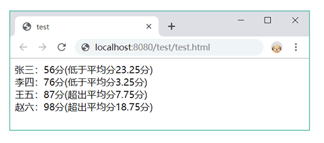

遍历数组时不能使用 for/in 语句因为数组中还存储有其他相关的匹配文本信息。应该使用 for 结构来实现。由于截取的数字都是字符串类型，应该把它们都转换为数值类型，再把数字连接在一起，或者按字母顺序进行比较等。 
字符串大写和小写之间的转换（4种方法）
String 定义了 4 个原型方法实现字符串大小写转换操作，说明如表所示。

| 字符串方法               | 说明        |
|---------------------|-----------|
| toLocaleLowerCase() | 把字符串转换成小写 |
| toLocaleUpperCase() | 将字符串转换成大写 |
| toLowerCase()       | 将字符串转换成小写 |
| toUpperCase()       | 将字符串转换成大写 |


下面代码把字符串全部转换成大写形式。
```javascript
var s = "JavaScript";
console.log(s.toUpperCase());  //返回字符串“JAVASCRIPT”
```

toLocaleLowerCase() 和 toLocaleUpperCase() 是两个本地化原型方法。它们能够按照本地方式转换大小写字母，由于只有几种语言（如土耳其语）具有地方特有的大小写映射，所以通常与 toLowerCase() 和 toUpperCase() 方法的返回值一样。
### 字符串比较大小
JavaScript 能够根据字符的 Unicode 编码大小逐位比较字符串大小。
直接比较字符串大小
在 JavaScript 中，可以直接使用 >、<、 = =  、=== 来比较两个字符串的大小，就像比较两个数字一样。

例如，小写字母 a 的编码为 97，大写字母 A 的编码为 65，则字符“a”就大于“A”。
```javascript
console.log("a" > "A");  //返回true
```

再如，“中国人”的 Unicode 编码是 \u4e2d\u56fd\u4eba，“编程语言”的编码是 \u7f16\u7a0b\u8bed\u8a00，因为 \u4e2d 小于 \u7f16，所以“中国人”就小于“编程语言”。
console.log("中国人"<"编程语言");  //返回true
使用 localeCompare() 方法
使用字符串的 localeCompare() 方法，可以根据本地约定顺序来比较两个字符串的大小。ECMAScript 标准没有规定如何进行本地化比较操作。

localeCompare() 方法包含一个参数，指定要比较的目标字符串。如果当前字符串小于参数字符串，则返回小于 0 的数；如果大于参数字符串，则返回大于 0 的数；如果两个字符串相等，或与本地排序约定没有区别，则该方法返回 0。

【实例】下面代码把字符串“JavaScript”转换为数组，然后按本地字符顺序进行排序。

```javascript
var s = "JavaScript";  //定义字符串直接量
var a = s.split("");  //把字符串转换为数组
var s1 = a.sort(function (a, b)) {  //对数组进行排序
    return a.localeCompare(b);  //将根据前后字符在本地的约定进行排序
});
a = s1.join("");  //然后再把数组还原为字符串
console.log(a);  //返回字符串“aaciJprStv”
```

### 字符串和数组之间的转换
使用字符串的 split() 方法可以根据指定的分隔符把字符串切分为数组。

如果使用数组的 join() 方法，可以把数组元素连接为字符串。
示例1
如果参数为空字符串，则 split() 方法能够按单个字符进行切分，然后返回与字符串等长的数组。
```javascript
var s = "JavaScript";
var a = s.split("");  //按字符空隙分隔
console.log(s.length);  //返回值为10
console.log(a.length);  //返回值为10
```
示例2
如果参数为空，则 split() 方法能够把整个字符串作为一个元素的数组返回。
```javascript
var s = "JavaScript";
var a = s.split("");  //空分隔
console.log(a.constructor == Array);  //返回true，说明Array是实例
console.log(a.length);  //返回值为1，说明没有对字符串进行分割
```
示例3
如果参数为正则表达式，则 split() 方法能够以匹配文本作为分隔符进行切分。
```javascript
var s = "a2b3c4d5e678f12g";
var a = s.split(/\d+/);  //把以匹配的数字为分隔符来切分字符串
console.log(a);  //返回数组[a,b,c,d,e,f,g]
console.log(a.length);  //返回数组长度为7
```
示例4
如果正则表达式匹配的文本位于字符串的边沿，则 split() 方法也执行切分操作，且为数组添加一个空数组。
```javascript
var s = "122a2b3c4d5e678f12g";
var a = s.aplit(/\d+/);
console.log(a);
console.log(a.length);
```
如果在字符串中指定的分隔符没有找到，则返回一个包含整个字符串的数组。
示例5
split() 方法支持第二个参数，该参数是一个可选的整数，用来指定返回数组的最大长度。如果设置了该参数，则返回的数组长度不会大于这个参数指定的值；如果没有设置该参数，那么整个字符串都被分割，不会考虑数组长度。
```javascript
var s = "JavaScript";
var a = s.split("", 4);  //按顺序从左到右，仅分切4个元素的数组
console.log(a);  //返回数组[J,a,v,a]
console.log(a.length);  //返回值为4
```
示例6
如果想使返回的数组包括分隔符或分隔符的一个或多个部分，可以使用带子表达式的正则表达式来实现。

```javascript
var s = "aa2bb3cc4dd5e678f12g";
var a = s.split(/(\d)/);  //使用小括号包含数字分隔符
console.log(a);  //返回数组[aa,2,bb,3,cc,4,dd,5,e,6,,7,,8,f,1,,2,g]
```
### 去除字符串前后空格
ECMAScript 5 为 String 新增了 trim() 原型方法，用以从字符串中去除前导空字符、尾随空字符和行终止符。该方法在表达处理中非常实用。

空字符包括：空格、制表符、换页符、回车符和换行符。
示例
下面代码使用 trim() 方法快速清除掉字符串首尾空格。
```javascript
var s = "    abc def   \r\n  ";
s = s.trim();
console.log("[" + s + "]");  //[abc def]
console.log(s.length);  //7
```
### 字符串分割
字符串分割，即将一个字符串分割为多个字符串，JavaScript中给我们提供了一个非常方便的函数split()，如：
示例l
```javascript
var myStr = "I,Love,You,Do,you,love,me";
var substrArray = myStr .split(",");
// ["I", "Love", "You", "Do", "you", "love", "me"];
var arrayLimited = myStr .split(",", 3);
// ["I", "Love", "You"];split()的第二个参数，表示返回的字符串数组的最大长度。
```
## 三元运算符
三元运算符又称为三目运算符，指的是根据不同的条件，执行不同的操作/返回不同的值。
语法结构为：条件 ？ 操作1 ： 操作2。 如果条件为真，执行操作1，否则执行操作2。
示例一
```javascript
var even = (n % 2 === 0) ? true : false;
```
上面代码中，如果n可以被2整除，则even等于true，否则等于false。它等同于下面的形式。 
示例二
```javascript
var msg = '数字' + n + '是' + (n % 2 === 0 ? '偶数' : '奇数');
```
上面代码利用三元运算符，在字符串之中插入不同的值。
示例
```javascript
(条件) ? 表达式1 : 表达式2 ? 表达式3 : 表达式4;
// 如果条件为真执行表达式1，为假执行表达式2，如果表达式2为真，则执行表达式3，为假则执行表达式4
 
```


我是Mr-老鬼、QQ1156346325 。交流QQ群：620028786,647082990
**------------------------------------------------版权声明------------------------------------------------------**
 本文版权所有~Mr-老鬼 ~转载请注明原文地址
免责声明：本文所有的教程仅限交流学习使用不得用于违法用途，造成的法律后果本人不承担责任。