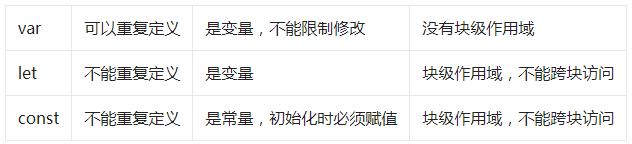

<!-- 来源：https://www.laoguicom.top/doc/173/ · 抓取状态：ok -->

# JavaScript 常见问题集锦
------------

#  var，let 和 const 

1. const定义的变量不可以修改，而且必须初始化。
```javascript
const b = 2;//正确
// const b;//错误，必须初始化 
console.log('函数外const定义b：' + b);//有输出值
// b = 5;
// console.log('函数外修改const定义b：' + b);//无法输出
```

2. var定义的变量可以修改，如果不初始化会输出undefined，不会报错。
```javascript
var a = 1;
// var a;//不会报错
console.log('函数外var定义a：' + a);//可以输出a=1
function change(){
a = 4;
console.log('函数内var定义a：' + a);//可以输出a=4
} 
change();
console.log('函数调用后var定义a为函数内部修改值：' + a);//可以输出a=4
```

3. let是块级作用域，函数内部使用let定义后，对函数外部无影响。
```javascript
let c = 3;
console.log('函数外let定义c：' + c);//输出c=3
function change(){
let c = 6;
console.log('函数内let定义c：' + c);//输出c=6
} 
change();
console.log('函数调用后let定义c不受函数内部定义影响：' + c);//输出c=3
```

# var 与let和const区别



##  const定义的对象属性是否可以改变?

实例：修改对象的属性值。

```javascript
const per = { 
  name:'倩倩' 
} 
per.name = "我是嘻哈" 
console.log("per.name",per.name) //打印出我是嘻哈 
```
通过上个实例，我们发现对象的属性是可以修改的，这是什么原因呢?

对象是引用类型的，per中保存的仅是对象的指针，意味着指针不会发生改变，修改对象的属性不会改变对象的指针，所以是允许修改的。

## 赋值：新增解构赋值，就是对数据拆解并赋值。
解构赋值的两个规则：
- 左右两边模式必须一致
- 必须让定义和赋值同步完成。

实例：正确的结构赋值
```javascript

let [a,b,c] = [1,2,3] 
console.log("a",a)//1 
console.log("b",b)//2 
console.log("c",c)//3 
```
实例：左右两边模式一致，数据长短不同时

```javascript
let [bar, foo] = [1]; 
console.log("bar",bar)//1 
console.log("foo",foo) // undefined 
```
上述解构不成功，变量值等于undefined。

注意：对象也是可以解构的，但是需要注意的是对象和数组的解构有很大的区别，对象的属性没有次序，变量必须与属性同名，才能取到正确的值。

```javascript
let { bar,foo } = { 
  foo:'aaa', 
  bar:'bbb' 
} 
console.log('bar',bar) 
console.log('foo',foo) 
console.log('baz',baz) // not defined 
```

# SyntaxError：语法错误
```javascript
// 1. Syntax Error: 语法错误
// 1.1 变量名不符合规范
var 1       // Uncaught SyntaxError: Unexpected number
var 1a       // Uncaught SyntaxError: Invalid or unexpected token
// 1.2 给关键字赋值益吾库
function = 5     // Uncaught SyntaxError: Unexpected token =
```

# Uncaught ReferenceError：引用错误

引用一个不存在的变量时发生的错误。将一个值分配给无法分配的对象，比如对函数的运行结果或者函数赋值。
```javascript
// 2.1 引用了不存在的变量
a()       // Uncaught ReferenceError: a is not defined
console.log(b)     // Uncaught ReferenceError: b is not defined
// 2.2 给一个无法被赋值的对象赋值
console.log("abc") = 1   // Uncaught ReferenceError: Invalid left-hand side in assignment
```

# RangeError：范围错误
RangeError是当一个只超出有效范围时发生的错误。主要的有几种情况，第一是数组长度为负数，第二是Number对象的方法参数超出范围，以及函数堆栈超过最大值。
```javascript

// 3.1 数组长度为负数
[].length = -5      // Uncaught RangeError: Invalid array length
// 3.2 Number对象的方法参数超出范围
var num = new Number(12.34)
console.log(num.toFixed(-1))   // Uncaught RangeError: toFixed() digits argument must be between 0 and 20 at Number.toFixed
// 说明: toFixed方法的作用是将数字四舍五入为指定小数位数的数字,参数是小数点后的位数,范围为0-20.
```

# TypeError类型错误

变量或参数不是预期类型时发生的错误。比如使用new字符串、布尔值等原始类型和调用对象不存在的方法就会抛出这种错误，因为new命令的参数应该是一个构造函数。
```javascript
// 4.1 调用不存在的方法
123()        // Uncaught TypeError: 123 is not a function
var o = {}
o.run()        // Uncaught TypeError: o.run is not a function
// 4.2 new关键字后接基本类型
var p = new 456      // Uncaught TypeError: 456 is not a constructor
```

# URIError，URL错误
主要是相关函数的参数不正确。
```javascript
decodeURI("%")     // Uncaught URIError: URI malformed at decodeURI
```
URI相关参数不正确时抛出的错误，主要涉及encodeURI、decodeURI()、encodeURIComponent()、decodeURIComponent()、escape()和unescape(）六个函数。

# EvalError eval()函数执行错误
在ES5以下的JavaScript中，当eval()函数没有被正确执行时，会抛出evalError错误。
例如下面的情况：
```javascript
var myEval = eval;
myEval("alert('call eval')");

```


我是Mr-老鬼、QQ1156346325 。交流QQ群：620028786,647082990
**------------------------------------------------版权声明------------------------------------------------------**
 本文版权所有~Mr-老鬼 ~转载请注明原文地址
免责声明：本文所有的教程仅限交流学习使用不得用于违法用途，造成的法律后果本人不承担责任。