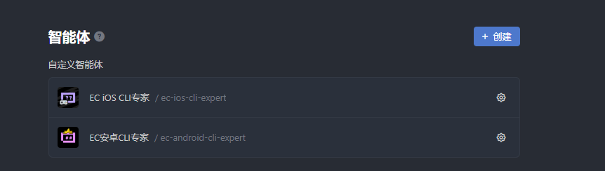

<!-- 来源：https://www.laoguicom.top/doc/891/ · 抓取状态：ok -->

 
## 一、EC 官方 CLI 工具（安卓+iOS 双平台支持）

EC 官方 CLI（命令行工具集）是 EasyClick 官方推出的核心开发辅助工具，专为自动化脚本开发设计，全面支持安卓、iOS 双平台，无需依赖图形化 IDE，即可完成项目全流程命令化操作，是实现工程化、自动化、AI 协同开发的核心入口，同时适配 EasyClick 安卓免 root、iOS 免越狱的特性，进一步降低开发门槛。其中 iOS 版 CLI（ec-ios-cli）针对 USB 版与脱机版做了差异化适配，严格遵循官方 9.27.0+ 插件版本规范。


### 1. 核心定位

作为 EC 开发的“操作入口”，CLI 工具标准化了所有开发操作，提供统一的命令接口，既能满足单人本地快速调试，也能支持团队批量执行、云控下发等规模化场景，同时结构化的日志输出的设计，也为后续对接 AI 智能体、实现自动化解析奠定了基础。其中 ec-ios-cli 核心定位是替代 IDEA 部分图形化命令，仅适用于 EasyClick iOS USB 版和脱机版，依赖 IDEA 及 iOS 开发插件正常运行。

### 2. 双平台核心功能（通用命令）

以下核心命令同时适配安卓、iOS 平台，操作逻辑一致，仅需根据设备类型调整对应参数，即可实现跨平台开发；其中 iOS 版需重点注意 preview 命令的差异化限制：

*   `ec preview`：实时预览工程 UI，连接安卓/iOS 设备后，可直接查看脚本界面效果，支持双端节点查找、图色识别相关预览，贴合双端 UI 特性；**特别说明（iOS 版）**：仅 iOS 脱机版支持该命令，iOS USB 版无法预览 UI，若 USB 版执行该命令会提示“非 iOS 脱机版项目不可预览”；
    
*   `ec run`：运行脚本，可指定安卓/iOS 设备、项目模块，后台执行脚本，支持调用双端专属 API（如 iOS 压力点击、安卓免 root 操作等），适配不同平台的操作特性；iOS 版执行该命令需提前将设备连接 IDEA，否则会提示无设备连接；
    
*   `ec build`：打包工程，根据设备类型生成对应格式的可发布文件（安卓适配 .iec 包，iOS 适配对应 IPA 相关格式），支持双端脚本混淆、权限配置，同时兼容 iOS17+ 系统的打包需求；iOS 版编译时，若 obfuscator.json 中 nodeBinPath 为空，会自动跳过 JS 混淆（属于正常行为）；
    
*   `ec monitor`：实时监控日志，抓取安卓/iOS 设备的运行日志、报错信息、OCR/找图结果，结构化输出便于查看和分析，适配双端日志输出规范；iOS 版该命令无需指定模块名，默认输出 JSON 格式日志，可通过参数调整为 text 格式；
    
*   `ec device`：管理设备，查看安卓/iOS 设备连接状态、设备信息，支持设备连接、重启、代理安装等操作，兼容 iOS 投屏、远程调试相关设备管理需求；
    
*   `ec config`：配置工程，统一管理安卓/iOS 项目的环境变量、签名信息、权限设置、云控参数，实现双平台项目配置标准化，同时适配 iOS 代理 IPA 相关配置需求。
    

### 3. iOS 版 CLI（ec-ios-cli）专属说明（官方规范）

结合 EasyClick 官方文档，针对 ec-ios-cli 补充专属规范，涵盖使用前提、文件路径、参数细节及版本差异，确保符合官方操作标准：

*   **使用前提**：需安装 9.27.0+ 版本开发插件，中控版本无限制；本机已启动 IntelliJ IDEA，并加载 EasyClick iOS 开发工具插件且插件处于可响应状态；命令行中使用的模块名，需与 IDEA 中脚本工程的模块名完全一致；多窗口、多工程同时运行时，需用 `-p` 参数传入与 IDEA 中打开路径一致的工程根目录，避免匹配错误。
    
*   **文件路径**：ec-ios-cli 及配套说明文件 SKILL.md，默认存放于 `ec_work_config/ios/bin` 目录；若打开 IDEA 后未出现该目录，关闭 IDEA 重新打开工程文件夹即可。SKILL.md 用于 AI 抓取 CLI 相关说明，辅助智能体理解命令体系。
    
*   **核心参数补充**：除通用参数外，iOS 版 CLI 部分参数有专属规则：① `-w / --monitor-logs`：preview、run、stop 命令未指定该参数时，默认视为 true（持续监控日志，直至 Ctrl+C 或命中停止关键字）；build 命令未指定时，默认视为 false（操作结束后立即停止日志）；②`-k / --stop-on`：支持用 `|||` 连接多个关键字，实现“任一关键字命中即退出日志监控”，各命令有默认停止关键字（如 preview 默认“执行UI结束”，run 默认“脚本已运行结束”）；③ `-r / --random-log`：设置为 true 时，会在 `ai_logs/`目录下自动生成日志文件名，不可与 `-o`（日志写入文件）同时使用。
    
*   **版本差异**：iOS USB 版与脱机版使用方式基本一致，核心差异仅在于 UI 预览功能（前文已说明）；两者均支持 run、stop、build、monitor 命令，且执行逻辑、参数要求完全相同，仅需根据实际使用的版本，避免在 USB 版中执行 preview 命令即可。
    
*   **命令调用示例**：默认当前目录为工程根目录，ec-ios-cli 调用示例如下：① 编译模块 testai：`./ec_work_config/ios/bin/ec-ios-cli build -m testai -w false`；② 运行模块 testai 并将日志写入文件：`./ec_work_config/ios/bin/ec-ios-cli run -m testai -f json -o /tmp/easyclick.log`；③ 监控日志并指定停止关键字：`./ec_work_config/ios/bin/ec-ios-cli monitor -f text -o /tmp/monitor.log -k "完成"`；④ 多工程场景运行模块：`./ec_work_config/ios/bin/ec-ios-cli run -m app -p /path/to/project/root`。
    

### 4. 双平台适配优势

CLI 工具深度适配安卓、iOS 双平台的开发特性，无需单独学习两套操作逻辑，开发者可通过统一命令实现跨平台开发，大幅降低跨平台开发成本；同时支持双端多设备并行操作，可批量对安卓、iOS 设备下发脚本、执行命令，提升规模化开发效率，且全面兼容 iOS17+ 系统的自动化需求，解决高版本 iOS 开发适配难题。其中 iOS 版 CLI 完美适配 USB 版、脱机版及高版本 iOS 系统，兼顾免越狱特性与工程化开发需求。

## 二、Trae 智能体（安卓版+iOS 版双版本同步推出）




Trae 智能体是基于 LLM（大语言模型）开发的“执行大脑”，专为 EC 官方 CLI 工具协同设计，同步推出安卓版和 iOS 版，分别适配对应平台的 CLI 操作逻辑和开发场景，实现“自然语言驱动开发”，让开发者无需记忆复杂命令，大幅提升开发效率，同时可辅助完成需求梳理、原型设计、代码调试等全流程开发工作。其中 iOS 版 Trae 智能体严格适配 ec-ios-cli 官方规范，区分 USB 版与脱机版场景，实现精准协同。

### 1. 核心定位

Trae 智能体相当于“AI 开发助手”，衔接开发者与 EC CLI 工具，通过理解自然语言需求，自动转化为 CLI 命令并执行，同时具备文件读取、终端运行、日志分析、代码修复等能力，安卓版与 iOS 版功能同步，仅针对双平台 CLI 特性做针对性适配，确保操作流畅性，同时支持 IDE 模式和 SOLO 模式，适配不同开发需求。其中 iOS 版智能体可自动读取 ec-ios-cli 及 SKILL.md 内容，理解 iOS 版 CLI 的命令规则、版本差异及参数限制，无需人工额外配置。

### 2. 双版本核心共性能力

安卓版与 iOS 版 Trae 智能体共享核心功能，确保跨平台开发体验一致，具体包括：

*   自然语言转 CLI 命令：开发者无需记忆复杂命令，只需用自然语言描述需求（如“预览 iOS 设备上的 cloudGo 项目”“打包安卓版工程并输出日志”），智能体自动解析意图，生成对应平台的 CLI 命令，无需手动调整参数；iOS 版智能体可自动判断当前 iOS 版本（USB 版/脱机版），若为 USB 版，会自动规避 preview 命令，避免执行失败；
    
*   全流程自动化执行：支持从项目预览、脚本运行、工程打包，到日志分析、问题定位的全流程自动化，开发者只需提出需求，智能体自动调用 CLI 工具完成所有操作，同时可辅助完成代码生成、原型设计等拓展工作，适配双端开发全流程；iOS 版智能体可自动处理 ec-ios-cli 的参数规则（如多工程自动添加`-p` 参数），无需人工干预；
    
*   日志自动解析：抓取 CLI 工具输出的安卓/iOS 设备日志，自动识别报错信息、定位问题根源（如安卓控件找不到、iOS OCR 识别失败、iOS USB 版预览失败等），并给出针对性修复建议，同时支持日志导出和分析报告生成；可自动解析 iOS 版 CLI 的 JSON 格式日志，提取关键信息；
    
*   项目结构解析：可直接读取安卓、iOS 平台的 EC 项目文件，理解工程结构、识别核心文件（如 UI 布局文件、脚本入口、依赖库等），新手可快速熟悉项目，同时支持多语言代码解析，适配双端开发语言特性；iOS 版智能体可识别 obfuscator.json 配置，提醒用户补充 JS 混淆相关路径（若未配置）；
    
*   自定义技能扩展：可配置 EC 开发专用技能，内置双平台常用 CLI 命令、最佳实践、错误库，支持根据开发者习惯优化指令生成逻辑，越用越贴合开发需求，同时可集成第三方工具，拓展开发能力；iOS 版可添加 ec-ios-cli 专属技能，适配 USB 版、脱机版差异化操作。
    

### 3. 双版本针对性适配（差异化亮点）

为贴合安卓、iOS 平台的开发差异，Trae 智能体双版本做了针对性优化，确保适配各平台特性，其中 iOS 版重点适配 ec-ios-cli 及 iOS 开发场景：

*   安卓版：深度适配 EC 安卓 CLI 特性，支持安卓免 root 相关操作指令生成，优化多设备群控、云控下发相关逻辑，适配安卓各类机型的日志解析，同时支持安卓专属 API 的调用辅助，解决安卓设备兼容性问题；
    
*   iOS 版：适配 iOS 免越狱开发场景，支持 iOS 专属 CLI 命令（如 IPA 代理安装、iOS17+ 系统适配相关命令），优化 iOS 设备投屏、远程调试相关操作的自动化执行，适配 iOS 平台的 UI 识别、触摸操作等特性，同时支持 Xcode 远程调试相关辅助功能，解决 iOS 开发调试繁琐的问题；核心差异化适配：① 自动区分 iOS USB 版与脱机版，USB 版自动屏蔽 preview 命令，避免无效操作；② 自动匹配 ec-ios-cli 路径（`ec_work_config/ios/bin/ec-ios-cli`），无需手动指定；③ 支持投喂 EC 官方文档，自动抓取 iOS 版 CLI 相关规范，持续优化指令生成精度；④ 可辅助修改 iOS 项目脚本（如删除自动化服务启动逻辑、编写循环日志打印代码），修改后自动调用 ec-ios-cli 运行验证。
    

## 三、EC CLI + Trae 智能体（双平台组合）的核心价值

EC 官方 CLI（双平台支持）与 Trae 智能体（安卓版/iOS 版）组合，构建了“双平台全覆盖、AI 驱动全流程”的开发模式，核心价值体现在：

1.  跨平台高效开发：适配安卓、iOS ，无需切换工具或学习两套操作，大幅降低跨平台开发成本，同时适配双端不同开发特性，解决多平台开发繁琐的痛点；其中 iOS 版可无缝适配 USB 版、脱机版，无需额外调整操作逻辑；
    
2.  门槛大幅降低：开发者无需记忆复杂的 CLI 命令，无需熟悉双平台开发细节，通过自然语言即可完成所有操作，新手也能快速上手安卓、iOS 双平台的 EC 自动化开发，同时借助 AI 辅助，降低代码编写、调试门槛；iOS 开发者无需记忆 ec-ios-cli 复杂参数，智能体可自动生成合规命令；
    
3.  效率指数提升：自动化执行 CLI 命令、自动解析日志、自动修复简单问题，减少人工重复性操作，同时支持批量操作，无论是单人开发还是团队协作，都能显著提升开发效率，实现“一人顶一个团队”的开发效果；iOS 版可自动完成脚本修改、命令执行、日志验证全流程，无需人工干预；
    
4.  操作标准化：通过智能体生成标准化 CLI 命令，避免人工输入错误，确保安卓、iOS 双平台的开发流程、配置规范统一，同时支持 CI/CD 集成，实现“一键打包→测试→发布”的全流程标准化，提升开发质量；iOS 版严格遵循官方 CLI 规范，避免因参数错误、版本适配问题导致的执行失败；
    
5.  适配性全面：同步覆盖安卓免 root、iOS 免越狱场景，兼容 iOS17+ 等高版本系统，解决双平台开发中的适配难题，同时支持多设备并行、云控下发等规模化场景，满足不同开发需求；iOS 版同时适配 USB 版、脱机版，兼顾不同使用场景的需求。
    
## 智能体能力
```
我作为 EC安卓CLI专家，具备以下能力：

## 1. ec-android-cli 工具操作

*   **项目预览** - preview 子命令
*   **项目运行** - run 子命令
*   **停止运行** - stop 子命令
*   **构建 IEC** - build 子命令
*   **截图** - capture-screen
*   **获取 UI 节点** - capture-node
*   **OCR 识别** - ocr-screen / ocr-local-image
*   **图像匹配测试** - test-image
*   **日志监控** - monitor

## 2. EasyClick 脚本开发

*   **无障碍模式** - 使用 acEvent 相关 API
*   **代理模式** - 使用 agentEvent 相关 API
*   **UI 界面开发** - XML 布局 + JavaScript 交互
*   **节点查找** - text() / desc() / id() / getOneNodeInfo() 等
*   **屏幕操作** - 点击、滑动、长按等手势
*   **OCR 识别** - 屏幕文字识别
*   **图像识别** - 找图、找色

## 3. 代码分析与编写

*   **代码解释** - 解释 EasyClick 脚本代码
*   **脚本编写** - 根据需求编写自动化脚本
*   **Bug 修复** - 排查和修复代码问题
*   **代码优化** - 改进代码结构和性能

## 4. 项目分析

*   **项目结构分析** - 理解项目组成和功能
*   **模块分析** - 分析特定模块的代码逻辑
*   **依赖分析** - 查看项目依赖关系

## 5. 文件操作

*   **读取文件** - 查看代码文件内容
*   **编辑文件** - 修改代码
*   **搜索代码** - 在项目中查找特定代码

## 6. 终端命令执行

*   **运行命令** - 执行 ec-android-cli 命令
*   **查看日志** - 获取运行日志和错误信息

```

## 四、适用场景

这套双平台组合适用于所有 EC 自动化脚本开发者，尤其适合：

*   需要同时开发安卓、iOS 双平台 EC 脚本的开发者，实现跨平台高效开发；
    
*   新手开发者，无需记忆命令、无需熟悉双平台特性，快速上手 EC 开发；
    
*   需要批量执行脚本、管理多设备（安卓/iOS 混合设备）的团队或工作室，提升规模化开发效率；
    
*   希望通过 AI 辅助，减少重复性工作，专注核心脚本逻辑设计的开发者；
    
*   需要适配 iOS17+ 系统、实现 iOS 免越狱开发的开发者，解决高版本 iOS 开发适配难题；
    
*   使用 iOS USB 版、脱机版进行 EC 开发的开发者，借助 Trae 智能体规避版本差异带来的操作问题，提升开发流畅度。


## 智能体
「EC iOS CLI专家」。 点击 https://s.trae.com.cn/a/aac9be?region=cn 立即复刻，一起来玩吧！
「EC安卓CLI专家」。 点击 https://s.trae.com.cn/a/0790ec?region=cn 立即复刻，一起来玩吧！