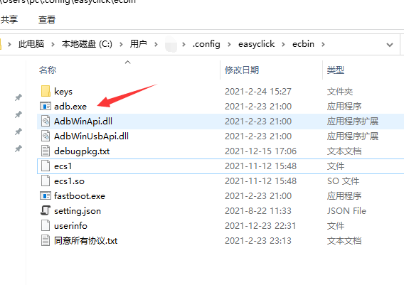

<!-- 来源：https://www.laoguicom.top/doc/53/ · 抓取状态：ok -->

[TOC]

#  EasyClick adb、shell命令大全
<font color="ff0000">友情提示，shell命令 不支持无障碍模式请使用代理模式。</font>
##  ADB包安装步骤

1. 首先下载SDK Platform-Tools工具包(去官网下载：[下载 SDK Platform-Tools](https://developer.android.google.cn/studio/releases/platform-tools))如下图所示

2. 配置环境变量，参考百度或者CSDN里搜索，这里不再赘述。

3. 分享资料：[Android系统根目录结构及说明](https://blog.csdn.net/brian512/article/details/41513685)
4. EasyClick adb 默认路径
本地APK模板文件路径: C:\Users\xx\AppData\Local\Temp\ecbin\adb\ec.apk
adb默认路径：C:\Users\xx\.config\easyclick\ecbin  (如下图所示)

## 使用教程
本人博客文章[EasyClick 执行 shell命令](https://blog.csdn.net/qq_21460781/article/details/115603140)
**注意**：部分命令需要 **root** 权限才能在手机里执行。
Android官方文档 ：[用户指南](https://developer.android.google.cn/studio/command-line/adb#shellcommands)

## ADB高级命令
利用无线来查看adb shell
```linux
adb tcpip 5555
````
连接设备：
```linux
 adb connect IP:5555
````
查看所有已经连接上的设备
```linux
adb devices 		     #列出所有的Android设备
adb devices -l           #列出所有的Android设备详细信息
adb 设备名 -s shell      #进入指定设备的shell 
adb 设备名 -s            #连接指定设备
````
飞行模式
```linux
开启飞行模式：

必须要先执行1 再执行2
--执行1
adb shell settings put global airplane_mode_on 1
--执行2
adb shell am broadcast -a android.intent.action.AIRPLANE_MODE --ez state true

关闭飞行模式：
--执行1
adb shell settings put global airplane_mode_on 0
--执行2
adb shell am broadcast -a android.intent.action.AIRPLANE_MODE --ez state false

```
安装应用
```linux
adb install 
adb install -r    # 通过install命令来安装apk文件，-r参数可以重新安装某个应用并保留应用数据

adb install -r ~/QQ.apk
````
卸载应用
```linux
adb uninstall <软件名>
adb uninstall -k < 软件名>          # 如果加 -k 参数,为卸载软件但是保留配置和缓存文件

adb uninstall com.tencent.mobileqq  #通过包名卸载QQ
````
关机命令
```linux
adb shell
su
reboot -p
````
重启
```linux
adb reboot
````
获取CPU信息
```shell
adb shell dumpsys battery # 真机运行
```
```text
1|HWBLA:/ $ dumpsys battery
Current Battery Service state:
  AC powered: false
  USB powered: true
  Wireless powered: false
  Max charging current: 500000
  Max charging voltage: 5038000
  Charge counter: 745000
  status: 4
  health: 2
  present: true
  level: 82
  scale: 100
  voltage: 4144
  temperature: 310 # 温度 除以10 
  technology: Li-poly
```
## Android 常用的Linux命令

**mkdir** 命令用来创建目录
```linux
mkdir filename
````
**touch** 命令有两个功能：一是用来创建新的空文件，它们的数据将原封不动地保留下来；二是用于把已存在文件的时间标签更新为系统当前的时间（默认方式）。
```linux
touch test.txt
````
**rm** 命令可以删除一个目录中的一个或多个文件或目录，也可以将某个目录及其下属的所有文件及其子目录均删除掉
```linux
rm -rf joe.txt
````
**rmdir** 命令用来删除空目录
```linux
rmdir joe
````
**mv** 命令用来对文件或目录重新命名 或者移动文件（移动文件时需要注意的是文件的源地址和目标地址必须不同）
```linux
mv ex3 new1
#或者
mv weproject.log  /home/logs/weproject/
 ````
**cp** 命令用来将一个或多个源文件或者目录复制到指定的目的文件或目录(  cp(选项)(参数) )
```linux
 cp 1.jpg /root/jerry
 ````
**pwd** 命令以绝对路径的方式显示用户当前工作目录。
```linux
pwd --->/usr/src
````
**cd** 命令用来切换工作目录
```linux
cd ~  进入用户主目录；
cd -  返回进入此目录之前所在的目录；
cd ..  返回上级目录（若当前目录为“/“，则执行完后还在“/"；".."为上级目录的意思）；
cd ../..  返回上两级目录；
cd !$  把上个命令的参数作为cd参数使用。
````
**ls** 命令用来显示目标列表参数比较多 常用的 -al 文件或者目录例如：ls -al /path
```linux
ls 
bin, boot, data, dev, etc, home, lib, lost+found, media, misc, mnt, opt, proc, root, sbin, selinux, srv, sys, tmp, usr, var
````
**find** 命令用来在指定目录下查找文件
```linux
find /home -name "*.txt"                             #例子查找home 目录下后缀名为txt的所有文件
find /要找的目录 –name  "文件名"                       #查找当前目录下某个文件
find /要找的目录 –iname "文件名"                       #-i 不区分大小写
find /要找的目录 –type d –name "目录名"                #在要找的目录下查找某个目录
find /要找的目录  type f –name "文件名"                #在要找的目录下查找某个文件
find /要找的目录  –type f –mtime 1                     #查找1天前修改的文件
find /要找的目录  –type f –cmin -60                    #查找1小时内更改过的文件
find /要找的目录  –type  f –size +50MB –size -100MB    #查找50MB到100MB的所有文件
````
**chmod** 命令用来修改文件或目录权限 666为所有用户具有读写权限 777为所有用户具有读写执行的权限
```linux
chmod -R 666 /filepath
````
 Android内核基于Linux的所以Linux 的一些命令在Android中使用shell 执行同样有效，。
 下面附一张Android支持的Linux命令表，模拟器上获取的真机自行测试可能有所不同。
 ```linux
 adb shell  #进入Android  shell 
 ls /system/bin/ -a  #列出可执行的Linux 命令
````

## Android am、pm、dpm命令
 [文档](https://shimo.im/docs/qkqtRcgXR8GwrGJR/%20%E3%80%8Aadb%20shell%E4%B9%8Bam%E3%80%81pm%E3%80%81dpm%E3%80%8B%EF%BC%8C%E5%8F%AF%E5%A4%8D%E5%88%B6%E9%93%BE%E6%8E%A5%E5%90%8E%E7%94%A8%E7%9F%B3%E5%A2%A8%E6%96%87%E6%A1%A3%20App%20%E6%88%96%E5%B0%8F%E7%A8%8B%E5%BA%8F%E6%89%93%E5%BC%80)
## 常用的adb shell 命令

1.列出所有包名
```linux
adb shell pm list packages

➜  ~ adb shell pm list packages
package:com.huawei.floatMms
package:com.android.defcontainer
package:com.tencent.mm
#--------------------------   下面是带参数的用法   --------------------------------
adb shell pm list packages -d    #只输出禁用的包。
adb shell pm list packages -e    #只输出启用的包。
adb shell pm list packages -s    #只输出系统的包。
adb shell pm list packages -i    #只输出包和安装信息（安装来源）。
adb shell pm list packages -u    #只输出包和未安装包信息（安装来源）。
adb shell pm list packages -i    #只输出包和安装信息（安装来源）。
adb shell pm list packages -f    #输出包和包相关联的文件
adb shell pm list packages -3    #输出所有第三方包。
adb shell pm list packages -[option] "QQ"     #按照要求搜索包。
adb shell pm list packages --user <USER_ID>   #根据用户id查询用户的空间的所有包，USER_ID代表当前连接设备的顺序，从零开始。
````
2.列出指定包的apk路径
```linux
adb shell pm path com.android.phone

➜  ~ adb shell pm path com.huawei.android.launcher
package:/system/app/HwLauncher6.apk
````
3.删除指定包
```linux
adb shell pm clear com.test.abc
````
4.截屏
```linux
adb shell screencap /sdcard/screen.png
adb pull /sdcard/screen.png #下载到本地
````
5.模拟点击
```linux
adb shell input tap 100 100
````
6.滑动
```linux
adb shell input swipe x1 y1 x2 y2 
adb input touchscreen swipe x1 y1 x2 y2 100

adb shell input swipe 100 100 400 100  300      #左往右
adb shell input swipe 400 100 100 100  300      #右往左
adb shell input swipe 100 100 100 400  300      #上往下
adb shell input swipe 100 400 100 100  300      #下往上
adb shell input swipe 100 100 400 400  300      #上往下斜
adb shell input swipe 400 400 100 100  300      #下往上斜
````
7.长按
```linux 
adb shell input swipe 100 100 100 100  1000     #在 100 100 位置长按 1000毫秒

adb shell input swipe 367 469 367 469 800
````
8.获取被点击的位置信息
```linux
adb shell getevent

>
/dev/input/event0 3 39 3e1
/dev/input/event0 1 14a 1
/dev/input/event0 1 145 1
/dev/input/event0 3 35 406  //x坐标
/dev/input/event0 3 54 1083  //y坐标
/dev/input/event0 0 0 0
/dev/input/event0 3 39 ffffffff
/dev/input/event0 1 14a 0
/dev/input/event0 1 145 0
/dev/input/event0 0 0

getevent -l -c 16
输出所有event设备的基本信息

add device 1: /dev/input/event2
  name:     "hi6421_on"
could not get driver version for /dev/input/mouse0, Not a typewriter
add device 2: /dev/input/event4
  name:     "huawei,touchscreen"
add device 3: /dev/input/event0
  name:     "mhl_rcp_dev"
could not get driver version for /dev/input/mice, Not a typewriter
add device 4: /dev/input/event1
  name:     "hisi_gpio_key.14"
add device 5: /dev/input/event3
  name:     "hi3630_hi6401_CARD Headset Jack"

getevent -c 10 #输出10条信息后退出
getevent -l  #将type、code、value以对应的常量名称显示
````
9.打开对应的activity
```linux
adb shell am start -n ｛包(package)名｝/｛包名｝.{活动(activity)名称}

adb shell am start com.songheng.eastnews/com.oa.eastfirst.activity.WelcomeActivity
````
10.获得当前活动窗口的信息，包名以及活动窗体
```linux
adb shell dumpsys window windows | grep mCurrent 
````
11.包名管理命令，获得对应包名的对应apk路径
```linux
adb shell pm  path com.migu.lobby
````
12.使用dumpsys命令可以查看Android手机当前正在运行的Activity
```linux
adb shell dumpsys activity activities | findstr "Run"
````
13.使用 uiautomator dump 获取app上的页面元素
```linux
adb shell uiautomator dump /data/local/tmp/uidump.xml
adb shell uiautomator dump /sdcard/dump.xml
````
14.下载文件
```linux
adb pull /sdcard/demo.mp4 
````
15.上传文件
```linux
adb push test.apk /sdcard
````
16.息屏
```linux
adb shell input keyevent 26
````
17.keyevent
```linux
adb shell input keyevent 20 #向下

adb shell input keyevent 4 #返回

adb shell input keyevent 3 #Home

adb shell input keyevent 6 #挂机

adb shell input keyevent 84 #搜索

adb shell input keyevent 26 #电源

adb shell input keyevent 24 #音量+

adb shell input keyevent 25 #音量-
````
导航键
```linux
Home      #Home
Back      #返回
Up        #上
Down      #下
Left      #左
Right     #右
Select/Ok #确认
Volume+   #音量+
Volume-   #音量-
Menu      #菜单
````

adb shell input text "ANDROID" 支持的KEYCODE
```linux
0 -->  "KEYCODE_UNKNOWN"
1 -->  "KEYCODE_MENU"
2 -->  "KEYCODE_SOFT_RIGHT"
3 -->  "KEYCODE_HOME"
4 -->  "KEYCODE_BACK"
5 -->  "KEYCODE_CALL" 
6 -->  "KEYCODE_ENDCALL" 
7 -->  "KEYCODE_0" 
8 -->  "KEYCODE_1" 
9 -->  "KEYCODE_2" 
10 -->  "KEYCODE_3"
11 -->  "KEYCODE_4" 
12 -->  "KEYCODE_5" 
13 -->  "KEYCODE_6" 
14 -->  "KEYCODE_7" 
15 -->  "KEYCODE_8" 
16 -->  "KEYCODE_9" 
17 -->  "KEYCODE_STAR" 
18 -->  "KEYCODE_POUND" 
19 -->  "KEYCODE_DPAD_UP" 
20 -->  "KEYCODE_DPAD_DOWN" 
21 -->  "KEYCODE_DPAD_LEFT" 
22 -->  "KEYCODE_DPAD_RIGHT"
23 -->  "KEYCODE_DPAD_CENTER"
24 -->  "KEYCODE_VOLUME_UP" 
25 -->  "KEYCODE_VOLUME_DOWN" 
26 -->  "KEYCODE_POWER" 
27 -->  "KEYCODE_CAMERA" 
28 -->  "KEYCODE_CLEAR" 
29 -->  "KEYCODE_A" 
30 -->  "KEYCODE_B" 
31 -->  "KEYCODE_C" 
32 -->  "KEYCODE_D" 
33 -->  "KEYCODE_E" 
34 -->  "KEYCODE_F" 
35 -->  "KEYCODE_G" 
36 -->  "KEYCODE_H" 
37 -->  "KEYCODE_I" 
38 -->  "KEYCODE_J" 
39 -->  "KEYCODE_K" 
40 -->  "KEYCODE_L" 
41 -->  "KEYCODE_M"
42 -->  "KEYCODE_N" 
43 -->  "KEYCODE_O" 
44 -->  "KEYCODE_P" 
45 -->  "KEYCODE_Q" 
46 -->  "KEYCODE_R" 
47 -->  "KEYCODE_S" 
48 -->  "KEYCODE_T" 
49 -->  "KEYCODE_U" 
50 -->  "KEYCODE_V" 
51 -->  "KEYCODE_W" 
52 -->  "KEYCODE_X"
53 -->  "KEYCODE_Y" 
54 -->  "KEYCODE_Z" 
55 -->  "KEYCODE_COMMA" 
56 -->  "KEYCODE_PERIOD"
57 -->  "KEYCODE_ALT_LEFT" 
58 -->  "KEYCODE_ALT_RIGHT" 
59 -->  "KEYCODE_SHIFT_LEFT" 
60 -->  "KEYCODE_SHIFT_RIGHT" 
61 -->  "KEYCODE_TAB" 
62 -->  "KEYCODE_SPACE" 
63 -->  "KEYCODE_SYM" 
64 -->  "KEYCODE_EXPLORER" 
65 -->  "KEYCODE_ENVELOPE" 
66 -->  "KEYCODE_ENTER" 
67 -->  "KEYCODE_DEL" 
68 -->  "KEYCODE_GRAVE" 
69 -->  "KEYCODE_MINUS" 
70 -->  "KEYCODE_EQUALS" 
71 -->  "KEYCODE_LEFT_BRACKET" 
72 -->  "KEYCODE_RIGHT_BRACKET" 
73 -->  "KEYCODE_BACKSLASH"
74 -->  "KEYCODE_SEMICOLON" 
75 -->  "KEYCODE_APOSTROPHE"
76 -->  "KEYCODE_SLASH" 
77 -->  "KEYCODE_AT" 
78 -->  "KEYCODE_NUM" 
79 -->  "KEYCODE_HEADSETHOOK" 
80 -->  "KEYCODE_FOCUS"
81 -->  "KEYCODE_PLUS"
82 -->  "KEYCODE_MENU"
83 -->  "KEYCODE_NOTIFICATION"
84 -->  "KEYCODE_SEARCH" 
85 -->  "TAG_LAST_KEYCODE"  
````
adb shell input keyevent值所对应的字符如上所示
adb命令模拟按键事件 KeyCode
18.输入框输入
```linux
adb shell input text "ANDROID"
````

我是Mr-老鬼、QQ1156346325 。交流QQ群：620028786,647082990
 **------------------------------------版权声明----------------------------------------**
版权所有~Mr-老鬼 ~转载请注明原文地址。
免责声明：本文所有的教程仅限交流学习使用不得用于违法用途，造成的法律后果本人不承担责任。