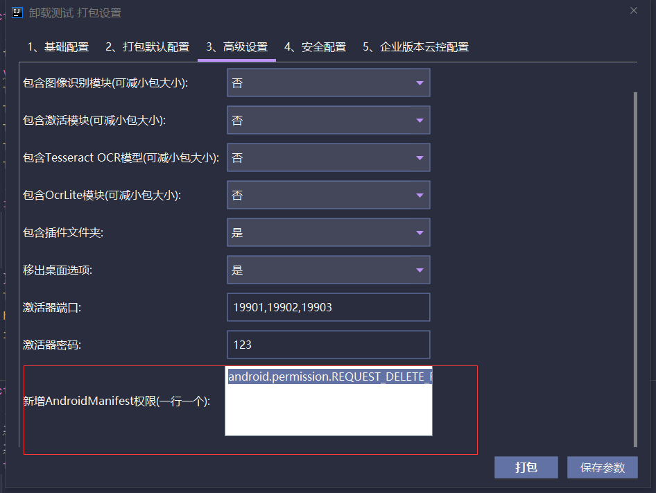
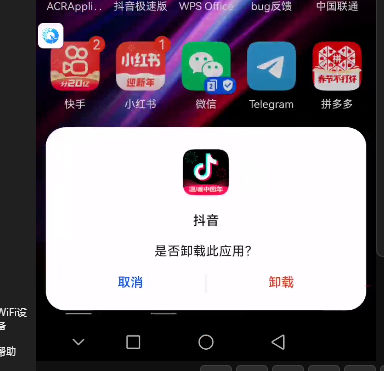

<!-- 来源：https://www.laoguicom.top/doc/270/ · 抓取状态：ok -->

# EasyClick intent方式安装卸载APP
通过跳转系统安装app页面和卸载页面实现
## setFlag() 和 addFlag()两个标志位设置避坑
>d setFlags():为intent 设置特殊的标志，会覆盖 intent 已经设置的所有标志。
addFlags():为intent 添加特殊的标志，不会覆盖，只会追加。
在使用过程中注意不要混用
如果是setFlag() 有多个标志位使用 "|" 分隔填写 或者使用addFlag()有多少就写多少个

## 安装APK 指定路径

```js
//例子
let apkPath = "/sdcard/Download/test.apk";
intentInstallAPK(apkPath);
/**
 * 安装APP
 * 作者:laogui，QQ：1156346325
 * @param apkPath apk 路径
 */
function intentInstallAPK(apkPath) {
		//说明 下面几个包请查看是否已导入 已导入无需再导入
        importPackage(android.content);
        importPackage(android.net);
        importPackage(android.os);
    try {
 	   let uri;
        if (Build.VERSION.SDK_INT >= Build.VERSION_CODES.N && Build.VERSION.SDK_INT <  Build.VERSION_CODES.Q) {
            let builder = new StrictMode.VmPolicy.Builder();
            StrictMode.setVmPolicy(builder.build());
			uri = Uri.parse("file://"+apkPath);
        }
		if(Build.VERSION.SDK_INT>= Build.VERSION_CODES.Q){
			uri =  androidx.core.content.FileProvider.getUriForFile(
            context,
            context.getPackageName()+".install_auth",
            new java.io.File(apkPath));
		}

        let intent = new Intent(Intent.ACTION_VIEW);
        intent.setDataAndType(uri, "application/vnd.android.package-archive");
        intent.addFlags(Intent.FLAG_GRANT_READ_URI_PERMISSION);
        intent.addFlags(Intent.FLAG_ACTIVITY_NEW_TASK);
        context.startActivity(intent);
        sleep(1000);
        if (Build.VERSION.SDK_INT >= Build.VERSION_CODES.N) {
            let builder = new StrictMode.VmPolicy.Builder();
            builder.detectAll();
            StrictMode.setVmPolicy(builder.build());
        }
    } catch (e) {
        loge(e)
    }
}
```

## 卸载APP 指定包名
```js
/**
 * 卸载APP
 * 作者:laogui，QQ：1156346325
 * @param pkgName 包名
 */
function intentUnstallAPK(pkgName) {
	//说明 下面两个包请查看是否已导入 已导入无需再导入
	importClass(android.content.Intent);
	importClass(android.net.Uri);
    try {
        let uri = Uri.parse("package:" +pkgName);
        let intent = new Intent(Intent.ACTION_DELETE, uri);
        intent.setFlags(Intent.FLAG_ACTIVITY_NEW_TASK);
        context.startActivity(intent);
    } catch (e) {
        loge(e)
    }
}

```
### 卸载APP 安卓9以上适配
上面的卸载代码安卓9以上无效需要添加权限,对安卓9以上版本做适配,按下述方法操作即可
打包选项->高级设置(如下图) 添加权限`android.permission.REQUEST_DELETE_PACKAGES`
<font color="#ff0000">修改打包选项后需要重新打包</font>

调用代码执行结果,节点点击卸载即可


我是Mr-老鬼、QQ1156346325 。交流QQ群：620028786，647082990，772810035
**------------------------------------------------版权声明------------------------------------------------------**
 本文版权所有~Mr-老鬼 ~转载请注明原文地址
免责声明：本文所有的教程仅限交流学习使用不得用于违法用途，造成的法律后果本人不承担责任。