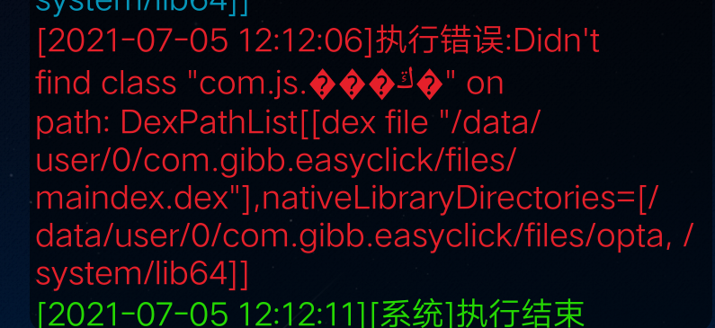
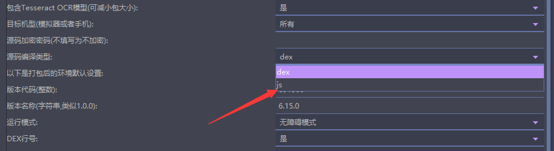
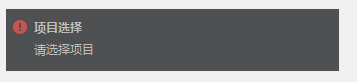
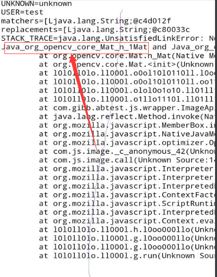
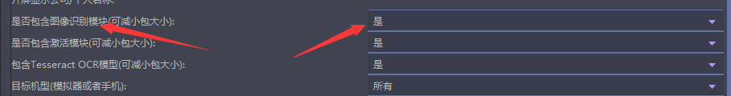

<!-- 来源：https://www.laoguicom.top/doc/193/ · 抓取状态：ok -->

#### 默认dex 打包方式，JavaScript文件名不得用中文命名改为字母命名即可。

如下图错误

或者 改打包模式为js模式，如下图所示

### 运行工程提示选择项目
如下图所示错误，新建EC项目 复制老项目src目录到新的项目解决。

##  运行过程 突然结束 无报错
请查看sdcard目录下如下如图所示文件夹内容 

打开后出现如图所示错误

打包选项 图像识别模块勾选为是解决

## 打包选项dex方式报错提示未找到xxx.js文件
报错：`Program too complex: too big jump offset `

解决方案：检查xxx.js文件内部while循环体量是否过大，压缩代码300行内。
注意编程规范不要在写太大的函数或循环体结构内部大体量代码。