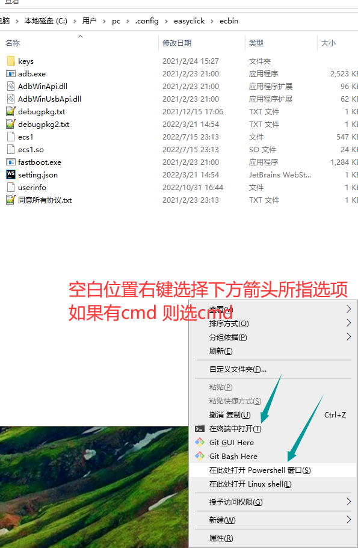
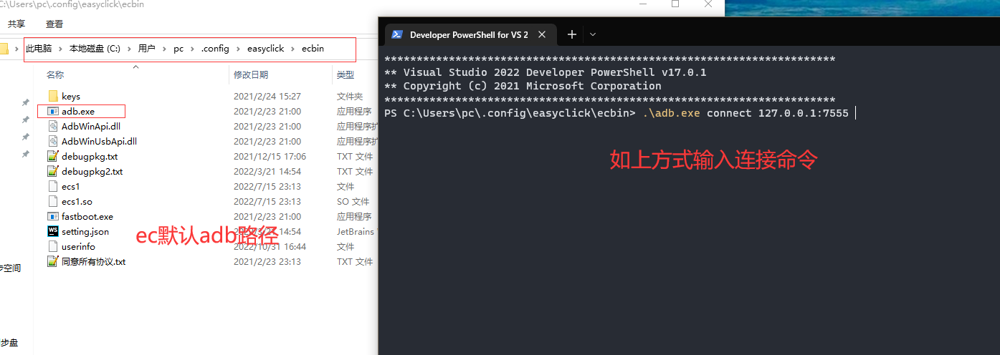

<!-- 来源：https://www.laoguicom.top/doc/57/ · 抓取状态：ok -->

# 模拟器连接端口汇总

注意：执行adb连接代码需要在adb所在目录执行或者配置adb环境变量执行。
配置环境变量参考：[adb shell 命令大全](https://www.laoguicom.top/doc/53/ "adb shell 命令大全")

| 模拟器  |     adb连接代码         |  模拟器官网 |
| :------- | :-------------------- | :------------ |
| iTools | adb connect 127.0.0.1:54001  |  http://www.itools.cn/  |
| 网易Mumu  |  adb connect 127.0.0.1:7555 | http://mumu.163.com/  |
| 夜神 | adb connect 127.0.0.1:62001  | https://www.yeshen.com/  |
| 逍遥  | adb connect 127.0.0.1:21503  | https://www.xyaz.cn/  |
| 腾讯手游助手  |  adb connect 127.0.0.1:5555 | https://syzs.qq.com/sempage/mrzh/index.html  |
| 天天  |  adb connect 127.0.0.1:6555 | http://www.ttmnq.com/  |
| 海马玩  | adb connect 127.0.0.1:26744  | http://www.haimawan.com/  |
| 蓝叠(BlueStacks)  | adb connect 127.0.0.1:5555  | https://www.bluestacks.cn/  |
| 雷电  | adb connect 127.0.0.1:5555  | http://www.ldmnq.com/ldy/baidu.html  |
| Genymotion  | adb connect 127.0.0.1:5555  | https://www.genymotion.com/  |

## 连接示例
端口号根据自身模拟器决定

上方的端口连接成功后，在EC里使用USB连接即可。

[夜神连接方案](https://blog.csdn.net/qq_21460781/article/details/115721457 "夜神连接方案")

我是Mr-老鬼、QQ1156346325 。交流QQ群：620028786,647082990
**------------------------------------------------版权声明------------------------------------------------------**
 本文版权所有~Mr-老鬼 ~转载请注明原文地址
免责声明：本文所有的教程仅限交流学习使用不得用于违法用途，造成的法律后果本人不承担责任。
