<!-- 来源：https://www.laoguicom.top/doc/273/ · 抓取状态：ok -->

# 新建项目
单项目新建出现如下图所示结构
## 解决办法一 按如下图所示操作即可

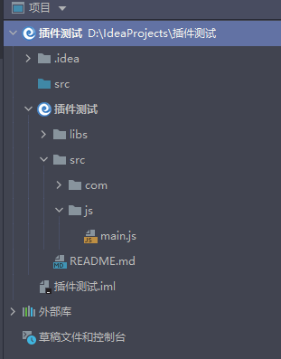

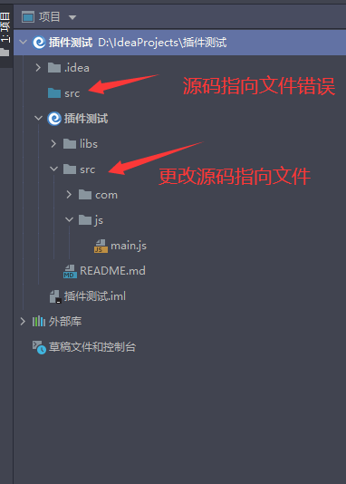
如下图所示右键打开模块设置
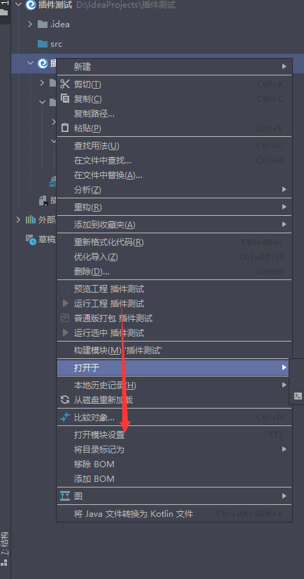

如下图所示操作更改源码目录

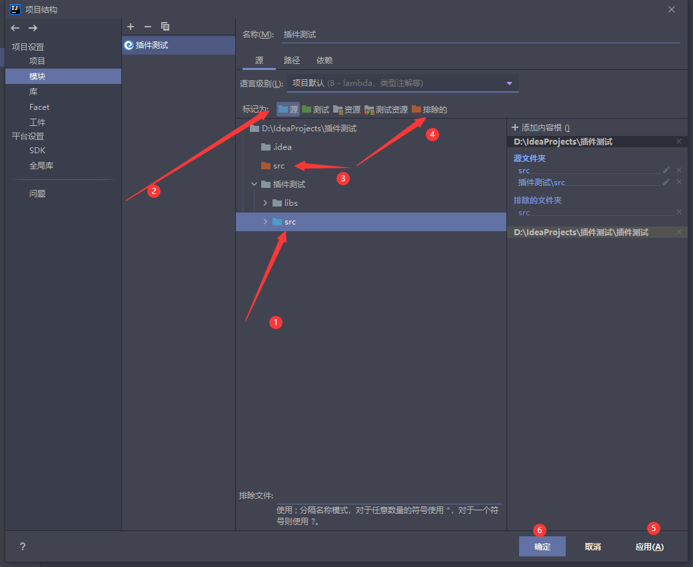
修改后结构如图

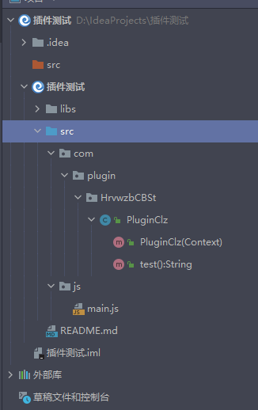

**如果遇到无法保存，提示已存在的情况去目录下删除对应的文件夹，重新设置源文件指向目录即可！**

##  解决办法二 建立多项目
在新建文件夹 拖到idea窗口， 右键新建模块即可

## 未找到编译后的目录

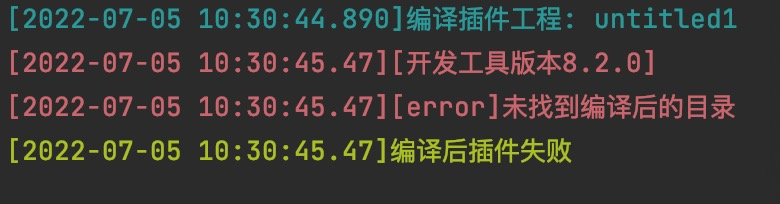
在项目根目录，单独模块的上一级目录新建out文件夹设为编译输出目录即可。

如下图设置编译后输出目录即可
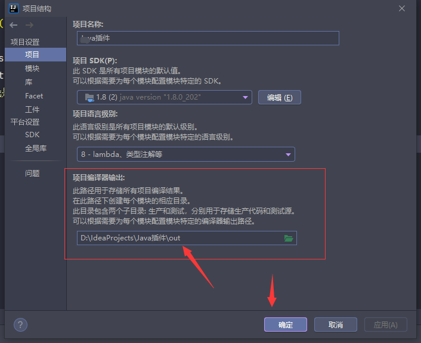

#  jdk版本导致的闪退
## jdk 版本1.8
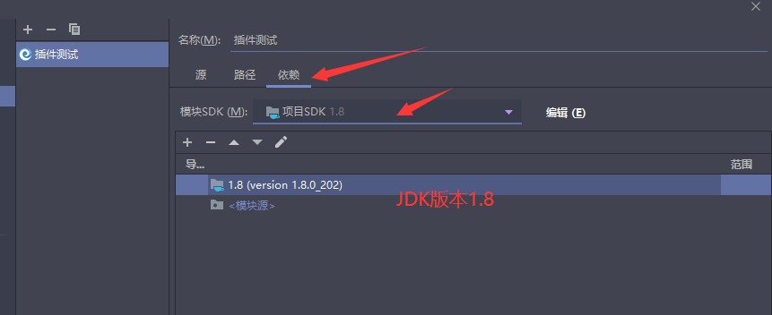

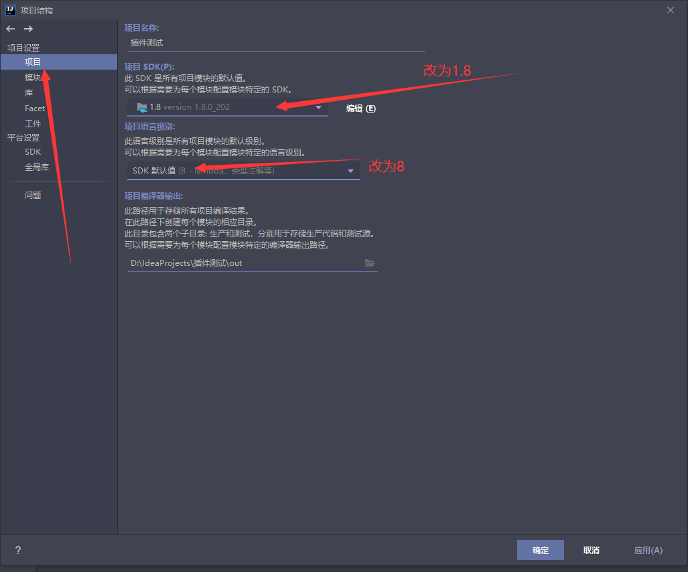

华为云jdk镜像地址：https://repo.huaweicloud.com/java/jdk/

## context 包不存在
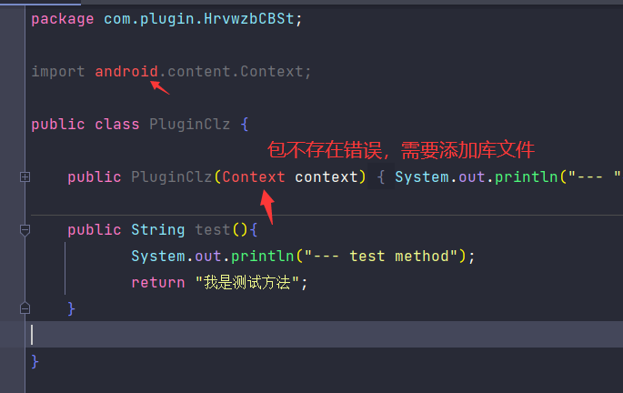

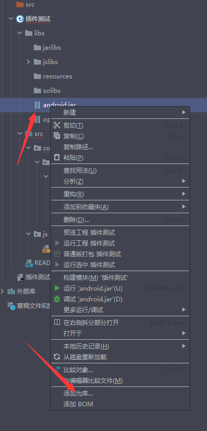
###  注意是模块库不是项目库！！！
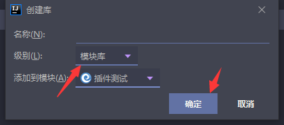

# 运行工程闪退
xxx.iml 文件误删了 新建项目或者其他项目复制一份改为本项目名即可

----

我是Mr-老鬼、QQ1156346325 。交流QQ群：620028786，647082990，772810035
**------------------------------------------------版权声明------------------------------------------------------**
 本文版权所有~Mr-老鬼 ~转载请注明原文地址
免责声明：本文所有的教程仅限交流学习使用不得用于违法用途，造成的法律后果本人不承担责任。