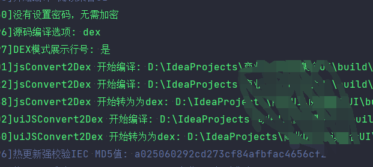

<!-- 来源：https://www.laoguicom.top/doc/351/ · 抓取状态：ok -->

# EasyClick IEC 热更新 问题
## 1. 提示无下载地址
<font color="#FF0000" size=3>解决方案： 检查update.json 文件中的 txt文本内JSON 数据格式是否正确！
注意：download_url、version、msg 后面的是 字符串类型，请使用双引号！</font>
```json
{
	"download_url": "http://xxxxxx/xxx/xx/.iec",
	"version": "1.1.0",
	"dialog":true,
	"msg": "优化部分问题",
	"force": false,
	 "md5":"编译iec 后输出的 iec文件的md5值"
}
```

## 2. 更新后无UI界面
<font color="#FF0000" size=3>
解决方案： MD5校验！检查 iec 文件是否正确编译！
</font>

```json
{
	"download_url": "http://xxxxxx/xxx/xx/.iec",
	"version": "1.1.0",
	"dialog":true,
	"msg": "优化部分问题",
	"force": false,
	 "md5":"编译iec 后输出的 iec文件的md5值"
}
```

## MD5 值输出如下



----
我是Mr-老鬼、QQ1156346325 。交流QQ群：620028786，647082990，772810035
————————————————版权声明——————————————————
本文版权所有~Mr-老鬼 ~转载请注明原文地址
免责声明：本文所有的教程仅限交流学习使用不得用于违法用途，造成的法律后果本人不承担责任。