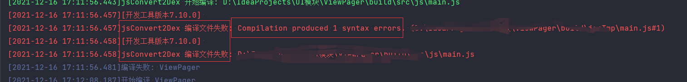

<!-- 来源：https://www.laoguicom.top/doc/357/ · 抓取状态：ok -->

# EC编译错误
如下图所示,这种错误ui.js 也会出现。



请检查代码是否有下面的错误
原因：EC 目前支持ES5部分ES6特性，不支持下面错误代码写法！请使用正确的写法
```
/**
 * @作者 Mr_老鬼 QQ:1156346325
 * @函数用途  EC  错误函数传参示例
 * @创建时间 17:10 2021-12-16
 * @参数
 * @return
 **/
// function aaa(array,array2=2) {
//     logd(array,array2);
// }
/**
 * @作者 Mr_老鬼 QQ:1156346325
 * @函数用途  EC  正确函数传参示例
 * @创建时间 17:12 2021-12-16
 * @参数
 * @return
 **/
function aaa2(array,arr2) {
    arr2 = arr2? arr2:"默认值";
    logd(arr2);
    logd(array);
}
```
----
我是Mr-老鬼、QQ1156346325 。交流QQ群：620028786，647082990，772810035
————————————————版权声明——————————————————
本文版权所有~Mr-老鬼 ~转载请注明原文地址
免责声明：本文所有的教程仅限交流学习使用不得用于违法用途，造成的法律后果本人不承担责任。