<!-- 来源：https://www.laoguicom.top/doc/406/ · 抓取状态：ok -->

# EasyClick IOS 2.X  环境安装 教程
##  EasyClick VIP IOS 教程(Mr、老冷：QQ/1920712147)：
http://home.laoleng.top:3001/web/#/271?page_id=1931
## 中控启动实例
已实测64台以上设备最高100台。
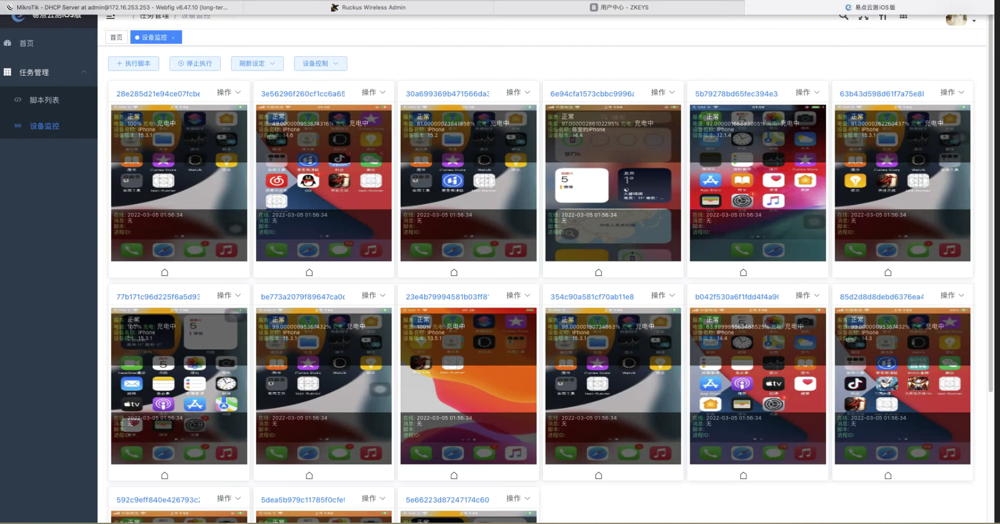
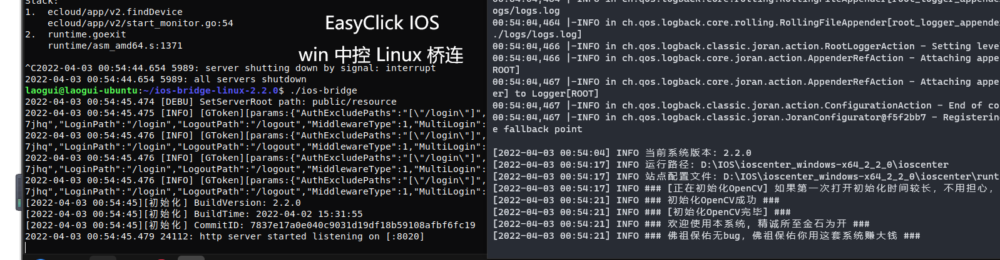

## IOS 分布式原理图
连接： https://gitmind.cn/app/doc/1bd7218134

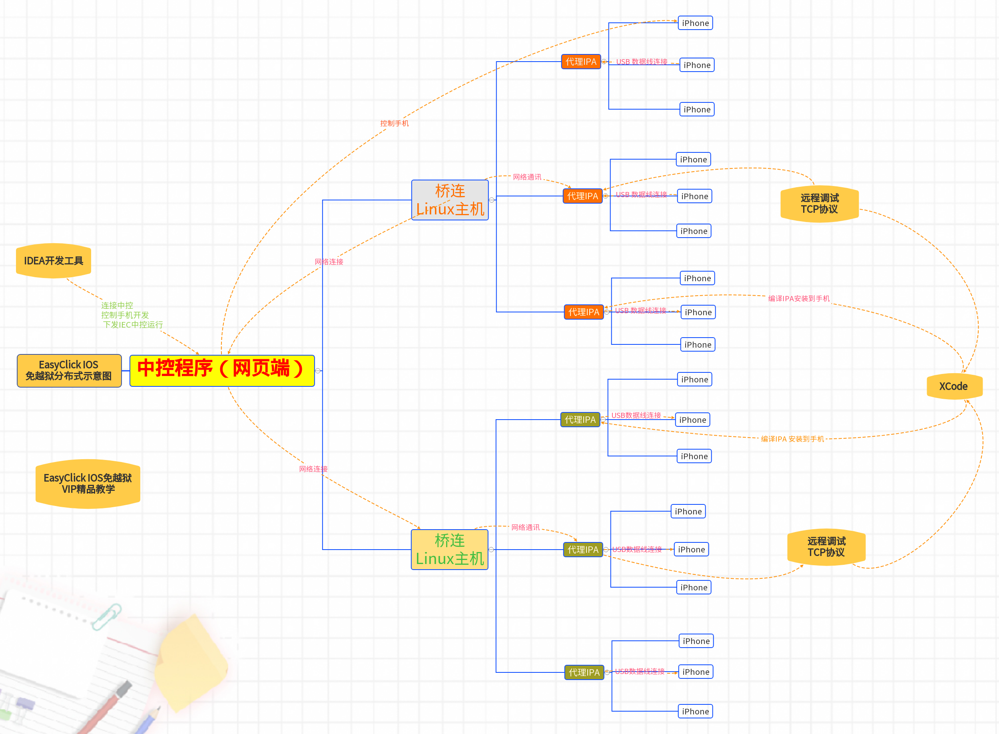

## 前置教程
### 黑苹果教程看 常用文档目录下的黑屏果教程即可。
### IOS 开发包 官方网盘下载（注意下载最新版本）
注意安装路径必须是不含中文和空格的路径！！！

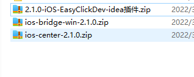

## win一键启动方式
下载并解压2.2以上版本

按下图所示操作即可
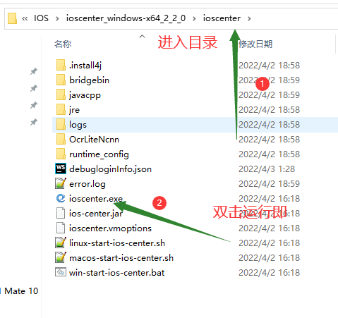

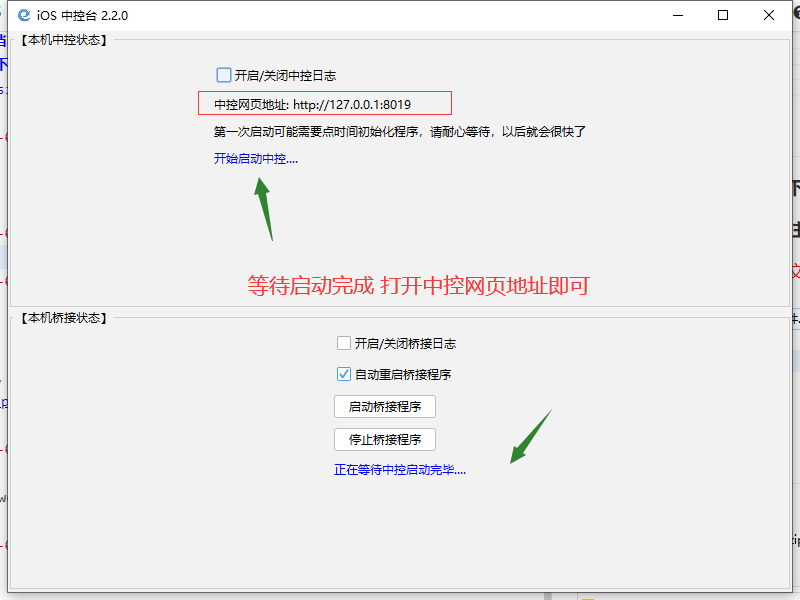
### 异常处理

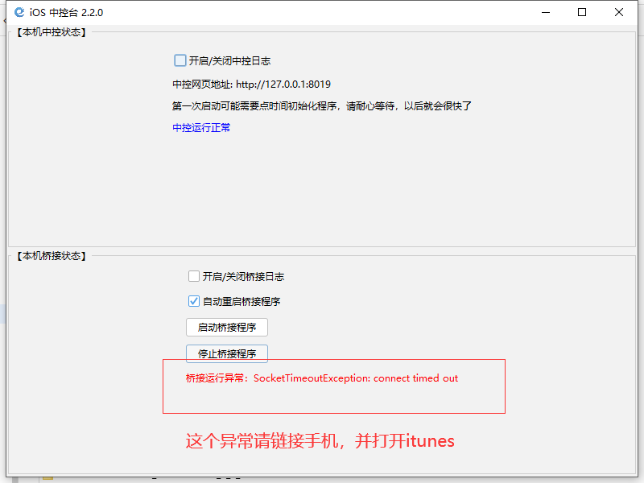

中文路径会报错，请解压到不包含中文路径位置

## 分布式安装方式
### win 10 前置
安装 终端应用 ，百度盘有，自行下载
必备安装包链接：https://pan.baidu.com/s/1nRa36Os92t_bHlaCvuBAIw 提取码：LaoG

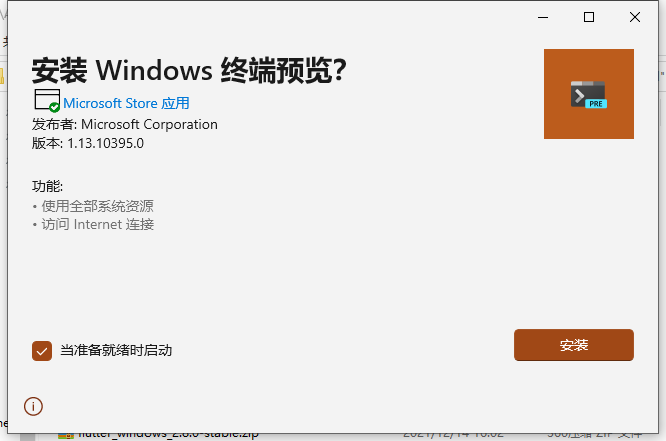

设置 命令行终端 默认为powershell方式启动！

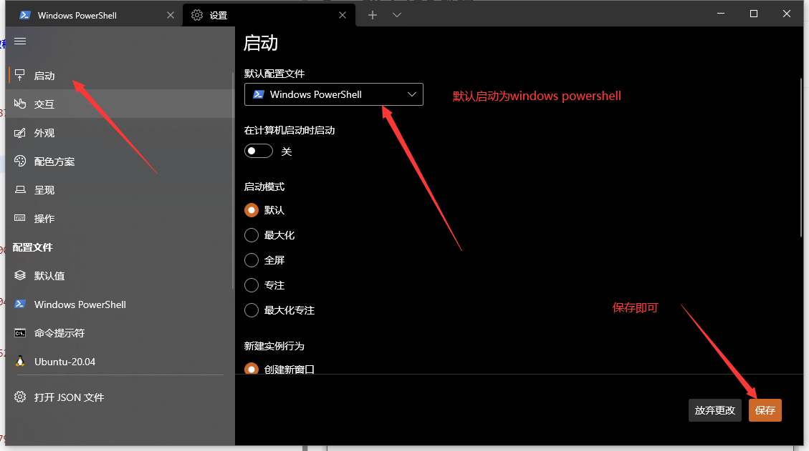

## win 启动桥接程序（Linux mac 自行执行终端命令即可无需win 这么复杂）

找到路径如图所示

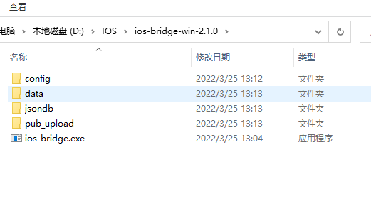

如下图所示操作即可
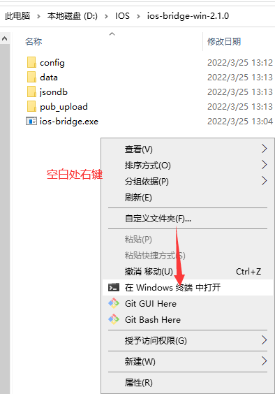

终端输入：`.\ios-bridge.exe` 回车即可
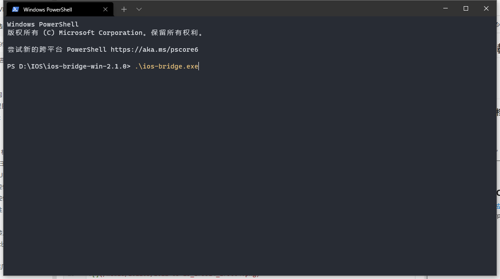

## win启动中控

找到路径 如图所示
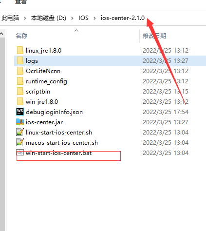

如下图所示操作即可
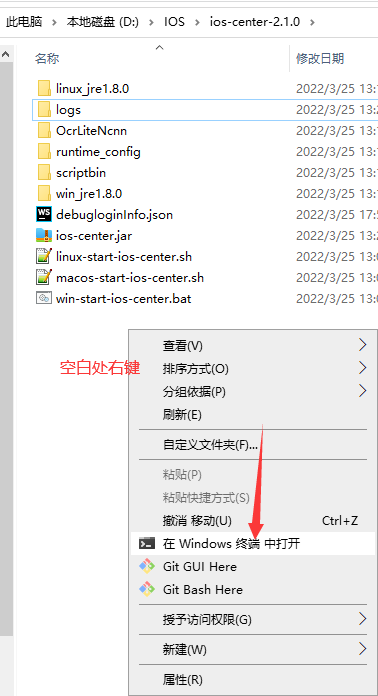

终端输入：`.\win-start-ios-center.bat` 回车即可

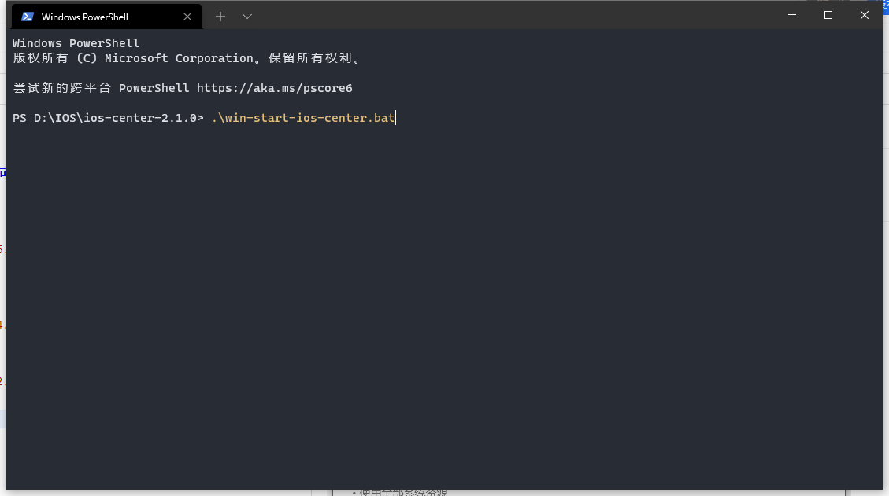

## ubuntu 资源
链接：https://pan.baidu.com/s/1Lm34ezw5sK2hJFHvxRVOpQ?pwd=laog 
提取码：laog 
盘中含Ubuntu20.04版本和win下Linux启动盘制作工具。

## IDEA连接中控调试
### IDEA 教程见常用文档里IDEA教程和IDEA汉化

如图所示
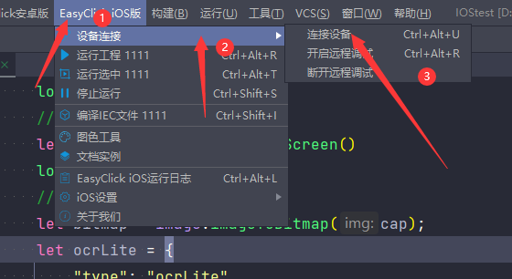

点击确定即可

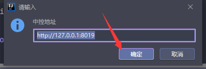

记得连接安装了IPA的手机，如下图所示即可正常开发。

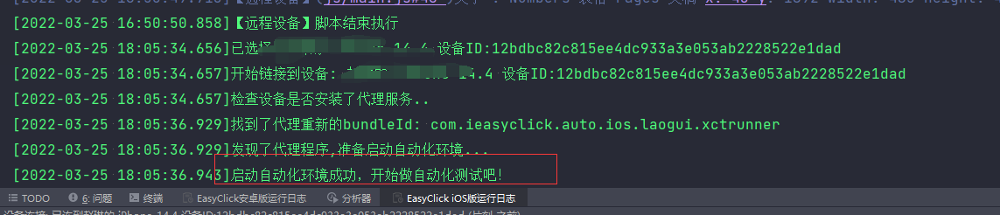

##  win启动中控报错

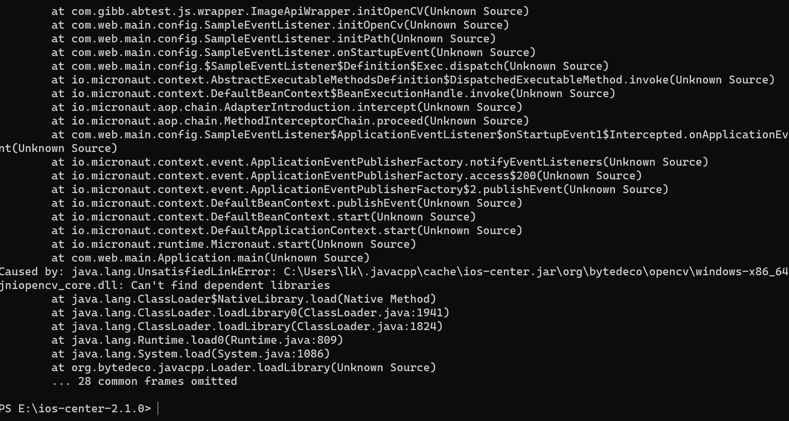

安装VC 库 解决 05-22 （官方网盘有或者自行百度）
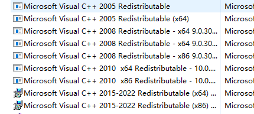

## win 启动桥接程序报错

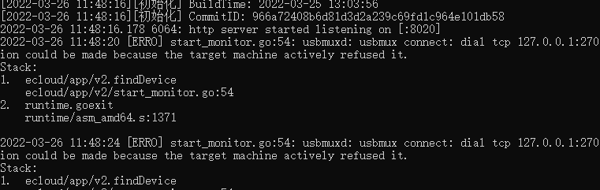

由于ios的封闭性，请在 Windows上安装iTunes或者爱思助手，并打开，保证能找到iphone设备

## XCode 添加开发者账号

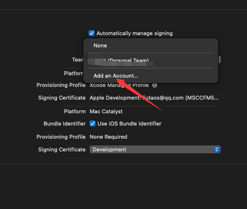

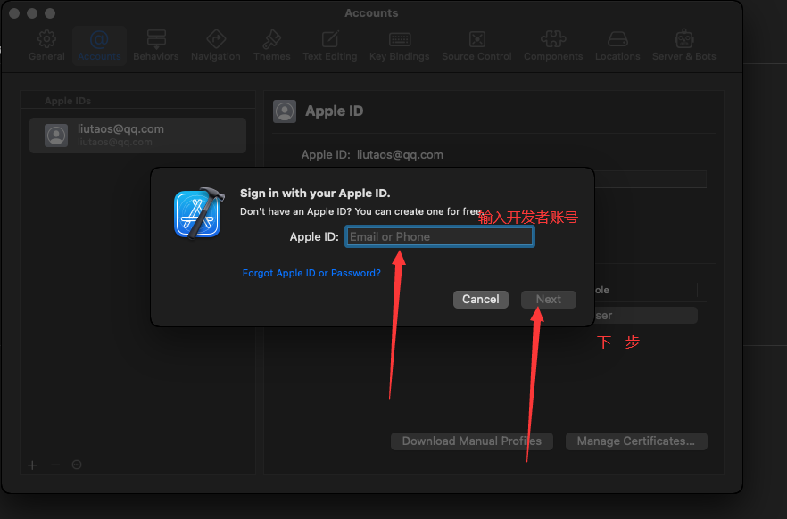

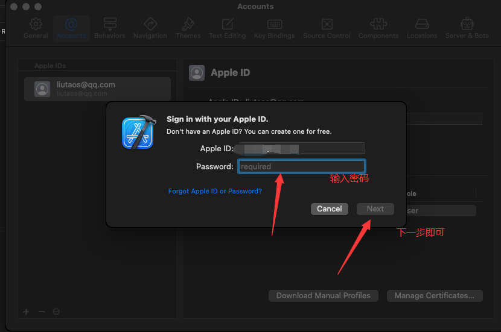

### Xcode 开发者账号添加后报错

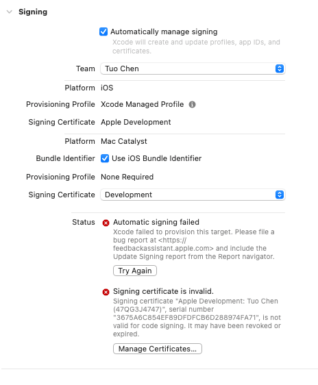

解决办法：http://home.laoleng.top:3001/web/#/271?page_id=2097
### 错误二
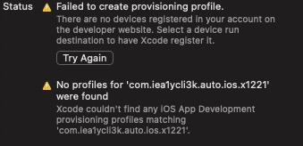

自己修改了包名 请在中控修改为对应的包名即可！不要使用ieasyclick前缀！！

### 错误三
根据USB3.0规范，最多支持32个device或者96个endpoint，所以当连接的USB-HUB将每个扩展口识别为设备的时候，最多可连接32个，超过32个USB3.0无法支持，属于USB3.0规格限制
AMD、英特尔主板对USB3.0连接数进行的限制，具体查看主板规范。

建议：USB HUB 集线器 买工业级产品不要买USB3.0 和 杂牌产品，会导致数据传输不稳定掉线！
官方推荐西普莱集线器工业级产品，质量有保证。

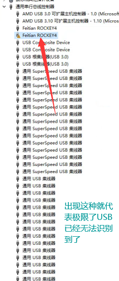
拔掉多的立马正常，这种情况就是USB数据不稳定导致掉线
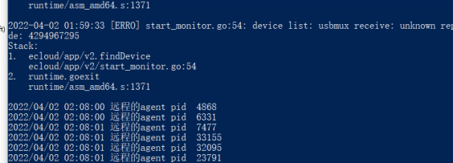

## 更多报错 参考老冷IOS文档常见问题