<!-- 来源：https://www.laoguicom.top/doc/394/ · 抓取状态：ok -->

# EasyClick 黑苹果安装教程、资源、坑点处理
## EC IOS安装成功示例

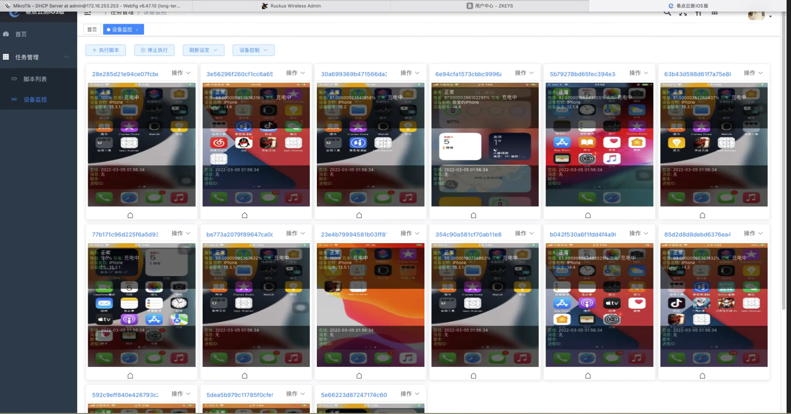

## EasyClick 官方开发资源
[百度云盘](https://pan.baidu.com/share/init?surl=24sTYQAZkedgfnTv3iFTZg "百度云盘")提取码：7bhy

[天翼云盘](https://cloud.189.cn/web/share?code=jUjE32AB7BBn "天翼云盘") 密码：0nsr

macos 12.5下载地址盘：  https://pan.baidu.com/s/1-IIpXkKMTClwqjwwfc34pg?pwd=laog 提取码：laog

## 使用MAC 真机
## 以下是符合要求的Mac：
MacBook2015及更高版本
MacBook Air2012或更高版本
MacBook Pro2012或更高版本
Mac Mini2012或更高版本
iMac2012或更高版本
iMac Pro2017或更高版本
Mac Pro2013或更高版本

## MAC真机macos 10.15以下版本升级到最新版 macos12(打开AppStore 搜索下图安装即可)
注意 预留剩余磁盘控件至少60GB

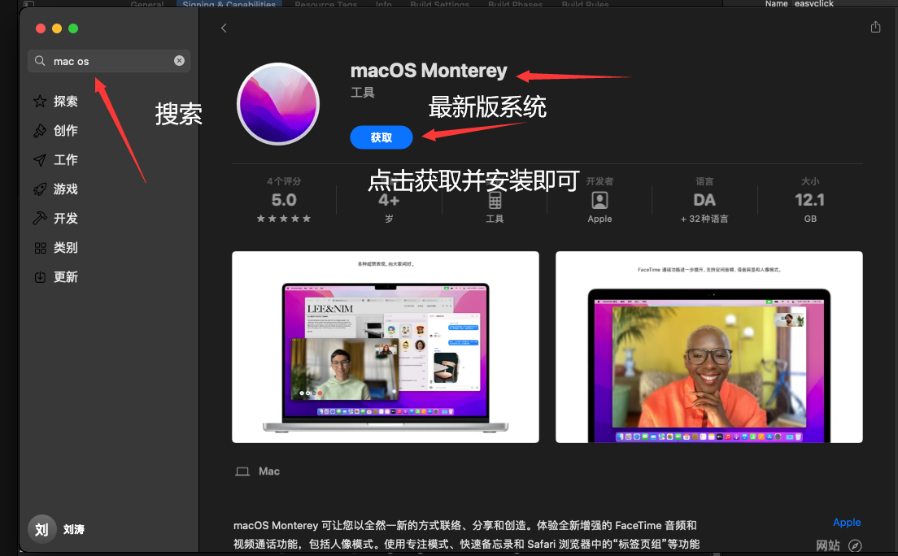

## 支持的IOS系统版本 10-15
## 必备XCode13.1以上版本
<font color="#FF0000" size=4>安装 XCode13  系统要求  macOS Monterey 12或更高版本！ 
黑苹果务必使用macos10.15版本或更高版本并且升级到最新版！</font>

XCode历史版本：https://developer.apple.com/download/all/?q=xcode

# 黑苹果教程

## 普通物理机安装 Mac OS
镜像地址：https://mirrors.dtops.cc/ISO/MacOS/
USB启动盘制作教程：https://www.iplaysoft.com/macos-usb-install-drive.html
B站教程：https://www.bilibili.com/read/cv6977038?from=search&spm_id_from=333.337.0.0
还有更多教程自己搜索


# EasyClick 黑苹果虚拟机资源
### 必备安装包链接：https://pan.baidu.com/s/1nRa36Os92t_bHlaCvuBAIw 提取码：LaoG

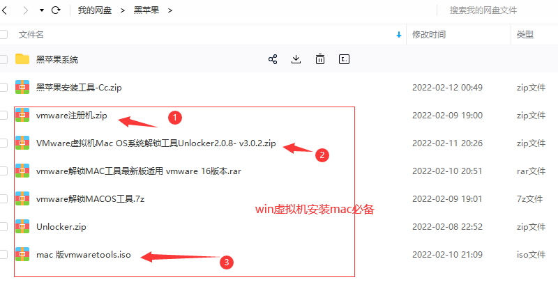

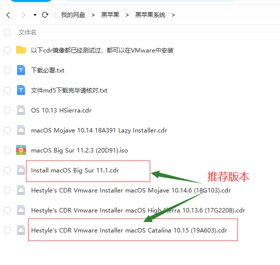

# 黑苹果vmware虚拟机安装教程
B站老冷教程：http://home.laoleng.top:3001/web/#/271?page_id=1931

常见EasyClick IOS安装 采坑：http://home.laoleng.top:3001/web/#/271?page_id=1931

## vmware 下载地址：
[vmware workstations Pro ](https://customerconnect.vmware.com/cn/downloads/info/slug/desktop_end_user_computing/vmware_workstation_pro/16_0#product_downloads "vmware workstations Pro ")


## 安装vmware 和使用
安装教程：https://www.jb51.net/softjc/745263.html
安装教程：https://blog.csdn.net/sinat_28228443/article/details/111062067


**安装完后需要升级mac os 到最新版才可以安装Xcode13版本！**

## 网络教程
 [CSDNvmware16安装macOS](https://blog.csdn.net/Lycoris_Red/article/details/113632562 "CSDNvmware16安装macOS")
[vmware MACOS 爬坑笔记](https://mp.weixin.qq.com/s/rqw9m8JVJ_XHi4Ufst_rsQ "vmware MACOS 爬坑笔记")

## VMware Workstation17+
>d 免费了 网盘有最新版

## 　VMware Workstation16 密钥：
```
ZF3R0-FHED2-M80TY-8QYGC-NPKYF
YF390-0HF8P-M81RQ-2DXQE-M2UT6
ZF71R-DMX85-08DQY-8YMNC-PPHV8
```

## vmware激活
盘中注册机注册。
# vmware虚拟机安装macos 坑点处理
## 开启虚拟机可能会出现不可恢复的错误

解决方法如下：
找到在之前的创建新的虚拟机时，设置的虚拟机位置。打开该目录，找到**OS X xx.xx.vmx**文件（这里的文件是：**OS X 10.15.vmx**），右键用记事本方式打开，找到 `smc.present = “TRUE”`
在`smc.present = “TRUE”`后面，手动添加一句
```
smc.version = "0"
```

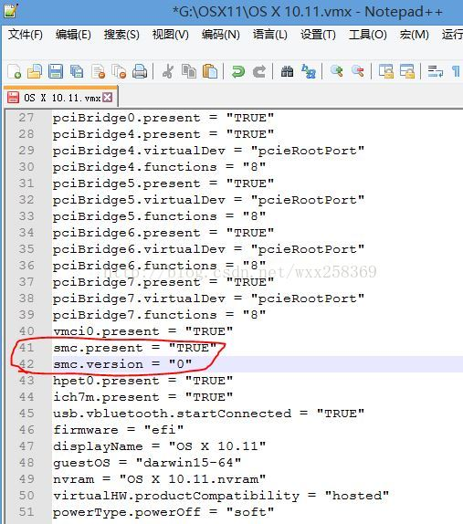
然后保存关闭，再重新启动虚拟机，就不会报错了
## 安装MacOSX  没有鼠标键盘的处理方法

**第一步**：
关闭虚拟机。
**第二步**：
在虚拟机目录下找到XXX.vmx，XXX代表你的虚拟机名；使用文本编辑器打开该文件，在文件末尾添加下列内容：


```
keyboard.vusb.enable = "TRUE"
mouse.vusb.enable = "TRUE"

```
**第三步**：
在左侧栏里该虚拟机上点右键-->设置，打开虚拟机设置界面，点击“硬件”选项卡，点击硬件列表框下的“添加”按钮，添加“USB控制器”。

**第四步**：
在硬件列表框里选中“USB控制器”，将右侧的“USB兼容性”更改为“USB2.0”，并勾选下列的“显示全部USB设备”。

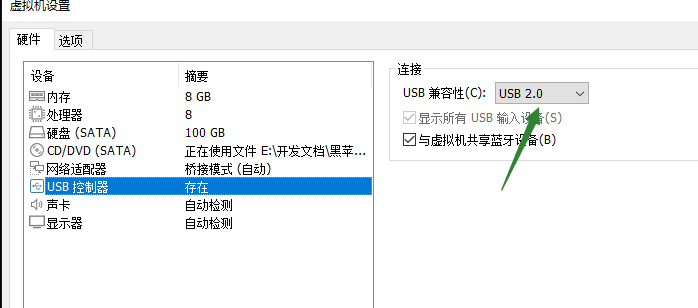
**第五步**：
启动虚拟机。
即可解决

## 登录AppleID 后提示无法提供服务或已下架
删除虚拟机虚拟磁盘重新创建即可。

## 修改mac 时区然后编译ipa


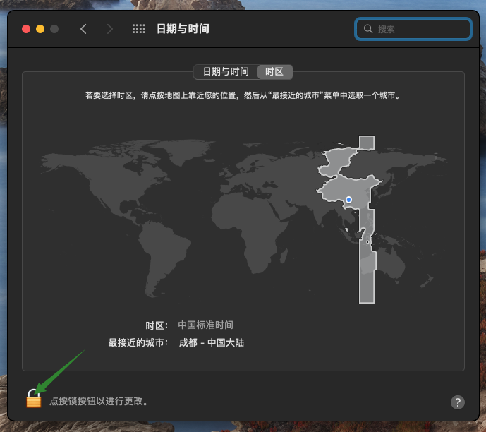
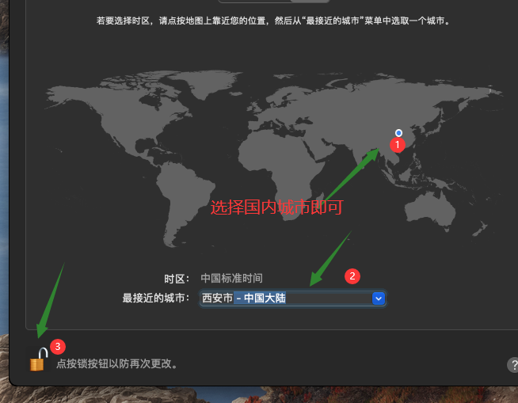
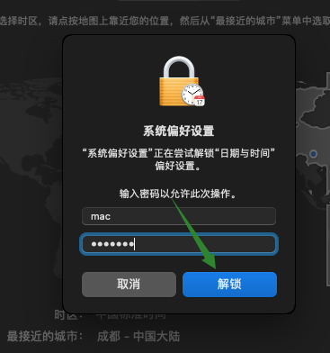

## XCode安装 并编译ipa程序
### 第一步，如图所示打开AppleStore

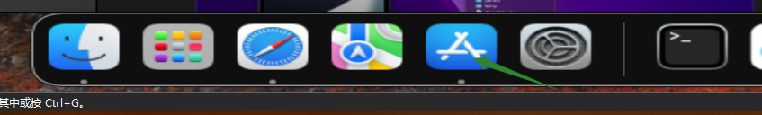
### 第二步，搜索XCode13并获取安装
如果没登录AppleID 则需要登录之后即可搜索安装。

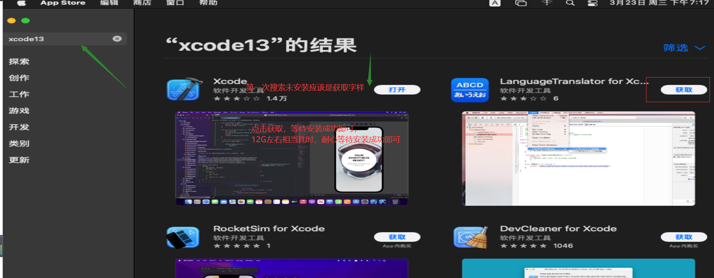
### 下载ipa 源码
官方网盘下载到mac 电脑

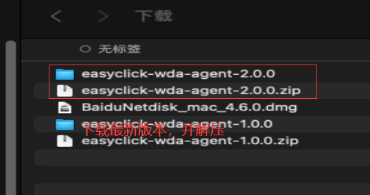

## 注册Apple 开发者账号
地址：[ AppleDeveloperProgram](https://developer.apple.com/cn/programs/enroll/ " AppleDeveloperProgram")

### 编译ipa
#### XCode打开下载的源码
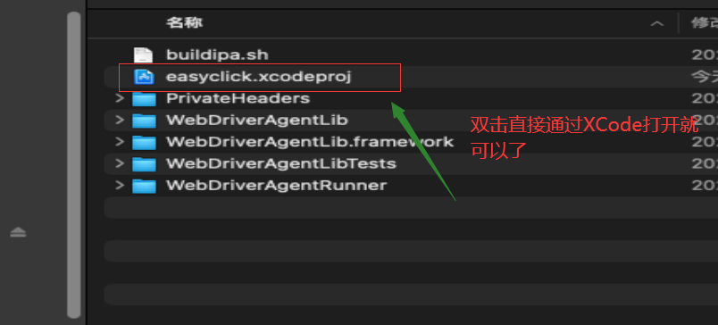
如图所示按步骤操作
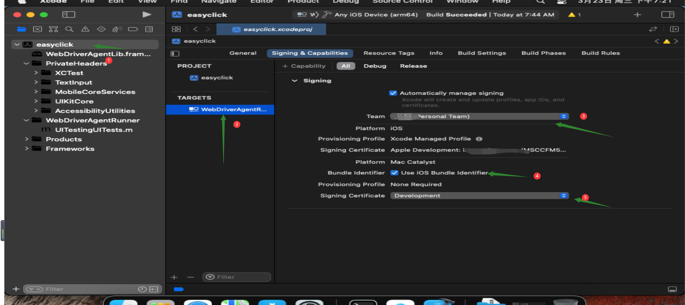

#### 连接手机并安装测试程序
<font size="4">选择已连接的手机</font>

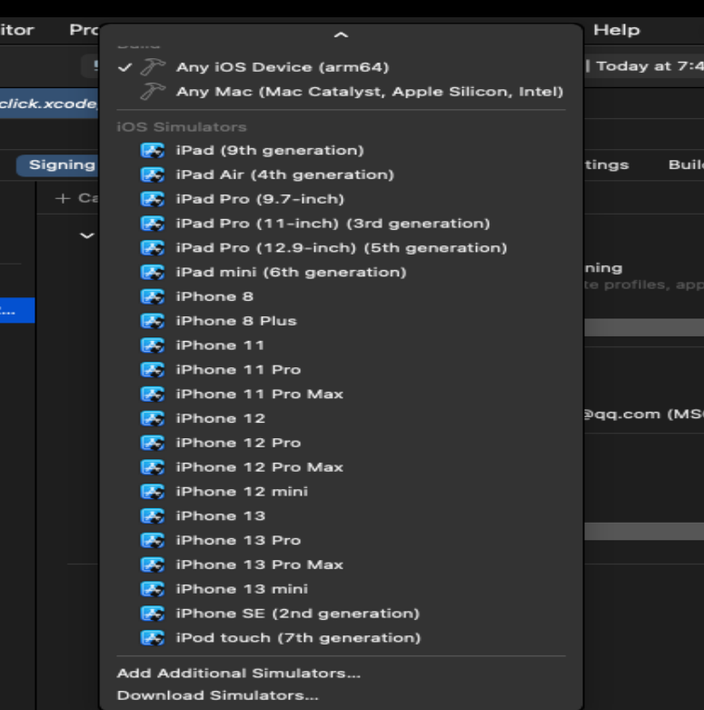

<font size="4">运行测试</font>
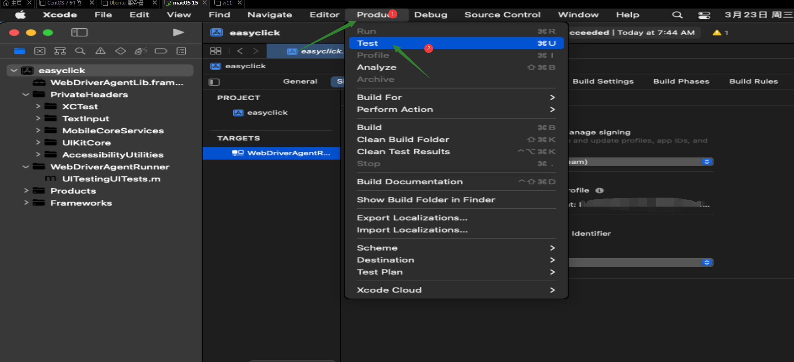

### 编译IPA 过程错误处理

错误一
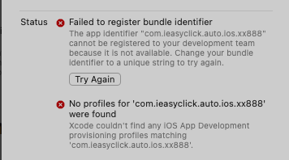
双击修改后缀com.ieasyclick.auto.ios.xxx从xxx开始修改成独一无二的id
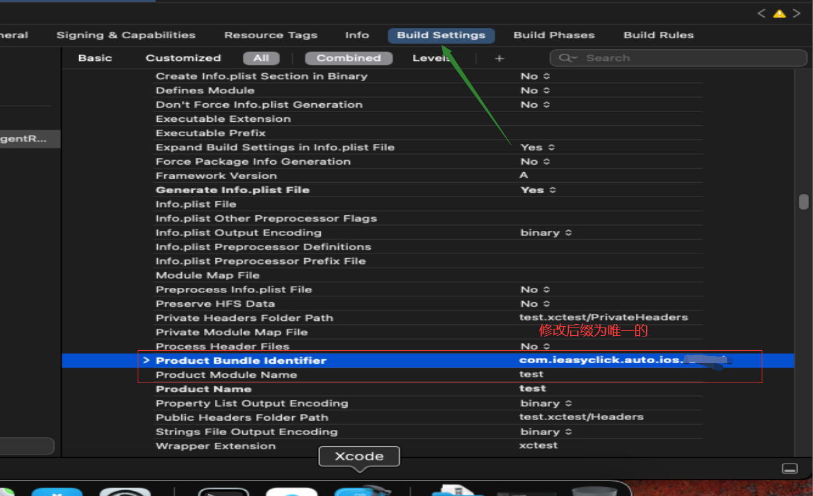

错误二

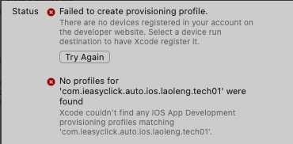
错误原因：
- 账号未注册成为开发者账号 
- 新账号需注册一天后再申请
解决办法
```
签名类型:
普通的appleid签名:
    - 免费
    - 限制: 只能安装3台设备，bundleId只能允许十天更改三次，
        证书7天就会过期，需要再次使用xcode运行代理ipa源码
  - 地址: https://appleid.apple.com/account
个人开发者签名:
    - 费用688元，使用iPhone
    - 限制: 安装100台设备，证书一年后过期，过期后需要再次使用xcode运行代理ipa源码
    - 地址：https://developer.apple.com/cn/support/enrollment/
    - https://www.jianshu.com/p/029167817dde
这里演示的是appleid免费的签名
实际开发和调试脚本可以使用免费appleid
正式使用超过3台设备，需要使用个人开发者签名或者申请大量的免费appleid签名
```

错误三

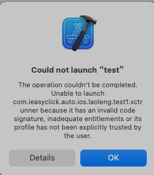
这种提示需要手机里进行信任开发者应用
<font size="3"> 进入手机的 设置 - 通用 - 设备管理 ，选择开发者应用, 点击信任 apple developement:xxxx</font>

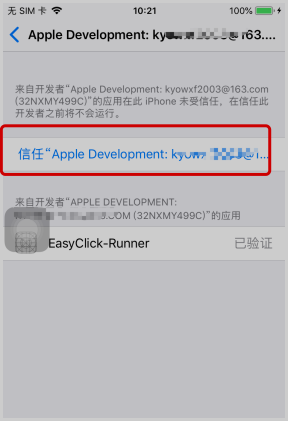
## 其他的中控 桥接 IDEA插件 详见 IOS 教程

## mac 多设备扩展集线器
西普莱厂家直供需要可以联系我购买。

----
我是Mr-老鬼、QQ1156346325 。交流QQ群：620028786，647082990，772810035
————————————————版权声明——————————————————
本文版权所有~Mr-老鬼 ~转载请注明原文地址
免责声明：本文所有的教程仅限交流学习使用不得用于违法用途，造成的法律后果本人不承担责任。

