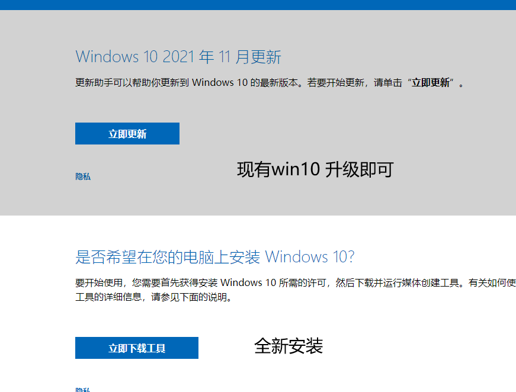
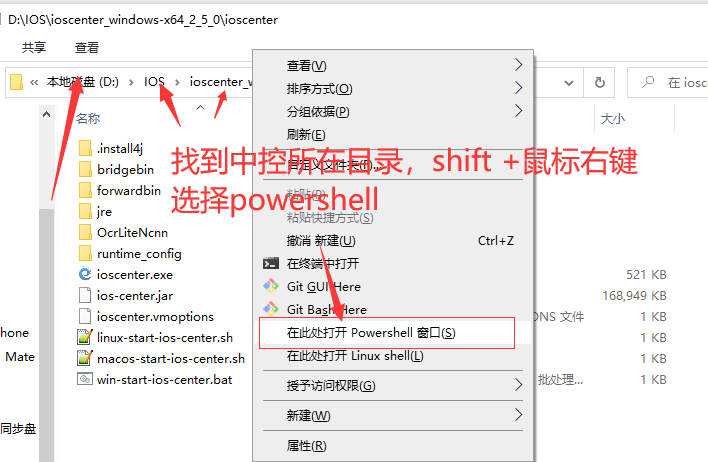
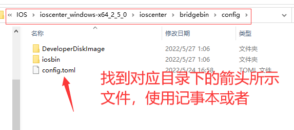
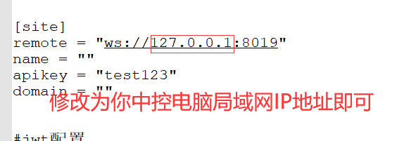

<!-- 来源：https://www.laoguicom.top/doc/414/ · 抓取状态：ok -->

# Windows 10 系统
现有工作室大部分为ghost一键装机版系统。这种系统多多少少存在一定的隐患，组件不全、系统权限问题、服务不全等各种运行异常问题。
正确安装Windows10操作系统即可解决Windows10操作系统被阉割导致的一些莫名其妙的运行错误。
系统下载地址：https://www.microsoft.com/zh-cn/software-download/windows10/ 

推荐装机工具[冰封启动](http://www.bfgho.com/ "冰封启动")

# 分布式执行IOS 中控和桥连
## 启动方式
大多工作室使用双击中控或桥连程序执行，这种方式是错误的。
 请使用powershell命令行执行。
 第一步：如下图所示打开powershell命令行终端（中控和桥连路径不一样注意）
 

 第二步：在蓝色命令行终端输入（回车后如果弹出防火墙，全部允许确定即可）
 中控如图输入，敲回车即可启动

桥连如图输入，敲回车即可启动

## 桥连使用长连接设置方式
如下图所示操作

找到如下图所示位置修改即可。

# 中控闪退

检查网络环境是否正常防火墙是否允许访问，检查vc运行库是否安装2005~2022 所有版本

# 桥连闪退

检查桥连路径是否包含中文名称，修改为英文或者转移其他非中文，空格等特殊符号路径即可。
# 桥连崩溃
启动脚本不要一次性全部一键启动，建议6台分批启动。一键启动占用资源太大会导致数据不稳掉线崩溃。

# 硬件环境问题
## 数据量过大导致中控或者桥连崩溃
检查USB HUB （集线器）是否为杂牌垃圾产品，市面上 很多安卓的集线器并不适合苹果使用！，请替换为官方推荐的西普莱集线器即可。

## 电脑带不动30台以上手机
检查主板是否支持30以上USB 设备连接，不支持请替换为X79,X99 ，B85等老款主板，市面上的新款主板会存在限制USB设备数的问题来提升性能导致不能连接30以上设备。

win10 如果不能连接30以上设备，替换操作系统为Ubuntu，国产深度，国产优麒麟系统即可。

禁用USB3.0！禁止使用USB3.0以上插口或者USBhub，如果非要使用，请使用雷电四接口的！

