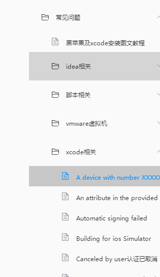

<!-- 来源：https://www.laoguicom.top/doc/415/ · 抓取状态：ok -->

# XCODE签名问题

## XCODE版本问题
官方要求使用XCODE13.1以上版本。
根据iPhone手机系统版本决定XCODE版本，IOS版本高于15.4请 保持手机系统最新版和XCODE为最新版。

## IOS 最低版本为13版本
低于13版本的iPhone手机请升级使用。

## 手机问题
选用正常手机不存在签名签不上的问题。
选用绕ID且有基带手机可签。
其他机型请自行测试，不能签的更换手机为上面两种即可。

# 脱离MAC XCODE签名
官方未发布任何方式脱离XCODE编译签名，其他三方脱离XCODE签名的自行测试出问题的话请按照官方方法操作即可。
# 签名的其他问题请参考老冷文档常见问题即可
地址：http://home.laoleng.top:3001/web/#/271?page_id=2125

