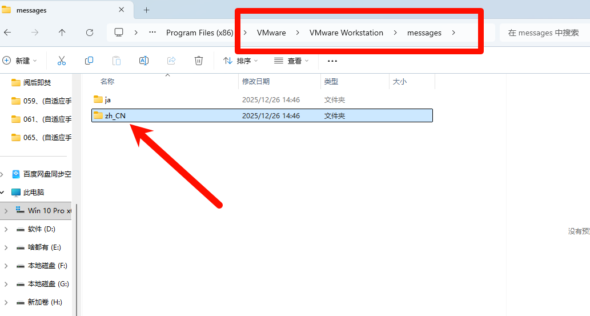
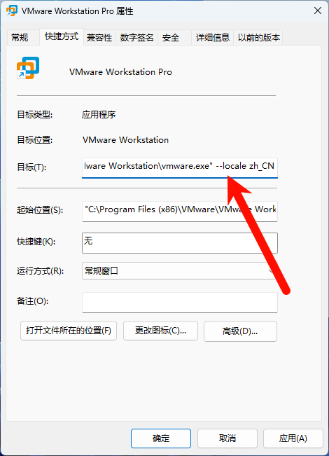

<!-- 来源：https://www.laoguicom.top/doc/881/ · 抓取状态：ok -->

# VMware25H2汉化
度盘: vmware
链接: https://pan.baidu.com/s/1ytx8gn5mvz6lo6lsl79Ayw?pwd=a8pd 提取码: a8pd 
 

## 1、复制语言包

在原先中文版的安装目录里`messages\\zh\_CN`，复制一份对应的语言包，假如没有就下载盘里的压缩包，记得解压哦！将语言包放到新安装的25H2的对应目录下。

## 2、编辑配置文件

文件位置：C:\\Users\\Administrator\\AppData\\Roaming\\VMware\\preferences.ini

在文件里添加一行：`pref.locale = “zh\_CN”`

此时重启vmware，中文应该就生效了，假如未生效，请参照第三步

## 3、通过启动快捷方式指定语言

右键vmware的启动图标，修改目标，在后面增加参数：--locale zh\_CN

注意和之前的命令有空格

