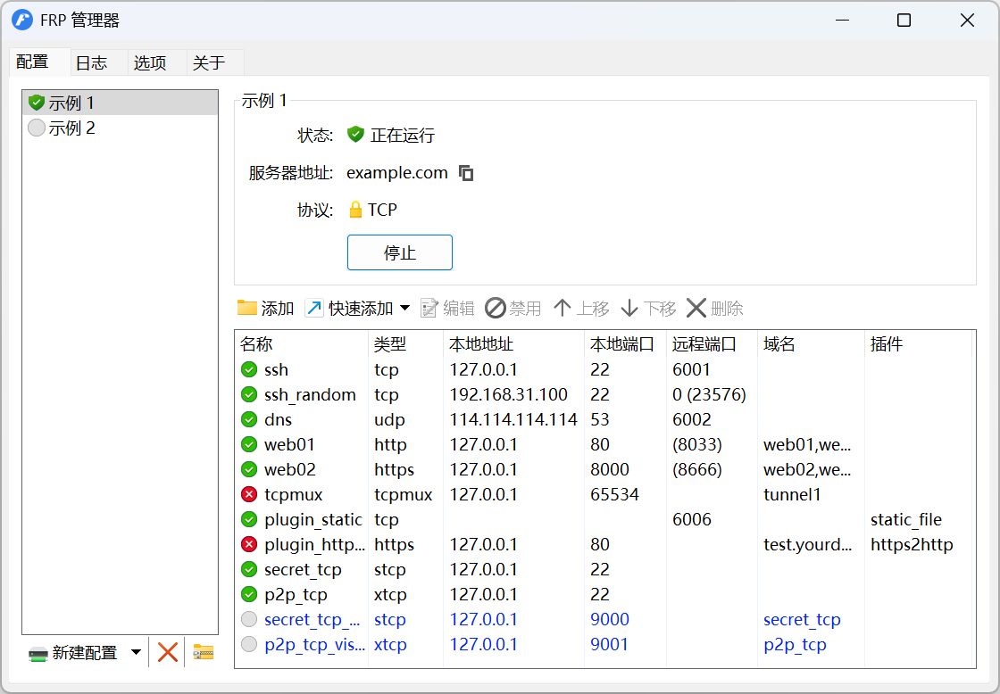
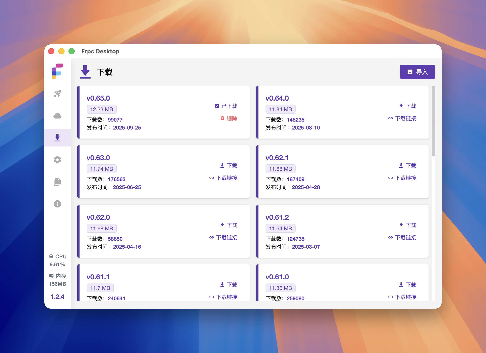

<!-- 来源：https://www.laoguicom.top/doc/430/ · 抓取状态：ok -->

# EasyClick 远程调试内网穿透工具

## 花生壳 

官网
 [花生壳](http://hsk.oray.com/download/ "花生壳")
 
## frp 云服务器自建

开源项目地址:https://github.com/fatedier/frp
安装文档:https://gofrp.org/docs/

## frpmgr

FRP   管理器是一个多节点、图形化反向代理工具，专为 Windows 上的 [FRP](https://github.com/fatedier/frp) 设计。它允许用户轻松设置反向代理，而无需编写配置文件。FRP 管理器提供了一套完整的解决方案，包括编辑器、启动器、状态跟踪和热重载。

该工具的灵感来自于一个常见的用例，我们经常需要组合使用多种工具，包括客户端、配置文件和启动器，以创建一个稳定的服务，将位于 NAT 或防火墙后的本地服务器暴露到互联网。现在，有了 FRP 管理器这个一体化解决方案，您可以在部署反向代理时省去许多繁琐的操作。

开源地址:https://github.com/koho/frpmgr

## frpc desktop

 开源地址: https://github.com/luckjiawei/frpc-desktop?tab=readme-ov-file

 
