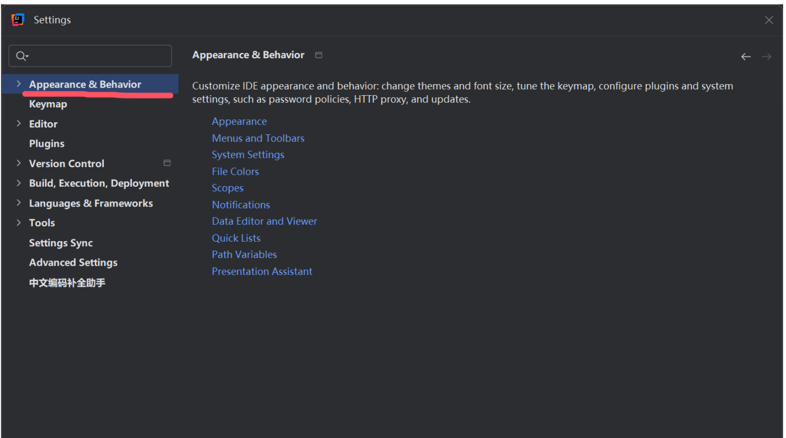
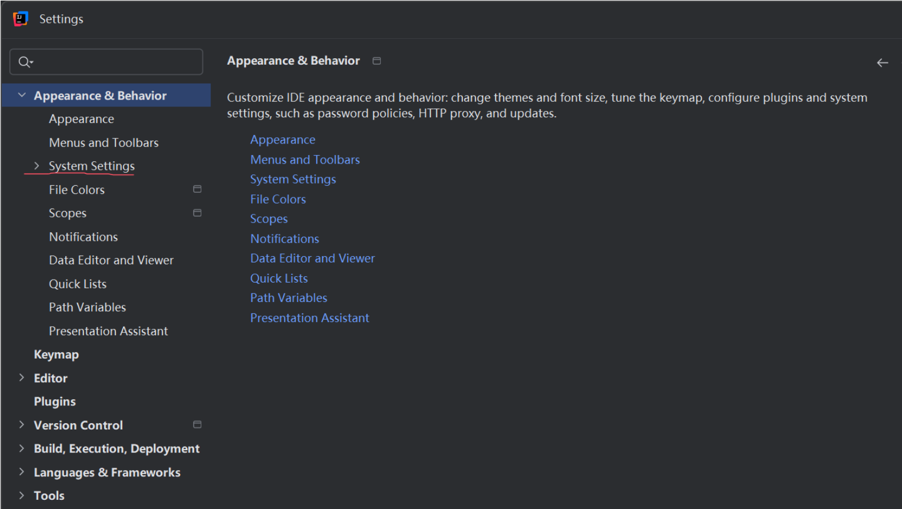
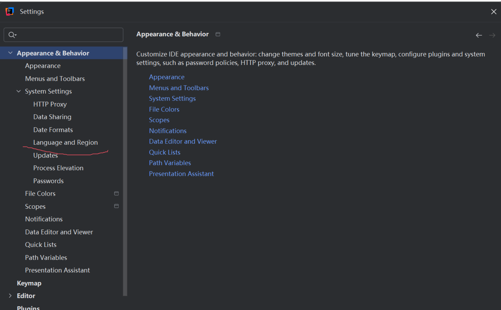
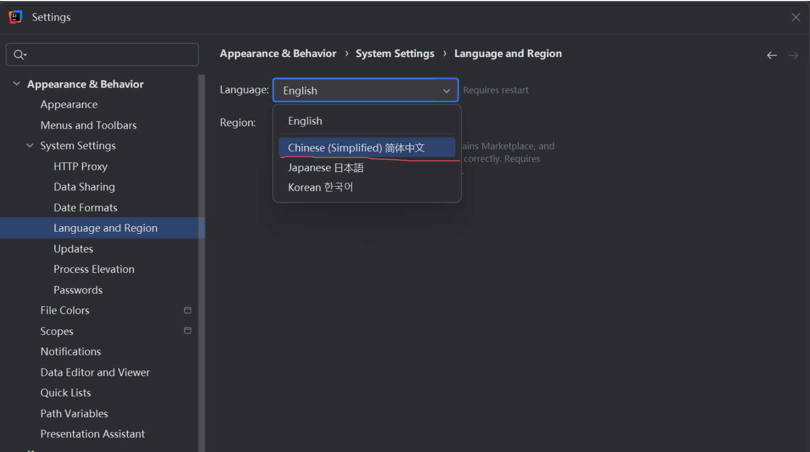
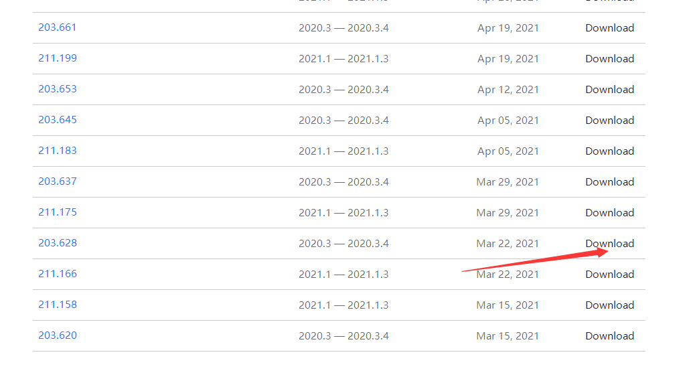
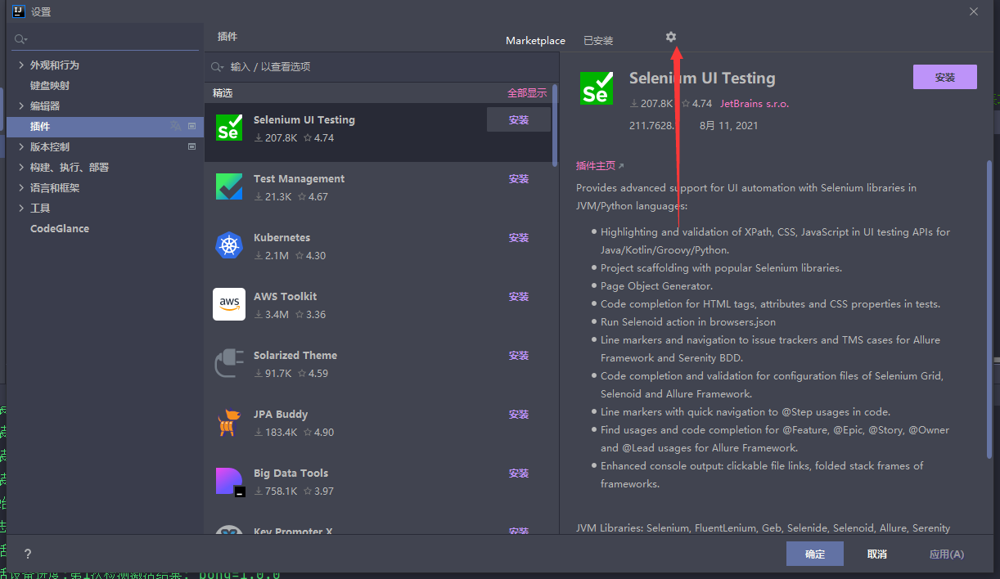
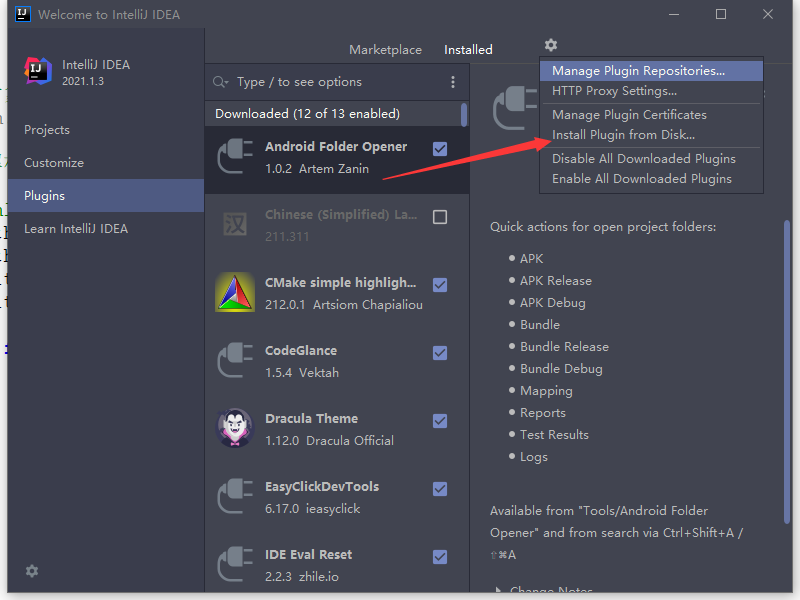
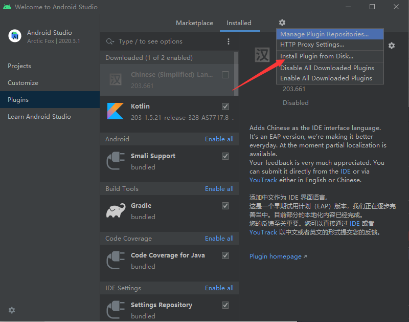
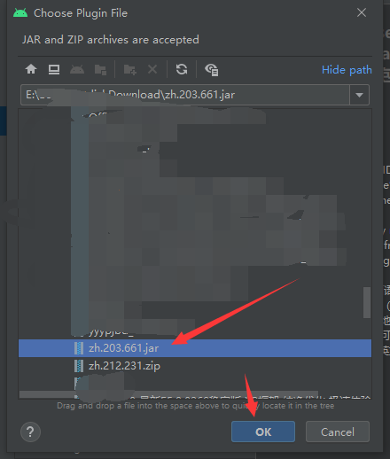
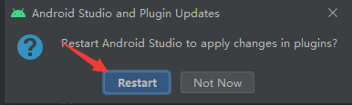

<!-- 来源：https://www.laoguicom.top/doc/165/ · 抓取状态：ok -->

# EasyClick IDEA 汉化
## 2024版设置方式
新版本已自带汉化需要去 设置语言和地区
>d settings -> Appearance&Behavior -> System Srttings -> Language and Region  选择中文后重启即可

>d 24版IDEA如果没有自带汉化 那么从下方链接下载24版专用汉化插件安装之后在按照上述方式操作即可
>通过网盘分享的文件：IDEA汉化包
链接: https://pan.baidu.com/s/1yFc_FQkuOJFqD2gIZl_x_Q?pwd=8aku 提取码: 8aku 
--来自百度网盘超级会员v6的分享

>s 注意地区选则非中国大陆!!!

 

## 离线本地安装方式(推荐)
idea 和Androidstudio 汉化插件安装方式相同 
高版本的Androidstudio 需要下载 汉化插件如下图所示方式安装

中文语言包下载地址：[语言包](https://plugins.jetbrains.com/plugin/13710-chinese-simplified-language-pack----/versions"语言包")
百度盘地址：https://pan.baidu.com/s/1Jrm1aZbzwa1Rrddd-UCgFQ 提取码: lgui  

下载如下图所示版本
>d 选择IDEA版本对应的插件版本下载

设置页 插件 选中设置图标 

选择磁盘安装
idea

Androidstudio

找到本地下载插件jar 包或者zip 包

重启即可 

------------

我是Mr-老鬼、QQ1156346325 。交流QQ群：620028786，647082990，772810035
**------------------------------------------------版权声明------------------------------------------------------**
 本文版权所有~Mr-老鬼 ~转载请注明原文地址
免责声明：本文所有的教程仅限交流学习使用不得用于违法用途，造成的法律后果本人不承担责任。