<!-- 来源：https://www.laoguicom.top/doc/446/ · 抓取状态：ok -->

# IDEA 常用开发插件

## 国内的ideaAI 插件

### 通义灵码
阿里云出品
插件在线搜索 TONGYI Lingma 安装

### 腾讯云AI代码助手
腾讯出品
插件在线搜索 Tencent Cloud CodeBuddy安装

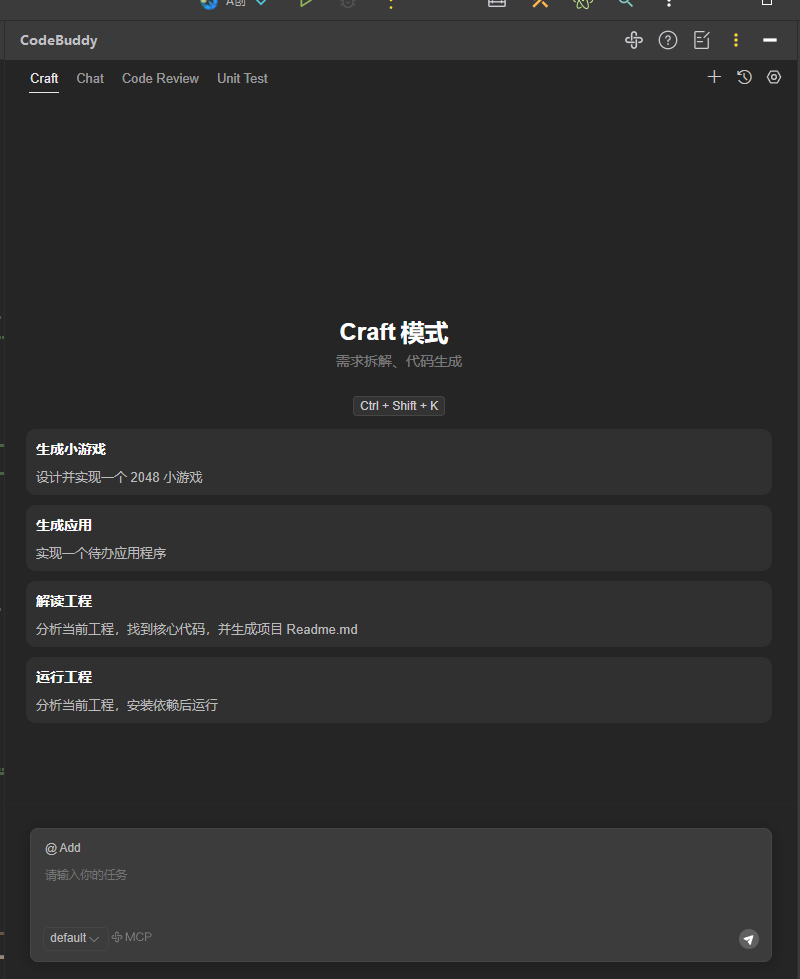

### Trae AI
字节出品
插件在线搜索  Trae AI 安装

### CodeGeeX 
智谱出品 开源，免费
插件在线搜索  CodeGeeX  安装

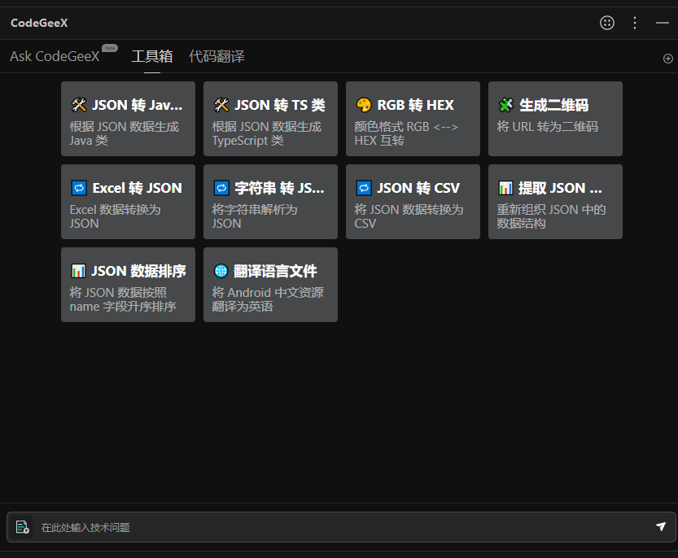

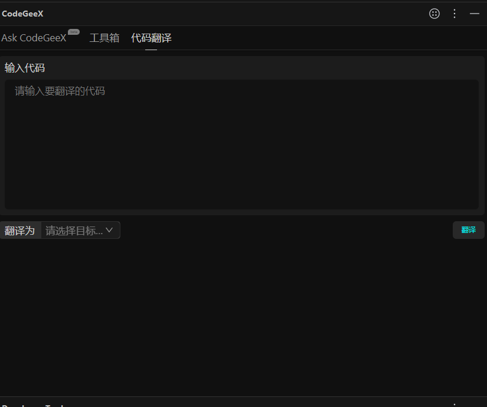

## 其他开发利器
### TreeInfotip  文件名水印

>s 可以在文件名后添加备注信息方便开发时不适用中文文件名备注名称
>

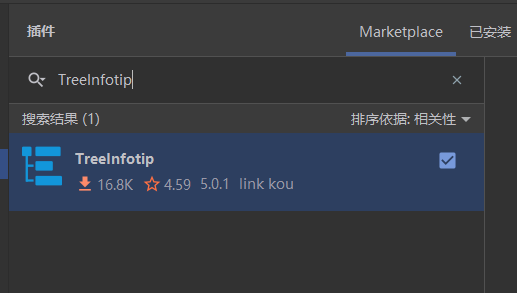

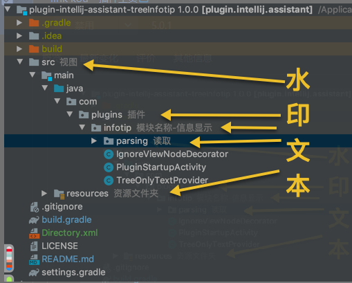

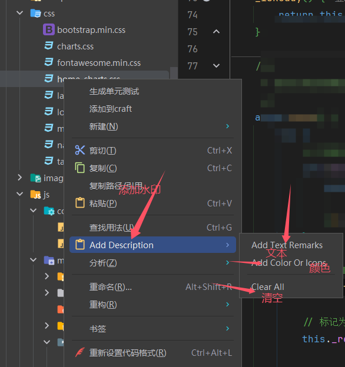

#### Rainbow Brackets
给括号添加彩虹色，使开发者通过颜色区分括号嵌套层级，便于阅读

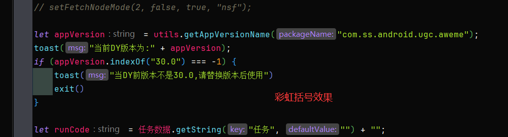

这个是收费版

这个是免费版 Rainbow Brackets Lite

免费版设置说明

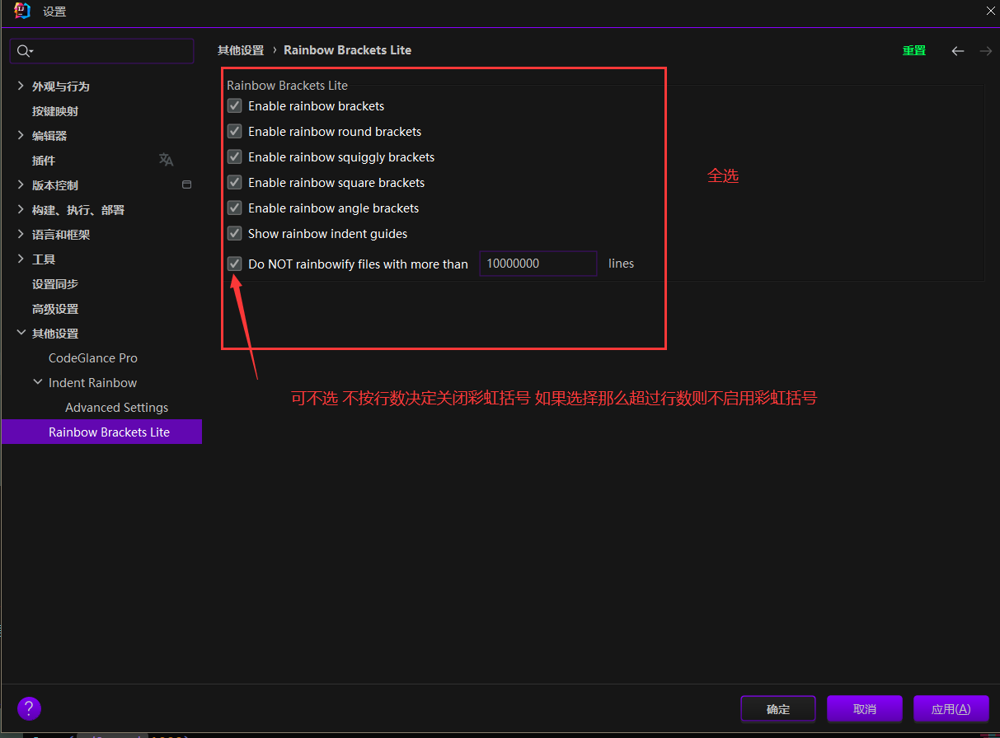

#### Indent Rainbow 
彩虹缩进插件,使开发者可以清晰的分辨代码层次结构,便于阅读

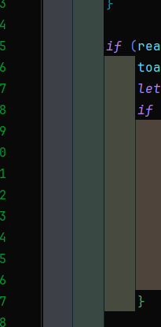
[插件下载地址](https://plugins.jetbrains.com/plugin/13308-indent-rainbow/versions "插件下载地址")
idea 自行在插件里在线 搜索安装也可.
设置说明
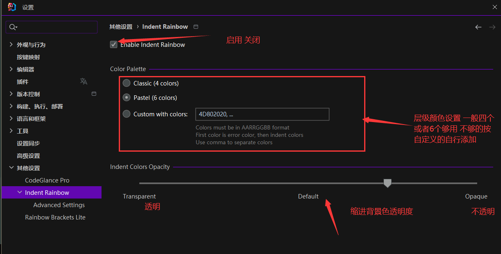

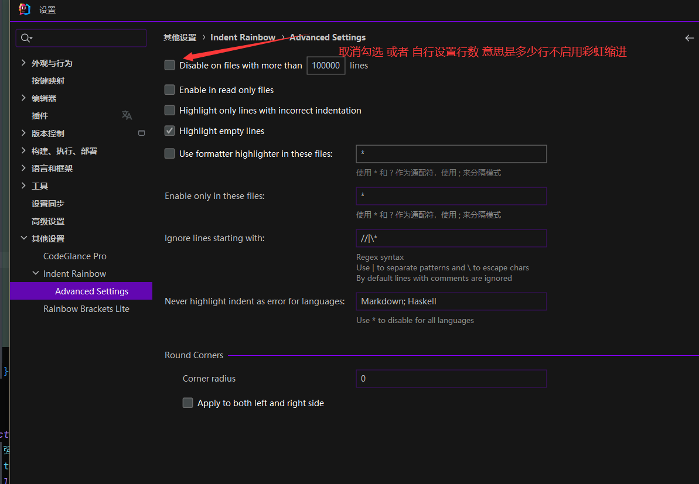

#### CodeGlance3

再也不用疯狂拖拽到底去找一遍啦，多不方便呀，使用此插件可以查看缩略图一样，快速切换到自己需要去的地方~

#### Chinese Language
汉化插件

#### Developer Tools
一款强大的工具箱插件，内整合了常用的功能,不用来回切换其他工具就可以做到很多功能。
支持的功能如下:
>d 编码和解码:JWT（JSON Web 令牌）、Base32、Base64、URL Base64、MIME Base64、URL 编码、换行
正则表达式匹配器
UUID、ULID、纳米 ID 和密码生成器
文本排序
文本案例转换
文本差异查看器
文本格式转换
文本转义:HTML 实体、Java 字符串、JSON、CSV 和 XML
文本过滤器
JSON 路径解析器
JSON 架构验证器
散列
存档（ZIP、TAR、JAR、7z、...)查看器和提取器
日期时间处理（Unix 时间戳、格式化、...)
时间、数据大小和传输速率的单位转换器
代码样式格式
SQL 格式化
颜色选择器
QR码/条形码生成器

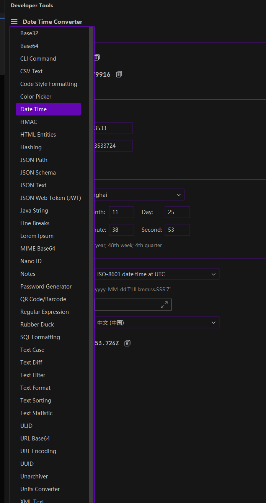

#### Codota
  Codota，程序员的编程助手，可以用于代码的智能补全功能，它基于百万级github仓库java程序，能根据程序上下文及依赖给出最适合的代码提示及自动补全推荐，给代码开发带来了极大的便利，绝对是idea 插件中的必备利器。
  
####  Key Promoter X
快捷键提示插件。当你执行鼠标操作时，如果该操作可被快捷键代替，会给出提示，帮助你自然形成使用快捷键的习惯，告别死记硬背。

#### Tabnine AI Code Completion
使用 AI 去自动提示和补全代码，比 IDEA 自带的代码补全更加智能化

#### Translation
翻译插件，鼠标选中文本，点击右键即可自动翻译成多国语言。

#### Background Image Plus
这款插件并不能直接提高你的开发效率，但是可以让你的IDE看起来更炫酷。

#### CSDN Tool
CSDN 出品的工具合集

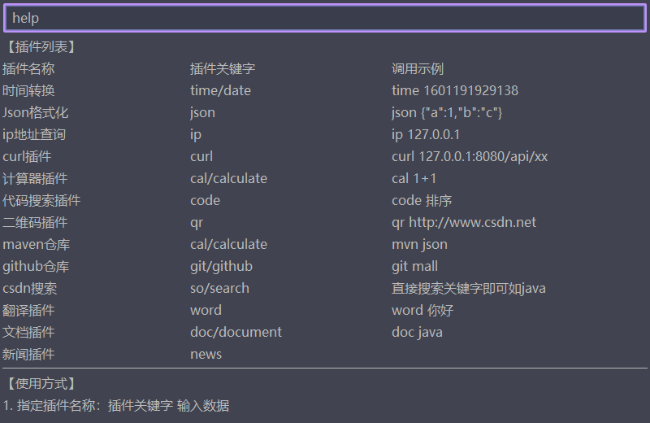

#### Extra Icons
图标美化插件

#### Gitee
码云出品官方插件

#### Dracula Theme
主题插件

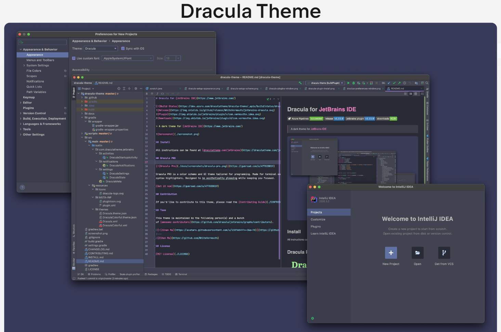

#### Material Palette
调色板插件(需要手动设置快捷键后才能启用)

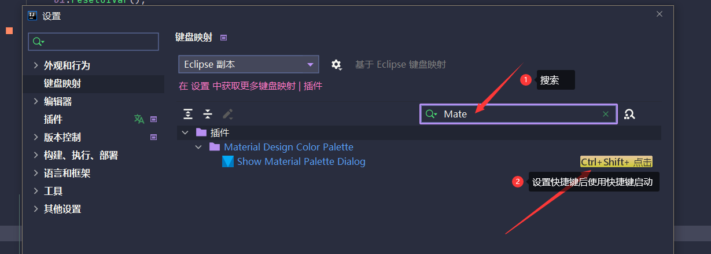

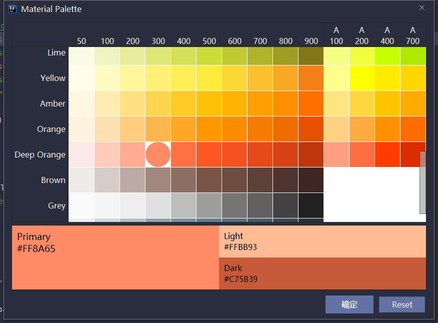