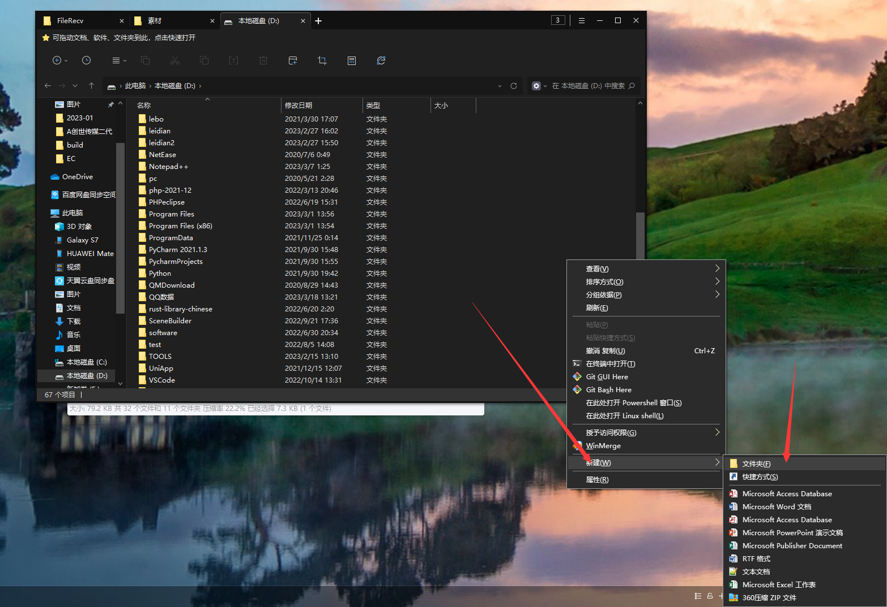
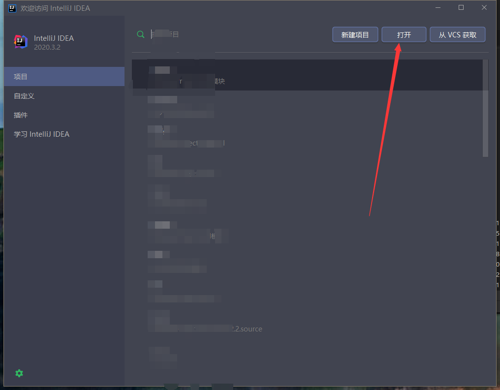
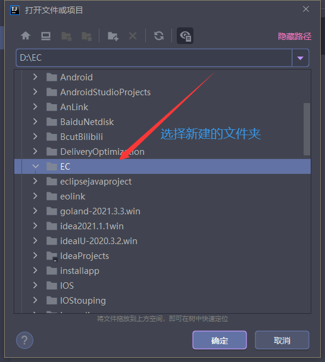
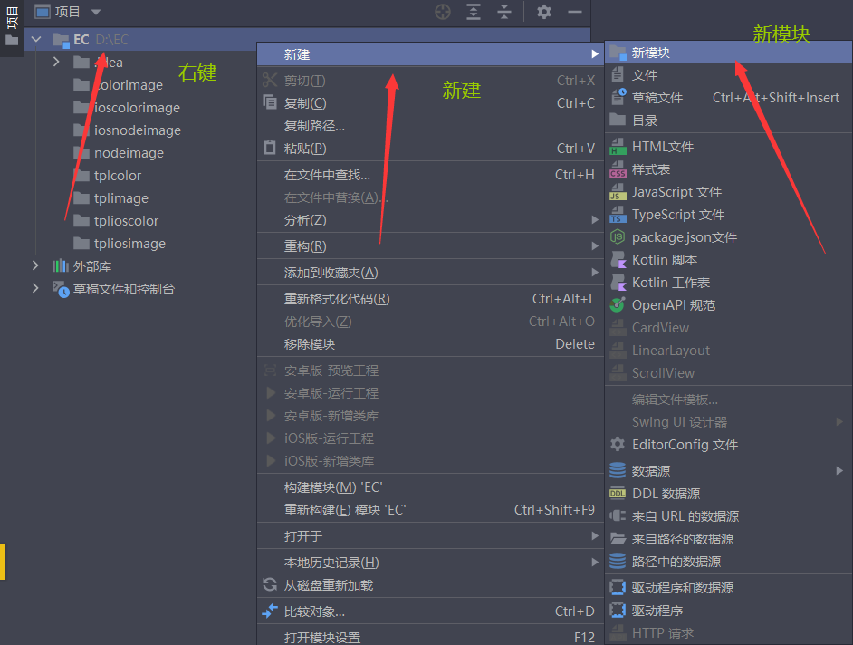
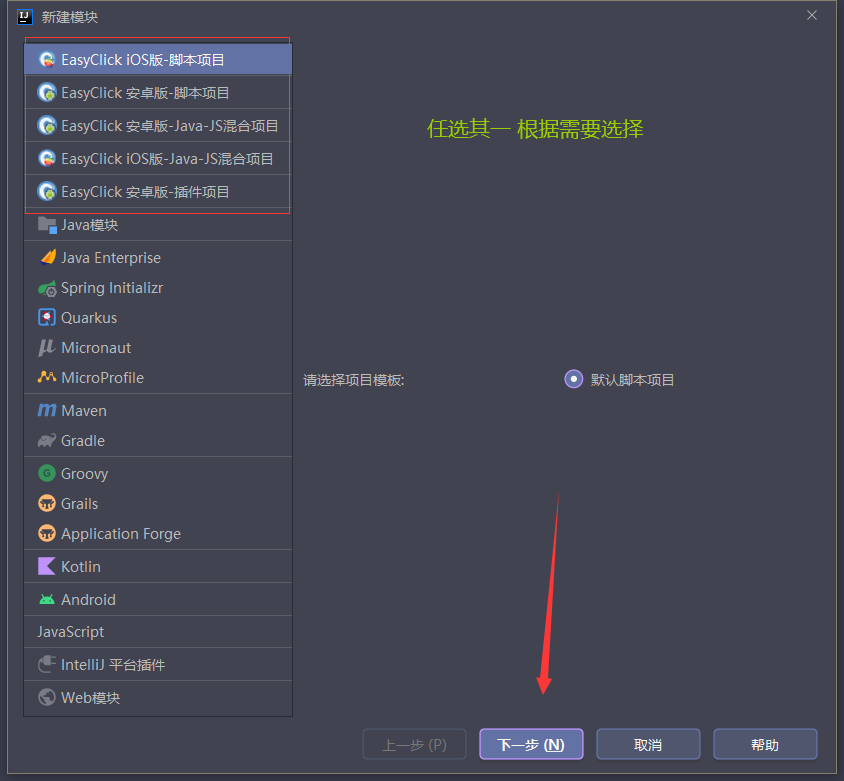
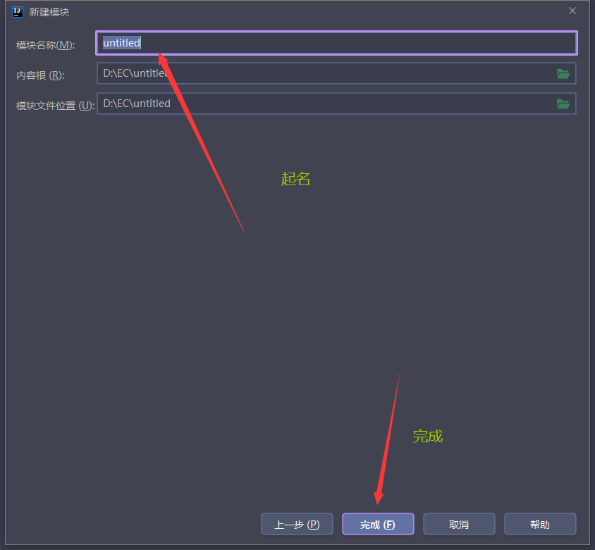
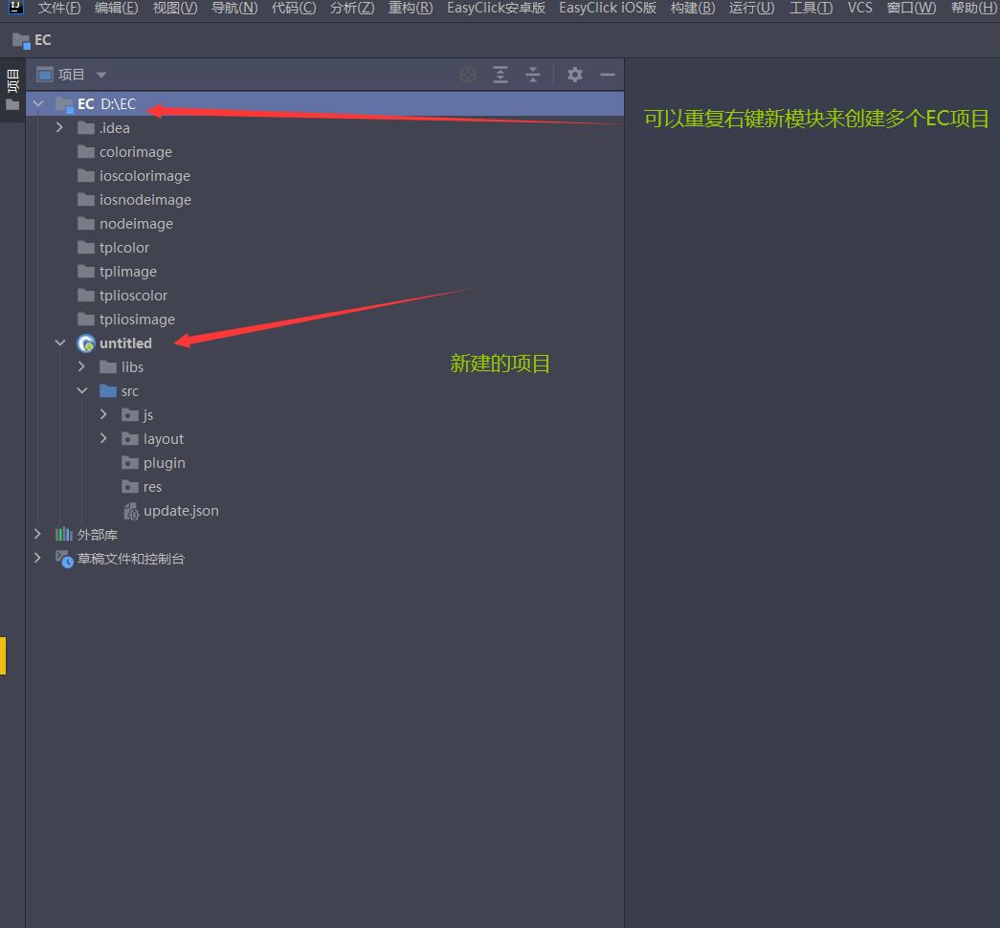

<!-- 来源：https://www.laoguicom.top/doc/481/ · 抓取状态：ok -->

# IDEA 创建多项目
>d 新版本只能以多项目模式创建,否则会遇到各种奇葩问题,项目无发运行,无法打包,打包后找不到文件等各种乱七八糟的问题.
>
> EC 随着版本升级已经彻底弃用了单项目模式,所以必须按照下方教程创建多项目模式!

## 新建文件夹
**根据喜好起名**

## IDEA打开创建的文件夹

## IDEA 新建多模块（EC多项目模式）

## 新模块起名

## 新模块创建完成

## EC 的多项目模式

