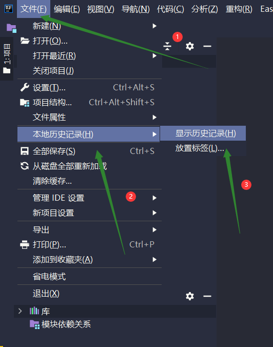
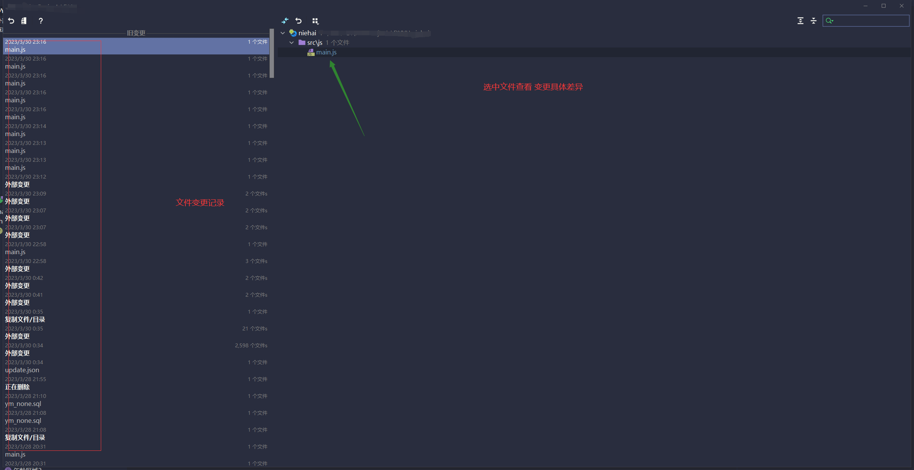
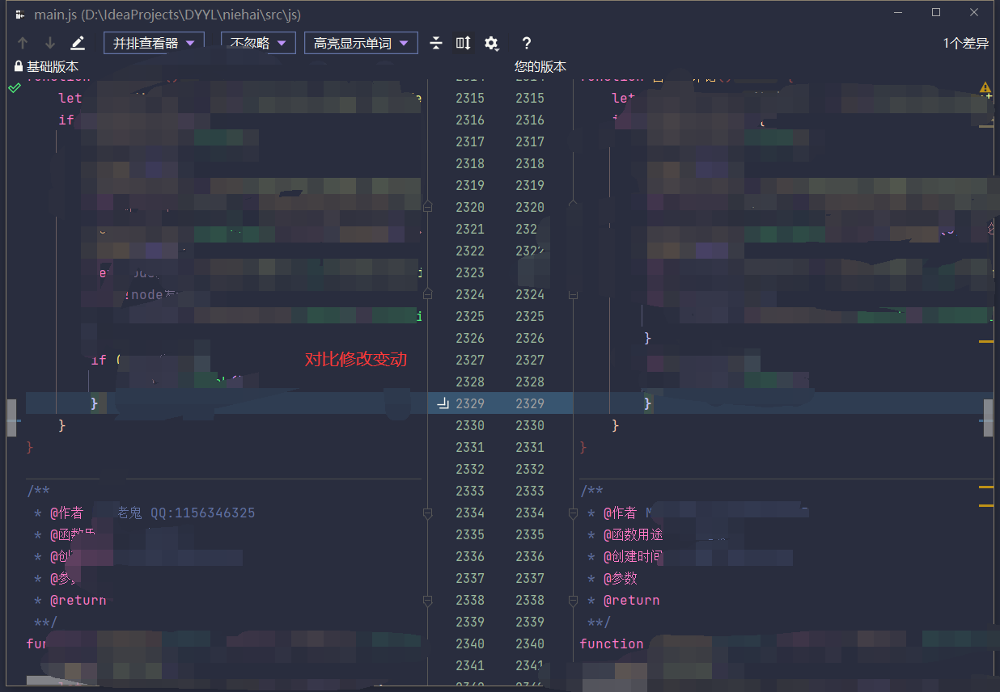
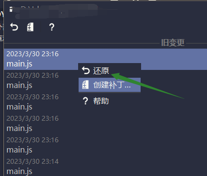
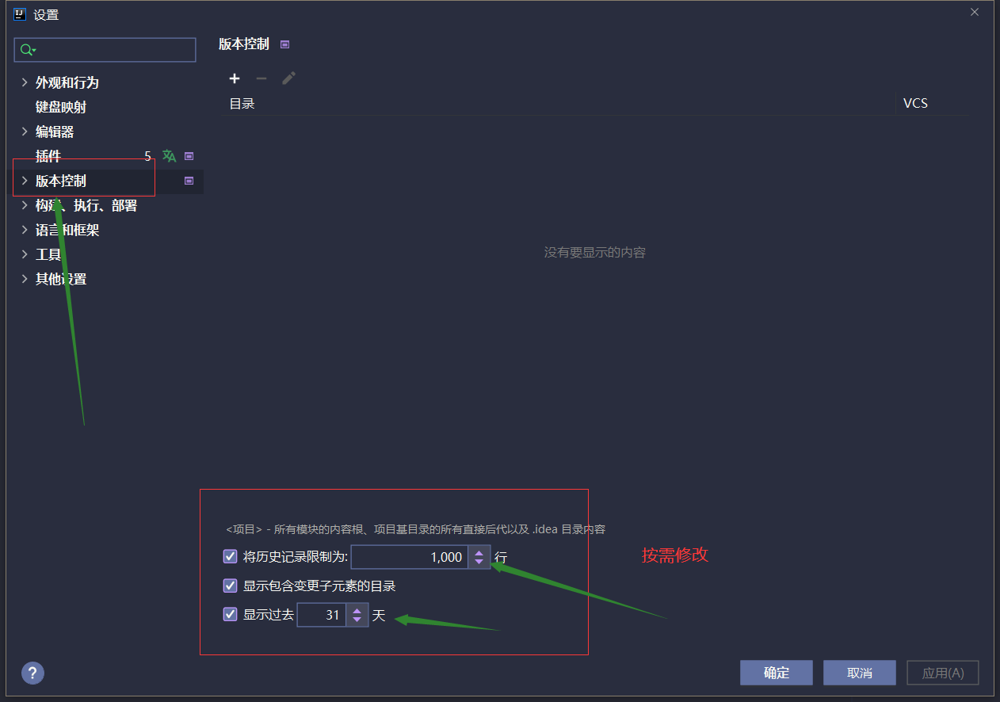

<!-- 来源：https://www.laoguicom.top/doc/495/ · 抓取状态：ok -->

# IDEA 恢复历史记录
如题,在平时写代码的过程中难免有不当的改动或者误删误改的情况,使用IDEA 自带的历史记录可挽回老版本代码,恢复之前的代码

## 如何操作
1. 文件-> 本地历史记录 ->显示历史记录 

2. 查看具体文件修改情况

3. 恢复老版本代码

## 设置历史记录保存时长

## 使用其他方式

1. 云盘同步代码
2. git 版本控制 随时提交修改的代码,随时恢复历史代码(github,gitee)
3. subversion 版本控制 同上
4. 备份源码到其他盘或者移动盘