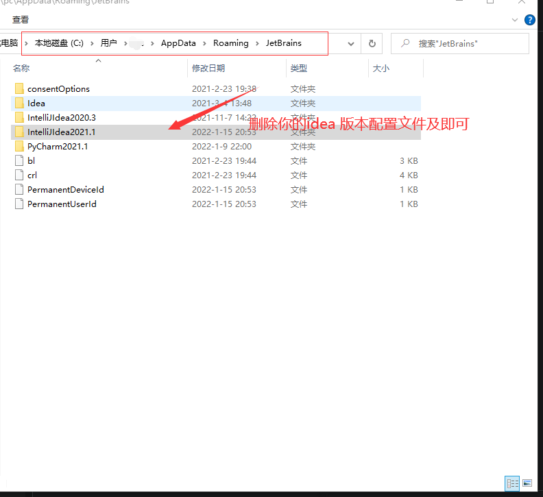
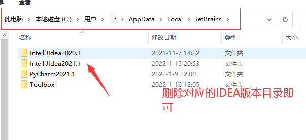
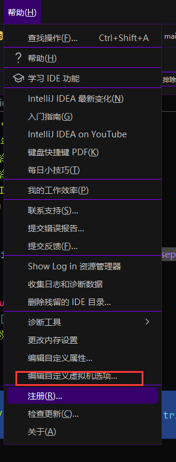
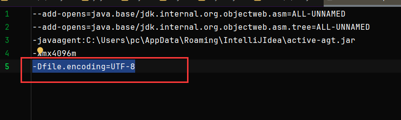

<!-- 来源：https://www.laoguicom.top/doc/668/ · 抓取状态：ok -->

# IDEA 常见问题

## 激活
 激活工具很多种,自行百度 或者下方链接
> s 无限试用插件 链接：链接: https://pan.baidu.com/s/1Jrm1aZbzwa1Rrddd-UCgFQ 提取码: lgui
激活到2099年:教程地址:https://ziby0nwxdov.feishu.cn/docx/S88zdr6S2omQynxXOXGcLM89nvf 工具地址:https://ziby0nwxdov.feishu.cn/docx/W5w9dya9LoDlNDxo6Y2cUXZOnlh   
全系IDEA一键激活2099: https://pan.quark.cn/s/efc331c6b105

上述地址如果失效:联系老鬼

## 激活后 无缘无故无法打开

解决方案，如下图所示两个目录删除对应的IDEA版本目录即可。
如果不能解决直接删除 下方两个路径的 `JetBrains` 目录

 
 
## IDEA 打开文件编码问题
再设置里已经设置了UTF8之后还有部分文件编码不正确问题在如下图路径点击

添加代码 `-Dfile.encoding=UTF-8` 保存重启IDEA 即可

## EC 插件版本与IDEA版本

>s Android EC 10.1 + 版本支持 IDEA 全系版本
IOS EC 6.46.0 +  版本支持 IDEA 全系版本

>d 其余EC版本只支持 IDEA 2019 ~2021.1.3版本