<!-- 来源：https://www.laoguicom.top/doc/409/ · 抓取状态：ok -->

# EasyClick   Android 自动化测试 ROM定制
>d  提示：ROM是Android系统包只能一个机型一个包，别想着一个包全机型适配我特么做不到！非要干去骂谷歌骂各种手机厂商

>d 定制须知:
- 注册改机定位请绕路别问！
- 三星类的板机免谈!
- 模拟器不支持别问!
- 关于刷机说明:必须解锁BL!必须解锁BL!必须解锁BL!如无法解锁请不要来定制,否则自行解决解锁问题再刷机,只做定制包不做BL解锁服务!
- 解锁BL 不能上锁否则系统无法进入,上锁造成的问题不负责解决!

## 定制功能说明

1. 无需打开无障碍服务执行脚本
2. 无需开启开发者选项执行脚本
3. 仅需要开启代理模式即可执行脚无需激活设备
4. 聊天APP防检测
5. 各种小游戏防检测
6. 其他项目防封防黑机
7. 仅支持EasyClick 自动化测试运行
8. 可绕过账号锁（解决隐藏账号锁锁机）
9. 可移除部分内置APP减少内存消耗
10. 可移除开机引导
11. 内核级root,屏蔽BL锁,可装LSP框架

- 支持的安卓版本 `7.0 ~ 13`
- 改机的 和定制免开发者免无障碍的不同,需要内置面具,自行安装面具模块实现 无法内置!
- 支持华为鸿蒙定制免USB 无障碍跑EC代理模式

--- 
>d 特殊定制

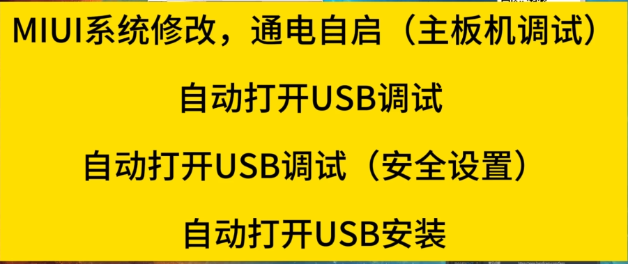

## 系统级解除截屏录屏限制
>d 全局系统级破解截屏,过印鉴类,密码类截屏投屏录屏
> 可支持 root,无root,EC专用代理模式无需开发者激活  截屏不限制于ec其他平台也可截屏
>
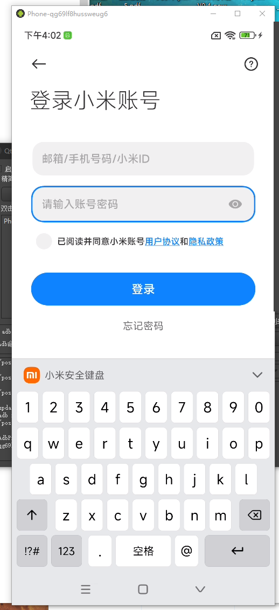

## 机型更新列表

1. 小米8青春版
2. 小米9 SE
3. 小米8SE
4. 小米8 （支持三种机型伪装：1.原机，2.华为P40，3.华为MATE40）
5. 华为 P20
6. 华为 MATE20
**以上为加密版需定制**

------

1. 小米8前置指纹锁版
2. 小米9 透明版 安卓11
3. 小米 5X MI5X 安卓7 安卓8
4. 华为7plus全网通
5. 小米8 青春版
6. 荣耀10
7. 小米8SE
8. 小米9SE 安卓10 安卓11
9. 荣耀8
10. 小米8普通版
低端机型不适合做大型项目的未收录，需要的可联系

----

##  后续更多机型持续更新按需定制
>w 理论上所有解锁BL手机都支持定制。
已有定制机型可测试￥500 一个包

## 可客制化定制ROM方案
### 定制价格看机型难度 1k起步 上不封顶
>i 小米系列1.5K起步，华为系列2.5K起步。

### 机型伪装
>i 伪装一个机型 +600, 五个机型就是600X5 +基础包1.5K =4.5K左右

>s 已有机型 小米 MIX2S 伪装数量60个包含功能绕过账号锁,精简APP
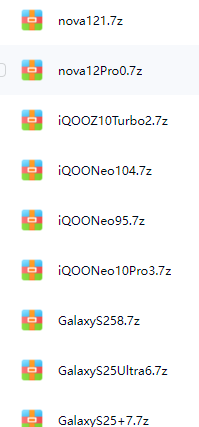

### 内置面具和指定APP
>s 内置面具,可指定版本自行安卓lsp框架
支持指定国内外APP 内置,支持安卓7~12
价格1K左右看机型

***已有机型***
1. 红米9A

### 可指定包名授权

## 机型伪装
### 底层ROM伪装方案（可换机型品牌界面）

## 已有案例
#### 客制化机型ROM ，防盗ROM 措施！ 刷机量控制！ROM底层伪装！

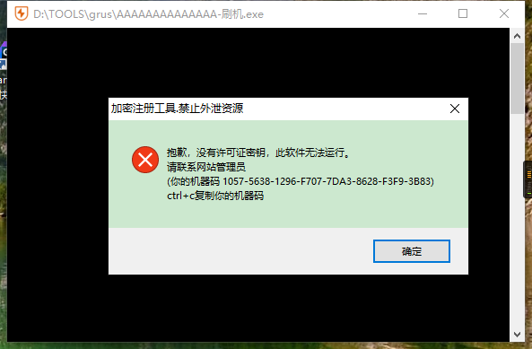

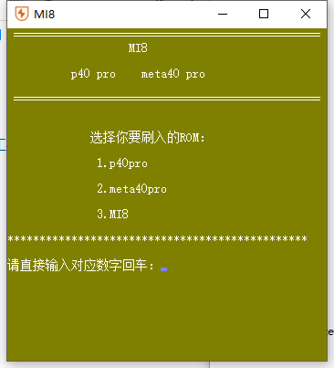

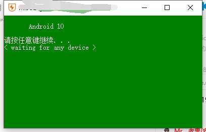

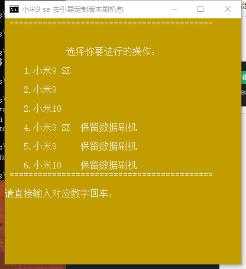
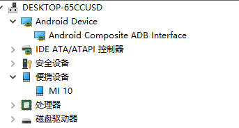

## 客户反馈

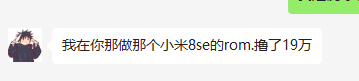

#### 其他更多机型联系我详谈
## 关于售后
>d 包制作打包如无法正常跑脚本会进行修改适配无需担心!
如无法解锁导致无法刷机与我无关!
如风控问题导致封号等与我无关!
如检测到ec的问题与我无关!
如检测BL锁的问题与我无关!也请不要定制!刷机必然会解锁!
定制包不是万能的,请勿用于违法用途!
定制包刷机后开启有账号锁的问题与我无关,刷机前请自行确认是否无账号锁,隐藏锁等购机时请注意机器成色,卖家可能会给一批有锁有隐藏锁或法刷机的机器,自行甄别!这类机器导致刷不了机的问题与我制作的定制包无关!
包制作好之后概不退款!!!软件无法退款!!!风险自行承担!!!我只是提供一种方案不保证能正常过各种检测! 鸿蒙系统的自行解锁BL,部分机型无法使用系统自带的恢复出厂设置,需通过命令行恢复,部分机型需要专用数据线传输数据,如使用正常数据线无法传输数据与定制ROM包无关,这是解锁导致的问题!

## 三方ROM
度盘链接：https://pan.baidu.com/s/1zyqwP5keEOw1a1MLUqGQ8g 提取码：LaoG
### 小米
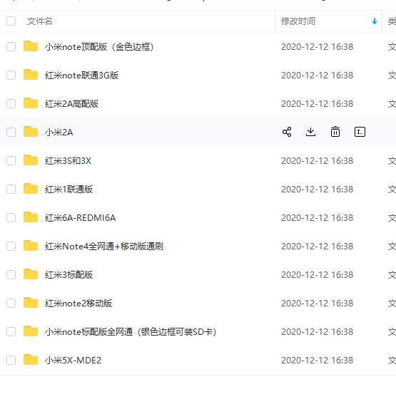
### 乐视
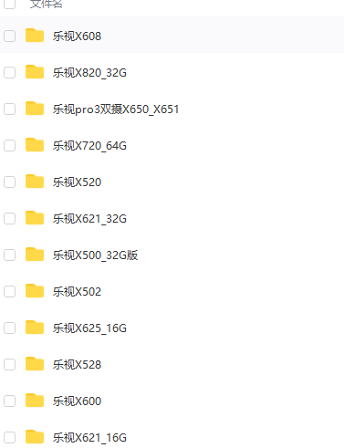
### vivo
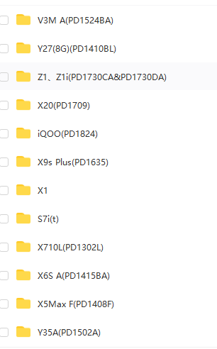
### OPPO
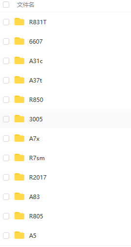
### 联想

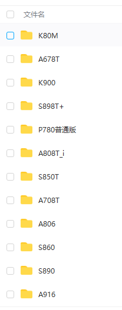

### 联系：Mr_老鬼 QQ1156346325  客制化定制QQ群：776959607 
### EasyClick 官方交流群： 620028786，647082990，772810035

