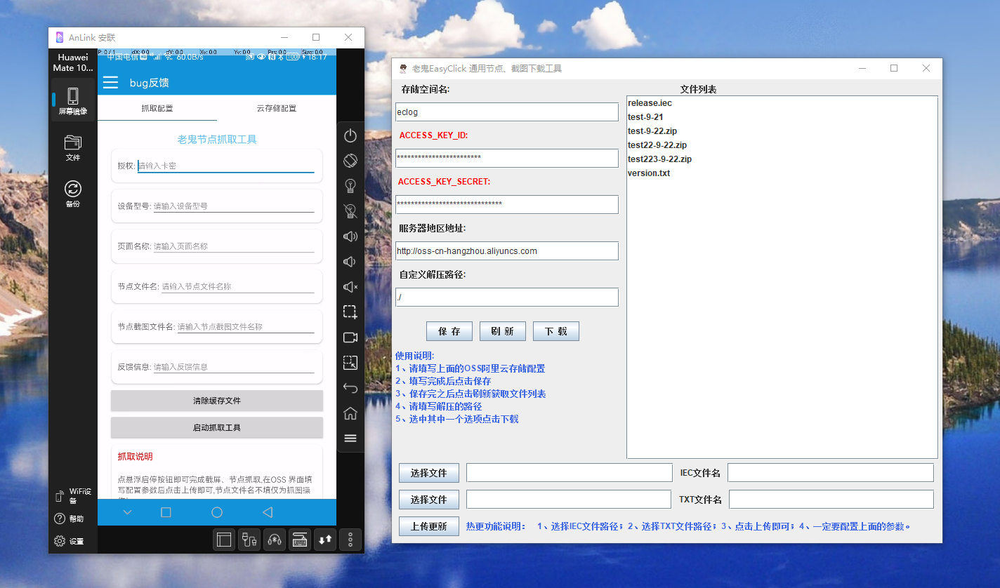

<!-- 来源：https://www.laoguicom.top/doc/428/ · 抓取状态：ok -->

# EasyClick bug反馈工具 OSS版
# 视频演示

  <iframe src="//player.bilibili.com/player.html?aid=380638987&bvid=BV17Z4y1f7mZ&cid=840642169&page=74" scrolling="no" border="0" frameborder="no" framespacing="0" allowfullscreen="true"> </iframe>
  

----

# 工具截图

图中左边为客户使用，右边为作者使用；
# 购买或定制联系QQ：1156346325
成品售价 ￥200 永久, ￥10 月卡
可根据需求定制界面，功能！无需服务器,阿里云OSS 存储即可

# 工具使用说明
1. 安卓端，填写卡密激活使用
2. 配置相关参数
3. 阿里云存储获取相关参数填写到安卓端云存储配置和PC端；
4. 安卓端点击启动抓取工具在指定界面点击悬浮工具窗口第二个图标即可抓取节点，点击上传节点信息即可上传到阿里云存储，PC端刷新文件列表选中下载即可
5. 上传热更新的iec文件和txt文件填写文件路径和上传的文件名后先保存后点上传更新

## 获取阿里云配置
[阿里云配置获取](https://www.jianshu.com/p/f39252eb8308 "阿里云配置获取")
[OSS授权配置](https://help.aliyun.com/document_detail/399763.html "OSS授权配置")

## 安卓端配置说明
- 授权：卡密激活
- 设备型号:填写机器品牌即可
- 页面名称：抓取的界面名称
- 节点文件名：抓取的界面名称（不带后缀名）
- 截图文件名：抓取的界面名称（不带后缀名）
- 反馈信息：出错情况说明
- 存储空间名：对应阿里云存储的存储空间名（Bucket）
- ACCESS_KEY_ID:对应阿里云申请的Access Key ID
- ACCESS_KEY_SECRET：对应阿里云申请的ACCESS KEY SECRET
- 服务器地区地质：对应阿里云存储地区地址
- 文件名：对应上传阿里云的文件名（不带后缀名）

## PC端配置说明
- 存储空间名：对应阿里云存储的存储空间名（Bucket）
- ACCESS_KEY_ID:对应阿里云申请的Access Key ID
- ACCESS_KEY_SECRET：对应阿里云申请的ACCESS KEY SECRET
- 服务器地区地址：对应阿里云存储地区地址
- 自定义解压路径：自己需要解压的文件夹绝对路径

## PC端热更配置说明
- 选择iec 文件，填写要上传的iec文件名（不带路径）
- 选择txt 文件，填写要上传的txt文件名（不带路径）
- 选好文件、填写对应的文件名后 点保存。
- 检查无误后点击上传更新
- 点刷新后 会在列表显示已上传的文件

PC 端填写完参数后先保存，然后刷新即可，右边列表刷新出文件后选中点击下载即可自动解压到指定目录

