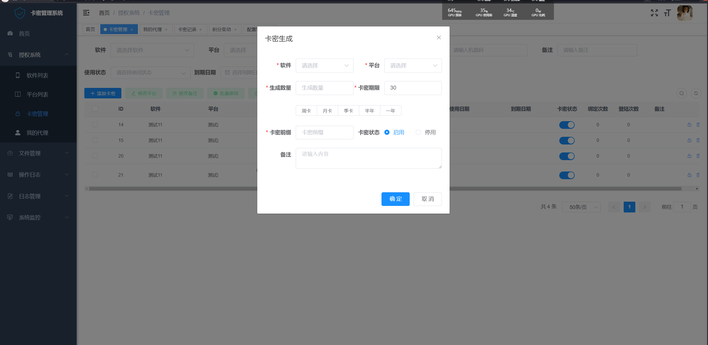

<!-- 来源：https://www.laoguicom.top/doc/674/ · 抓取状态：ok -->

# 卡密管理系统

# 系统功能
1.支持代理(不限下级数量)
2.卡密捆绑(一机一卡)
3.EC热更新 (开放接口)
4.EC apk 更新(开放接口)
5. 其他资源管理(不限制文件类型)(开发查询下载接口)
6.支持UI更新(XML更新或H5静态页面)
7.支持配置参数后台修改
8.支持单脚本在线更新
9.支持代理新增卡密时长自定义天数
10.支持导入卡密设置自定义天数
11.支持代理导入卡密(可管理代理导入卡密权限)
12.支持卡密续期
12.功能定制可谈(联系老鬼QQ:1156346325 )

 

