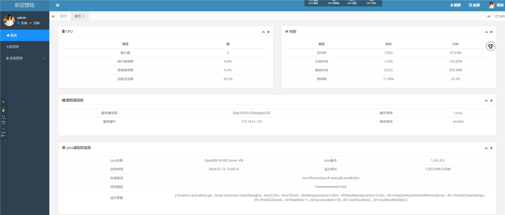
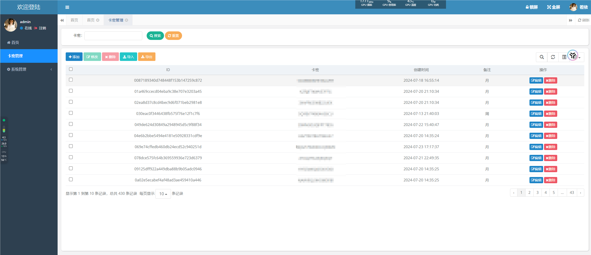
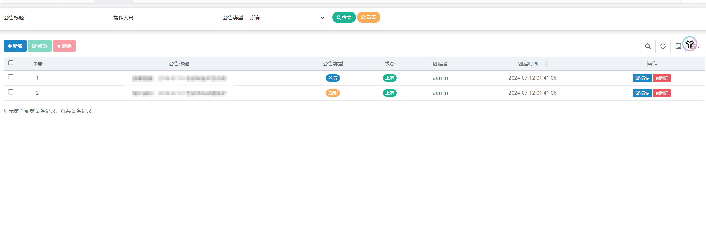
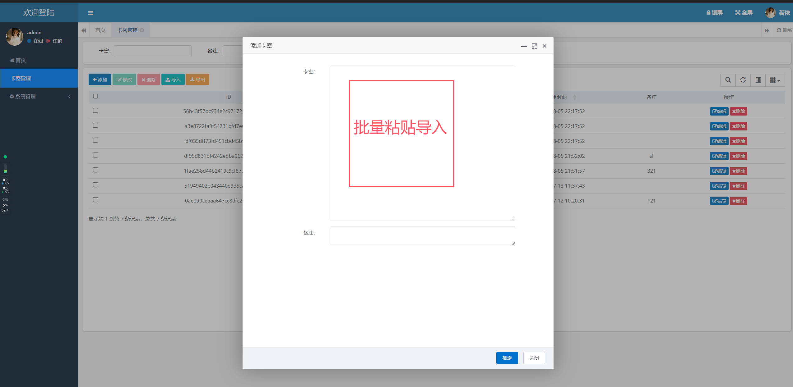
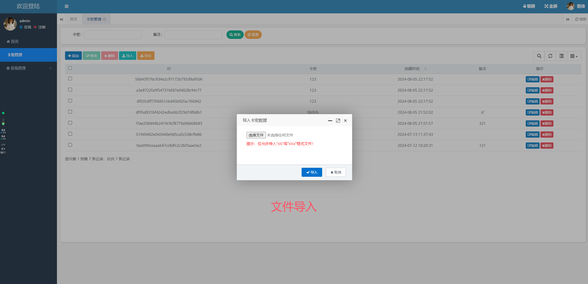
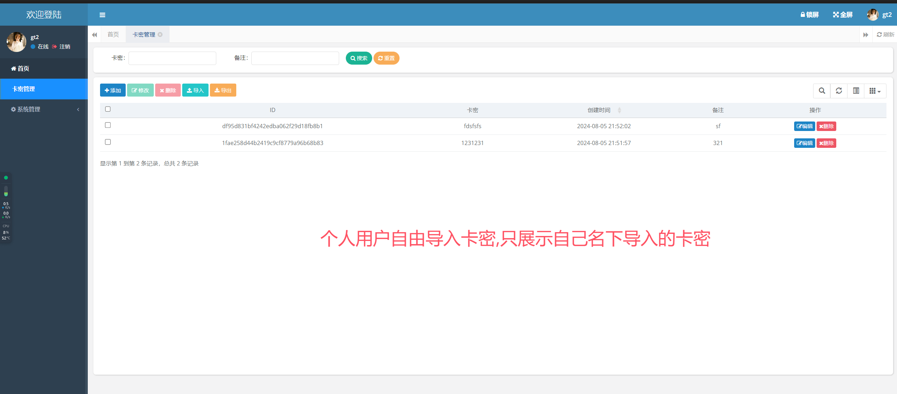

<!-- 来源：https://www.laoguicom.top/doc/675/ · 抓取状态：ok -->

# 卡密二次验证系统

# 系统功能
1. 导入卡密(支持Excel批量导入)
2. 通知功能,提供接口(养猪,可自行提示盗版发布正版产品信息)
3. 卡密查询(验证脚本卡密是否已存在)
4. 支持创建用户,自由导入卡密,用户各人管理各人的卡密
5. 添加支持复制粘贴批量导入卡密
6. 卡密默认最新的展示在顶部,支持备注搜索卡密搜索

>s 提供脚本接口,批量上传示例

