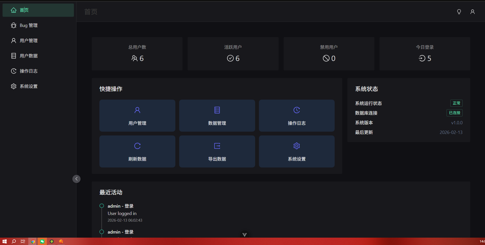
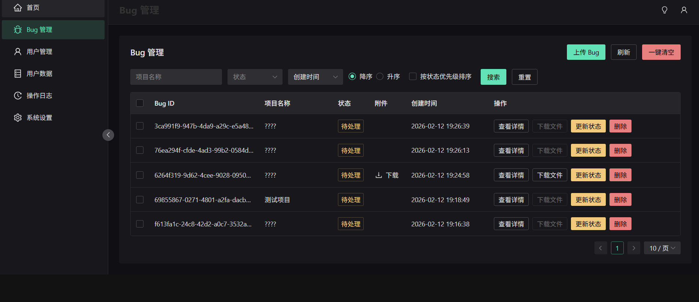
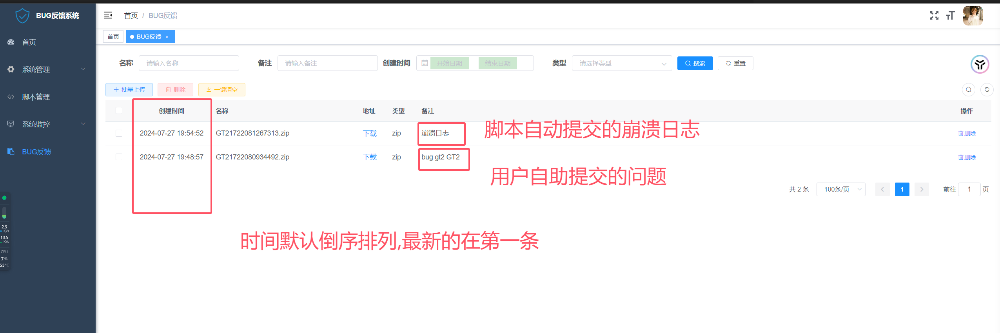
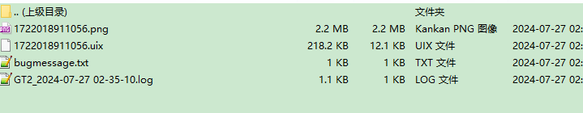
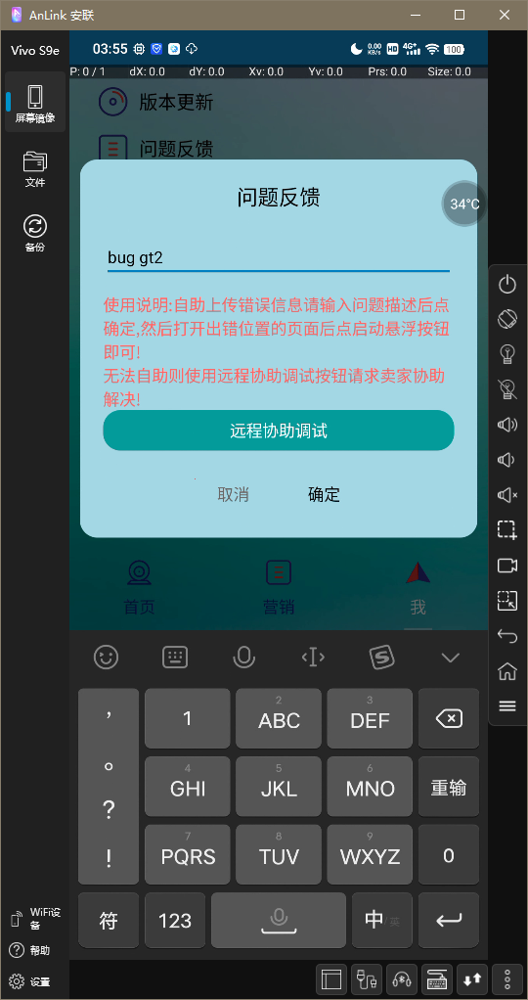

<!-- 来源：https://www.laoguicom.top/doc/676/ · 抓取状态：ok -->

# EasyClick BUG 反馈 公共版
>s 用于用户自助提交脚本运行问题,脚本崩溃自动提交Bug信息,方便及时处理脚本问题!

# 功能
1. 支持EC客户自主抓取错误位置节点信息
2. 提供接口方式,自主对接
3. 提供独立抓节点工具源码 (自行对接或自行修改后打包独立工具)
4. 提供后端地址,自行登录下载上传的bug反馈文件
5. 可创建普通用户,个人管理个人的bug(也可以项目名方式创建普通用户,方便归类)
6. 系统支持删除单个,批量选中删除,一键清空全部bug文件
7. 默认按提交时间排序,最新的反馈信息在第一条,方便第一时间处理

>s 反馈文件是个zip压缩包,包含截图和uix节点文件自行下载解压导入到EC节点工具即可
对接文件:
bug.zip -> js/bugUpload.js ; js/cloudFile.js ; layout/ui.js ; layout/dialogBug.xml 说明.txt

>d 计费方式:月卡十元 年卡 100元
支持私有化部署,永久付费500元,支持更新维护,包部署,自行购买服务器或使用现有服务器
如需要帮助对接,编写UI界面 单独付费 远程服务:100元一次

>w 非EC台子的自行修改为其他平台请求方式即可

<iframe src="//player.bilibili.com/player.html?isOutside=true&aid=112858671222772&bvid=BV1ytvLeYEVe&cid=500001629415541&p=1" scrolling="no" border="0" frameborder="no" framespacing="0" allowfullscreen="true" height="600" width="1000"></iframe>
 

## 后台管理页面
2026新版重构,采用rust语言,超低内存占用,超高并发,无忧运行,1核1G即可运行

## bug信息文件

## 手机端

