<!-- 来源：https://www.laoguicom.top/doc/691/ · 抓取状态：ok -->

# 云控定制

>s 功能说明
1.用户登录系统(每个用户独立管理自己的数据)(设备数量,使用期限)
2.任务管理(新建,删除,完成情况)(新增时各个设备任务参数可独立修改)
3.设备管理(分组,状态)
4.数据管理(不同任务对应的数据)
5.任务列表(各个功能)
6.参数配置(手机端执行的参数)
7.其他功能定制(联系:QQ:1156346325)

客户定制产品: FB TK云控后端

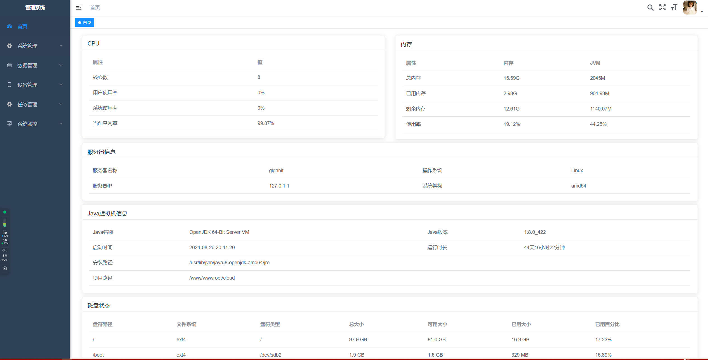
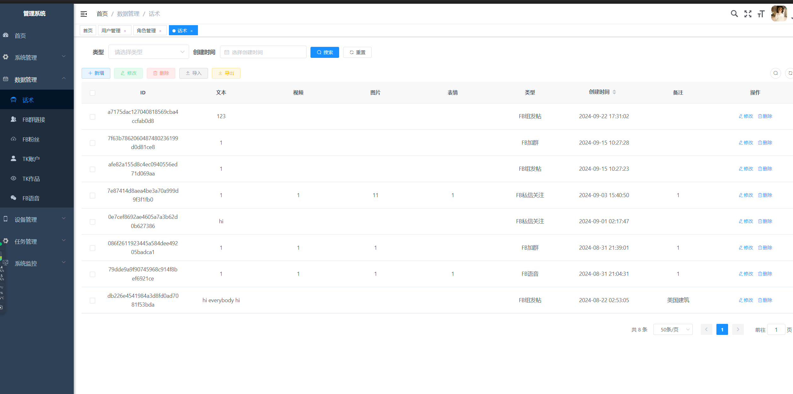
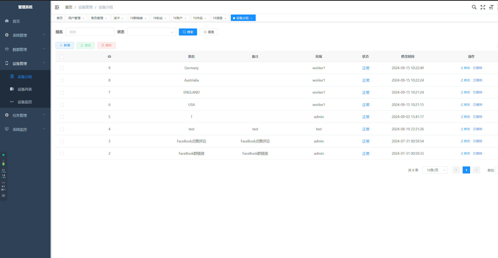
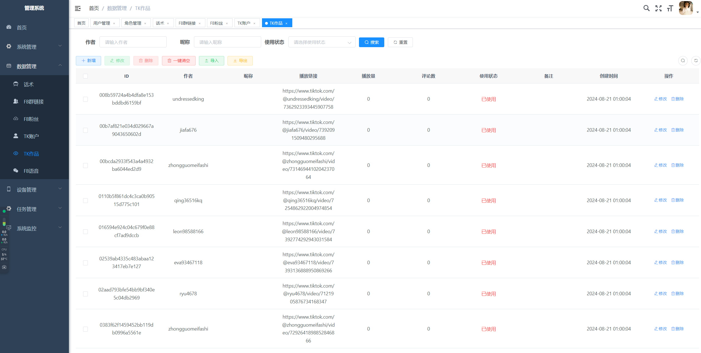
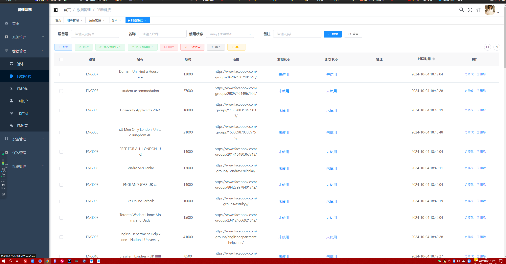
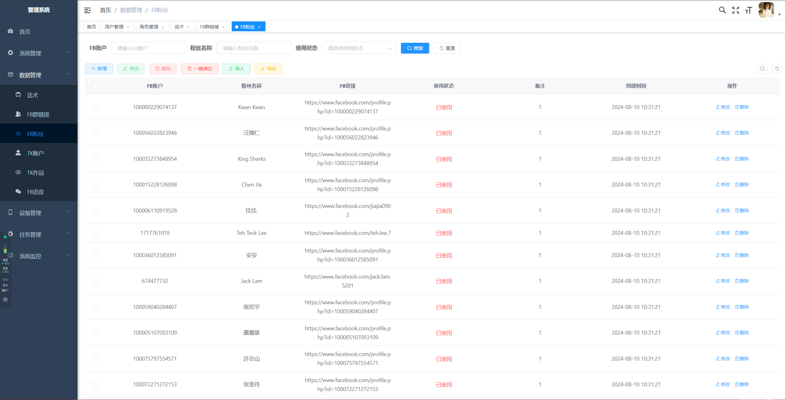
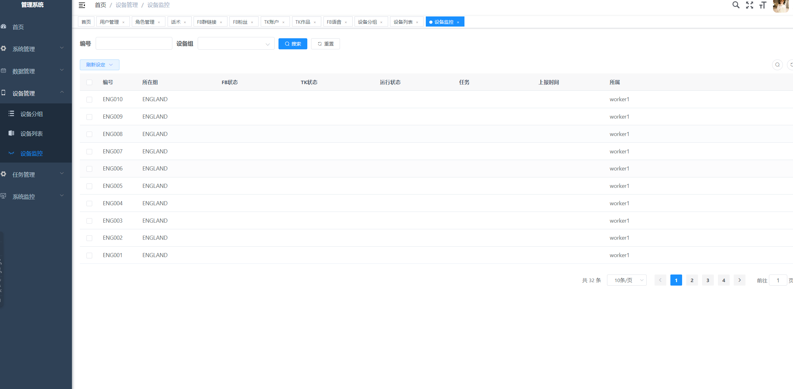
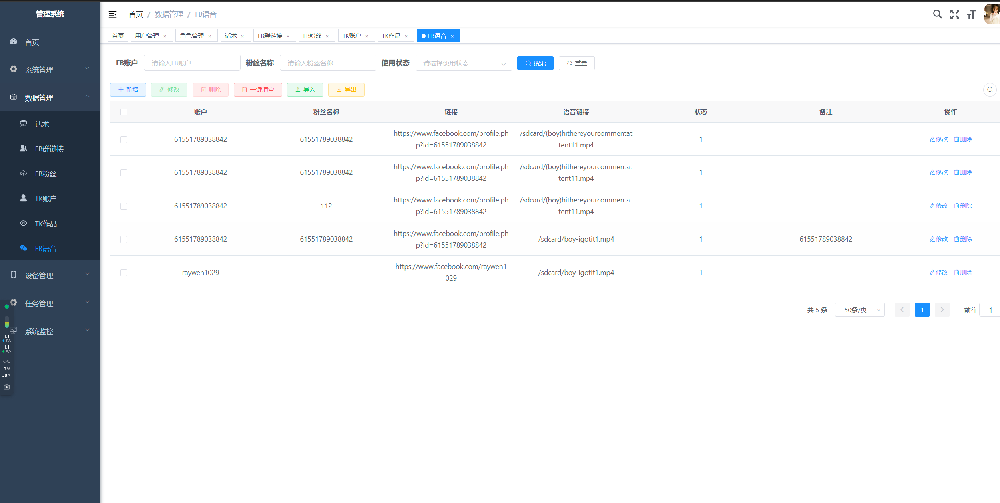
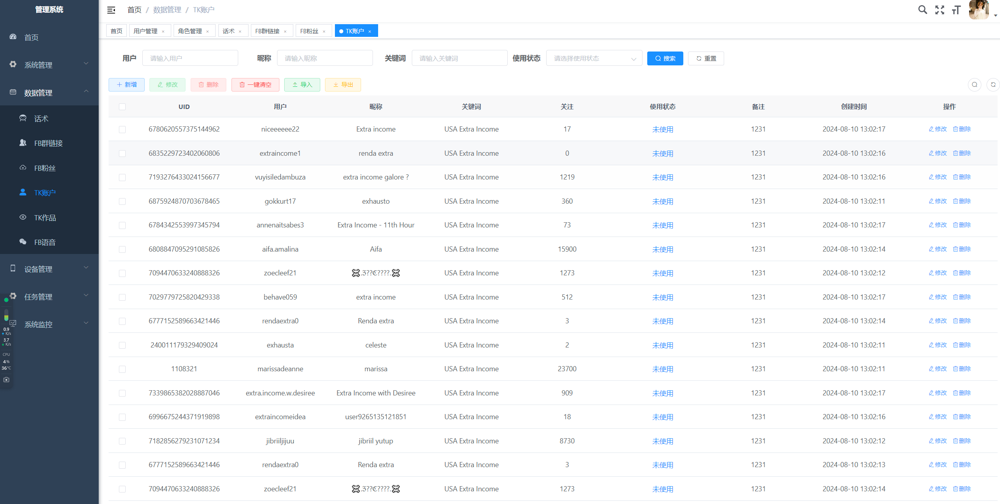
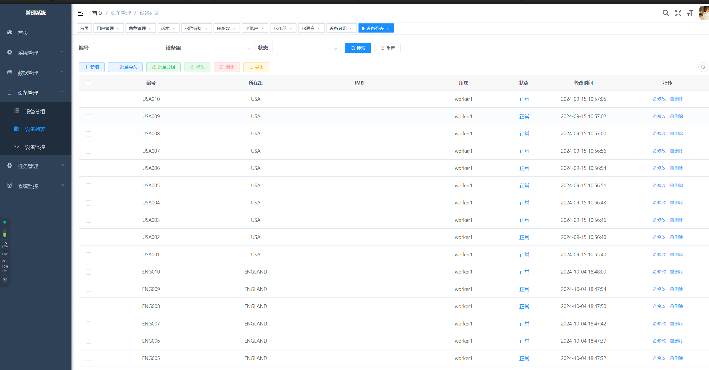
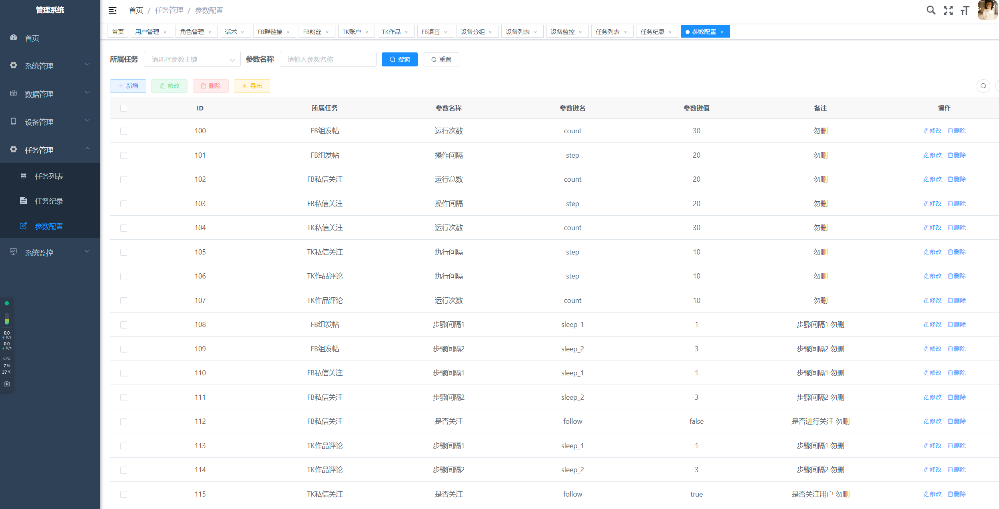
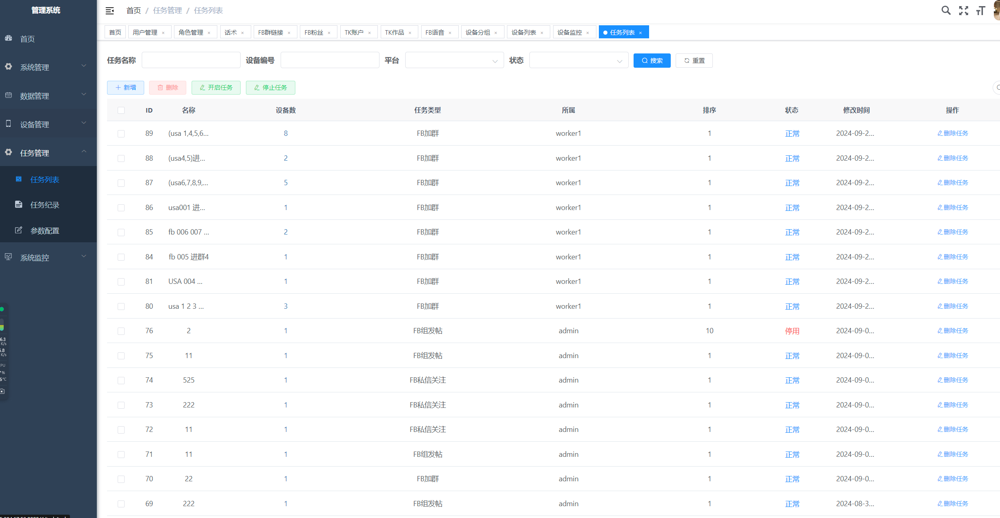
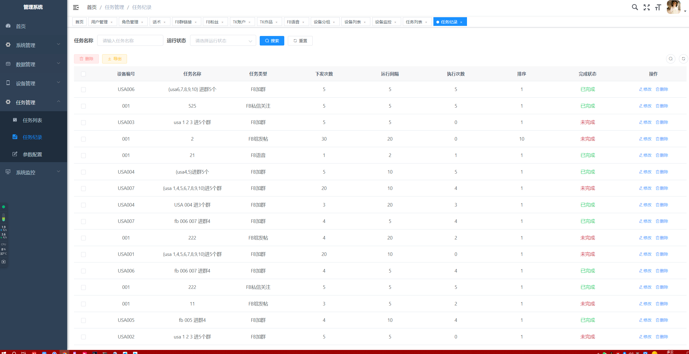

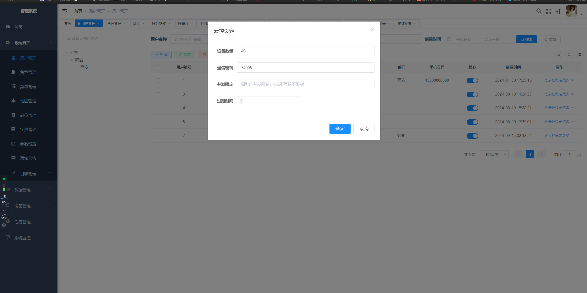