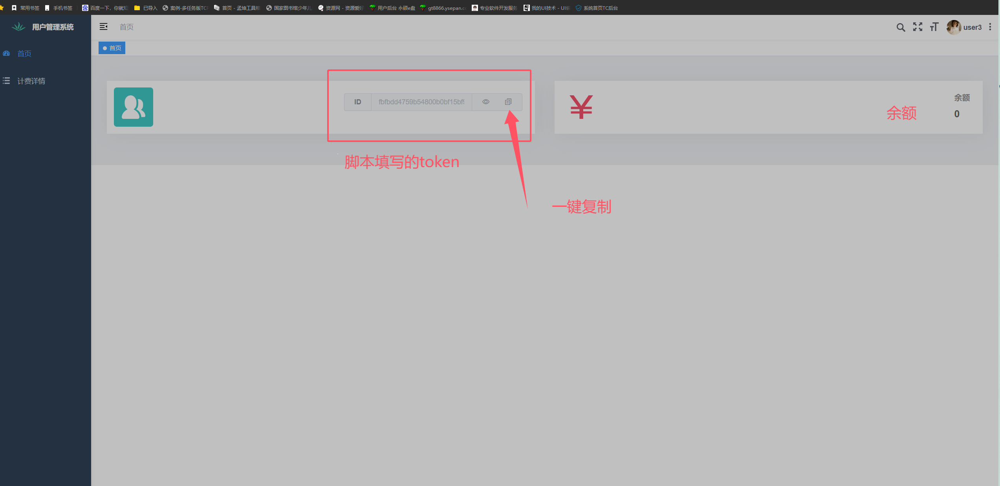
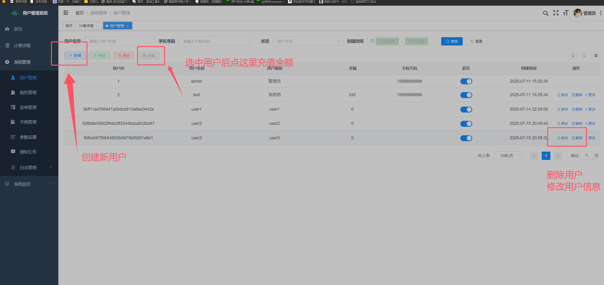
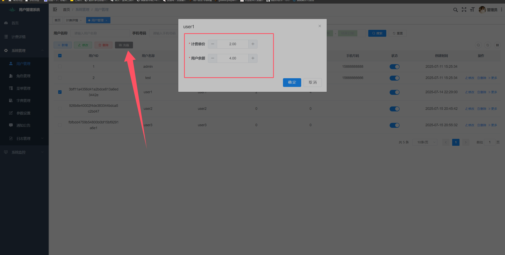

<!-- 来源：https://www.laoguicom.top/doc/860/ · 抓取状态：ok -->

# 积分管理系统

## 功能介绍
>s 1.用户管理系统,用户创建删除修改积分规则,唯一用户Id
>2. 积分管理,扣点充值详情列表
>3. 余额管理,计费详情列表
>4. 充值管理,
>5. 实时修改积分扣点规则
>6. 查询余额接口,加密签名校验
>7. 扣费接口,加密签名校验

## 样图

