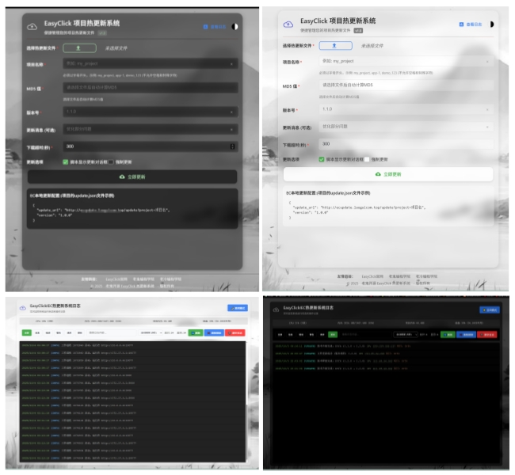
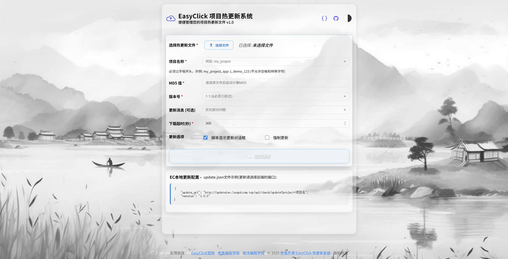
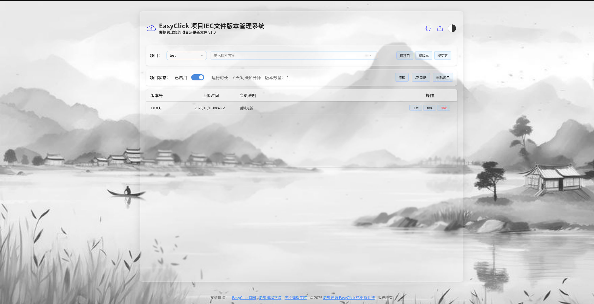
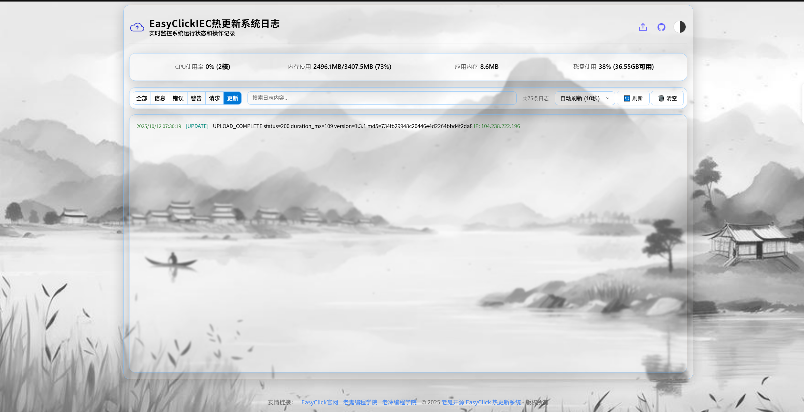
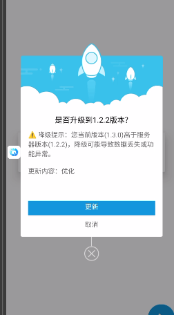

<!-- 来源：https://www.laoguicom.top/doc/870/ · 抓取状态：ok -->

# EasyClick 热更新版本管理系统
>s 部分用户不希望用OSS等大厂的对象存储服务,希望自己的服务器来进行热更新,所以有了这个开源的热更新服务端.支持基本的上传热更新配置,日志系统,版本管理系统。

## 功能说明
>s xxx:xxx 域名或IP:端口

所有页面支持日夜间模式切换.

>d V2.0.0支持IOS/Android 热更新,上传页面自行选择项目类型

**上传热更新页面**:`http://xxx:xxx/static/upload.html`
选择iec文件（自动计算md5值自行和编译的md5对比确保一致）。
填写项目名称,支持多项目。
三段式版本号(1.0.0)。
更新提示消息(可以不填,会默认为优化部分功能)。
配置勾选对话框,强制更新。
配置完成后点立即更新，此时如果是首次上传会返回上传成功，非首次上传会提示版本变更说明，确认后上传成功返回上传成功和下载地址，版本变更说明。

**版本管理页面**:`http://xxx:xxx/static/version-manager.html`
注意：rust版的每个项目的版本最多30个，超过之后需要删除旧的版本。Nodejs版本没有这个限制。
支持 查看项目当前所有版本,点切换按钮可以随时切换到旧版本,删除项目,删除指定版本。
切换指定版本可以有效防止客户跑路，新版本有问题临时切回旧版本保命。
项目停用和删除也可以防止客户更新窃取iec。
支持搜索项目，搜版本，搜更新说明。

**日志页面**:`http://xxx:xxx/static/logs.html` 
分级记录了各种类型的日志,方便查看更新情况,版本管理操作记录,上传记录等等,一键清空日志,系统运行监控功能。

具体各个功能接口看开源代码介绍。

>d 关于脚本端版本更新的说明:
>服务端对版本号进行三段式比较确保每一个值大于脚本端才会返回更新提示,
>如果每个段的值相等返回无更新,
>如果高于服务端那么返回降级提醒,不用配置自动添加降级提醒.这么做的目的是防止上传了错误的版本而更新导致的问题,当然了 也可以是 回退（切换）老版本避免新版本出现问题的临时解决办法。


>i !!!热更填坑吐槽!!!
>1.代码热更新无论安卓还是iOS都要求纯数字版本
>2. iOS脱机版update.json里的 version只能填纯数字,不管你填的是不是1.1.0 还是0 都认为是0
>安卓无所谓 可纯数字可三段式 ,如果是代码热更新只能纯数字!
>3. 版本已更新为2.1.0,如果要支持iOS脱机版 安卓代码热更新请更新到最新版!

## 效果图
<iframe src="//player.bilibili.com/player.html?isOutside=true&aid=115411089623459&bvid=BV1wtWQzbEEG&cid=33266403609&p=1" scrolling="no" border="0" frameborder="no" framespacing="0" allowfullscreen="true"></iframe>

### NODEJS版
 


### RUST版
rust版本相比nodejs版本 内存占用更低,并发强大,如果项目/设备比较多的情况建议rust版本部署
体验站:http://updateiec.laoguicom.top/
>d  体验站1小时自动删除所有项目,不要在体验站长期挂项目.










脚本端更新提示



## 热更新服务端源码

[nodejs版本](https://gitee.com/Mr_laogui/EasyClickupdateIEC) [RUST版本](https://gitee.com/Mr_laogui/EasyClickupdateIecRust)


前端: 纯HTML + css 简易的页面,可以自行改造.
后端:
- nodejs 版本 采用 纯 JavaScript 实现
- rust版本 采用 rust + actix web框架实现


## 部署教程
>i NODEJS 版 B站视频
 

RUST版本 一键脚本部署(见rust版本项目源码地址有部署指南) 或者按照 B站教程部署前端后脚本启动后端。

>w RUST版 部署教程


  

 ##  早版本迁移到2.0.0版本


1. 打开项目 JSON 文件

2. 找到  `settings ` 对象

3. 在  `settings ` 对象中添加  `project_type` 字段

>d 如下所示

```json

{

  "name": "项目名称",

  "enabled": true,

  "first_upload_time": "1760232767",

  "settings": {

    "min_version": "",

    "timeout": 0,

    "strict_version": false,

    "project_type": "android"

  },

  "current\_version": "1.0.0",

  "versions": [...]

}

```
