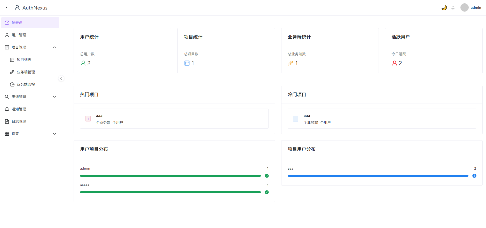
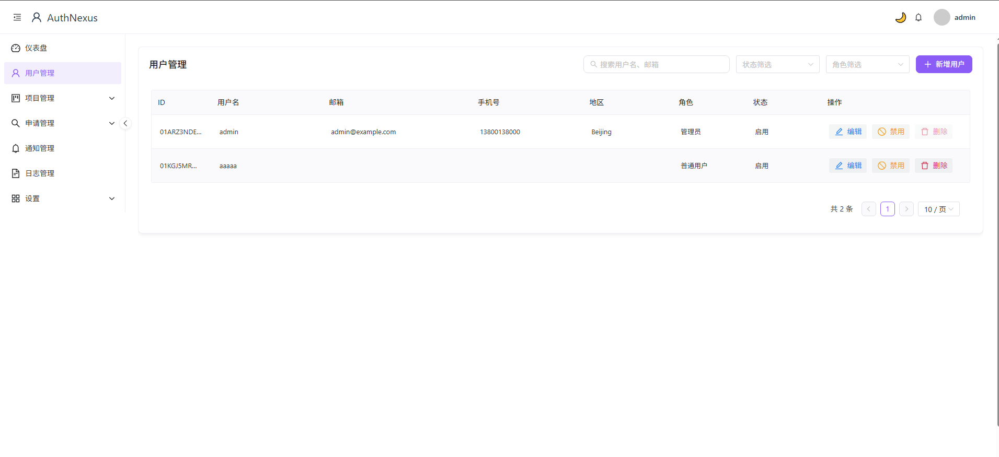
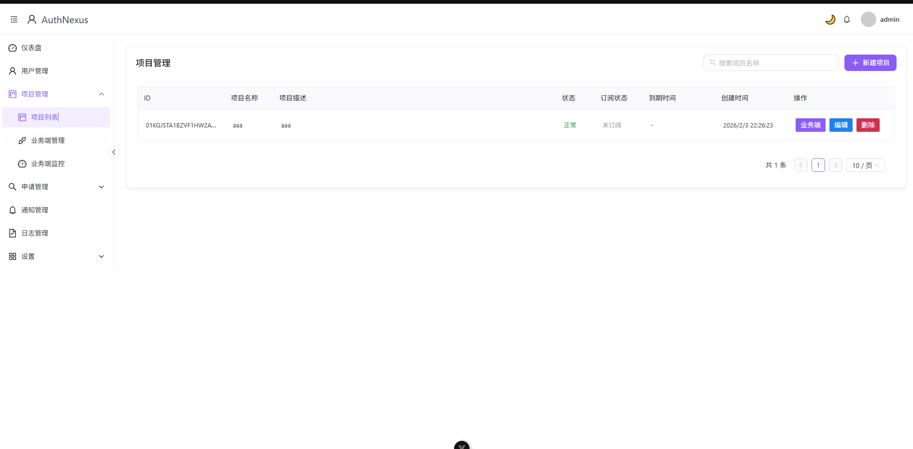
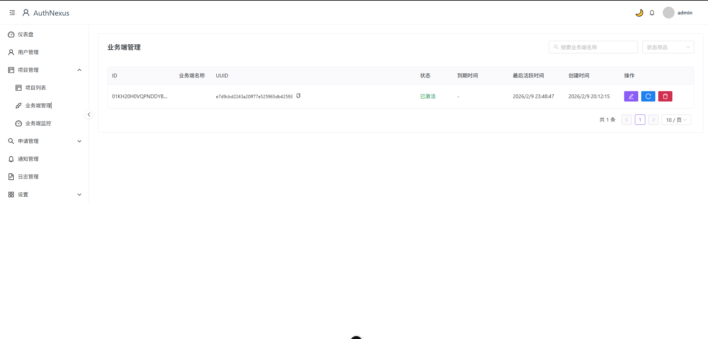
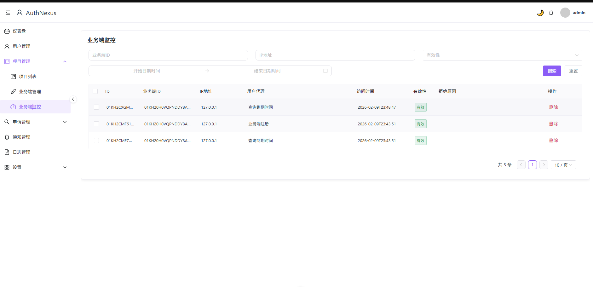
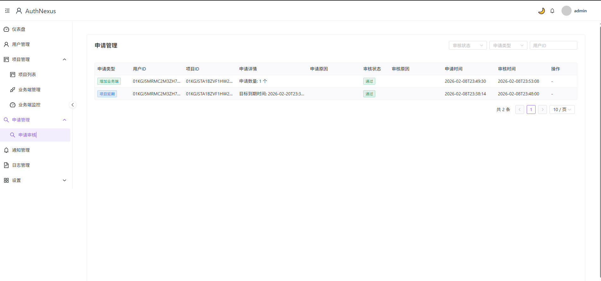
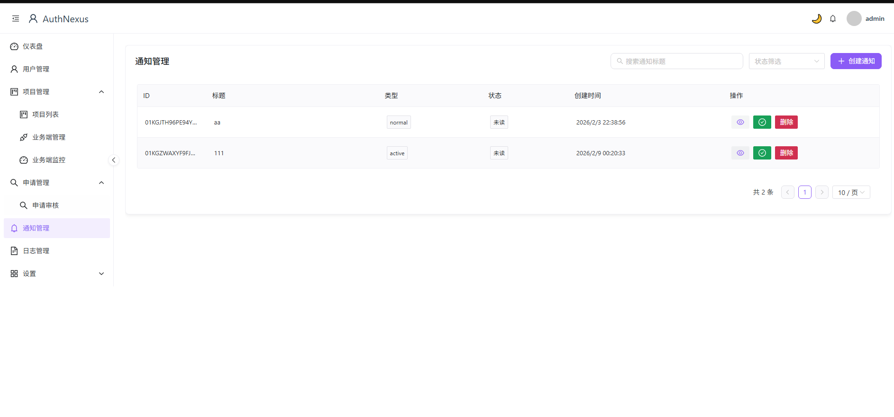
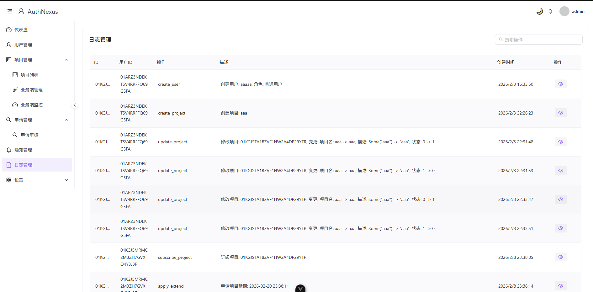
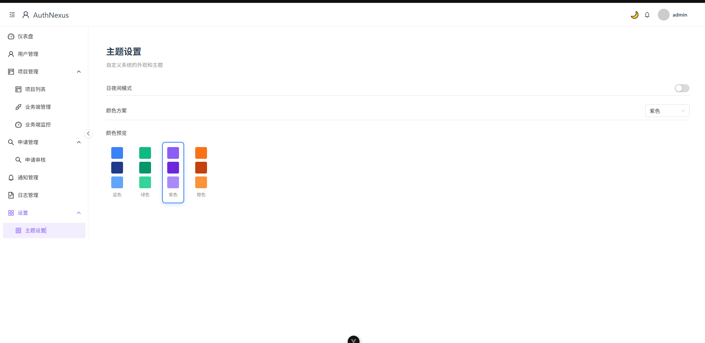

<!-- 来源：https://www.laoguicom.top/doc/882/ · 抓取状态：ok -->

# 用户业务端认证系统


```mindmap>200px
 

*   *   **系统核心**
        
        *   系统概述：企业级认证授权管理系统，前后端分离，覆盖用户/项目/业务端全流程管理
            
        *   功能亮点：安全可靠、易用便捷、功能完整、高效管理
            
        *   联系支持：钧界编程工作室
            
    *   **核心功能模块**
        
        *   认证中心
            
            *   核心功能：用户登录、注册、密码找回/重置
                
            *   操作流程：访问登录页→验证信息→完成登录/注册/密码重置
                
        *   仪表盘
            
            *   核心数据：总/活跃用户数、项目状态分布、业务端在线/离线数、待办事项
                
            *   核心用途：日常监控、管理决策、异常预警
                
        *   项目管理
            
            *   核心功能：项目创建/编辑、启用/禁用、权限控制、信息维护
                
            *   操作流程：项目列表→创建项目→填写信息→提交/管理
                
        *   业务端管理
            
            *   核心功能：设备注册、状态监控、信息编辑、日志查看、权限管控
                
            *   核心能力：列表管理、实时监控、日志审计、批量操作
                
        *   应用管理
            
            *   核心功能：项目延期申请、业务端扩容申请、审批管理
                
            *   操作流程：发起申请→填写信息→提交→等待审批→执行结果
                
        *   用户管理
            
            *   核心功能：用户创建/编辑、角色分配、启用/禁用、批量操作
                
            *   核心能力：账户管理、权限分配、批量导入/导出
                
        *   通知管理
            
            *   核心功能：通知查看、待办处理、已读/未读标记、筛选查询
                
            *   核心能力：列表查看、详情查看、类型筛选
                
        *   日志管理
            
            *   核心功能：日志查看、筛选搜索、详情溯源、导出审计
                
            *   核心用途：操作审计、问题排查、安全监控、合规存档
                
        *   个人中心
            
            *   核心功能：信息更新、密码修改、登录历史查看、安全设置
                
            *   核心能力：信息管理、密码安全、登录追溯
                
        *   系统设置
            
            *   核心功能：主题切换、界面偏好、语言设置、安全规则配置
                
            *   核心能力：个性化定制、全局规则配置
                
    *   **系统使用流程**
        
        *   管理员流程：登录系统→系统初始化→用户管理→项目管理→应用审批→系统监控→日常维护
            
        *   普通用户流程：登录系统→项目管理→业务端管理→应用申请→通知查看→个人设置
            
    *   **常见问题解答**
        
        *   新用户创建：登录→用户管理→创建→填信息→分配角色→提交
            
        *   业务端扩容：项目管理→选项目→发起申请→填信息→提交→审批→注册
            
        *   活动情况查看：业务端监控→列表查看→点详情→筛选时间→看日志
            
        *   项目延期：项目管理→选项目→发起延期→填信息→提交→审批→生效
```

## 系统截图


























## 技术栈介绍

### 前端技术栈

| 类别 | 技术 | 版本 | 用途 |
|------|------|------|------|
| **核心框架** | Vue 3 | ^3.5.27 | 前端核心框架，采用 Composition API |
| **类型系统** | TypeScript | ~5.9.3 | 类型安全的JavaScript超集 |
| **状态管理** | Pinia | ^3.0.4 | Vue 3官方推荐的状态管理库 |
| **路由管理** | Vue Router | ^5.0.1 | 前端路由管理，实现页面导航 |
| **UI组件** | Naive UI | ^2.43.2 | 现代化的Vue 3组件库 |
| **样式方案** | Unocss | ^66.6.0 | 原子化CSS框架 |
| **图标库** | @vicons/antd | ^0.13.0 | Ant Design图标库 |
| **构建工具** | Vite | ^7.3.1 | 现代化的前端构建工具 |
| **HTTP客户端** | Axios | ^1.13.4 | 基于Promise的HTTP客户端 |

### 后端技术栈

| 类别 | 技术 | 版本 | 用途 |
|------|------|------|------|
| **核心语言** | Rust | 1.89 | 系统级编程语言，提供内存安全和高性能 |
| **Web框架** | Salvo | ^0.89.1 | Rust异步Web框架，处理HTTP请求和路由 |
| **数据库** | SQLx | ^0.8.6 | Rust异步SQL工具库，支持PostgreSQL |
| **数据库** | MySql |5.7 | 关系型数据库，存储系统数据 |
| **缓存** | Redis | - | 内存数据库，用于缓存和会话管理 |
| **认证** | JWT | ^10 | JSON Web Token，实现无状态认证 |
| **密码加密** | Argon2 | ^0.5 | 现代密码哈希算法 |
| **配置管理** | Figment | ^0.10 | Rust配置管理库 |
| **序列化** | Serde | ^1 | Rust序列化/反序列化库 |
| **日志** | Tracing | ^0.1 | Rust结构化日志库 |
| **模板引擎** | Askama | ^0.15.4 | Rust模板引擎，用于生成HTML |


